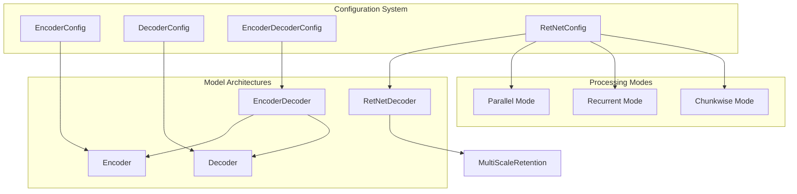
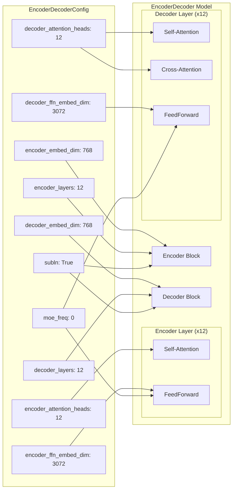
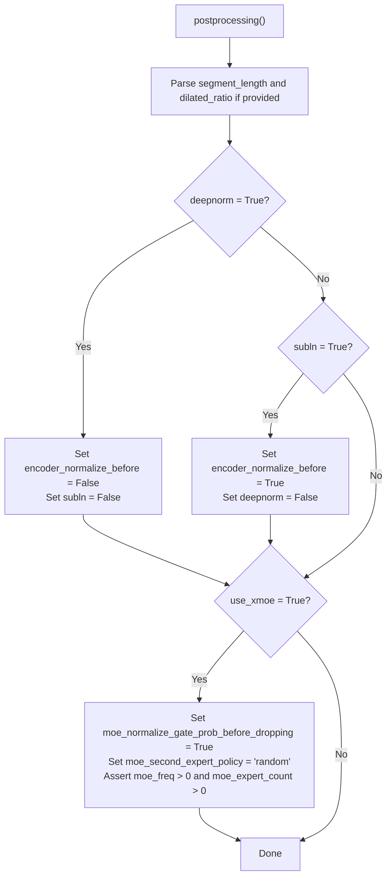
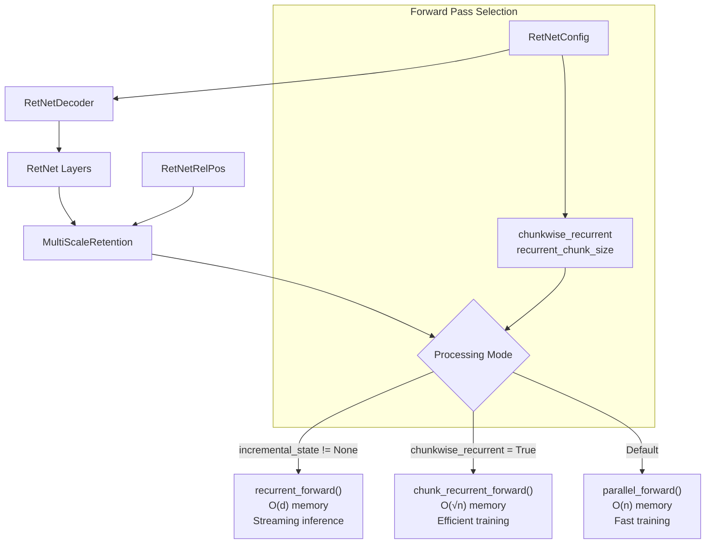
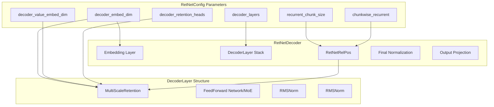
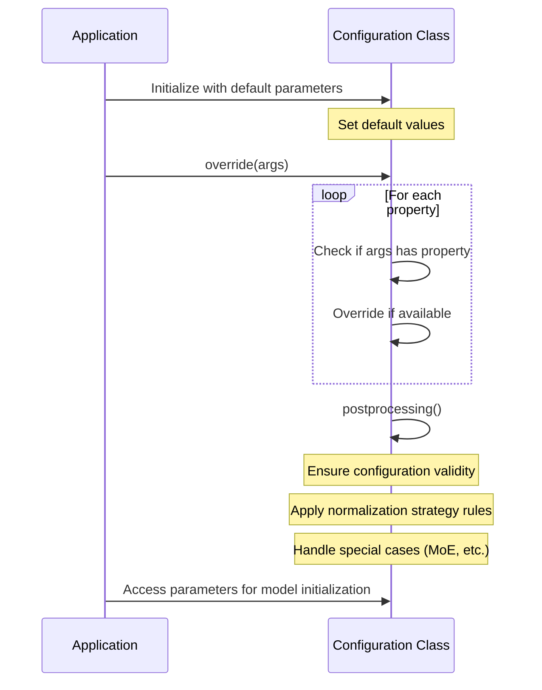
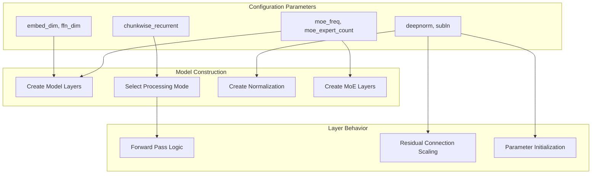

<!-- source: DeepWiki mcp.deepwiki.com · repo microsoft/torchscale · page 3.2 EncoderDecoderConfig & RetNetConfig · fetched 2026-10-26 -->

# EncoderDecoderConfig & RetNetConfig

Relevant source files

The following files were used as context for generating this wiki page:

- [torchscale/architecture/config.py](torchscale/architecture/config.py)
- [torchscale/architecture/retnet.py](torchscale/architecture/retnet.py)
- [torchscale/component/multiscale_retention.py](torchscale/component/multiscale_retention.py)

## Purpose and Scope

This document provides a comprehensive explanation of two key configuration classes in TorchScale: `EncoderDecoderConfig` and `RetNetConfig`. These configuration classes serve as blueprints for creating encoder-decoder models and RetNet (Retention Network) models, respectively.

For information about individual encoder and decoder configurations, see [EncoderConfig & DecoderConfig](#3.1).

## Configuration Architecture Overview

Sources: [torchscale/architecture/config.py:164-247](), [torchscale/architecture/config.py:249-315]()

## EncoderDecoderConfig

`EncoderDecoderConfig` provides a unified configuration for models that contain both encoder and decoder components, allowing coordination between the two components while maintaining flexibility for both.

### Key Parameters

| Parameter Group | Key Parameters | Description |
|-----------------|----------------|-------------|
| **Architecture Dimensions** | `encoder_embed_dim`, `encoder_attention_heads`, `encoder_ffn_embed_dim`, `decoder_embed_dim`, `decoder_attention_heads`, `decoder_ffn_embed_dim` | Control the size and capacity of the model |
| **Architecture Depth** | `encoder_layers`, `decoder_layers` | Control the depth of encoder and decoder |
| **Normalization** | `encoder_normalize_before`, `decoder_normalize_before`, `normalize_output`, `deepnorm`, `subln` | Configure normalization strategies |
| **Dropout** | `dropout`, `drop_path_rate`, `attention_dropout`, `activation_dropout` | Control regularization strength |
| **Mixture of Experts** | `moe_freq`, `moe_expert_count`, `moe_top1_expert` | Configure sparse MoE layers |
| **Positional Information** | `rel_pos_buckets`, `max_rel_pos`, `xpos_rel_pos` | Configure positional encoding |
| **Sequence Handling** | `max_source_positions`, `max_target_positions` | Maximum sequence lengths |
| **Performance** | `checkpoint_activations`, `fsdp` | Optimize training efficiency |
| **Dilated Attention** | `flash_attention`, `segment_length`, `dilated_ratio` | Configure dilated attention for long sequences |

Sources: [torchscale/architecture/config.py:164-247]()

### Example Parameter Relationship

Sources: [torchscale/architecture/config.py:164-247]()

### Configuration Normalization Logic

The `postprocessing` method ensures configurations are consistent and valid:

Sources: [torchscale/architecture/config.py:231-246]()

## RetNetConfig

`RetNetConfig` configures RetNet (Retention Network) models, which offer an alternative to traditional transformer architectures by using a retention mechanism instead of the standard attention mechanism.

### Key RetNet-Specific Parameters

| Parameter | Default | Description |
|-----------|---------|-------------|
| `decoder_embed_dim` | 768 | Dimension of embedding vectors |
| `decoder_value_embed_dim` | 1280 | Dimension of value vectors in retention |
| `decoder_retention_heads` | 3 | Number of retention heads |
| `chunkwise_recurrent` | False | Enable chunkwise recurrent processing mode |
| `recurrent_chunk_size` | 512 | Size of chunks for chunkwise processing |

Sources: [torchscale/architecture/config.py:249-297]()

### RetNet Processing Modes

RetNet supports three processing modes controlled by the configuration:

Sources: [torchscale/component/multiscale_retention.py:76-202](), [torchscale/architecture/retnet.py:167-195]()

### RetNet Architecture and Configuration Flow

Sources: [torchscale/architecture/retnet.py:39-202](), [torchscale/architecture/retnet.py:199-392]()

## Configuration Initialization and Override

Both `EncoderDecoderConfig` and `RetNetConfig` follow the same pattern for initialization and overriding:

1. **Initialization**: Default values are set in the constructor
2. **Override**: The `override` method allows updating parameters from an args object
3. **Postprocessing**: The `postprocessing` method ensures configuration consistency

Sources: [torchscale/architecture/config.py:225-246](), [torchscale/architecture/config.py:299-315]()

## Interaction with Model Components

The configurations directly influence which components are created and how they're connected:

Sources: [torchscale/architecture/retnet.py:72-196](), [torchscale/architecture/retnet.py:199-392]()

## Best Practices for Configuration

When working with these configuration classes:

1. **Use as Foundation**: Begin with the provided configuration classes rather than creating custom ones
2. **Override Selectively**: Use the `override` method to selectively update parameters
3. **Consider Normalization Strategy**: Choose either DeepNorm or SubLN (default), not both
4. **MoE Configuration**: When using MoE, ensure `moe_freq > 0` and `moe_expert_count > 0`
5. **RetNet Processing Modes**:
   - For training: Use parallel mode (default) for speed
   - For memory-constrained training: Use chunkwise recurrent mode
   - For streaming inference: Use recurrent mode via incremental state

Sources: [torchscale/architecture/config.py:164-247](), [torchscale/architecture/config.py:249-315]()

---

