<!-- source: DeepWiki mcp.deepwiki.com · repo microsoft/torchscale · page 4 Core Components · fetched 2026-10-26 -->

# Core Components

Relevant source files

The following files were used as context for generating this wiki page:

- [README.md](README.md)
- [torchscale/component/feedforward_network.py](torchscale/component/feedforward_network.py)
- [torchscale/component/multihead_attention.py](torchscale/component/multihead_attention.py)
- [torchscale/component/xmoe/moe_layer.py](torchscale/component/xmoe/moe_layer.py)
- [torchscale/component/xpos_relative_position.py](torchscale/component/xpos_relative_position.py)

This page provides an overview of the fundamental building blocks that power TorchScale's model architectures. These components serve as the critical internal machinery that enables the library's advanced transformer variants, including Encoders, Decoders, RetNet, and LongNet architectures.

For information about how these components are combined to form complete architectures, see [Architecture Overview](#2).

## Component Architecture Overview

The TorchScale library is built around a set of reusable neural network components that can be composed to create various transformer-based architectures. These components are designed to be highly configurable and support features like DeepNorm, SubLN, X-MoE, and various positional embedding schemes.

```mermaid
flowchart TD
    subgraph "Core Components"
        MHA["MultiheadAttention"]
        FFN["FeedForwardNetwork"]
        MOE["Mixture of Experts (MoE)"]
        FA["Flash Attention"]
        PE["Positional Embeddings"]
        MW["Multiway Network"]
    end

    subgraph "Positional Embedding Types"
        PE --> XPOS["XPOS"]
        PE --> RPB["RelativePositionBias"]
    end

    subgraph "Attention Optimizations"
        MHA --> FA
    end

    subgraph "FFN Variants"
        FFN --> Regular["Regular FFN"]
        FFN --> MOE
    end

    subgraph "Architecture Integration"
        MHA --> Encoder["Used in Encoder"]
        MHA --> Decoder["Used in Decoder"]
        MHA --> RetNet["Used in RetNet"]
        MHA --> LongNet["Used in LongNet"]
        
        FFN --> Encoder
        FFN --> Decoder
        FFN --> RetNet
        FFN --> LongNet
        
        PE --> Encoder
        PE --> Decoder
        PE --> RetNet
        
        MW --> Multimodal["Used in Multimodal Models"]
    end
```

Sources: [README.md:117-139]()

## MultiheadAttention

The `MultiheadAttention` module is a critical component in transformer architectures that enables the model to focus on different parts of the input sequence simultaneously. TorchScale's implementation supports both self-attention and encoder-decoder cross-attention, with additional features like XPOS relative positional embeddings and flash attention optimizations.

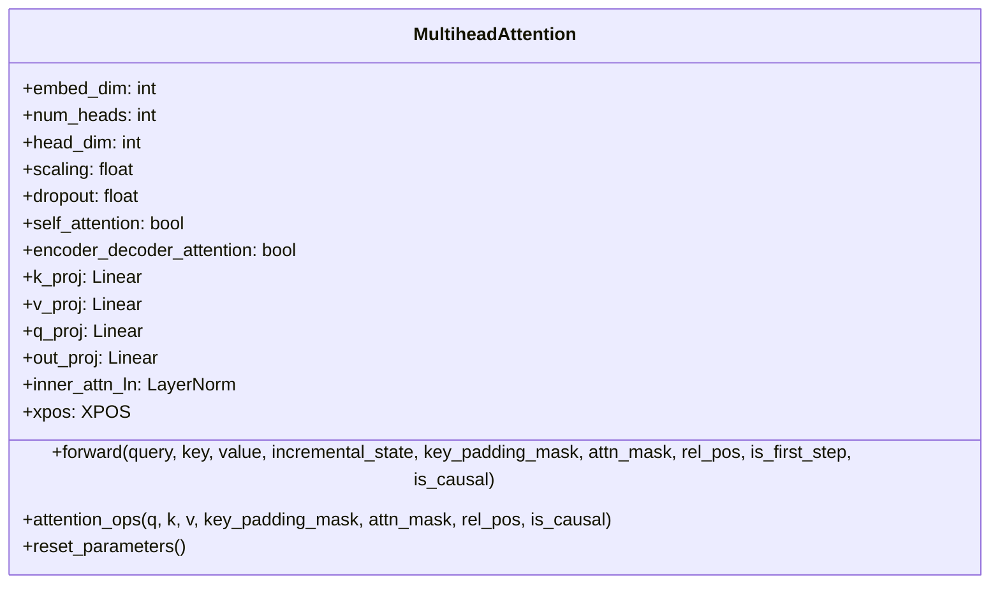

Key features of the `MultiheadAttention` implementation:

1. **Query, Key, Value Projections**: Linear transformations that project the input embeddings into query, key, and value representations.
2. **Multiway Wrapper Support**: All projection layers are wrapped with `MultiwayWrapper` for multi-modal model support.
3. **SubLN Support**: Optional inner attention layer normalization for better training stability.
4. **XPOS Integration**: Optional extrapolatable positional embeddings.
5. **Flash Attention**: Optional high-performance attention implementation for faster training and inference.

The attention computation can follow either the standard attention algorithm or use the optimized flash attention implementation when available:

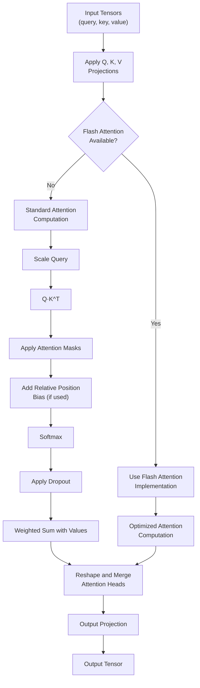

Sources: [torchscale/component/multihead_attention.py:20-171]()

## FeedForwardNetwork

The `FeedForwardNetwork` module implements the position-wise feed-forward networks used in transformer models. This component transforms each position's representation independently using two linear transformations with an activation function in between.

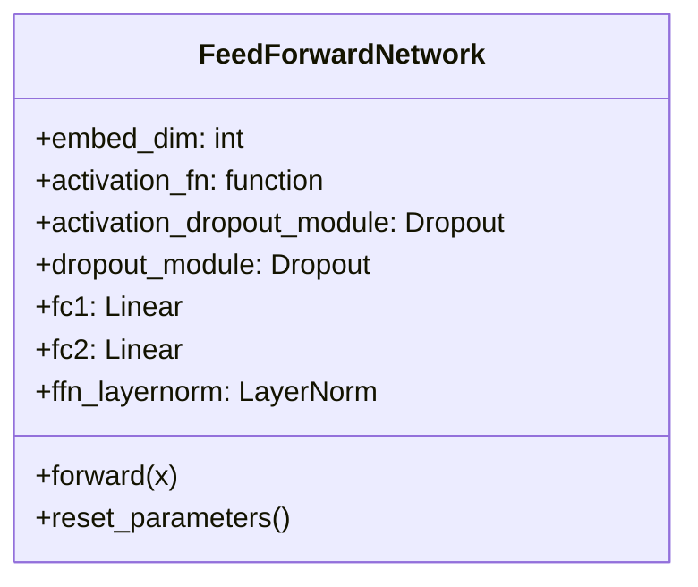

Key features of the `FeedForwardNetwork` implementation:

1. **Configurable Activation**: Supports multiple activation functions including ReLU, GELU, and SwiGLU.
2. **SubLN Support**: Optional layer normalization between the two linear transformations.
3. **Dropout**: Applied after both the activation function and the second linear transformation.

The feed-forward computation flow is:

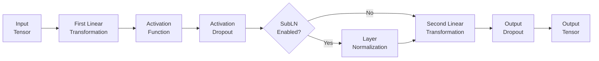

Sources: [torchscale/component/feedforward_network.py:105-142]()

## Mixture of Experts (MoE)

TorchScale implements the X-MoE (Mixture of Experts) system, which allows for efficient scaling of transformer models by conditionally routing tokens to different expert networks. This approach enhances model capacity without significantly increasing computation for each token.

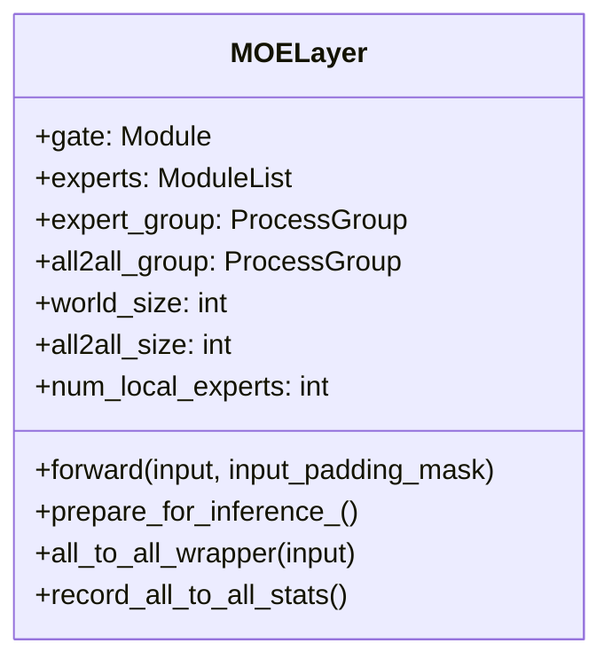

The MoE mechanism works as follows:

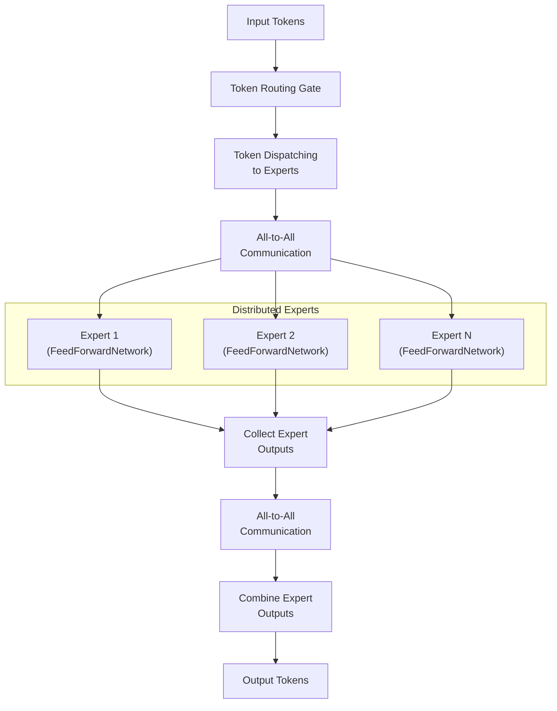

Key features of the X-MoE implementation:

1. **Token Routing**: Uses a gating mechanism to determine which expert should process each token.
2. **Load Balancing**: Ensures that experts receive a balanced number of tokens.
3. **Distributed Processing**: Supports distributed training with experts distributed across multiple GPUs.
4. **Performance Optimizations**: Includes optional Tutel MoE optimizations for improved efficiency.

Sources: [torchscale/component/xmoe/moe_layer.py:68-308](), [torchscale/component/feedforward_network.py:43-91]()

## Positional Embeddings

TorchScale supports several types of positional embeddings, with a particular focus on extrapolatable position embeddings (XPOS) and relative position bias for improved handling of sequences of varying lengths.

### XPOS (Extrapolatable Position Embeddings)

XPOS is designed to help models generalize to longer sequences than seen during training:

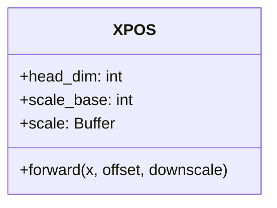

The XPOS mechanism applies a rotary position encoding with a carefully designed scaling scheme:

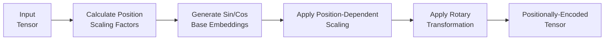

Sources: [torchscale/component/xpos_relative_position.py:38-66]()

## Flash Attention

Flash Attention is an optimization technique that significantly speeds up the attention computation by reducing memory I/O operations. TorchScale integrates Flash Attention as an optional component that can be enabled for models running on compatible hardware.

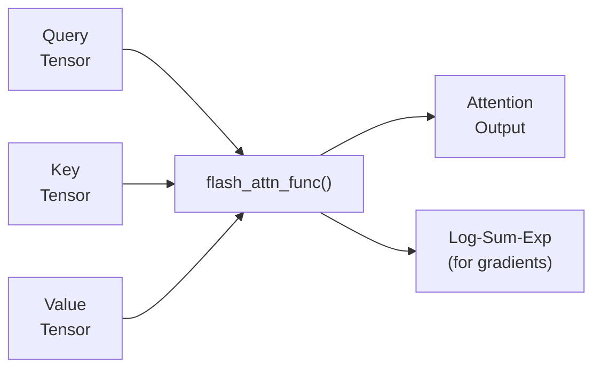

Key benefits of Flash Attention:

1. **Memory Efficiency**: Reduces memory usage during attention computation
2. **Computation Speed**: Faster attention computation, especially for longer sequences
3. **Scalability**: Enables handling of longer sequences without quadratic memory growth

Flash Attention is particularly important for models like LongNet, which are designed to process extremely long sequences.

Sources: [torchscale/component/multihead_attention.py:97-105](), [README.md:43-44]()

## Multiway Network

The Multiway architecture is designed for multi-modal models, allowing different sets of parameters to be used for processing different modalities within the same model architecture.

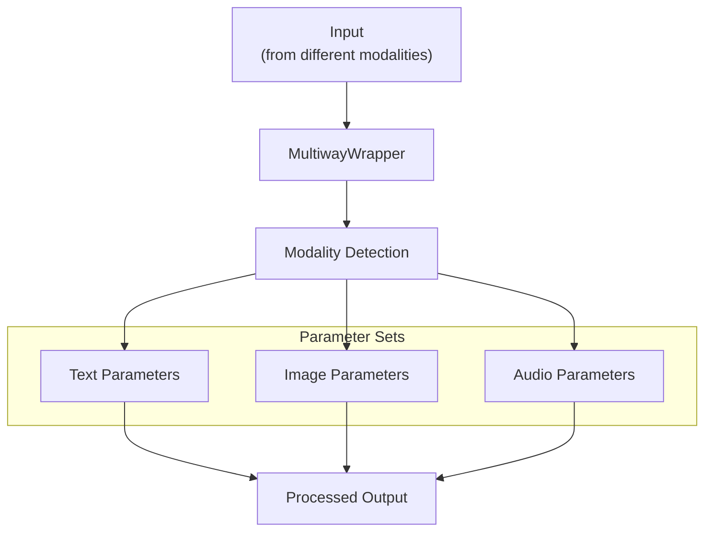

The Multiway feature wraps standard modules like Linear layers and LayerNorm, allowing them to use different parameters depending on which modality is being processed. This creates a more flexible architecture that can handle diverse input types while maintaining shared knowledge across modalities.

Sources: [torchscale/component/multihead_attention.py:43-52](), [README.md:131-132]()

## Component Integration

These core components are assembled to build the various model architectures in TorchScale. Here's how they typically integrate in a transformer layer:

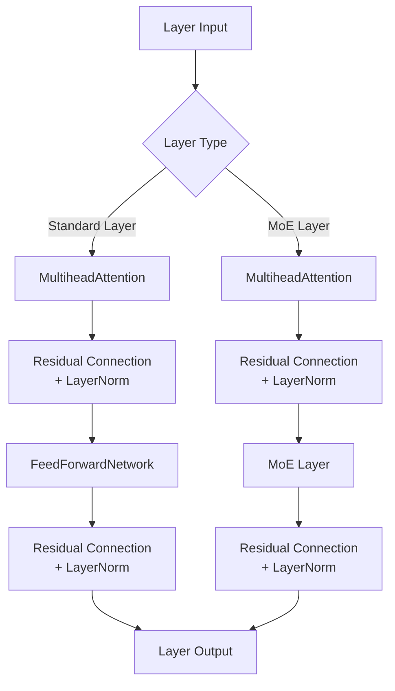

Different architectures (Encoder, Decoder, RetNet, LongNet) use these components in different configurations, but the core building blocks remain the same across all model types.

Sources: [README.md:54-63](), [README.md:87-100]()

---

