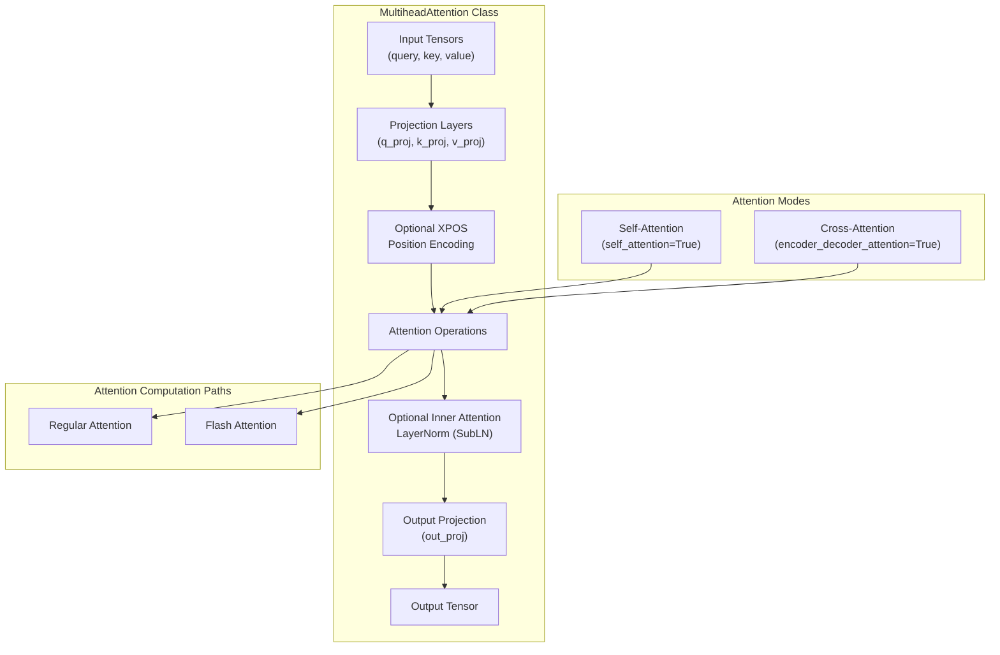
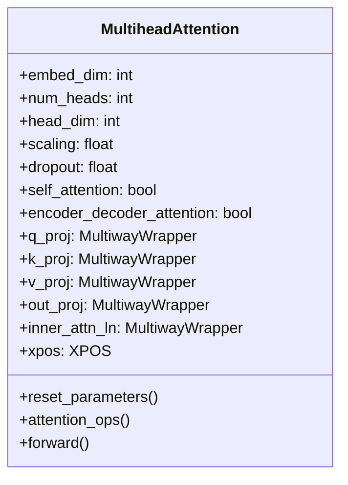
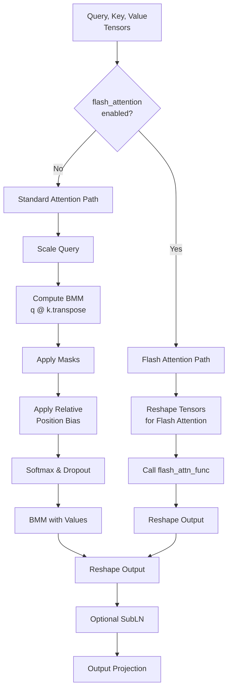
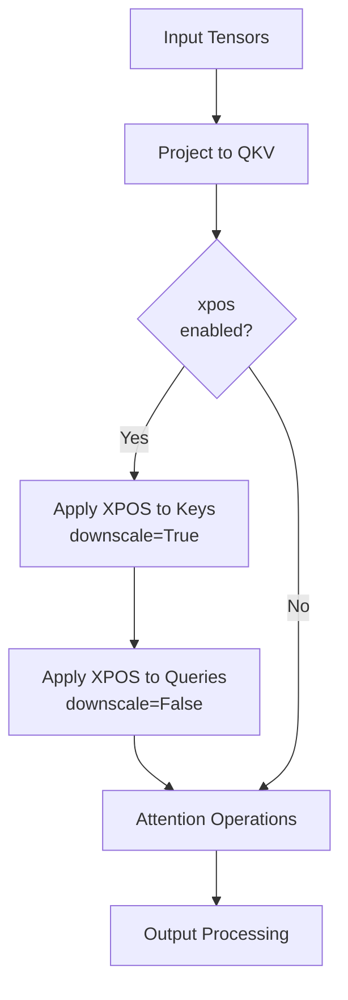
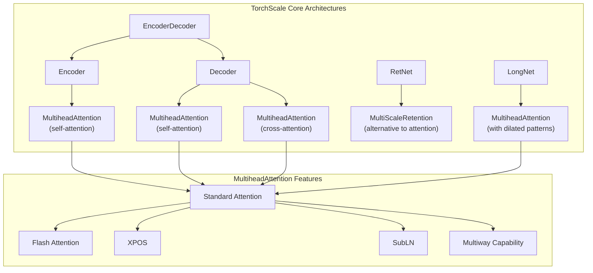

<!-- source: DeepWiki mcp.deepwiki.com · repo microsoft/torchscale · page 4.1 Multi-head Attention · fetched 2026-10-26 -->

# Multi-head Attention

Relevant source files

The following files were used as context for generating this wiki page:

- [torchscale/component/multihead_attention.py](torchscale/component/multihead_attention.py)

## Purpose and Scope

This document covers the Multi-head Attention component in TorchScale, a fundamental building block for all transformer-based architectures in the library. This implementation provides optimized attention mechanisms for both self-attention and encoder-decoder cross-attention patterns. For information about specific attention optimization techniques like Flash Attention, see [Flash Attention](#4.3).

## Overview

TorchScale's Multi-head Attention implementation extends the conventional transformer attention mechanism with several advanced features, including multiway capability, XPOS relative positional encoding, optional flash attention, and SubLN (Sub-LayerNorm) for better normalization.

Sources: [torchscale/component/multihead_attention.py:20-171]()

## Implementation Architecture

The `MultiheadAttention` class follows a modular design that supports multiple attention patterns and optimization techniques:

Sources: [torchscale/component/multihead_attention.py:20-62]()

### Key Components

The implementation consists of these main components:

1. **Projection Layers**: Linear projections for queries, keys, and values
2. **Attention Operations**: Core attention computation with options for standard or flash attention
3. **Optional Features**: XPOS, SubLN, multiway capability
4. **Output Processing**: Linear projection to produce the final output

Sources: [torchscale/component/multihead_attention.py:43-59]()

## Attention Computation

TorchScale supports two attention computation paths depending on whether Flash Attention is enabled:

### Standard Attention Path

The standard attention computation follows these steps:

1. Apply scaling to the query vectors
2. Compute attention weights with matrix multiplication: `attn_weights = torch.bmm(q, k.transpose(1, 2))`
3. Apply optional attention masks and padding masks
4. Apply optional relative positional bias
5. Apply softmax and dropout
6. Compute the output by multiplying attention probabilities with value vectors

### Flash Attention Path

When `flash_attention` is enabled:

1. Reshape tensors to the format required by Flash Attention
2. Call the optimized `flash_attn_func` for faster computation
3. Reshape the output back to the expected format

Sources: [torchscale/component/multihead_attention.py:68-107]()

## Key Features

### Multiway Network Support

All projection layers are wrapped with `MultiwayWrapper`, enabling the attention module to be used in multiway networks where different "experts" or "paths" can be selected based on routing decisions. This is particularly useful for multi-modal or mixture-of-experts models.

Sources: [torchscale/component/multihead_attention.py:43-48]()

### XPOS Relative Positional Encoding

When enabled (`args.xpos_rel_pos`), the module uses XPOS (Extrapolatable Position Encoding) to inject positional information into queries and keys. This provides better extrapolation to longer sequences at inference time.

Sources: [torchscale/component/multihead_attention.py:156-162]()

### SubLN (Sub-LayerNorm)

When `subln` is enabled and the module is used for self-attention, an additional LayerNorm is applied to the attention output before the final projection. This helps stabilize training for deeper networks.

Sources: [torchscale/component/multihead_attention.py:48-53](), [torchscale/component/multihead_attention.py:166-167]()

### Incremental Decoding Support

The module supports incremental decoding for generation tasks. When `incremental_state` is provided, it caches previous keys and values and appends new ones to enable efficient autoregressive generation.

Sources: [torchscale/component/multihead_attention.py:138-154]()

## Usage Patterns

### Self-Attention vs Cross-Attention

The module supports two mutually exclusive attention modes:

1. **Self-Attention**: Used within encoder or decoder self-attention layers where query, key, and value come from the same source.
2. **Encoder-Decoder Attention**: Used in cross-attention layers where queries come from the decoder and keys/values come from the encoder.

Sources: [torchscale/component/multihead_attention.py:27-41]()

### Input Arguments

The `forward` method accepts the following key arguments:

| Argument | Description |
|----------|-------------|
| `query` | Query tensor of shape `(batch_size, target_length, embed_dim)` |
| `key` | Key tensor of shape `(batch_size, source_length, embed_dim)` |
| `value` | Value tensor of shape `(batch_size, source_length, embed_dim)` |
| `incremental_state` | Optional dictionary for caching keys/values during generation |
| `key_padding_mask` | Mask for padding tokens in the input |
| `attn_mask` | General attention mask (e.g., causal mask for decoder) |
| `rel_pos` | Optional relative positional bias |
| `is_first_step` | Flag for first step in incremental decoding |
| `is_causal` | Flag for causal attention (prevents attending to future tokens) |

Sources: [torchscale/component/multihead_attention.py:109-120]()

## Integration with TorchScale Architecture

The MultiheadAttention module is a core component that is used across different TorchScale architectures:

Sources: [torchscale/component/multihead_attention.py:20-171]()

## Implementation Details

### Initialization

The attention module uses Xavier uniform initialization for all projection matrices, with a gain of `1/sqrt(2)` for query, key, and value projections to ensure stable gradients during training.

Sources: [torchscale/component/multihead_attention.py:61-66]()

### Attention Computation Logic

The core attention operation is implemented in the `attention_ops` method, which handles both standard and flash attention paths based on configuration:

1. For standard attention:
   - Apply scaling to queries
   - Compute attention scores via matrix multiplication
   - Apply masks and biases
   - Normalize with softmax and apply dropout
   - Compute weighted values

2. For flash attention:
   - Reshape tensors for compatibility with flash attention
   - Call optimized kernel
   - Reshape outputs back to expected format

Sources: [torchscale/component/multihead_attention.py:68-107]()

### Tensor Reshaping Operations

The module makes heavy use of reshaping operations to transform between:
- Batch-first format: `(batch_size, seq_length, embed_dim)`
- Head-separated format: `(batch_size, seq_length, num_heads, head_dim)`
- Batch-and-heads-merged format: `(batch_size*num_heads, seq_length, head_dim)`

These transformations enable efficient parallel computation across attention heads.

Sources: [torchscale/component/multihead_attention.py:134-136](), [torchscale/component/multihead_attention.py:96-100]()

## Conclusion

TorchScale's MultiheadAttention implementation extends the standard transformer attention mechanism with numerous optimizations and features that enable better performance, stability, and flexibility across different architectures and use cases. Its support for features like Flash Attention, XPOS, SubLN, and multiway capability make it particularly suitable for large-scale transformer training.

---

