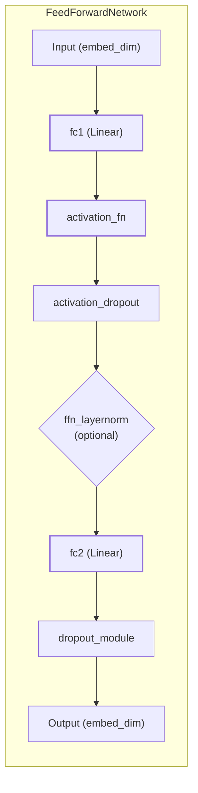
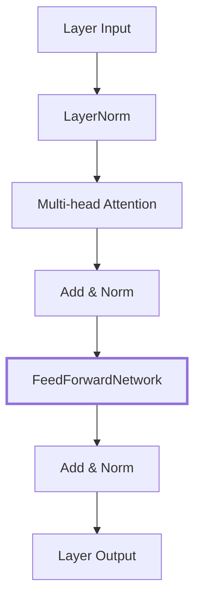
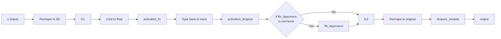
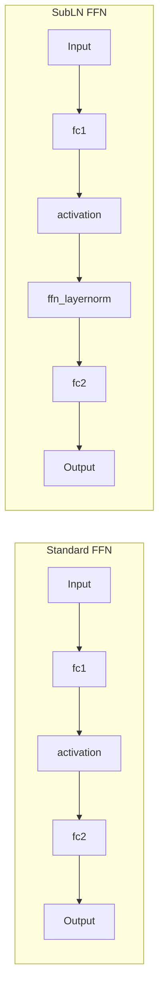
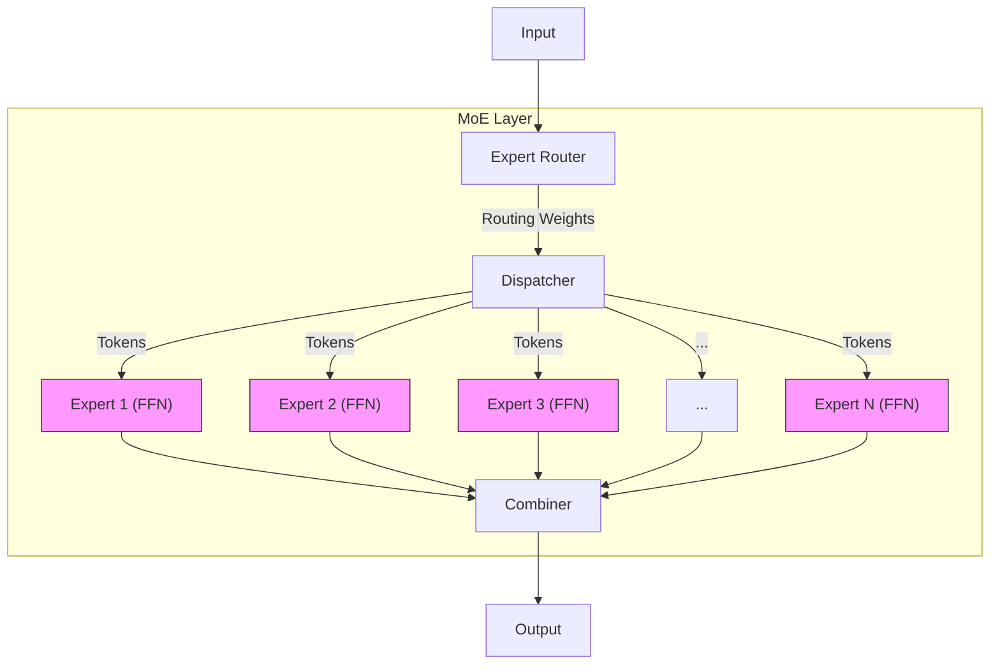
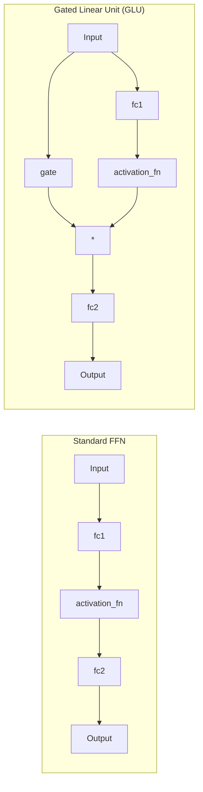

<!-- source: DeepWiki mcp.deepwiki.com · repo microsoft/torchscale · page 4.2 FeedForward Network · fetched 2026-10-26 -->

# FeedForward Network

Relevant source files

The following files were used as context for generating this wiki page:

- [torchscale/component/feedforward_network.py](torchscale/component/feedforward_network.py)
- [torchscale/component/gate_linear_unit.py](torchscale/component/gate_linear_unit.py)
- [torchscale/component/rms_norm.py](torchscale/component/rms_norm.py)
- [torchscale/component/xmoe/moe_layer.py](torchscale/component/xmoe/moe_layer.py)

This page documents the FeedForward Network (FFN) component in TorchScale, a fundamental building block in transformer-based architectures. For information about related components like Mixture of Experts, see [Mixture of Experts (MoE)](#4.4), or for positional embeddings, see [Positional Embeddings](#4.5).

## Overview

The FeedForward Network is a critical component in transformer architectures, typically consisting of two linear transformations with a non-linear activation function in between. In TorchScale, the FFN implementation provides flexibility through configurable activation functions, dropout rates, and normalization options.

Sources: [torchscale/component/feedforward_network.py:105-142](torchscale/component/feedforward_network.py:105-142)

## Architecture

### Basic Structure

The FeedForward Network applies a series of transformations to its input:
1. First linear projection (dimension expansion)
2. Non-linear activation
3. Optional layer normalization (SubLN variant)
4. Second linear projection (dimension reduction)
5. Dropout

**Diagram: FeedForward Network Architecture**

Sources: [torchscale/component/feedforward_network.py:105-142](torchscale/component/feedforward_network.py:105-142)

### FFN in Transformer Layer Context

**Diagram: FFN Position in Transformer Layer**

Sources: [torchscale/component/feedforward_network.py:105-142](torchscale/component/feedforward_network.py:105-142)

## Implementation Details

### Class Structure

The `FeedForwardNetwork` class in TorchScale implements a configurable feed-forward network with the following parameters:

| Parameter | Type | Description |
|-----------|------|-------------|
| embed_dim | int | Dimensionality of input and output embeddings |
| ffn_dim | int | Dimensionality of inner feed-forward layer |
| activation_fn | str | Activation function to use (`relu`, `gelu`, or `swish`) |
| dropout | float | Dropout probability |
| activation_dropout | float | Dropout probability after activation |
| layernorm_eps | float | Epsilon for layer normalization |
| subln | bool | Whether to use subnet layer normalization |

Sources: [torchscale/component/feedforward_network.py:105-117](torchscale/component/feedforward_network.py:105-117)

### Core Components

The FeedForwardNetwork consists of several key components:

1. **Linear Layers**:
   - `fc1`: First linear transformation (embed_dim → ffn_dim)
   - `fc2`: Second linear transformation (ffn_dim → embed_dim)

2. **Activation Function**:
   - Configurable through the `activation_fn` parameter
   - Supports `relu`, `gelu`, and `swish` (silu)

3. **Dropout Modules**:
   - `activation_dropout_module`: Applied after activation
   - `dropout_module`: Applied to the final output

4. **Optional Normalization**:
   - `ffn_layernorm`: Only used when `subln=True`
   - Applied between activation and the second linear layer

Sources: [torchscale/component/feedforward_network.py:118-123](torchscale/component/feedforward_network.py:118-123)

### Forward Pass

The forward pass of the FeedForwardNetwork follows these steps:

1. Reshape input to 2D tensor (if necessary)
2. Apply first linear transformation (`fc1`)
3. Apply activation function (type-cast to float for precision)
4. Apply activation dropout
5. Apply layer normalization (if `subln=True`)
6. Apply second linear transformation (`fc2`)
7. Reshape back to original input shape
8. Apply final dropout

This sequence is optimized for both performance and numerical stability, particularly the float casting for activation.

**Diagram: Forward Pass Data Flow**

Sources: [torchscale/component/feedforward_network.py:131-142](torchscale/component/feedforward_network.py:131-142)

## SubLN Variant

The SubLN (subnet layer normalization) variant adds a layer normalization between the activation function and the second linear layer. This can help with training stability and model performance, especially in deeper networks.

**Diagram: Standard FFN vs SubLN FFN**

Sources: [torchscale/component/feedforward_network.py:123](torchscale/component/feedforward_network.py:123), [torchscale/component/feedforward_network.py:137-138](torchscale/component/feedforward_network.py:137-138)

## Integration with Mixture of Experts

The FeedForwardNetwork can function as an expert in a Mixture of Experts (MoE) architecture. The `make_experts` function creates a list of FFN modules to be used as experts.

**Diagram: FFN as Experts in MoE Architecture**

Sources: [torchscale/component/feedforward_network.py:43-91](torchscale/component/feedforward_network.py:43-91), [torchscale/component/xmoe/moe_layer.py:68-308](torchscale/component/xmoe/moe_layer.py:68-308)

### Expert Creation

The `make_experts` function handles the creation of experts for MoE layers:

1. Determines the number of experts per device based on world size
2. Creates experts with consistent initialization through controlled random seeds
3. Supports both scenarios where:
   - Expert count ≥ world size (multiple experts per device)
   - Expert count < world size (experts distributed across devices)

The created experts are identical in structure to the standard FFN but are initialized with different random seeds to ensure diversity.

Sources: [torchscale/component/feedforward_network.py:43-91](torchscale/component/feedforward_network.py:43-91)

## Related Component: Gated Linear Unit (GLU)

TorchScale also provides a Gated Linear Unit (GLU) implementation as an alternative to the standard FFN. GLU introduces a gating mechanism that controls information flow through the network.

**Diagram: GLU vs Standard FFN**

Sources: [torchscale/component/gate_linear_unit.py:11-44](torchscale/component/gate_linear_unit.py:11-44)

## Usage in TorchScale Architectures

The FeedForwardNetwork is used in various architecture implementations within TorchScale:

1. As a standard component in encoder and decoder layers
2. As experts in MoE-based transformer variants
3. In RetNet and LongNet architectures

Each architecture may configure the FFN differently based on its specific requirements.

Sources: [torchscale/component/feedforward_network.py:105-142](torchscale/component/feedforward_network.py:105-142)

---

