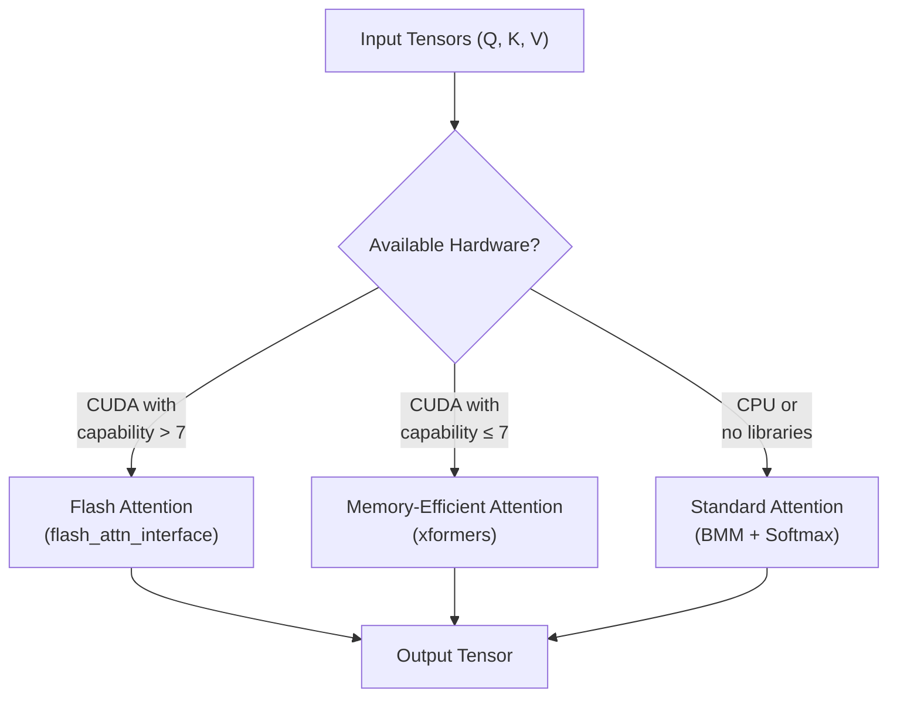
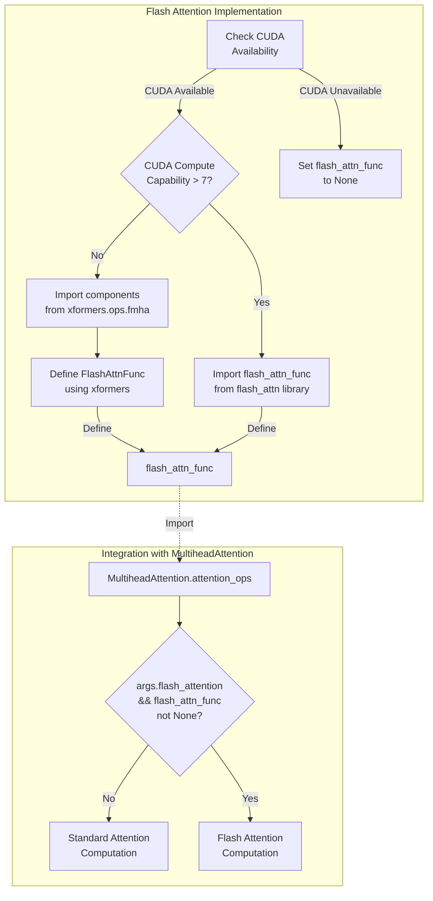
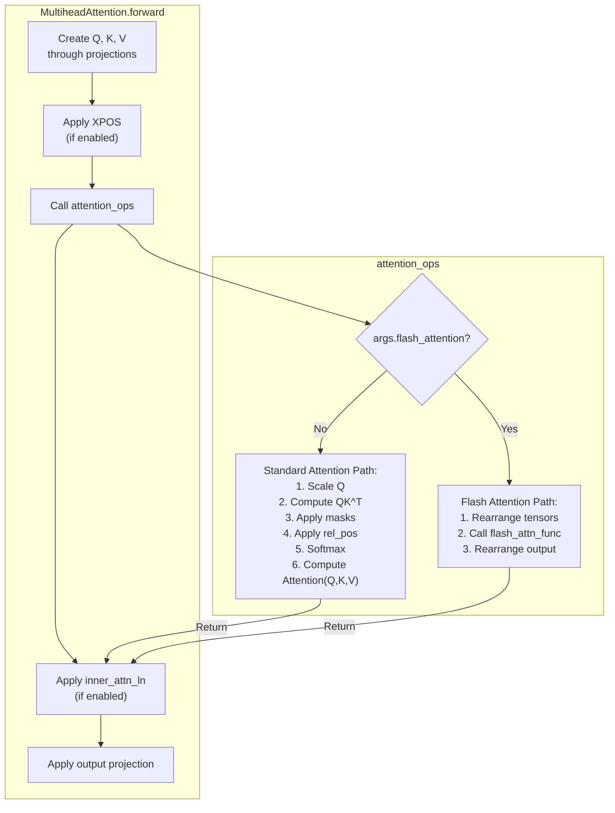
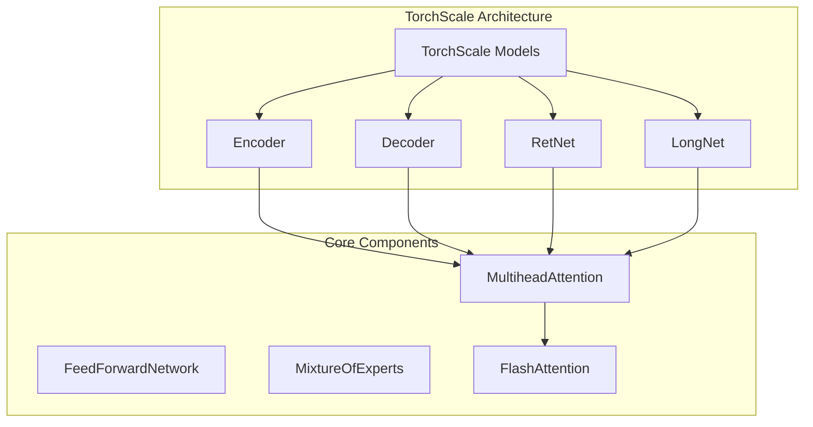

<!-- source: DeepWiki mcp.deepwiki.com · repo microsoft/torchscale · page 4.3 Flash Attention · fetched 2026-10-26 -->

# Flash Attention

<details>
<summary>Relevant source files</summary>

The following files were used as context for generating this wiki page:

- [torchscale/component/flash_attention.py](torchscale/component/flash_attention.py)
- [torchscale/component/multihead_attention.py](torchscale/component/multihead_attention.py)

</details>


## Purpose and Scope

This document explains the Flash Attention implementation in TorchScale. Flash Attention is a memory-efficient attention mechanism that significantly reduces memory usage and increases computation speed for transformer models. This page covers the implementation details, hardware requirements, and integration with other components in TorchScale. For information about the standard Multi-head Attention mechanism, see [Multi-head Attention](#4.1).

## Overview

Flash Attention optimizes the standard attention computation by avoiding materializing the full attention matrix in memory. This allows for processing longer sequences and training larger models with the same hardware resources. TorchScale provides a flexible implementation that adapts to different hardware capabilities.



**Diagram: Flash Attention Selection Path in TorchScale**

Sources: [torchscale/component/flash_attention.py:8-123]()

## Implementation Details

TorchScale implements Flash Attention through conditional imports based on hardware capabilities:

1. For NVIDIA GPUs with compute capability > 7 (Ampere, Hopper architectures), the implementation uses the optimized `flash_attn_func` from the Flash Attention library.

2. For older NVIDIA GPUs, TorchScale falls back to memory-efficient attention from the xformers library.

3. If neither is available, Flash Attention is disabled and standard attention is used.

### Hardware-Based Implementation Selection



**Diagram: Flash Attention Implementation and Integration**

Sources: [torchscale/component/flash_attention.py:8-123](), [torchscale/component/multihead_attention.py:68-107]()

### Core Implementation

The core Flash Attention implementation varies depending on hardware:

1. **High-end NVIDIA GPUs (>7.0 compute capability)**: Uses the original Flash Attention implementation:
   ```python
   def flash_attn_func(q, k, v, dropout=0.0, bias=None, softmax_scale=None, is_causal=False):
       assert bias is None
       attn, lse, _ = _flash_attn_func(q, k, v, dropout_p=dropout, softmax_scale=softmax_scale, causal=is_causal, return_attn_probs=True)
       return attn, lse
   ```

2. **Other NVIDIA GPUs**: Uses a custom autograd function `FlashAttnFunc` based on xformers' memory-efficient attention implementation, which handles both forward and backward passes.

Sources: [torchscale/component/flash_attention.py:13-16](), [torchscale/component/flash_attention.py:28-119]()

## Integration with MultiheadAttention

Flash Attention is integrated into the `MultiheadAttention` class through the `attention_ops` method. The method decides whether to use Flash Attention or standard attention based on the configuration.



**Diagram: MultiheadAttention Data Flow with Flash Attention**

Sources: [torchscale/component/multihead_attention.py:68-107](), [torchscale/component/multihead_attention.py:109-171]()

### Key Components in the Integration

1. **Input Tensor Rearrangement**: Before passing to Flash Attention, the tensors are rearranged from `(batch_size * num_heads, seq_len, head_dim)` to `(batch_size, seq_len, num_heads, head_dim)`.

2. **Flash Attention Call**: The function is called with appropriate parameters including dropout rate and causality flag.

3. **Output Processing**: The output is rearranged back to the original shape and passed through the output projection.

## Tensor Operations Comparison

| Operation | Standard Attention | Flash Attention |
|-----------|-------------------|-----------------|
| Memory Complexity | O(N²) | O(N) |
| Time Complexity | O(N²) | O(N²) |
| Attention Matrix | Explicitly computed | Computed in tiles |
| Backward Pass | Standard autograd | Custom autograd function |
| Supported Hardware | All | CUDA-enabled GPUs |

Sources: [torchscale/component/multihead_attention.py:68-107]()

## Usage in TorchScale Architecture

Flash Attention is an optional optimization that can be enabled for any TorchScale model that uses `MultiheadAttention`, including Encoders, Decoders, RetNet, and LongNet. It's particularly valuable for LongNet which is designed to handle very long sequences.



**Diagram: Flash Attention in TorchScale Architecture**

Sources: [torchscale/component/multihead_attention.py:17](), [torchscale/component/multihead_attention.py:98-104]()

## Enabling Flash Attention

To enable Flash Attention in TorchScale models, set the `flash_attention` flag to `True` in the model configuration. This will cause the model to use Flash Attention where available based on the hardware capabilities.

Note that Flash Attention has some limitations:
1. It requires CUDA-enabled GPUs
2. It doesn't support all attention mask types
3. It doesn't work with relative position embeddings directly (must be applied separately)

## Performance Implications

Flash Attention can significantly improve the performance of transformer models by:

1. **Reducing Memory Usage**: By not materializing the full attention matrix, Flash Attention dramatically reduces memory footprint.
2. **Improving Training Speed**: The optimized implementation often leads to faster training times.
3. **Enabling Longer Sequences**: With reduced memory requirements, models can process longer sequences.

This is especially beneficial for LongNet and other models designed to work with very long sequences.

Sources: [torchscale/component/multihead_attention.py:98-104]()

---

