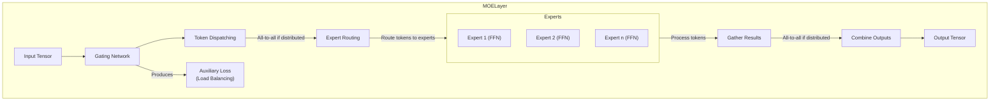
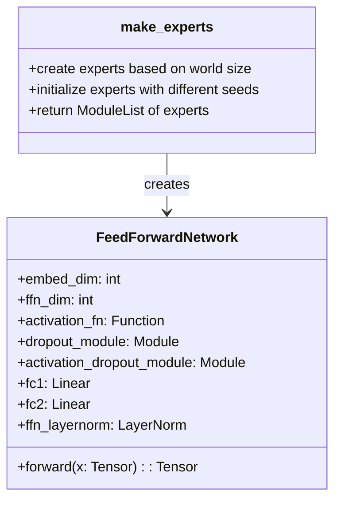
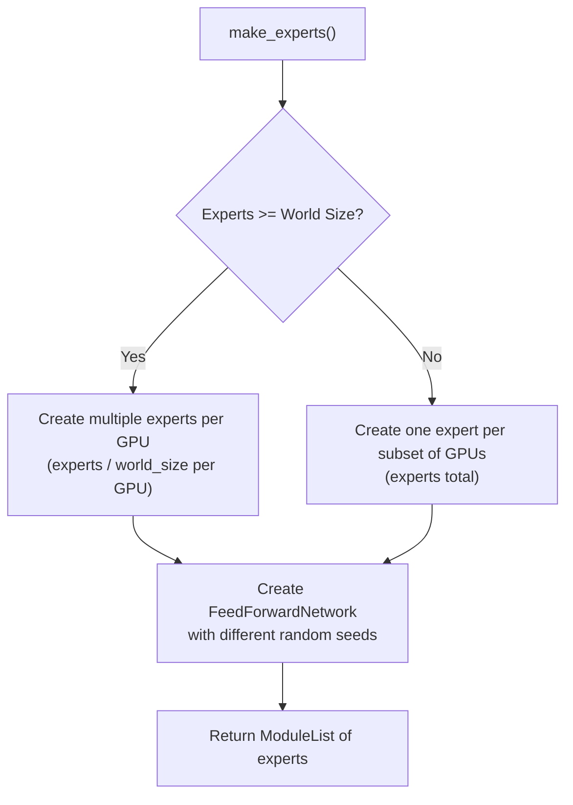
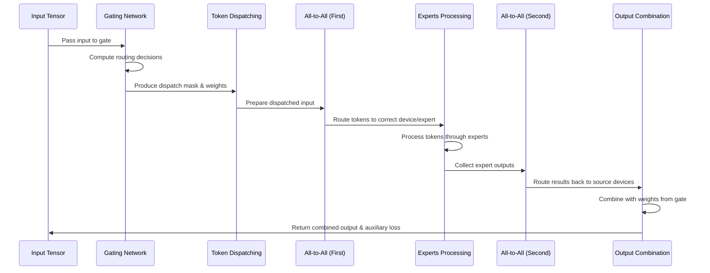
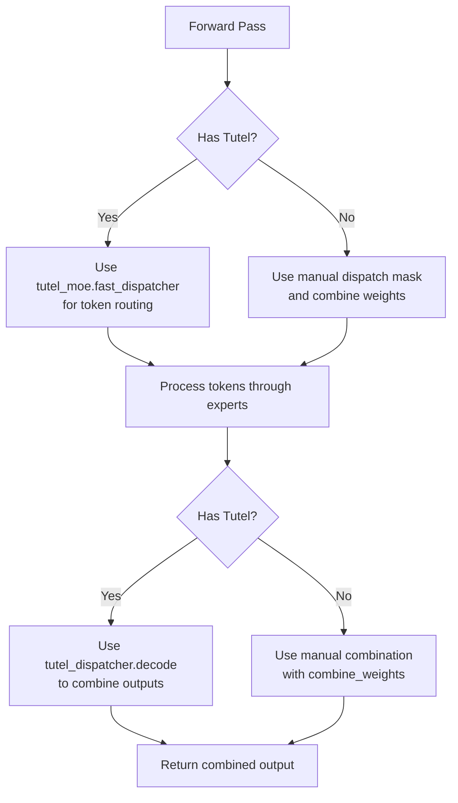
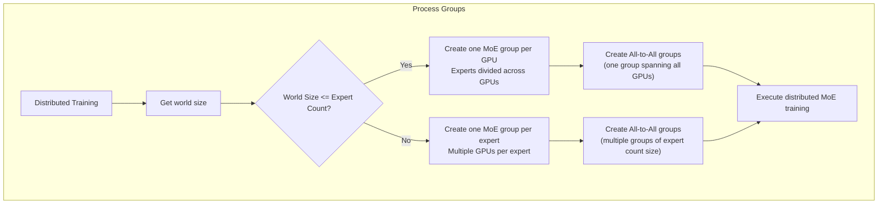
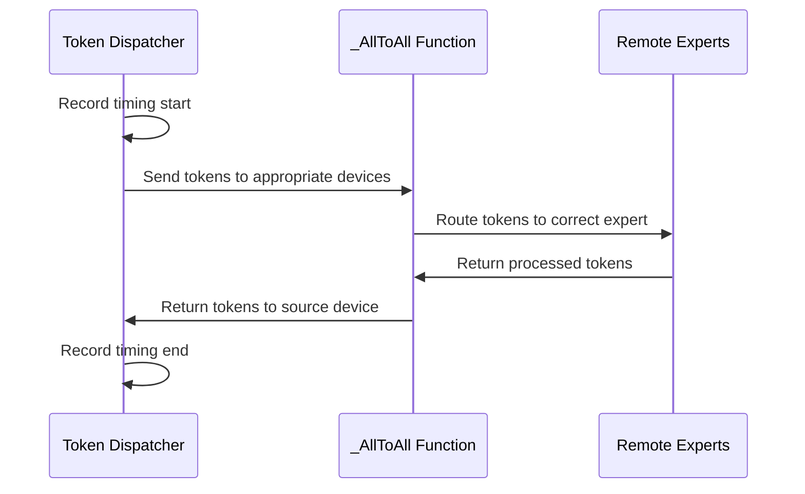
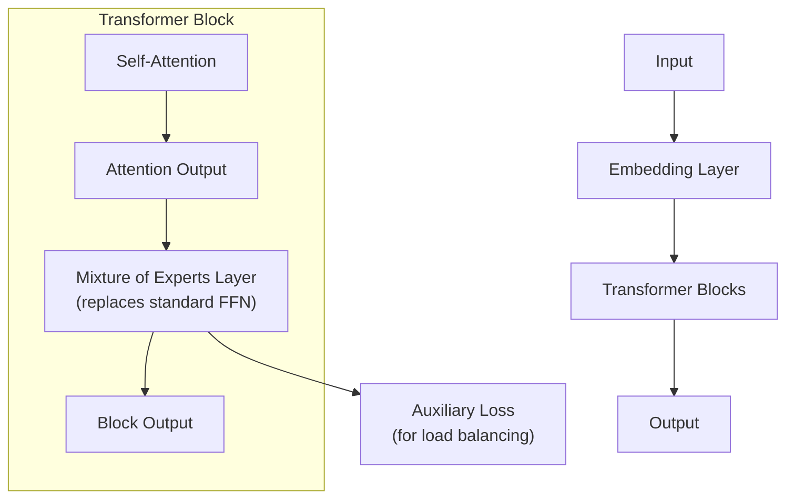
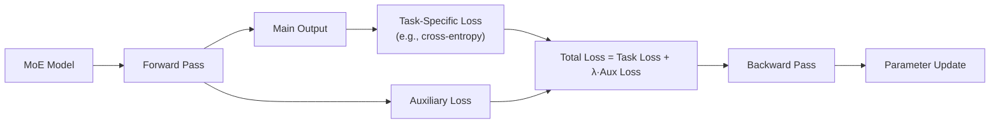

<!-- source: DeepWiki mcp.deepwiki.com · repo microsoft/torchscale · page 4.4 Mixture of Experts (MoE) · fetched 2026-10-26 -->

# Mixture of Experts (MoE)

Relevant source files

The following files were used as context for generating this wiki page:

- [examples/fairseq/criterions/__init__.py](examples/fairseq/criterions/__init__.py)
- [examples/fairseq/criterions/masked_lm_moe.py](examples/fairseq/criterions/masked_lm_moe.py)
- [torchscale/component/feedforward_network.py](torchscale/component/feedforward_network.py)
- [torchscale/component/xmoe/global_groups.py](torchscale/component/xmoe/global_groups.py)
- [torchscale/component/xmoe/moe_layer.py](torchscale/component/xmoe/moe_layer.py)

## Purpose and Scope

This document describes TorchScale's implementation of Mixture of Experts (MoE), a technique that divides computation across a set of specialized neural network submodels ("experts"). Each expert processes a subset of the input data, as determined by a routing mechanism. This approach enables efficient scaling of model capacity while keeping computational costs manageable.

This page focuses on the MoE implementation in TorchScale, including its architecture, components, distributed training support, and integration with transformer models. For information about how MoE is used in specific architectures like Encoder and Decoder, see [Encoder Architecture](#2.1) and [Decoder Architecture](#2.2).

## 1. MoE Architecture Overview

The MoE implementation in TorchScale follows the approach described in the GShard paper, with a modular design that supports distributed training.

The main components of the MoE implementation are:

1. **Gating Network**: Determines which experts should process each token
2. **Experts**: Specialized feedforward networks that process subsets of tokens
3. **Token Dispatching/Combining**: Routes tokens to experts and combines their outputs
4. **Distributed Communication**: Handles token routing across multiple GPUs

Sources: [torchscale/component/xmoe/moe_layer.py:67-271]()

## 2. Expert Implementation

In TorchScale, each expert is implemented as a standard feed-forward network. The `make_experts` function creates a set of experts for each MoE layer.

### Expert Creation Logic

The expert creation process adapts to different distributed training scenarios:

1. **More experts than GPUs**: Each GPU hosts multiple experts
2. **More GPUs than experts**: Multiple GPUs collaborate on a single expert

Each expert is a `FeedForwardNetwork` with two linear transformations and a non-linearity in between, similar to the FFN block in a standard Transformer.

Sources: [torchscale/component/feedforward_network.py:43-91](), [torchscale/component/feedforward_network.py:105-142]()

## 3. MOELayer Implementation

The core `MOELayer` class orchestrates the entire MoE process. It takes a gate network and a set of experts as input and manages the routing and computation.

### 3.1 Forward Pass Flow

The forward pass of the `MOELayer` follows these steps:
1. **Reshaping input**: Flatten sequence dimension
2. **Gating**: Determine which experts should process each token and with what weight
3. **Dispatching**: Route tokens to their assigned experts
4. **All-to-all communication**: In distributed settings, send tokens to the right devices
5. **Expert computation**: Process tokens through their assigned experts
6. **Second all-to-all**: Return processed tokens to their source devices
7. **Combining**: Weight and sum the expert outputs

Sources: [torchscale/component/xmoe/moe_layer.py:108-271]()

### 3.2 Optimization with Tutel

TorchScale optionally integrates with Microsoft's Tutel library for optimized MoE operations:

Sources: [torchscale/component/xmoe/moe_layer.py:205-262]()

## 4. Distributed Training Support

TorchScale's MoE implementation supports distributed training through specialized process groups.

### 4.1 Process Groups

Two types of process groups are used:
1. **MoE Group**: For parallel expert computation
2. **All-to-All Group**: For routing tokens between devices

The global groups strategy adapts to the relationship between the number of experts and available GPUs:

- When there are **more experts than GPUs** (E > W), each GPU hosts multiple experts (E/W)
- When there are **more GPUs than experts** (W > E), multiple GPUs (W/E) collaborate on a single expert

Sources: [torchscale/component/xmoe/global_groups.py:11-61]()

### 4.2 All-to-All Communication

The `all_to_all_wrapper` method handles the communication of tokens between devices:

This communication is a potential bottleneck in distributed MoE training, so TorchScale includes performance monitoring to track all-to-all communication times.

Sources: [torchscale/component/xmoe/moe_layer.py:276-307](), [torchscale/component/xmoe/moe_layer.py:48-63]()

## 5. Integration with Models

TorchScale provides a simple way to integrate MoE into transformer models by replacing standard feed-forward networks with MoE layers.

### Example Architecture with MoE

The MoE layer can be used as a drop-in replacement for standard feed-forward networks in transformer architectures.

Sources: [torchscale/component/xmoe/moe_layer.py:67-86]()

## 6. MoE Training and Loss Calculation

When training MoE models, an auxiliary loss is typically added to encourage load balancing across experts. This is handled by specialized criterion classes.

In TorchScale's Fairseq integration, `MaskedLMMoECrossEntropyCriterion` extends the standard masked language modeling criterion to handle MoE auxiliary loss.

Sources: [examples/fairseq/criterions/masked_lm_moe.py:13-70]()

## 7. Performance Considerations

### 7.1 Load Balancing

Proper load balancing is crucial for MoE performance. Without it, a few experts might become overloaded while others remain underutilized. The auxiliary loss helps address this by encouraging a more balanced distribution of tokens across experts.

### 7.2 Communication Overhead

In distributed settings, the all-to-all communication can become a bottleneck. TorchScale includes performance monitoring to track this:

```mermaid
gantt
    title "All-to-All Communication Timeline"
    dateFormat s
    axisFormat %S
    
    section CPU Operations
    Prepare dispatch mask      :a1, 0, 0.1
    All-to-all (first)         :a2, after a1, 0.3
    Process by experts         :a3, after a2, 0.2
    All-to-all (second)        :a4, after a3, 0.3
    Combine outputs            :a5, after a4, 0.1
    
    section CUDA Events
    First all-to-all           :cuda1, 0.1, 0.4
    Second all-to-all          :cuda2, 0.6, 0.9
```

TorchScale records both CPU timing and CUDA events for all-to-all operations, allowing users to identify and address communication bottlenecks.

Sources: [torchscale/component/xmoe/moe_layer.py:295-307]()

## Summary

TorchScale's Mixture of Experts implementation provides a flexible and efficient way to scale model capacity while keeping computational costs manageable. Key features include:

1. Support for different expert-to-GPU ratios
2. Efficient token routing through gating networks
3. Optimized implementation with optional Tutel integration
4. Comprehensive distributed training support
5. Performance monitoring for all-to-all communication
6. Seamless integration with transformer architectures

By using MoE layers instead of standard feed-forward networks, TorchScale enables models to achieve greater parameter efficiency and potentially higher quality across a range of natural language processing tasks.

---

