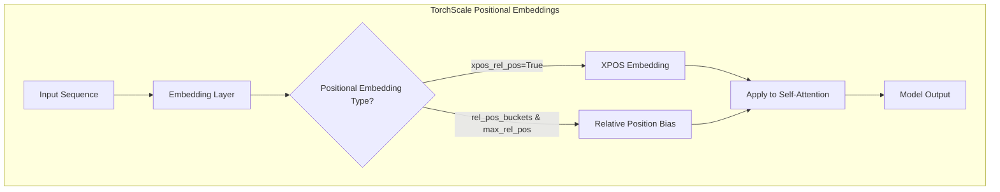
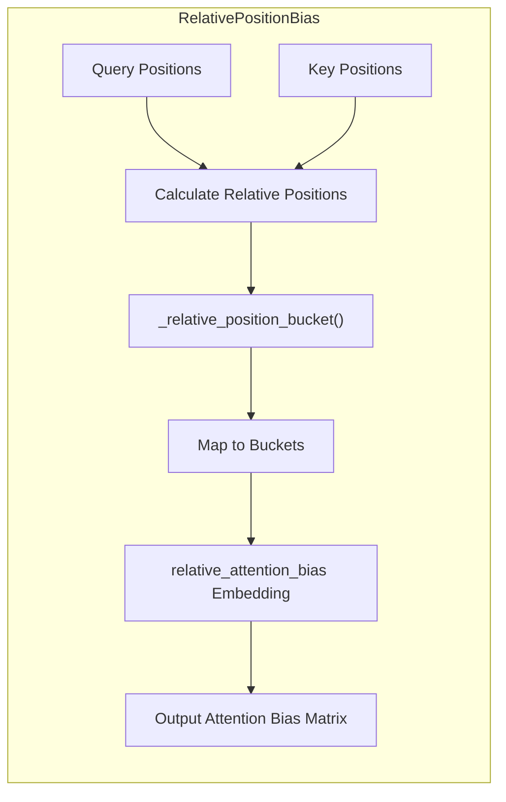
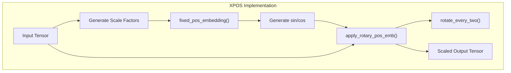
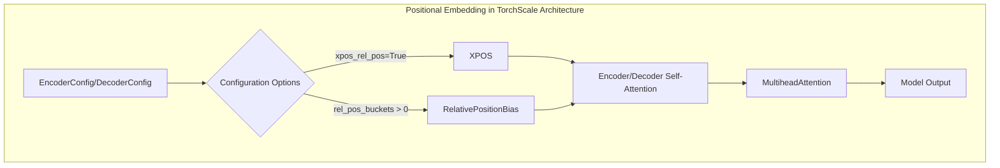

<!-- source: DeepWiki mcp.deepwiki.com · repo microsoft/torchscale · page 4.5 Positional Embeddings · fetched 2026-10-26 -->

# Positional Embeddings

<details>
<summary>Relevant source files</summary>

The following files were used as context for generating this wiki page:

- [README.md](README.md)
- [setup.py](setup.py)
- [torchscale/component/relative_position_bias.py](torchscale/component/relative_position_bias.py)
- [torchscale/component/xpos_relative_position.py](torchscale/component/xpos_relative_position.py)

</details>


This page provides a detailed explanation of the positional embedding mechanisms available in TorchScale. Positional embeddings are crucial components in transformer-based architectures as they provide information about token positions in a sequence, enabling the model to understand sequential relationships that would otherwise be lost in the position-invariant self-attention mechanism.

## Overview

TorchScale offers two main types of positional embeddings:

1. **Relative Position Bias (RPB)** - A bucketing-based approach that computes relative positional biases between query and key tokens
2. **eXtrapolatable POSition embedding (XPOS)** - A specialized rotary position embedding method that can extrapolate to longer sequences

Both positional embedding mechanisms can be configured through the model's configuration options and provide different advantages depending on the specific use case.



Sources: [README.md:135-139]()</file>, [torchscale/component/xpos_relative_position.py]()</file>, [torchscale/component/relative_position_bias.py]()</file>

## Relative Position Bias

The Relative Position Bias (RPB) mechanism in TorchScale implements a bucketing-based approach to compute attention biases based on the relative positions between tokens.

### Implementation Details

The `RelativePositionBias` class is defined in [torchscale/component/relative_position_bias.py]()</file> and computes biases between query and key positions based on their relative distances. The key aspects include:

1. Bucketing relative positions into a fixed number of buckets
2. Learning distinct biases for each attention head
3. Supporting both bidirectional and unidirectional contexts
4. Handling incremental decoding via a `step` parameter



Sources: [torchscale/component/relative_position_bias.py:10-83]()</file>

### Configuration Parameters

The `RelativePositionBias` class accepts several configuration parameters:

| Parameter | Description | Default |
|-----------|-------------|---------|
| `bidirectional` | Whether to use bidirectional context | `True` |
| `num_buckets` | Number of buckets for mapping relative positions | `32` |
| `max_distance` | Maximum distance to consider for logarithmic bucketing | `128` |
| `n_heads` | Number of attention heads | `12` |

The bucketing mechanism allows the model to share weights for similar relative positions while using a logarithmic scale to handle larger distances more efficiently.

Sources: [torchscale/component/relative_position_bias.py:11-19]()</file>

## XPOS (eXtrapolatable POSition embedding)

XPOS is an innovative positional embedding technique designed to help models extrapolate to longer sequences than seen during training, making it particularly useful for length generalization.

### Implementation Details

The `XPOS` class is defined in [torchscale/component/xpos_relative_position.py]()</file> and implements a rotary position embedding with scale factors. The key aspects include:

1. Generating sinusoidal embeddings through `fixed_pos_embedding`
2. Applying rotary transformations through `rotate_every_two` and `apply_rotary_pos_emb`
3. Incorporating scale factors that allow the model to extrapolate to longer sequences
4. Supporting offset parameters for handling sliding window attention



Sources: [torchscale/component/xpos_relative_position.py:8-65]()</file>

### Configuration Parameters

The `XPOS` class accepts the following configuration parameters:

| Parameter | Description | Default |
|-----------|-------------|---------|
| `head_dim` | Dimension of each attention head | Required |
| `scale_base` | Base value for scaling factor calculation | `512` |

Additionally, the `forward` method accepts optional parameters:

| Parameter | Description | Default |
|-----------|-------------|---------|
| `offset` | Position offset for sliding window attention | `0` |
| `downscale` | Whether to downscale (inverse) the scaling factors | `False` |

The scale factors are computed using the formula `(scale ** position) / scale_base`, where `scale` is a learnable parameter that varies along the head dimension.

Sources: [torchscale/component/xpos_relative_position.py:38-65]()</file>

## Integration with TorchScale Models

Positional embeddings are integrated into TorchScale models through the configuration system. The following diagram illustrates how positional embeddings are integrated into the self-attention mechanism:



Sources: [README.md:135-139]()</file>

## Usage Example

To enable different positional embedding options in TorchScale, you can configure them through the model configuration:

For Relative Position Bias:
```python
from torchscale.architecture.config import EncoderConfig
from torchscale.architecture.encoder import Encoder

# Configure with Relative Position Bias
config = EncoderConfig(
    vocab_size=64000,
    rel_pos_buckets=32,  # Number of buckets for relative position
    max_rel_pos=128      # Maximum relative position distance
)
model = Encoder(config)
```

For XPOS:
```python
from torchscale.architecture.config import EncoderConfig
from torchscale.architecture.encoder import Encoder

# Configure with XPOS
config = EncoderConfig(
    vocab_size=64000,
    xpos_rel_pos=True    # Enable XPOS
)
model = Encoder(config)
```

Sources: [README.md:135-139]()</file>

## When to Use Each Type

| Positional Embedding | Best For | Advantages |
|----------------------|----------|------------|
| Relative Position Bias | General use cases | Simple, effective for most tasks |
| XPOS | Length extrapolation | Can generalize to longer sequences than seen during training |

XPOS is particularly recommended when you expect to process sequences longer than those used during training, as it has better extrapolation capabilities. For standard sequence modeling where training and inference sequence lengths are similar, Relative Position Bias often provides sufficient performance.

## Implementation Details in Other TorchScale Models

Different TorchScale model architectures incorporate positional embeddings in slightly different ways:

1. **Encoder/Decoder**: Both can use either RPB or XPOS based on configuration
2. **RetNet**: Uses RetNetRelPos, a specialized variant for retention-based architectures
3. **LongNet**: Typically uses XPOS for better handling of extremely long sequences

Sources: [README.md:144-148]()</file>

## Summary

Positional embeddings are a critical component of transformer-based architectures in TorchScale, providing the model with information about token positions. The library offers two main types of positional embeddings: Relative Position Bias for general use cases and XPOS for improved length extrapolation. These components can be easily configured through the model configuration system and integrated with various TorchScale architectures.

---

