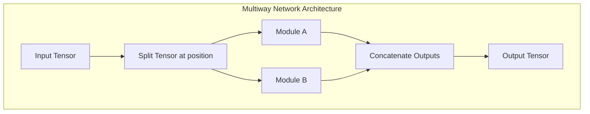
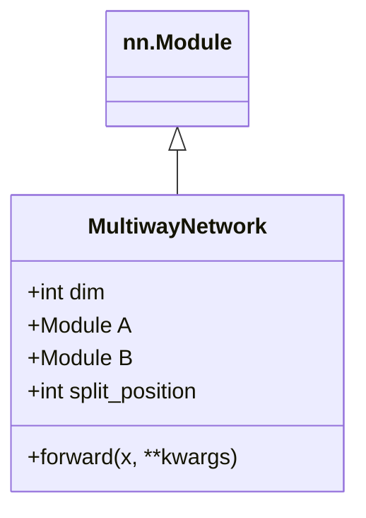
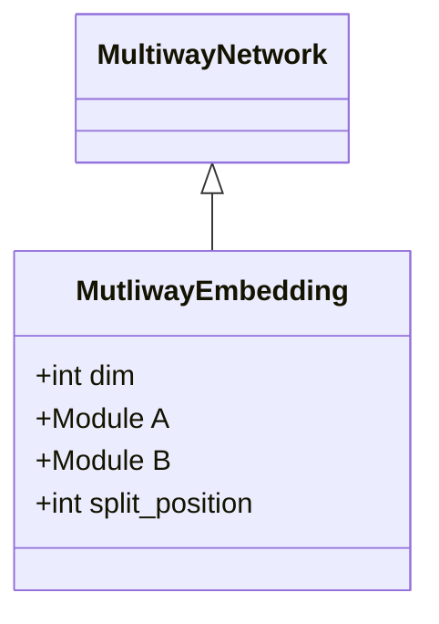
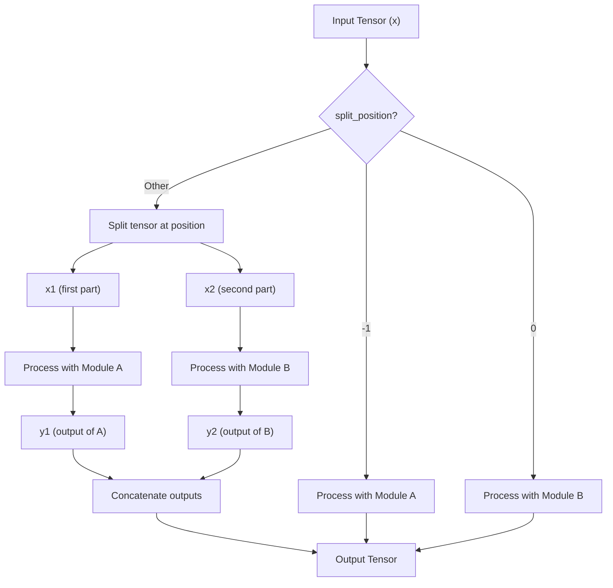
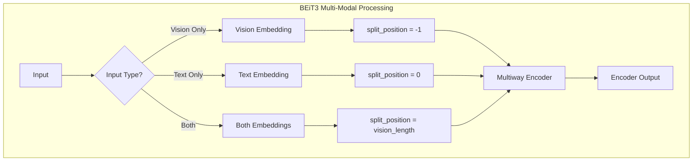
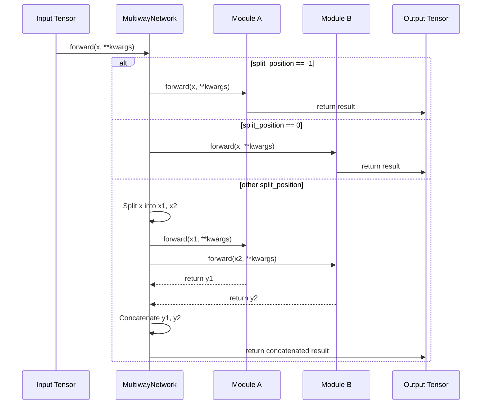

<!-- source: DeepWiki mcp.deepwiki.com · repo microsoft/torchscale · page 4.6 Multiway Network · fetched 2026-10-26 -->

# Multiway Network

<details>
<summary>Relevant source files</summary>

The following files were used as context for generating this wiki page:

- [torchscale/component/embedding.py](torchscale/component/embedding.py)
- [torchscale/component/multiway_network.py](torchscale/component/multiway_network.py)
- [torchscale/model/BEiT3.py](torchscale/model/BEiT3.py)

</details>


## Overview

The Multiway Network component in TorchScale provides a mechanism for handling multi-modal inputs by allowing different parts of an input tensor to pass through different network pathways. This is particularly useful for models that need to process different types of data (such as text and images) simultaneously while maintaining specialized processing for each modality.

For information about Mixture of Experts (MoE), which is a different approach to parameter efficiency, see [Mixture of Experts (MoE)](#4.4).



Sources: [torchscale/component/multiway_network.py:24-45]()

## Core Implementation

The Multiway Network component consists of two main classes and two utility functions:

1. `MultiwayNetwork`: The main implementation that creates two identical but separately parameterized modules
2. `MutliwayEmbedding`: A variant that works with two different pre-defined modules
3. `MultiwayWrapper`: A helper function to conditionally wrap modules with multiway functionality
4. `set_split_position`: A utility function to set the split position in multiway modules

### MultiwayNetwork Class

The `MultiwayNetwork` class duplicates a given module and distributes the processing between the two copies based on a configurable split position.



Sources: [torchscale/component/multiway_network.py:24-45]()

Key features:

- Creates two instances of the same module: the original (A) and a copy with reset parameters (B)
- Uses the `split_position` parameter to determine how to split the input tensor
- When `split_position = -1`, only module A is used (default behavior)
- When `split_position = 0`, only module B is used
- Otherwise, splits the input at the specified position and processes each part through the respective module

The forward method implementation shows how the network handles input data based on the split position:

```python
def forward(self, x, **kwargs):
    if self.split_position == -1:
        return self.A(x, **kwargs)
    if self.split_position == 0:
        return self.B(x, **kwargs)
    x1, x2 = torch.split(
        x,
        [self.split_position, x.size(self.dim) - self.split_position],
        dim=self.dim,
    )
    y1, y2 = self.A(x1, **kwargs), self.B(x2, **kwargs)
    return torch.cat([y1, y2], dim=self.dim)
```

Sources: [torchscale/component/multiway_network.py:33-45]()

### MutliwayEmbedding Class

`MutliwayEmbedding` is a specialized variant that works with two different pre-defined modules rather than duplicating a single module.



Sources: [torchscale/component/multiway_network.py:48-55]()

The key difference is in its initialization:

```python
def __init__(self, modules, dim=1):
    super(MultiwayNetwork, self).__init__()
    self.dim = dim
    assert len(modules) == 2
    self.A = modules[0]
    self.B = modules[1]
    self.split_position = -1
```

Unlike `MultiwayNetwork`, which creates a copy of a module, `MutliwayEmbedding` takes two pre-existing modules as input.

### Utility Functions

The component provides two utility functions:

1. `MultiwayWrapper`: A helper function that conditionally wraps a module with `MultiwayNetwork`:

```python
def MultiwayWrapper(args, module, dim=1):
    if args.multiway:
        return MultiwayNetwork(module, dim=dim)
    return module
```

2. `set_split_position`: A function that sets the split position in a module if it has the 'split_position' attribute:

```python
def set_split_position(position):
    def apply_fn(module):
        if hasattr(module, "split_position"):
            module.split_position = position
    return apply_fn
```

This function is typically used with the `apply()` method to set the split position across all multiway modules in a network.

Sources: [torchscale/component/multiway_network.py:10-21]()

## Data Flow

The following diagram illustrates how data flows through a Multiway Network:



Sources: [torchscale/component/multiway_network.py:33-45]()

## Usage in Multi-Modal Models: BEiT3 Example

The Multiway Network component is particularly useful for multi-modal models. The BEiT3 model in TorchScale provides a good example of this usage:



Sources: [torchscale/model/BEiT3.py:16-96]()

In the BEiT3 model:

1. Different embedding modules process different types of inputs (text vs. vision)
2. The multiway split position is set based on the input type:
   - `-1` for vision-only inputs
   - `0` for text-only inputs
   - The length of the vision embedding for combined inputs
3. A positional embedding is implemented using `MutliwayEmbedding` with two different modules:
   ```python
   embed_positions = MutliwayEmbedding(
       modules=[
           PositionalEmbedding(self.vision_embed.num_position_embeddings() + 2, args.encoder_embed_dim),
           PositionalEmbedding(args.max_source_positions, args.encoder_embed_dim),
       ],
       dim=1,
   )
   ```

The `multiway_split_position` parameter is passed to the encoder to control which pathway processes each part of the input.

Sources: [torchscale/model/BEiT3.py:33-96]()

## Detailed Implementation Flow

To provide a clearer picture of how the Multiway Network functions in practice, here's a more detailed flow diagram:



Sources: [torchscale/component/multiway_network.py:33-45]()

## Implementation Considerations

When using the Multiway Network component, consider the following:

1. **Module Compatibility**: Both modules (A and B) should accept the same types of input arguments and keyword arguments.
2. **Dimension Consistency**: The output dimension of both modules should match to ensure proper concatenation.
3. **Split Position Management**: The split position needs to be properly managed across the network, especially when multiple multiway modules are used.
4. **Parameter Initialization**: In `MultiwayNetwork`, module B gets its parameters reset, while in `MutliwayEmbedding`, two separate modules are used directly.

## Summary

The Multiway Network component in TorchScale provides a flexible mechanism for processing different parts of an input tensor through separate network pathways. This is particularly valuable for multi-modal models that need to handle different types of data, such as text and vision inputs, within a unified architecture.

Key features:
- Ability to split input tensors at configurable positions
- Support for both identical modules with separate parameters and entirely different modules
- Simple integration into larger model architectures
- Controllable routing through different split position settings

This component enables more efficient specialized processing of different input modalities within a single model architecture, making it a valuable tool for implementing multi-modal AI systems.

---

