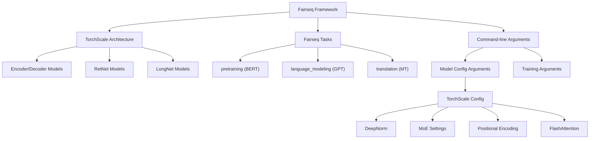
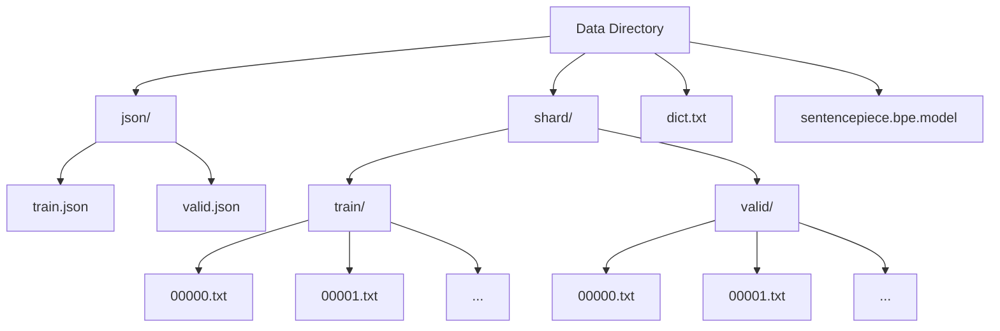
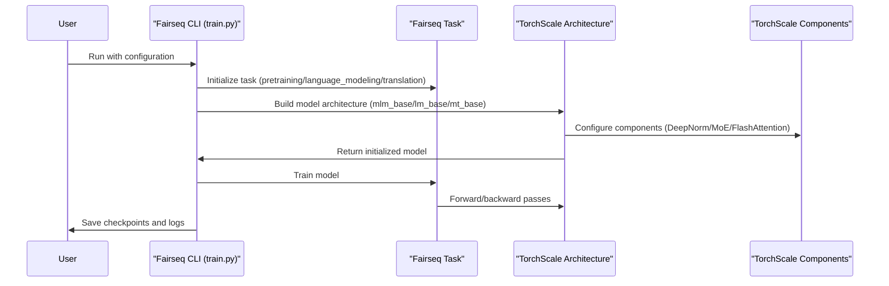

<!-- source: DeepWiki mcp.deepwiki.com · repo microsoft/torchscale · page 5 Integration with Fairseq · fetched 2026-10-26 -->

# Integration with Fairseq

<details>
<summary>Relevant source files</summary>

The following files were used as context for generating this wiki page:

- [examples/fairseq/README.md](examples/fairseq/README.md)

</details>


This page provides an overview of how to integrate TorchScale with Fairseq, a sequence-to-sequence learning toolkit. TorchScale's integration with Fairseq enables the use of advanced architectural components like DeepNorm, MoE (Mixture of Experts), and LongNet for various natural language processing tasks including BERT pretraining, GPT language modeling, and machine translation.

For details about specific model architectures available in TorchScale, see [Architecture Overview](#2).

## Setup and Installation

Before using TorchScale with Fairseq, you need to set up your environment with the correct dependencies. The following steps outline the installation process:

```bash
# Install the repo as a package:
git clone https://github.com/microsoft/torchscale.git
cd torchscale
pip install -e .
pip install git+https://github.com/shumingma/fairseq.git@moe
pip install git+https://github.com/shumingma/infinibatch.git
pip install iopath
pip install numpy==1.23.0
```

Note that the integration uses a specific fork of Fairseq that includes MoE support.

Sources: [examples/fairseq/README.md:3-14]()

## Integration Architecture

The integration between TorchScale and Fairseq allows users to leverage TorchScale's optimized architectures within Fairseq's training framework. The diagram below shows the high-level architecture of this integration:



Sources: [examples/fairseq/README.md]()

## Supported Tasks and Model Variants

TorchScale integration with Fairseq supports three main tasks, each with several model variants:

| Task | Model Variants | Key TorchScale Features |
|------|----------------|-------------------------|
| BERT Pretraining | Dense, MoE (Sparse) | DeepNorm, X-MoE, Relative Positional Bias |
| GPT Language Modeling | Dense, MoE (Sparse), LongNet | DeepNorm, X-MoE, FlashAttention, Dilated Attention |
| Machine Translation | Dense, MoE (Sparse) | X-MoE |

Sources: [examples/fairseq/README.md:16-328]()

## Data Format Requirements

Depending on the task, the data format requirements vary:

### BERT Pretraining Data Format

For BERT pretraining, TorchScale with Fairseq uses a streaming dataloader based on Infinibatch. The data should be organized as follows:



Each sharded file should contain no more than 10K lines with one sentence per line, and documents should be separated by empty lines.

Sources: [examples/fairseq/README.md:18-71]()

### GPT Pretraining Data Format

For GPT pretraining, TorchScale follows Fairseq's language modeling data format. The data needs to be preprocessed according to Fairseq's language modeling example.

Sources: [examples/fairseq/README.md:174-175]()

### Machine Translation Data Format

For machine translation, the data should be preprocessed following Fairseq's neural machine translation example.

Sources: [examples/fairseq/README.md:296-297]()

## Usage Examples

The following sections provide examples of how to use TorchScale with Fairseq for various tasks.

### BERT Pretraining

TorchScale supports both dense and sparse (MoE) variants for BERT pretraining.

#### Dense Model Training

```bash
python -m torch.distributed.launch --nproc_per_node=8 --nnodes=8 train.py ${PATH_TO_DATA} \
        --task pretraining  \
        --tokens-per-sample 512  \
        --mask-prob 0.15  \
        --span-length 3.0  \
        --leave-unmasked-prob 0.0  \
        --random-token-prob 0.0 \
        --criterion masked_lm  \
        --arch mlm_base  \
        --share-encoder-input-output-embed \
        --required-batch-size-multiple 8 \
        --spm-model ${PATH_TO_DATA}/sentencepiece.bpe.model \
        --dict-file ${PATH_TO_DATA}/dict.txt \
        --optimizer adam  \
        --adam-betas '(0.9,0.98)'  \
        --adam-eps 1e-6  \
        --clip-norm 2.0 \
        --lr-scheduler polynomial_decay  \
        --lr 0.0005  \
        --warmup-updates 10000  \
        --total-num-update 125000 \
        --max-update 125000 \
        --max-sentences 32  \
        --update-freq 1 \
        --log-format simple  \
        --log-interval 100 \
        --disable-validation \
        --save-interval-updates 5000 \
        --no-epoch-checkpoints \
        --fp16 \
        --fp16-init-scale 4 \
        --fp16-scale-window 256 \
        --min-loss-scale 0.0001 \
        --seed 1 \
        --save-dir ${PATH_TO_CKPT} \
        --ddp-backend=no_c10d \
        --distributed-no-spawn \
        --reset-dataloader \
        --batch-read-ahead 10000 \
        --rel-pos-buckets 32 \
        --max-rel-pos 128 \
        --deepnorm
```

Key TorchScale features used:
- `--deepnorm`: Enables DeepNorm initialization and scaling
- `--rel-pos-buckets 32` and `--max-rel-pos 128`: Configure the relative positional bias

Sources: [examples/fairseq/README.md:74-118]()

#### Sparse (MoE) Model Training

For MoE models, additional parameters are needed:

```bash
python -m torch.distributed.launch --nproc_per_node=8 --nnodes=8 train.py ${PATH_TO_DATA} \
        # [same base parameters as dense model]
        --deepnorm \
        --moe-expert-count 64 --moe-freq 2 \
        --moe-gating-use-fp32 --moe-second-expert-policy random --moe-normalize-gate-prob-before-dropping \
        --moe-eval-capacity-token-fraction -1.0 \
        --criterion masked_lm_moe_cross_entropy --moe-gate-loss-wt 0.01 --moe-gate-loss-combine-method sum \
        --use-xmoe --pad-to-max-length
```

Key TorchScale features used:
- `--moe-expert-count 64 --moe-freq 2`: Configure the number of experts and how often MoE layers are used
- `--use-xmoe`: Enable X-MoE implementation from TorchScale

Sources: [examples/fairseq/README.md:120-169]()

### GPT Pretraining

TorchScale supports dense, sparse (MoE), and LongNet variants for GPT language modeling.

#### Dense Model Training

```bash
python -m torch.distributed.launch --nproc_per_node=2 --nnodes=1 train.py \
    ${PATH_TO_DATA} \
    --num-workers 2 \
    --activation-fn gelu \
    --share-decoder-input-output-embed \
    --validate-interval-updates 1000 \
    --save-interval-updates 1000 \
    --no-epoch-checkpoints \
    --memory-efficient-fp16 \
    --fp16-init-scale 4 \
    --arch lm_base \
    --task language_modeling \
    --sample-break-mode none \
    --tokens-per-sample 128 \
    --optimizer adam --adam-betas "(0.9, 0.98)" \
    --adam-eps 1e-08 \
    --clip-norm 0.0 \
    --lr 5e-4 \
    --lr-scheduler polynomial_decay \
    --warmup-updates 750 \
    --dropout 0.1 \
    --attention-dropout 0.1 \
    --weight-decay 0.01 \
    --batch-size 4 \
    --update-freq 1 \
    --required-batch-size-multiple 1 \
    --total-num-update 50000 \
    --max-update 50000 \
    --seed 1 \
    --ddp-backend=c10d
```

Sources: [examples/fairseq/README.md:179-211]()

#### Sparse (MoE) Model Training

```bash
python -m torch.distributed.launch --nproc_per_node=2 --nnodes=1 train.py \
    ${PATH_TO_DATA} \
    # [same base parameters as dense model]
    --ddp-backend=no_c10d \
    --moe-expert-count 2 --moe-freq 2 \
    --moe-gating-use-fp32 --moe-second-expert-policy random --moe-normalize-gate-prob-before-dropping \
    --moe-eval-capacity-token-fraction -1.0 \
    --criterion moe_cross_entropy --moe-gate-loss-wt 0.01 --moe-gate-loss-combine-method sum \
    --use-xmoe
```

Key TorchScale features used:
- `--moe-expert-count 2 --moe-freq 2`: Configure a smaller number of experts for demonstration purposes
- `--use-xmoe`: Enable X-MoE implementation from TorchScale

Sources: [examples/fairseq/README.md:214-252]()

#### LongNet Model Training

```bash
python -m torch.distributed.launch --nproc_per_node=2 --nnodes=1 train.py \
    ${PATH_TO_DATA} \
    # [same base parameters as dense model, with these differences]
    --tokens-per-sample 4096 \
    --flash-attention \
    --segment-length [2048,4096] \
    --dilated-ratio [1,2]
```

Key TorchScale features used:
- `--tokens-per-sample 4096`: Support for longer sequences
- `--flash-attention`: Enable optimized flash attention implementation
- `--segment-length [2048,4096]` and `--dilated-ratio [1,2]`: Configure LongNet's dilated attention mechanism

Sources: [examples/fairseq/README.md:254-291]()

### Machine Translation

TorchScale supports both dense and sparse (MoE) variants for machine translation.

#### Dense Model Training

```bash
python -m torch.distributed.launch --nproc_per_node=2 --nnodes=1 train.py \
    ${PATH_TO_DATA} \
    --arch mt_base --share-decoder-input-output-embed \
    --optimizer adam --adam-betas '(0.9, 0.98)' --clip-norm 0.0 \
    --lr 5e-4 --lr-scheduler inverse_sqrt --warmup-updates 4000 \
    --dropout 0.3 --weight-decay 0.0001 \
    --max-tokens 4096 --fp16
```

Sources: [examples/fairseq/README.md:301-310]()

#### Sparse (MoE) Model Training

```bash
python -m torch.distributed.launch --nproc_per_node=2 --nnodes=1 train.py \
    ${PATH_TO_DATA} \
    --arch mt_base --share-decoder-input-output-embed \
    --optimizer adam --adam-betas '(0.9, 0.98)' --clip-norm 0.0 \
    --lr 5e-4 --lr-scheduler inverse_sqrt --warmup-updates 4000 \
    --dropout 0.3 --weight-decay 0.0001 \
    --moe-expert-count 2 --moe-freq 2 \
    --moe-gating-use-fp32 --moe-second-expert-policy random --moe-normalize-gate-prob-before-dropping \
    --moe-eval-capacity-token-fraction -1.0 \
    --criterion moe_cross_entropy --moe-gate-loss-wt 0.01 --moe-gate-loss-combine-method sum \
    --use-xmoe \
    --max-tokens 4096 --fp16
```

Sources: [examples/fairseq/README.md:313-328]()

## Key Configuration Parameters

TorchScale integration with Fairseq exposes various configuration parameters to enable its advanced features. The diagram below shows the key parameter categories and their relationship to TorchScale components:

```mermaid
graph TD
    A["TorchScale Parameters"] --> B["Architecture Parameters"]
    A --> C["MoE Parameters"]
    A --> D["Position Encoding Parameters"]
    A --> E["Optimization Parameters"]
    
    B --> B1["--arch mlm_base/lm_base/mt_base"]
    B --> B2["--deepnorm"]
    B --> B3["--flash-attention"]
    B --> B4["--segment-length [sizes]"]
    B --> B5["--dilated-ratio [ratios]"]
    
    C --> C1["--moe-expert-count N"]
    C --> C2["--moe-freq N"]
    C --> C3["--moe-gating-use-fp32"]
    C --> C4["--moe-second-expert-policy random"]
    C --> C5["--moe-normalize-gate-prob-before-dropping"]
    C --> C6["--moe-eval-capacity-token-fraction -1.0"]
    C --> C7["--use-xmoe"]
    
    D --> D1["--rel-pos-buckets N"]
    D --> D2["--max-rel-pos N"]
    
    E --> E1["--criterion masked_lm/moe_cross_entropy"]
    E --> E2["--moe-gate-loss-wt 0.01"]
    E --> E3["--moe-gate-loss-combine-method sum"]
```



Sources: [examples/fairseq/README.md]()

## Integration Workflow

The following diagram illustrates the workflow when using TorchScale with Fairseq:



Sources: [examples/fairseq/README.md]()

## Summary

TorchScale's integration with Fairseq provides a flexible and powerful framework for training various types of transformer-based models. Key benefits include:

1. Support for different model architectures (BERT, GPT, MT) with both dense and sparse (MoE) variants
2. Integration of advanced TorchScale features like DeepNorm, X-MoE, and LongNet
3. Efficient training with distributed capabilities
4. Support for long sequence processing with LongNet and FlashAttention

For more details about specific architectures, see [Encoder Architecture](#2.1), [Decoder Architecture](#2.2), [RetNet Architecture](#2.3), and [LongNet Architecture](#2.4).

For information about task-specific pretraining, see [BERT Pretraining](#5.1), [GPT & RetNet Language Models](#5.2), and [Machine Translation](#5.3).

Sources: [examples/fairseq/README.md]()

---

