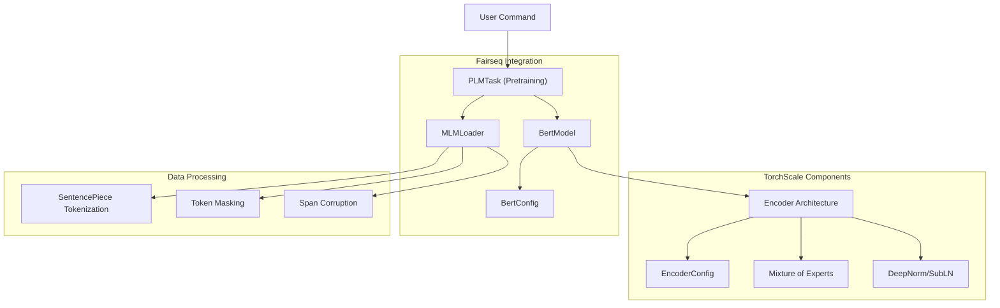
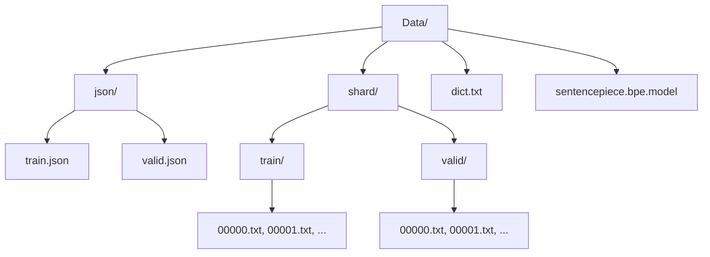
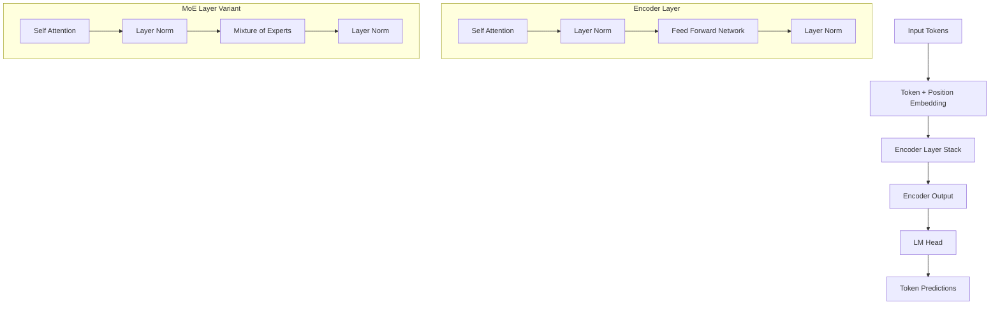
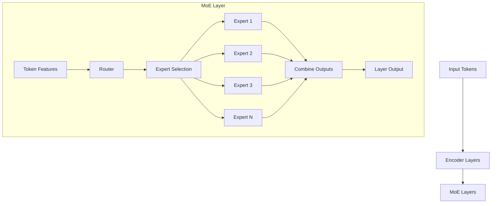
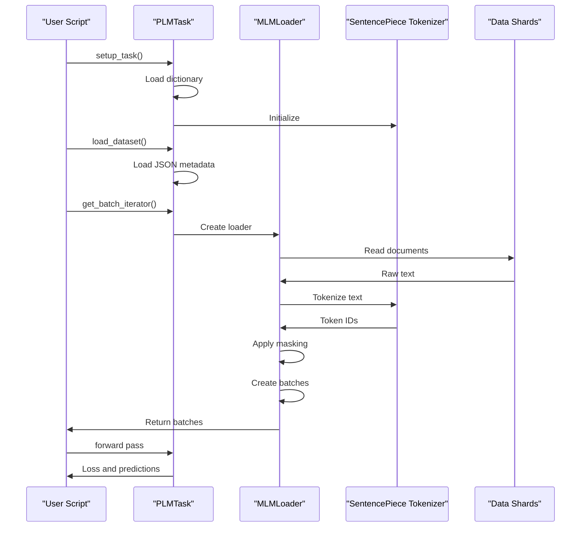

<!-- source: DeepWiki mcp.deepwiki.com · repo microsoft/torchscale · page 5.1 BERT Pretraining · fetched 2026-10-26 -->

# BERT Pretraining

<details>
<summary>Relevant source files</summary>

The following files were used as context for generating this wiki page:

- [examples/fairseq/README.md](examples/fairseq/README.md)
- [examples/fairseq/models/bert.py](examples/fairseq/models/bert.py)
- [examples/fairseq/tasks/data/mlm_loader.py](examples/fairseq/tasks/data/mlm_loader.py)
- [examples/fairseq/tasks/pretraining.py](examples/fairseq/tasks/pretraining.py)

</details>


This document provides a technical reference for pretraining BERT models using TorchScale integrated with the Fairseq framework. It covers the data preparation process, model configuration options, and command-line instructions for both dense and sparse (Mixture of Experts) BERT pretraining.

## System Overview

TorchScale provides efficient transformer model implementations that can be integrated with Fairseq for large-scale pretraining. The BERT pretraining system in TorchScale leverages the encoder architecture with support for advanced features like DeepNorm and Mixture of Experts (MoE).



**Diagram: BERT Pretraining System Architecture**

Sources: [examples/fairseq/models/bert.py:203-255](), [examples/fairseq/tasks/pretraining.py:125-156]()

## Data Preparation

TorchScale uses a streaming dataloader (InfiniBatch) to efficiently process large datasets by reading data on-the-fly from disk. This approach requires specific data formatting.

### Data Directory Structure



**Diagram: BERT Pretraining Data Structure**

Sources: [examples/fairseq/README.md:20-39]()

### Data Format Requirements

1. **Shard Files**: Each data file should contain no more than 10,000 lines with one sentence per line
2. **Document Separation**: Two documents should be separated with an empty line
3. **JSON Metadata File**: Contains paths to the shard files and language information

Example JSON format:
```json
[
    {
        "source": [
            "shard/train/00000.txt",
            "shard/train/00001.txt",
            ...
        ],
        "source_lang": "en",
        "weight": 1.0
    }
]
```

Sources: [examples/fairseq/README.md:42-66]()

### Tokenization

The system uses SentencePiece for tokenization. A vocabulary file (`dict.txt`) is also required, which can be generated from the SentencePiece model.

```bash
spm_export_vocab --model=sentencepiece.bpe.model | sed 's/\t/ /g' | tail -n +4 > dict.txt
```

Sources: [examples/fairseq/README.md:68-71](), [examples/fairseq/tasks/pretraining.py:151-154]()

## Model Architecture

The BERT implementation in TorchScale consists of an encoder-only architecture with masked language modeling capabilities.



**Diagram: BERT Model Architecture in TorchScale**

Sources: [examples/fairseq/models/bert.py:204-267](), [examples/fairseq/models/bert.py:417-442]()

### Configuration Options

BERT models in TorchScale can be configured with various parameters defined in the `BertConfig` class:

| Parameter | Description | Default Value |
|-----------|-------------|---------------|
| encoder_embed_dim | Embedding dimension | 768 |
| encoder_ffn_embed_dim | FFN embedding dimension | 3072 |
| encoder_layers | Number of encoder layers | 12 |
| encoder_attention_heads | Number of attention heads | 12 |
| dropout | Dropout probability | 0.1 |
| attention_dropout | Attention dropout probability | 0.0 |
| activation_fn | Activation function | gelu |
| max_source_positions | Maximum sequence length | 1024 |
| deepnorm | Whether to use DeepNorm | False |
| subln | Whether to use SubLN | False |

Sources: [examples/fairseq/models/bert.py:33-200](), [examples/fairseq/models/bert.py:445-488]()

### Masking Strategy

The pretraining task implements masked language modeling with customizable masking parameters:

| Parameter | Description | Default Value |
|-----------|-------------|---------------|
| mask_prob | Probability of replacing a token with mask | 0.15 |
| leave_unmasked_prob | Probability that a masked token is unmasked | 0.1 |
| random_token_prob | Probability of replacing a token with a random token | 0.1 |
| span_length | Average span length for masking | 3.0 |

Sources: [examples/fairseq/tasks/pretraining.py:39-98](), [examples/fairseq/tasks/data/mlm_loader.py:226-298]()

## Mixture of Experts (MoE) Integration

TorchScale supports Mixture of Experts (MoE) for BERT pretraining, allowing for larger and more efficient models.



**Diagram: Mixture of Experts Architecture in BERT**

Sources: [examples/fairseq/models/bert.py:133-193]()

### MoE Configuration Parameters

| Parameter | Description | Default |
|-----------|-------------|---------|
| moe_freq | Frequency of MoE layers in the network | 0 |
| moe_expert_count | Number of experts in each MoE layer | 0 |
| moe_top1_expert | Whether to use top-1 gating instead of top-2 | False |
| moe_gating_use_fp32 | Use FP32 computations in MoE gating | False |
| moe_second_expert_policy | Policy for second expert selection | "sampling" |
| moe_eval_capacity_token_fraction | Fraction of tokens as capacity during validation | 0.25 |

Sources: [examples/fairseq/models/bert.py:133-193]()

## Training Commands

### Dense BERT Model

```bash
python -m torch.distributed.launch --nproc_per_node=8 --nnodes=8 train.py ${PATH_TO_DATA} \
        --task pretraining  \
        --tokens-per-sample 512  \
        --mask-prob 0.15  \
        --span-length 3.0  \
        --leave-unmasked-prob 0.0  \
        --random-token-prob 0.0 \
        --criterion masked_lm  \
        --arch mlm_base  \
        --share-encoder-input-output-embed \
        --required-batch-size-multiple 8 \
        --spm-model ${PATH_TO_DATA}/sentencepiece.bpe.model \
        --dict-file ${PATH_TO_DATA}/dict.txt \
        --optimizer adam  \
        --adam-betas '(0.9,0.98)'  \
        --adam-eps 1e-6  \
        --clip-norm 2.0 \
        --lr-scheduler polynomial_decay  \
        --lr 0.0005  \
        --warmup-updates 10000  \
        --total-num-update 125000 \
        --max-update 125000 \
        --max-sentences 32  \
        --update-freq 1 \
        --fp16 \
        --deepnorm
```

Sources: [examples/fairseq/README.md:74-118]()

### Sparse (MoE) BERT Model

To train a model with Mixture of Experts, additional parameters are required:

```bash
python -m torch.distributed.launch --nproc_per_node=8 --nnodes=8 train.py ${PATH_TO_DATA} \
        --task pretraining  \
        --tokens-per-sample 512  \
        --mask-prob 0.15  \
        --span-length 3.0  \
        --leave-unmasked-prob 0.0  \
        --random-token-prob 0.0 \
        --arch mlm_base  \
        --share-encoder-input-output-embed \
        --required-batch-size-multiple 8 \
        --spm-model ${PATH_TO_DATA}/sentencepiece.bpe.model \
        --dict-file ${PATH_TO_DATA}/dict.txt \
        --optimizer adam  \
        --lr 0.0005  \
        --warmup-updates 10000  \
        --total-num-update 125000 \
        --max-update 125000 \
        --max-sentences 32  \
        --fp16 \
        --deepnorm \
        --moe-expert-count 64 --moe-freq 2 \
        --moe-gating-use-fp32 --moe-second-expert-policy random --moe-normalize-gate-prob-before-dropping \
        --moe-eval-capacity-token-fraction -1.0 \
        --criterion masked_lm_moe_cross_entropy --moe-gate-loss-wt 0.01 --moe-gate-loss-combine-method sum \
        --use-xmoe --pad-to-max-length
```

Sources: [examples/fairseq/README.md:120-169]()

## Data Loading and Processing Pipeline

The data loading and processing pipeline for BERT pretraining in TorchScale follows these steps:



**Diagram: BERT Pretraining Data Flow**

Sources: [examples/fairseq/tasks/pretraining.py:157-209](), [examples/fairseq/tasks/data/mlm_loader.py:15-53](), [examples/fairseq/tasks/data/mlm_loader.py:161-220]()

## Key Components and Their Interactions

### PLMTask (Pretraining Language Model Task)

The `PLMTask` class handles the pretraining task for masked language modeling:

- Loads dictionary and tokenizer
- Sets up data loading
- Manages the batch iterator

Sources: [examples/fairseq/tasks/pretraining.py:125-156]()

### MLMLoader

The `MLMLoader` class implements the data loading mechanism:

- Reads and tokenizes documents from disk
- Implements masking strategies (standard masking and span corruption)
- Creates batches for training

Sources: [examples/fairseq/tasks/data/mlm_loader.py:15-53](), [examples/fairseq/tasks/data/mlm_loader.py:226-298]()

### BertModel

The `BertModel` class is the core model implementation:

- Integrates with TorchScale's encoder architecture
- Manages the language modeling head
- Handles optional classification heads

Sources: [examples/fairseq/models/bert.py:204-387]()

### LMHead

The `LMHead` class provides the masked language modeling projection:

- Projects encoder outputs to vocabulary space
- Applies transformations specific to masked token prediction

Sources: [examples/fairseq/models/bert.py:417-442]()

## Conclusion

This document has covered the technical aspects of BERT pretraining using TorchScale integrated with Fairseq. The system provides a flexible architecture for both dense and sparse (MoE) BERT models, with support for advanced features like DeepNorm. The data format and processing pipeline are designed for efficient large-scale pretraining.

For information about other model types like GPT and RetNet language models, see [GPT & RetNet Language Models](#5.2).

---

