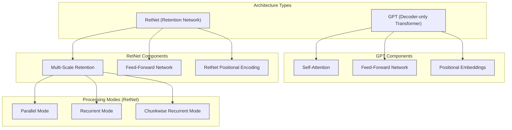
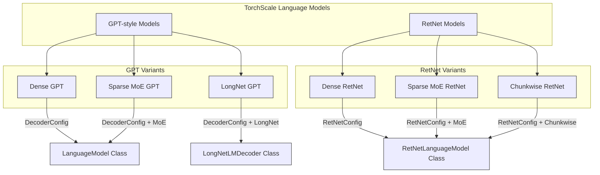
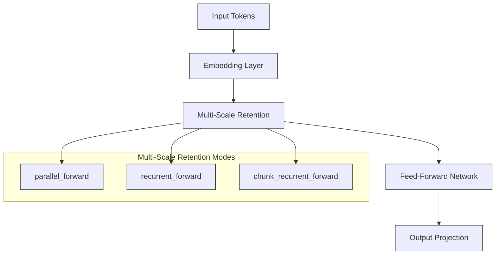
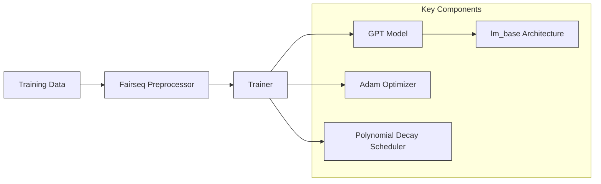
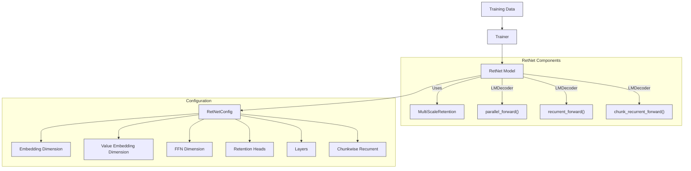

<!-- source: DeepWiki mcp.deepwiki.com · repo microsoft/torchscale · page 5.2 GPT & RetNet Language Models · fetched 2026-10-26 -->

# GPT & RetNet Language Models

<details>
<summary>Relevant source files</summary>

The following files were used as context for generating this wiki page:

- [examples/fairseq/README.md](examples/fairseq/README.md)
- [examples/fairseq/models/language_modeling.py](examples/fairseq/models/language_modeling.py)
- [examples/fairseq/models/retnet.py](examples/fairseq/models/retnet.py)

</details>


This document provides a detailed guide on training GPT and RetNet language models using TorchScale with Fairseq integration. It covers model architectures, configuration options, and practical training examples. For information about BERT pretraining, see [BERT Pretraining](#5.1), and for machine translation models, see [Machine Translation](#5.3).

## Introduction to GPT & RetNet Models in TorchScale

TorchScale provides implementations for training both traditional decoder-only transformer language models (like GPT) and RetNet (Retention Network) language models. These models serve as powerful foundation models for various natural language processing tasks.

### Key Architecture Comparison



Sources: [examples/fairseq/models/retnet.py:235-242](), [examples/fairseq/models/language_modeling.py:279-286]()

### Model Configuration Options

Both GPT and RetNet models in TorchScale offer several variants:

1. **Dense Models**: Standard model architectures without parameter sharing
2. **Sparse (MoE) Models**: Models with Mixture of Experts layers for increased parameter count without proportional computation
3. **LongNet Models** (GPT only): Models designed for handling extremely long contexts using dilated attention



Sources: [examples/fairseq/models/language_modeling.py:215-288](), [examples/fairseq/models/retnet.py:189-242]()

## Data Preparation

### GPT Models Data Format

GPT models in TorchScale use the standard Fairseq language modeling data format. The data needs to be preprocessed using Fairseq's preprocessing tools as described in their [language modeling example](https://github.com/facebookresearch/fairseq/tree/main/examples/language_model).

Sources: [examples/fairseq/README.md:174-175]()

## Model Architecture Details

### GPT Architecture

The GPT models in TorchScale follow the standard decoder-only transformer architecture, with the following components:

- **Embedding Layer**: Token and optional positional embeddings
- **Decoder Layers**: Series of self-attention and feed-forward layers
- **Output Projection**: Linear projection to vocabulary size

The model supports various optimizations like DeepNorm, SubLN, and MoE integration, as well as LongNet for extended context length.

Sources: [examples/fairseq/models/language_modeling.py:295-302](), [examples/fairseq/models/language_modeling.py:333-395]()

### RetNet Architecture

RetNet replaces the traditional self-attention mechanism with a multi-scale retention mechanism, offering three distinct processing modes:

1. **Parallel Mode**: Similar to transformer's self-attention in parallelizable computation
2. **Recurrent Mode**: Sequential processing with a state-based approach
3. **Chunkwise Recurrent Mode**: Hybrid approach processing chunks in recurrent fashion



Sources: [examples/fairseq/models/retnet.py:249-264](), [examples/fairseq/models/retnet.py:162-166]()

## Model Size Configurations

### RetNet Model Sizes

TorchScale provides several pre-defined RetNet model configurations ranging from base to 65B parameters:

| Model Name | Embed Dim | Value Embed Dim | FFN Embed Dim | Retention Heads | Layers |
|------------|-----------|-----------------|---------------|-----------------|--------|
| Base       | 512       | 864             | 864           | 2               | 6      |
| Medium     | 1024      | 1728            | 1728          | 4               | 16     |
| XL         | 2048      | 3456            | 3456          | 8               | 24     |
| 3B         | 2560      | 4280            | 4280          | 10              | 32     |
| 7B         | 4096      | 6912            | 6912          | 16              | 32     |
| 13B        | 5120      | 8560            | 8560          | 20              | 40     |
| 65B        | 8192      | 13824           | 13824         | 32              | 64     |

Sources: [examples/fairseq/models/retnet.py:267-386]()

## Training Models with Fairseq

### Dense GPT Model Training

To train a standard GPT model:



The command for training a dense GPT model includes many configuration parameters:

```
python -m torch.distributed.launch --nproc_per_node=2 --nnodes=1 train.py \
    ${PATH_TO_DATA} \
    --arch lm_base \
    --task language_modeling \
    --optimizer adam \
    --lr 5e-4 \
    --lr-scheduler polynomial_decay \
    [additional parameters]
```

Key parameters include model architecture (`lm_base`), optimizer, learning rate, and scheduler type.

Sources: [examples/fairseq/README.md:179-211]()

### Sparse (MoE) GPT Model Training

Training a Mixture of Experts GPT model requires additional MoE-specific parameters:

```
python -m torch.distributed.launch --nproc_per_node=2 --nnodes=1 train.py \
    ${PATH_TO_DATA} \
    --arch lm_base \
    --moe-expert-count 2 --moe-freq 2 \
    --moe-gating-use-fp32 --moe-second-expert-policy random \
    --criterion moe_cross_entropy --moe-gate-loss-wt 0.01 \
    --use-xmoe
    [additional parameters]
```

The MoE parameters control the number of experts, frequency of MoE layers, gating mechanism, and loss functions.

Sources: [examples/fairseq/README.md:214-252]()

### LongNet GPT Model Training

LongNet extends GPT to handle very long sequences using dilated attention:

```
python -m torch.distributed.launch --nproc_per_node=2 --nnodes=1 train.py \
    ${PATH_TO_DATA} \
    --arch lm_base \
    --task language_modeling \
    --tokens-per-sample 4096 \
    --flash-attention \
    --segment-length [2048,4096] \
    --dilated-ratio [1,2]
    [additional parameters]
```

The LongNet-specific parameters include long token sequences (4096), flash attention optimization, segment length, and dilated ratio settings.

Sources: [examples/fairseq/README.md:254-291]()

### RetNet Model Training

RetNet models can be trained using the `retnet` architecture with specific configurations:



To train a RetNet model, use the `retnet` architecture with specific configuration arguments:

```
python -m torch.distributed.launch --nproc_per_node=2 --nnodes=1 train.py \
    ${PATH_TO_DATA} \
    --arch retnet_base \  # or other size variants
    --task language_modeling \
    --chunkwise-recurrent \  # optional for chunkwise mode
    --recurrent-chunk-size 512
```

RetNet architecture offers unique parameters for controlling the retention network configuration, including the chunk size for chunkwise recurrent mode.

Sources: [examples/fairseq/models/retnet.py:235-242](), [examples/fairseq/models/retnet.py:162-166]()

## Key Implementation Classes

The implementation includes several key classes for GPT and RetNet models:

| Model Type | Main Model Class | Decoder Class | Architecture Config |
|------------|------------------|---------------|---------------------|
| GPT (Dense/MoE) | `LanguageModel` | `LMDecoder` | `DecoderConfig` |
| GPT (LongNet) | `LanguageModel` | `LongNetLMDecoder` | `DecoderConfig` with LongNet params |
| RetNet | `RetNetLanguageModel` | `LMDecoder` (RetNet) | `RetNetConfig` |

Sources: [examples/fairseq/models/language_modeling.py:215-288](), [examples/fairseq/models/retnet.py:189-242]()

## Common Configuration Options

Both GPT and RetNet models support several common configuration options:

1. **Model Size Parameters**: Embedding dimensions, FFN dimensions, number of layers, heads
2. **Training Parameters**: Dropout, activation function, attention dropout
3. **Optimization Features**: DeepNorm, SubLN, checkpointing activations
4. **MoE Parameters**: Expert count, expert frequency, gating parameters
5. **Positional Encoding**: Different options for positional embeddings

Sources: [examples/fairseq/models/language_modeling.py:34-211](), [examples/fairseq/models/retnet.py:33-187]()

## Conclusion

TorchScale provides comprehensive support for training state-of-the-art language models, including GPT variants and the innovative RetNet architecture. The integration with Fairseq makes it easy to train these models at scale with various optimizations like MoE and LongNet for extended context. The codebase offers multiple model size configurations from base to 65B parameters, making it suitable for a wide range of applications and compute budgets.

---

