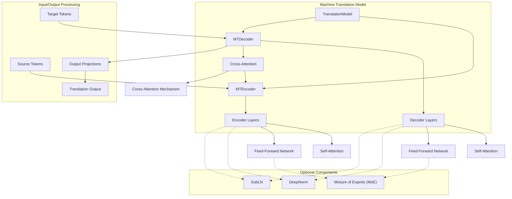
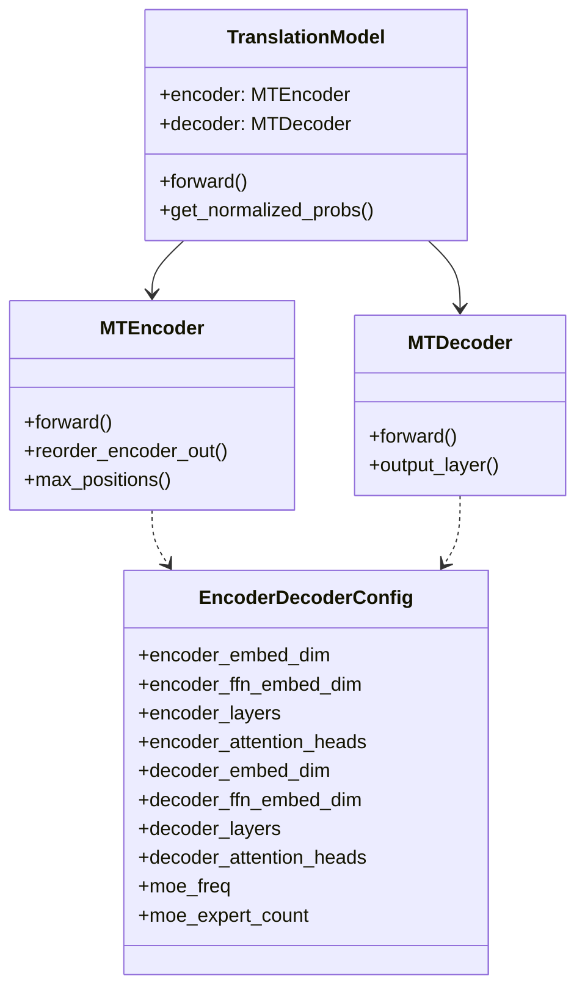
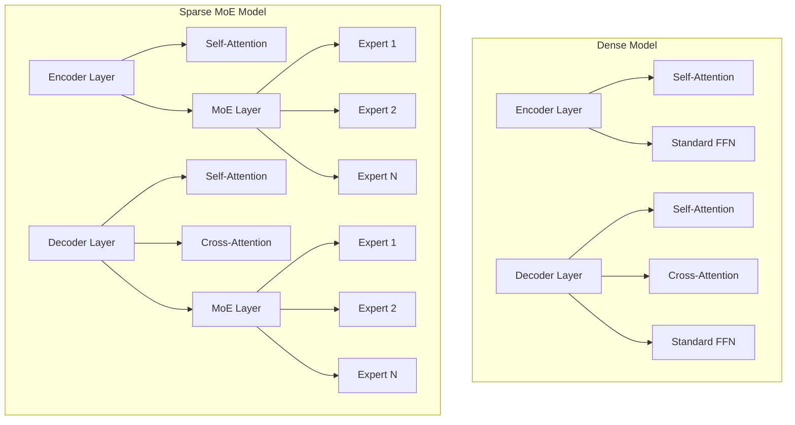
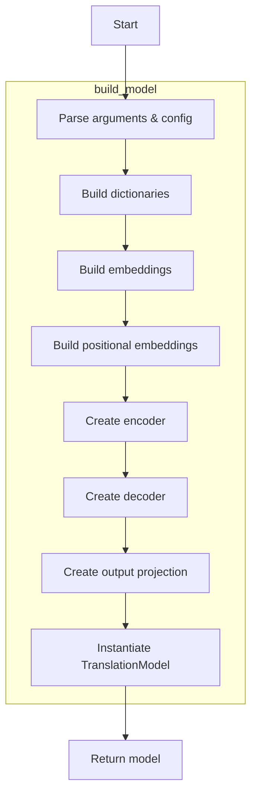

<!-- source: DeepWiki mcp.deepwiki.com · repo microsoft/torchscale · page 5.3 Machine Translation · fetched 2026-10-26 -->

# Machine Translation

<details>
<summary>Relevant source files</summary>

The following files were used as context for generating this wiki page:

- [examples/fairseq/README.md](examples/fairseq/README.md)
- [examples/fairseq/models/machine_translation.py](examples/fairseq/models/machine_translation.py)

</details>


This document explains how to use TorchScale to train neural machine translation (MT) models using the Fairseq integration. It covers the architecture components, available model variants (dense and sparse with Mixture of Experts), data preparation, and training commands. For information about language model training, see [GPT & RetNet Language Models](#5.2).

## Architecture Overview

TorchScale implements a Transformer-based encoder-decoder architecture for machine translation tasks. The implementation follows the standard Transformer architecture with additional capabilities from TorchScale, such as DeepNorm, SubLN, and Mixture of Experts (MoE) integration.



Sources: [examples/fairseq/models/machine_translation.py:37-364]()

The translation model is registered in Fairseq as `"mt"` with the architecture `"mt_base"`. It builds upon TorchScale's `Encoder` component for the encoder and reuses the `LMDecoder` (renamed as `MTDecoder`) for the decoder part.

## Model Components

The machine translation model consists of these key components:



Sources: [examples/fairseq/models/machine_translation.py:37-65](), [examples/fairseq/models/machine_translation.py:366-396]()

### Encoder Architecture

The encoder (`MTEncoder`) extends TorchScale's `Encoder` and Fairseq's `FairseqEncoder`. It processes source tokens and generates a representation that the decoder can use through cross-attention.

Key features:
- Self-attention mechanisms
- Feed-forward networks
- Optional DeepNorm or SubLN normalizations
- Optional Mixture of Experts integration

Sources: [examples/fairseq/models/machine_translation.py:366-396]()

### Decoder Architecture

The decoder (imported as `MTDecoder` from the language modeling module) processes target tokens while attending to the encoder's output. It generates probabilities for output tokens.

Key features:
- Self-attention mechanisms
- Cross-attention to encoder outputs
- Feed-forward networks
- Output projection to vocabulary
- Optional DeepNorm or SubLN normalizations
- Optional Mixture of Experts integration

## Model Variants

TorchScale supports two main variants for machine translation:

### Dense Model

The standard Transformer-based encoder-decoder without Mixture of Experts. This is the traditional architecture where each layer has fixed parameters that process all inputs.

### Sparse (MoE) Model

A variant using Mixture of Experts layers that replace standard feed-forward networks at specified frequencies. MoE layers contain multiple "expert" networks, with a routing mechanism that selects which experts to use for each token.



Sources: [examples/fairseq/models/machine_translation.py:142-179](), [examples/fairseq/README.md:299-328]()

## Data Preparation

TorchScale follows Fairseq's data format for machine translation. To prepare your data:

1. Follow the [neural machine translation example](https://github.com/facebookresearch/fairseq/tree/main/examples/translation#training-a-new-model) from Fairseq to preprocess your dataset.
2. The preprocessing typically involves:
   - Tokenization
   - Building vocabulary for source and target languages
   - Binarization for efficient training

Sources: [examples/fairseq/README.md:295-297]()

## Training Models

### Training a Dense Translation Model

Use the following command to train a standard dense Transformer-based translation model:

```bash
cd examples/fairseq/
python -m torch.distributed.launch --nproc_per_node=2 --nnodes=1 train.py \
    ${PATH_TO_DATA} \
    --arch mt_base --share-decoder-input-output-embed \
    --optimizer adam --adam-betas '(0.9, 0.98)' --clip-norm 0.0 \
    --lr 5e-4 --lr-scheduler inverse_sqrt --warmup-updates 4000 \
    --dropout 0.3 --weight-decay 0.0001 \
    --max-tokens 4096 --fp16
```

Sources: [examples/fairseq/README.md:300-310]()

### Training a Sparse (MoE) Translation Model

For training a model with Mixture of Experts layers:

```bash
cd examples/fairseq/
python -m torch.distributed.launch --nproc_per_node=2 --nnodes=1 train.py \
    ${PATH_TO_DATA} \
    --arch mt_base --share-decoder-input-output-embed \
    --optimizer adam --adam-betas '(0.9, 0.98)' --clip-norm 0.0 \
    --lr 5e-4 --lr-scheduler inverse_sqrt --warmup-updates 4000 \
    --dropout 0.3 --weight-decay 0.0001 \
    --moe-expert-count 2 --moe-freq 2 \
    --moe-gating-use-fp32 --moe-second-expert-policy random --moe-normalize-gate-prob-before-dropping \
    --moe-eval-capacity-token-fraction -1.0 \
    --criterion moe_cross_entropy --moe-gate-loss-wt 0.01 --moe-gate-loss-combine-method sum \
    --use-xmoe \
    --max-tokens 4096 --fp16
```

Sources: [examples/fairseq/README.md:313-328]()

## Configuration Options

The machine translation model supports various configuration options through command-line arguments:

| Parameter | Description | Default |
|-----------|-------------|---------|
| `--encoder-embed-dim` | Dimension of encoder embedding | 512 |
| `--encoder-ffn-embed-dim` | Dimension of encoder FFN | 2048 |
| `--encoder-layers` | Number of encoder layers | 6 |
| `--encoder-attention-heads` | Number of encoder attention heads | 8 |
| `--decoder-embed-dim` | Dimension of decoder embedding | 512 |
| `--decoder-ffn-embed-dim` | Dimension of decoder FFN | 2048 |
| `--decoder-layers` | Number of decoder layers | 6 |
| `--decoder-attention-heads` | Number of decoder attention heads | 8 |
| `--dropout` | Dropout probability | 0.1 |
| `--share-decoder-input-output-embed` | Share decoder input/output embeddings | False |
| `--moe-expert-count` | Number of experts in MoE layers | 0 |
| `--moe-freq` | Frequency of MoE layers | 0 |
| `--deepnorm` | Enable DeepNorm initialization | False |
| `--subln` | Enable SubLN normalization | False |

Sources: [examples/fairseq/models/machine_translation.py:399-453]()

### MoE-Specific Options

When using MoE models, additional parameters control the behavior of expert routing and load balancing:

| Parameter | Description |
|-----------|-------------|
| `--moe-second-expert-policy` | Policy for selecting the second expert (random, sampling) |
| `--moe-gating-use-fp32` | Use FP32 computations in gating function |
| `--moe-normalize-gate-prob-before-dropping` | When to normalize gate probabilities |
| `--moe-eval-capacity-token-fraction` | Fraction of tokens as capacity during evaluation |
| `--moe-gate-loss-wt` | Weight for the auxiliary loss in MoE training |
| `--use-xmoe` | Enable X-MoE implementation |

Sources: [examples/fairseq/models/machine_translation.py:142-179]()

## Model Creation Process

The creation of a machine translation model follows this sequence:



Sources: [examples/fairseq/models/machine_translation.py:194-296]()

## Setup and Installation

Before training translation models, you need to set up the environment:

```bash
# Install the repo as a package:
git clone https://github.com/microsoft/torchscale.git
cd torchscale
pip install -e .
pip install git+https://github.com/shumingma/fairseq.git@moe
pip install git+https://github.com/shumingma/infinibatch.git
pip install iopath
pip install numpy==1.23.0
```

Sources: [examples/fairseq/README.md:5-14]()

This installs TorchScale and the required dependencies, including a specific fork of Fairseq that supports Mixture of Experts and other TorchScale features.

---

