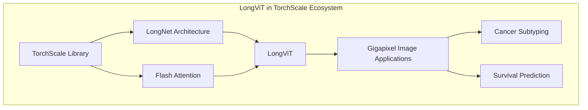
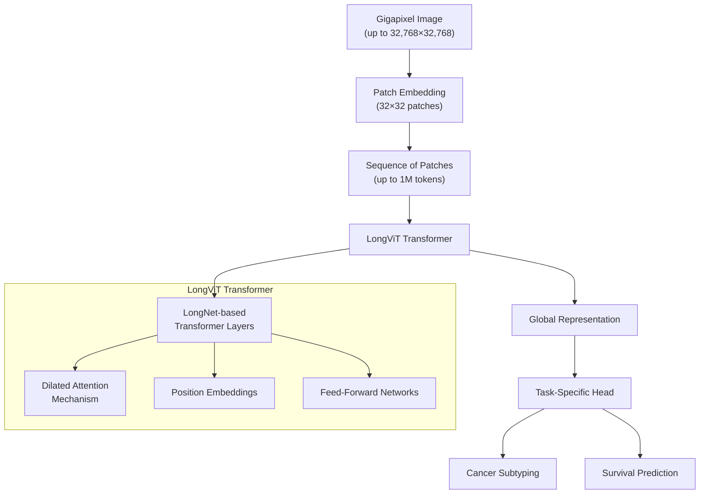
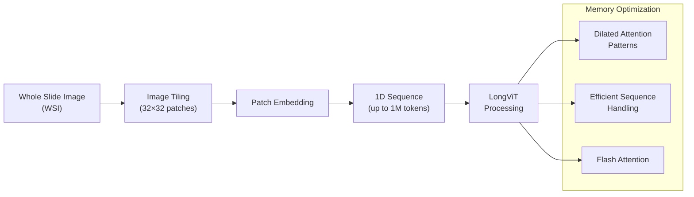
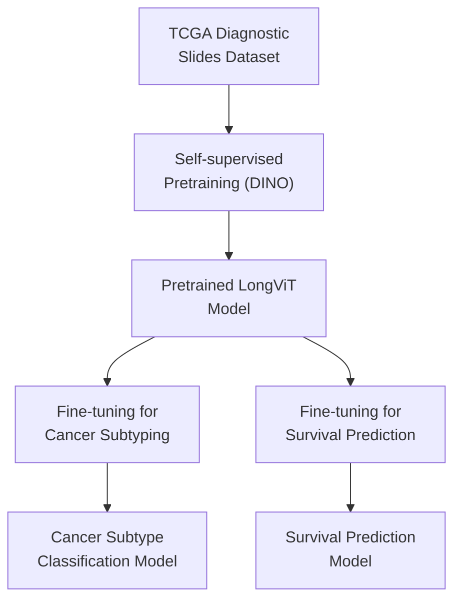
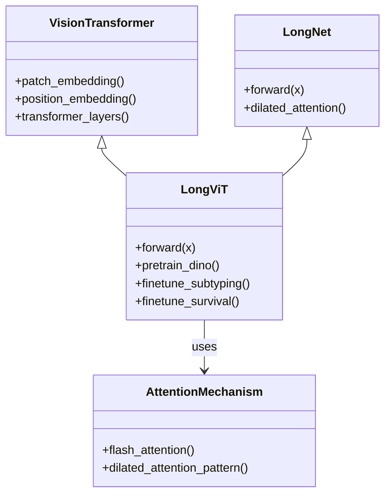

<!-- source: DeepWiki mcp.deepwiki.com · repo microsoft/torchscale · page 6 LongViT for Vision Applications · fetched 2026-10-26 -->

# LongViT for Vision Applications

<details>
<summary>Relevant source files</summary>

The following files were used as context for generating this wiki page:

- [examples/longvit/README.md](examples/longvit/README.md)

</details>


## Purpose and Scope

This document provides detailed information about LongViT, a vision Transformer architecture designed to process gigapixel images end-to-end. LongViT integrates TorchScale's LongNet architecture to efficiently handle extremely long sequences, enabling analysis of images up to 32,768×32,768 pixels (1M patches). This page focuses on LongViT's architecture, implementation, and applications in computational pathology. For information about the underlying LongNet architecture, see [LongNet Architecture](#2.4).

## Introduction to LongViT

LongViT extends vision transformers to handle gigapixel-scale images by leveraging TorchScale's LongNet architecture. Traditional vision transformers struggle with very large images due to the quadratic complexity of self-attention. LongViT overcomes this limitation by applying dilated attention patterns from LongNet, enabling efficient processing of millions of image patches in a single forward pass.



Sources: [examples/longvit/README.md:1-5]()

## LongViT Architecture

LongViT employs a hierarchical approach to process gigapixel images by dividing them into patches and applying the LongNet architecture to model the resulting long sequence.



The standard LongViT model has the following specifications:
- 12 transformer layers
- 384 hidden dimensions
- 4× FFN expansion factor
- 16 attention heads
- 32×32 patch size

Sources: [examples/longvit/README.md:16-19]()

## Preprocessing and Image Handling

Processing gigapixel images requires specialized handling to manage the extreme number of patches:



Sources: [examples/longvit/README.md:3-4]()

## Training Methodology

LongViT employs a two-stage training approach:

1. **Self-supervised pretraining**: Using DINO (DIstillation with NO labels) objective on TCGA diagnostic slides
2. **Task-specific fine-tuning**: For cancer subtyping or survival prediction

This approach allows the model to learn general pathology image features before specializing in specific diagnostic tasks.



Sources: [examples/longvit/README.md:14-29]()

## Applications in Computational Pathology

LongViT has been primarily applied to two key tasks in computational pathology:

| Task | Description | Image Size | Approach |
|------|-------------|------------|----------|
| Cancer Subtyping | Classification of cancer subtypes from whole slide images | Up to 32,768×32,768 | End-to-end using full gigapixel images |
| Survival Prediction | Predicting patient survival based on histopathology | Up to 32,768×32,768 | End-to-end using full gigapixel images |

The ability to process entire gigapixel images end-to-end is a significant advancement over prior methods that relied on patch-based or multi-stage approaches, potentially capturing global patterns and relationships that might be missed in patch-based methods.

Sources: [examples/longvit/README.md:22-29]()

## Technical Implementation

LongViT is implemented as part of the TorchScale ecosystem, building upon several key technologies:



The implementation integrates techniques from:
- BEiT-3 (for vision transformer foundation)
- MCAT and HIPT (for pathology-specific adaptations)
- DINO (for self-supervised pretraining)
- TorchScale's LongNet (for handling extremely long sequences)

Sources: [examples/longvit/README.md:59-61]()

## Installation and Usage

To use LongViT, the following dependencies need to be installed:

```
pip install -r requirements.txt
pip install git+https://github.com/shumingma/fairseq.git@moe
pip install -v -U git+https://github.com/facebookresearch/xformers.git@v0.0.20#egg=xformers
```

A pretrained model is available at the repository specified in the README. Detailed instructions for pretraining, fine-tuning for cancer subtyping, and fine-tuning for survival prediction are provided in separate documentation files.

Sources: [examples/longvit/README.md:6-29]()

## Performance and Capabilities

LongViT represents a significant advancement in handling gigapixel images:

- Processes images up to 32,768×32,768 pixels
- Handles up to 1 million patches in a single forward pass
- End-to-end processing without patch aggregation or multi-stage pipelines
- Applied successfully to complex medical imaging tasks in computational pathology

The direct processing of entire gigapixel images enables the model to capture both local and global patterns that may be critical for accurate diagnosis and prognosis in pathology applications.

Sources: [examples/longvit/README.md:3-5](), [examples/longvit/README.md:22-29]()

## Relation to Other TorchScale Components

LongViT is built on top of TorchScale's core technologies, particularly LongNet, which enables efficient processing of extremely long sequences through dilated attention mechanisms. By applying these techniques to vision transformers, LongViT extends TorchScale's capabilities into the domain of gigapixel image processing for medical applications.

Sources: [examples/longvit/README.md:3-4](), [examples/longvit/README.md:42-48]()

---

