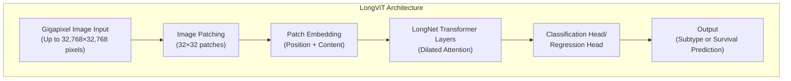
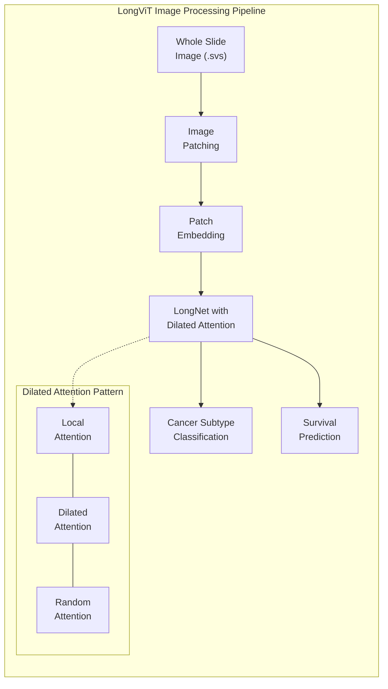
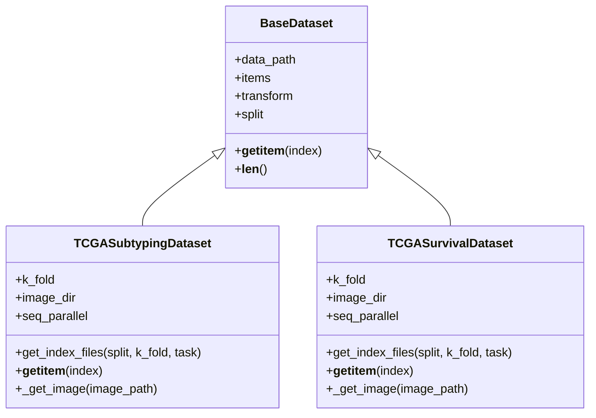
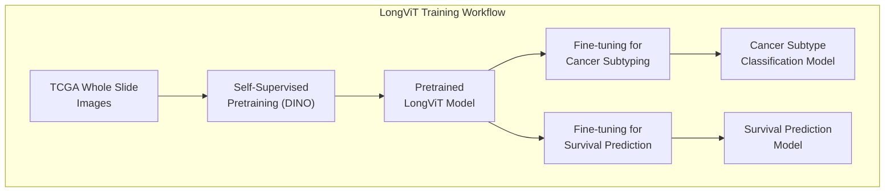
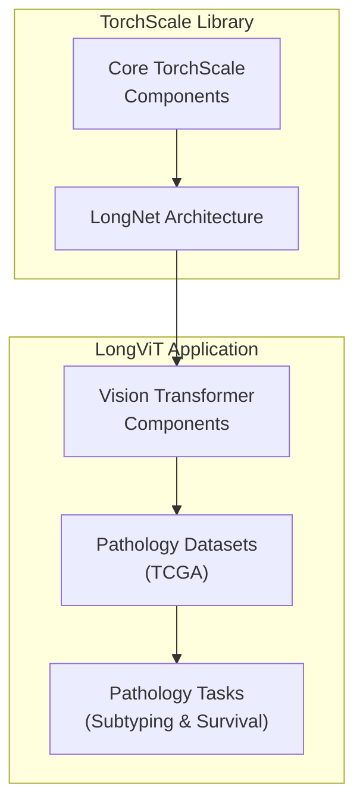

<!-- source: DeepWiki mcp.deepwiki.com · repo microsoft/torchscale · page 6.1 Architecture & Use Cases · fetched 2026-10-26 -->

# Architecture & Use Cases

<details>
<summary>Relevant source files</summary>

The following files were used as context for generating this wiki page:

- [examples/longvit/README.md](examples/longvit/README.md)
- [examples/longvit/datasets.py](examples/longvit/datasets.py)

</details>


This document covers the architecture of LongViT and its applications in computational pathology. LongViT is a specialized vision transformer built on TorchScale's LongNet architecture, designed specifically for processing extremely large gigapixel medical images. For information about the core LongNet architecture that powers LongViT, see [LongNet Architecture](#2.4).

## LongViT Architecture Overview

LongViT is a vision transformer designed specifically to handle gigapixel-scale medical images (up to 32,768×32,768 pixels) in an end-to-end manner. Unlike conventional vision transformers that struggle with extremely large images, LongViT leverages the dilated attention mechanism from LongNet to efficiently model sequences of millions of patches.



Sources: [examples/longvit/README.md:3-3]()

The core LongViT model consists of:
- **Patch Size**: 32×32 pixels
- **Architecture**: 12 transformer layers
- **Hidden Dimension**: 384
- **Feed-Forward Network Factor**: 4×
- **Attention Heads**: 16

This architecture allows LongViT to process up to 1 million patches (32K×32K images) in a single forward pass, making it suitable for whole-slide image analysis in computational pathology.

Sources: [examples/longvit/README.md:19-19]()

## Image Processing Pipeline

LongViT processes gigapixel images through a specialized pipeline that handles the extreme sequence lengths:



Sources: [examples/longvit/README.md:3-3](), [examples/longvit/datasets.py:147-156](), [examples/longvit/datasets.py:245-258]()

The key innovation in LongViT is its ability to process the entire whole-slide image at once, rather than using patch-based or multi-resolution approaches. This provides the model with complete context across the entire slide, which is crucial for accurate diagnosis and prognosis in computational pathology.

## Data Handling Architecture

LongViT supports multiple dataset types for different computational pathology tasks, primarily focusing on The Cancer Genome Atlas (TCGA) datasets:



Sources: [examples/longvit/datasets.py:30-81](), [examples/longvit/datasets.py:124-157](), [examples/longvit/datasets.py:223-258]()

The dataset architecture follows a clear hierarchy:
1. `BaseDataset`: Provides common functionality for all dataset types
2. Task-specific datasets:
   - `TCGASubtypingDataset`: For cancer subtyping tasks
   - `TCGASurvivalDataset`: For survival prediction tasks

Each dataset loads giant whole-slide images and their corresponding labels, and handles the specific requirements of the corresponding task.

## Primary Use Cases

LongViT has been designed for and demonstrated on two primary use cases in computational pathology:

### 1. Cancer Subtyping

LongViT has been applied to the classification of cancer subtypes across multiple tissue types:

| Cancer Type | Subtypes | Input Image Resolution |
|-------------|----------|------------------------|
| Lung        | LUAD, LUSC | Up to 32K×32K |
| Kidney      | KICH, KIRC, KIRP | Up to 32K×32K |
| Breast      | IDC, ILC, Other | Up to 32K×32K |

This task involves classifying whole-slide pathology images into specific cancer subtypes, which is crucial for treatment planning and prognosis.

Sources: [examples/longvit/datasets.py:370-372]()

### 2. Survival Prediction

LongViT has also been applied to predicting patient survival outcomes:

| Cancer Type | Task | Input Image Resolution |
|-------------|------|------------------------|
| Endometrial (UCEC) | Survival prediction | Up to 32K×32K |
| Lung adenocarcinoma (LUAD) | Survival prediction | Up to 32K×32K |
| Breast (BRCA) | Survival prediction | Up to 32K×32K |

This task involves predicting patient survival time and censorship status, which is a more challenging regression/ranking task than classification.

Sources: [examples/longvit/datasets.py:373-375]()

## Model Training and Workflow

LongViT follows a two-phase approach for training:



Sources: [examples/longvit/README.md:14-16](), [examples/longvit/README.md:22-24](), [examples/longvit/README.md:27-29]()

1. **Self-supervised Pretraining**: 
   - Uses the DINO (self-DIstillation with NO labels) objective
   - Pretrains on TCGA diagnostic slides without using labels
   - Builds a robust representation of pathology image features

2. **Task-specific Fine-tuning**:
   - Cancer subtyping: Fine-tuned for multi-class classification
   - Survival prediction: Fine-tuned to predict survival time and censorship

This two-phase approach allows LongViT to leverage large unlabeled datasets before specializing for specific diagnostic tasks.

## Integration with TorchScale

LongViT is built on top of the TorchScale library, specifically leveraging the LongNet architecture for handling extremely long sequences. The relationship between LongViT and the broader TorchScale ecosystem is illustrated below:



Sources: [examples/longvit/README.md:3-3]()

LongViT exemplifies how specialized domain applications can be built on top of TorchScale's core architectures. By extending the LongNet architecture to the vision domain and adapting it for pathology-specific tasks, LongViT demonstrates the flexibility and scalability of the underlying TorchScale library.

## Implementation Considerations

When working with LongViT, several technical considerations should be taken into account:

1. **Memory Requirements**: Processing gigapixel images requires substantial GPU memory. LongViT's efficient attention mechanism helps mitigate this, but it still requires powerful hardware.

2. **Sequence Parallelism**: The implementation supports sequence parallelism for distributing the processing of extremely long sequences across multiple GPUs.
   ```python
   # Sequence parallelism is enabled via configuration
   opt_kwargs["seq_parallel"] = args.seq_parallel
   ```

3. **Data Augmentation Caching**: To improve training efficiency, the implementation supports cached random augmentations:
   ```python
   opt_kwargs["cached_randaug"] = args.cached_randaug
   ```

Sources: [examples/longvit/datasets.py:438-440]()

4. **K-fold Cross-validation**: The implementation supports k-fold cross-validation for robust evaluation:
   ```python
   opt_kwargs["k_fold"] = args.k_fold
   ```

Sources: [examples/longvit/datasets.py:437-437]()

These implementation details highlight the practical considerations for deploying LongViT in real-world computational pathology scenarios.

---

