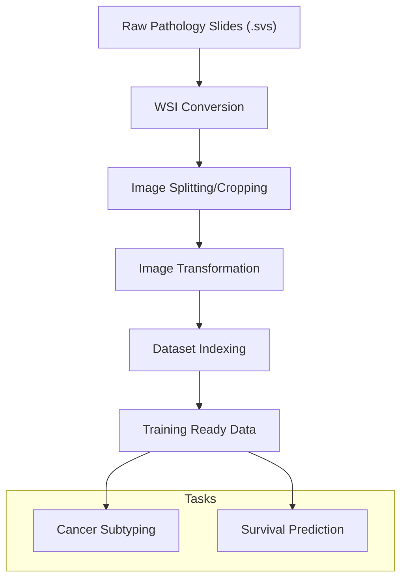
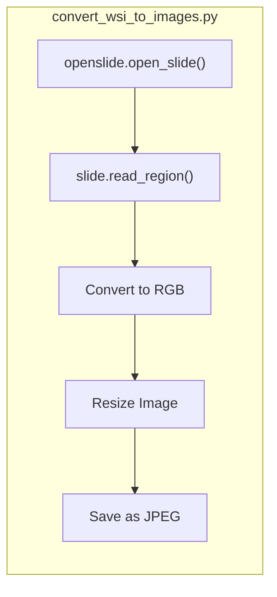
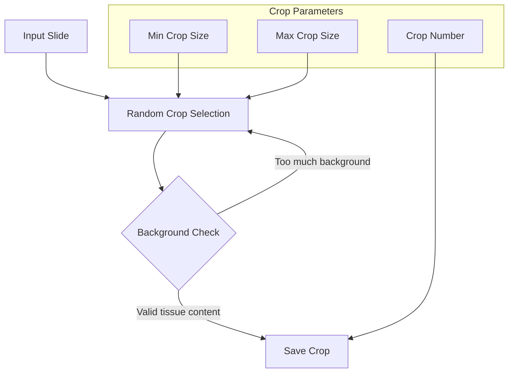
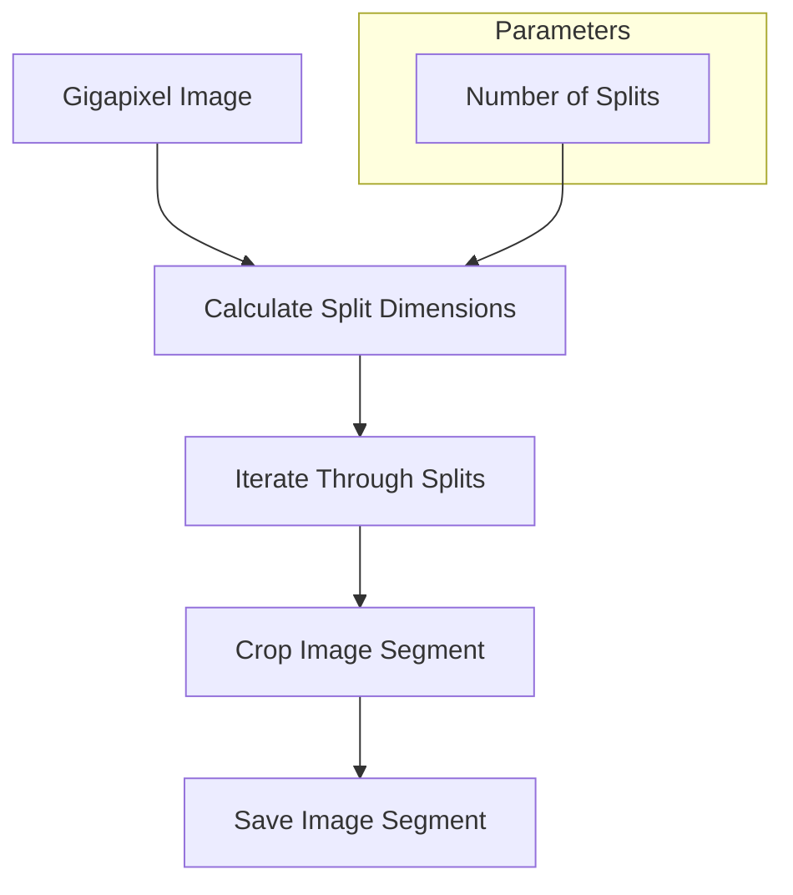
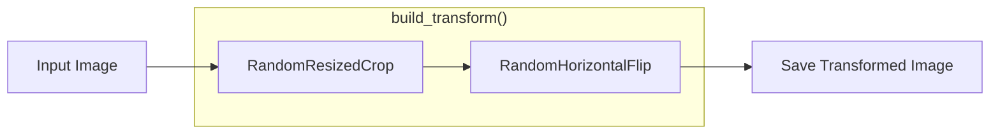
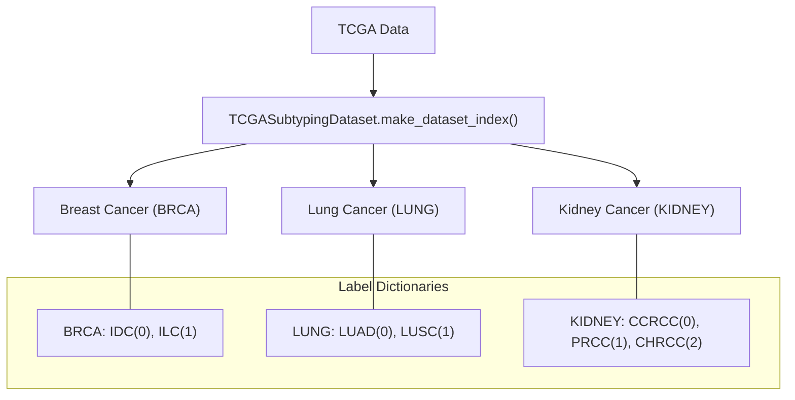
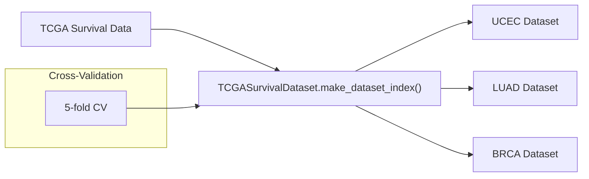
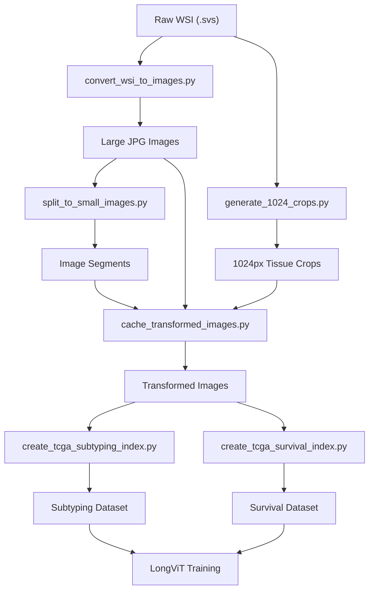

<!-- source: DeepWiki mcp.deepwiki.com · repo microsoft/torchscale · page 6.2 Data Preprocessing · fetched 2026-10-26 -->

# Data Preprocessing

Relevant source files

The following files were used as context for generating this wiki page:

- [examples/longvit/README.md](examples/longvit/README.md)
- [examples/longvit/data_preprocessing/cache_transformed_images.py](examples/longvit/data_preprocessing/cache_transformed_images.py)
- [examples/longvit/data_preprocessing/convert_wsi_to_images.py](examples/longvit/data_preprocessing/convert_wsi_to_images.py)
- [examples/longvit/data_preprocessing/create_tcga_subtyping_index.py](examples/longvit/data_preprocessing/create_tcga_subtyping_index.py)
- [examples/longvit/data_preprocessing/create_tcga_survival_index.py](examples/longvit/data_preprocessing/create_tcga_survival_index.py)
- [examples/longvit/data_preprocessing/generate_1024_crops.py](examples/longvit/data_preprocessing/generate_1024_crops.py)
- [examples/longvit/data_preprocessing/split_to_small_images.py](examples/longvit/data_preprocessing/split_to_small_images.py)

## Purpose and Scope

This document details the data preprocessing techniques and workflows used for LongViT, a vision Transformer designed to process gigapixel-scale images (up to 32,768×32,768 pixels) for computational pathology applications. The preprocessing steps focus on handling Whole Slide Images (WSI), creating appropriate training inputs, and organizing dataset indices for cancer subtyping and survival prediction tasks.

## Overview of Data Preprocessing for LongViT

LongViT requires specialized preprocessing due to the enormous size of pathology whole slide images. Standard computer vision pipelines cannot handle gigapixel-scale images directly, necessitating custom preprocessing approaches.

Sources: [examples/longvit/README.md:3-3](), [examples/longvit/data_preprocessing/convert_wsi_to_images.py:10-17]()

## Handling Whole Slide Images (WSI)

### Converting WSI to Standard Image Formats

The first step in preprocessing involves converting proprietary slide formats (typically `.svs`) to standard image formats. This is handled by the `convert_wsi_to_images.py` script.

The conversion process:
1. Opens the slide file using OpenSlide library
2. Reads the specified region at the desired pyramid level
3. Converts the image to RGB format
4. Resizes to the target dimensions
5. Saves as a standard image format (JPEG)

Sources: [examples/longvit/data_preprocessing/convert_wsi_to_images.py:10-17]()

### Generating Random Crops

For training and data augmentation purposes, random crops are generated from whole slide images using the `generate_1024_crops.py` script.

This process:
1. Selects random coordinates and dimensions for cropping
2. Extracts the crop from the WSI
3. Checks if the crop should be discarded (e.g., too much background)
4. Saves valid crops to the output directory

Background detection is performed by checking pixel similarity to a target background color (typically white/gray in pathology slides).

Sources: [examples/longvit/data_preprocessing/generate_1024_crops.py:23-86]()

## Processing Gigapixel Images

### Splitting Large Images

For extremely large images that exceed memory constraints, the `split_to_small_images.py` script divides them into manageable segments.

The splitting process:
1. Opens the large image using PIL with increased maximum pixel limit
2. Calculates dimensions for each split (typically horizontal strips)
3. Crops each segment
4. Saves individual segments as separate files

The script handles images up to 6.4 billion pixels by setting `Image.MAX_IMAGE_PIXELS = 6400000000`.

Sources: [examples/longvit/data_preprocessing/split_to_small_images.py:11-28]()

### Applying Image Transformations

After converting or splitting images, various transformations are applied using the `cache_transformed_images.py` script to prepare them for model training.

Key transformations include:
1. Random resized cropping with scaling (0.5 to 1.0) using bicubic interpolation
2. Random horizontal flipping
3. Saving the transformed images for training

Sources: [examples/longvit/data_preprocessing/cache_transformed_images.py:14-22]()

## Dataset Organization

### TCGA Subtyping Dataset Preparation

The Cancer Genome Atlas (TCGA) dataset is organized for cancer subtyping tasks using the `create_tcga_subtyping_index.py` script.

Dataset indexing involves:
1. Reading CSV files containing slide information
2. Organizing data according to 10-fold cross-validation splits
3. Handling class labels and ignoring specific subtypes
4. Creating index files for training, validation, and testing

Sources: [examples/longvit/data_preprocessing/create_tcga_subtyping_index.py:1-37]()

### TCGA Survival Prediction Dataset Preparation

For survival prediction tasks, dataset indices are created using the `create_tcga_survival_index.py` script.

The survival dataset organization:
1. Processes survival data from TCGA for uterine, lung, and breast cancers
2. Implements 5-fold cross-validation splitting
3. Creates index files for model training and evaluation

Sources: [examples/longvit/data_preprocessing/create_tcga_survival_index.py:1-11]()

## Complete Preprocessing Workflow

The full preprocessing pipeline for LongViT combines all these steps into a cohesive workflow:

This workflow enables LongViT to process gigapixel-scale pathology images efficiently by:
1. Converting proprietary formats to standard ones
2. Breaking down enormous images into manageable pieces
3. Applying appropriate transformations
4. Organizing data for specific computational pathology tasks

Sources: [examples/longvit/README.md:14-29](), [examples/longvit/data_preprocessing/convert_wsi_to_images.py:10-17](), [examples/longvit/data_preprocessing/generate_1024_crops.py:45-75](), [examples/longvit/data_preprocessing/split_to_small_images.py:11-28](), [examples/longvit/data_preprocessing/cache_transformed_images.py:14-53]()

## Technical Considerations

### Memory Management

Working with gigapixel images requires careful memory management:

- The `split_to_small_images.py` script raises PIL's maximum pixel limit: `Image.MAX_IMAGE_PIXELS = 6400000000`
- Multiprocessing is used in all preprocessing scripts to handle large workloads efficiently
- Images are processed in chunks or segments to avoid out-of-memory errors

Sources: [examples/longvit/data_preprocessing/split_to_small_images.py:8-8](), [examples/longvit/data_preprocessing/cache_transformed_images.py:1-12]()

### Quality Control

Quality control measures ensure that only informative image regions are used:

| Function | Purpose | Implementation |
|----------|---------|----------------|
| `should_discard_image()` | Removes background-dominated crops | Measures pixel similarity to background color |
| `random_crop()` | Generates diverse tissue samples | Random selection with size variations |
| `is_similar_pixel()` | Identifies background pixels | Euclidean distance threshold |

Sources: [examples/longvit/data_preprocessing/generate_1024_crops.py:23-42]()

## Conclusion

The data preprocessing pipeline for LongViT addresses the unique challenges of working with gigapixel pathology images. Through systematic conversion, cropping, transformation, and organization, it enables end-to-end training of vision transformers on extremely large images for computational pathology applications.