# Page: Overview

# Overview

<details>
<summary>Relevant source files</summary>

The following files were used as context for generating this wiki page:

- [README.md](README.md)
- [setup.py](setup.py)
- [torchscale/component/relative_position_bias.py](torchscale/component/relative_position_bias.py)
- [torchscale/component/xpos_relative_position.py](torchscale/component/xpos_relative_position.py)

</details>


TorchScale is a PyTorch library that enables researchers and developers to scale up Transformer models efficiently and effectively. This page provides a comprehensive introduction to the TorchScale repository, summarizing its purpose, key features, main components, and architecture overview. For installation details, refer to [Installation & Setup](#1.1).

Sources: [README.md:1-10]()

## Purpose and Scope

TorchScale focuses on fundamental research to develop new architectures for foundation models and AI, with specific emphasis on:

1. **Modeling Generality** - Building models that work across diverse tasks and modalities
2. **Model Capability** - Developing architectures that can handle complex problems
3. **Training Stability** - Enabling stable training of extremely deep networks
4. **Computational Efficiency** - Optimizing models for better performance with fewer resources

The library provides implementations of several innovative architectures including DeepNet, Foundation Transformers (Magneto), RetNet, LongNet, and integration with sparse Mixture-of-Experts (MoE) models.

Sources: [README.md:10-14](), [README.md:16-19]()

## Architecture Overview

TorchScale provides multiple architecture types that can be easily instantiated through a unified configuration system:

**Architecture Types Diagram**
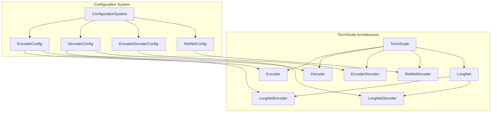

Each architecture can be instantiated using only a few lines of code through the appropriate configuration class:

```python
# Example: Creating an encoder model
from torchscale.architecture.config import EncoderConfig
from torchscale.architecture.encoder import Encoder

config = EncoderConfig(vocab_size=64000)
model = Encoder(config)
```

Sources: [README.md:53-65](), [README.md:67-85](), [README.md:89-99](), [README.md:101-114]()

## Key Architectural Innovations

TorchScale implements several cutting-edge transformer architecture innovations:

**Architectural Innovations Diagram**
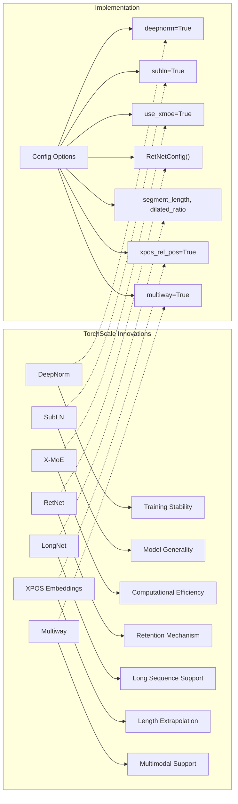

### Key Features in Detail

1. **DeepNorm**: Improves training stability of Post-LayerNorm Transformers, enabling scaling to 1,000+ layers
   - Enabled via `deepnorm=True` in the configuration
   - Adjusts residual connections and initialization based on model architecture

2. **SubLN** (Submodule LayerNorm): Enhances model generality and training stability
   - Enabled via `subln=True` (default setting)
   - Introduces additional LayerNorm to each sublayer with architecture-specific initialization
   - Note: Cannot be used alongside DeepNorm

3. **X-MoE**: Provides efficient and finetunable sparse Mixture-of-Experts modeling
   - Enabled via `use_xmoe=True`
   - Replaces every `moe_freq` feedforward layers with X-MoE layers

4. **RetNet**: Retentive Network as a successor to Transformer for large language models
   - Created using `RetNetConfig` and `RetNetDecoder`
   - Implements a multi-scale retention mechanism with multiple operational modes

5. **LongNet**: Scales transformers to handle up to 1 billion tokens
   - Implements dilated attention patterns for efficient processing of extremely long sequences
   - Requires Flash Attention for optimal performance

6. **Positional Embeddings**:
   - **XPOS**: Extrapolatable position embedding for better length generalization
   - **Relative Position Bias**: Alternative position encoding mechanism

7. **Multiway Architecture**: Enables parameter sharing across different modalities

Sources: [README.md:116-146]()

## Code Architecture to Component Mapping

**Code to Component Mapping Diagram**
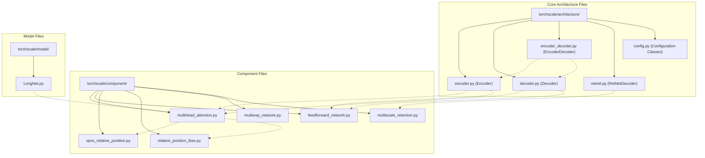

The diagram above shows the relationship between the main code files and components in TorchScale. The library is organized into architecture, component, and model modules, with configuration classes linking them together.

Sources: [README.md:1-264](), [torchscale/component/relative_position_bias.py:1-84](), [torchscale/component/xpos_relative_position.py:1-66]()

## Usage Flow

**Usage Flow Diagram**
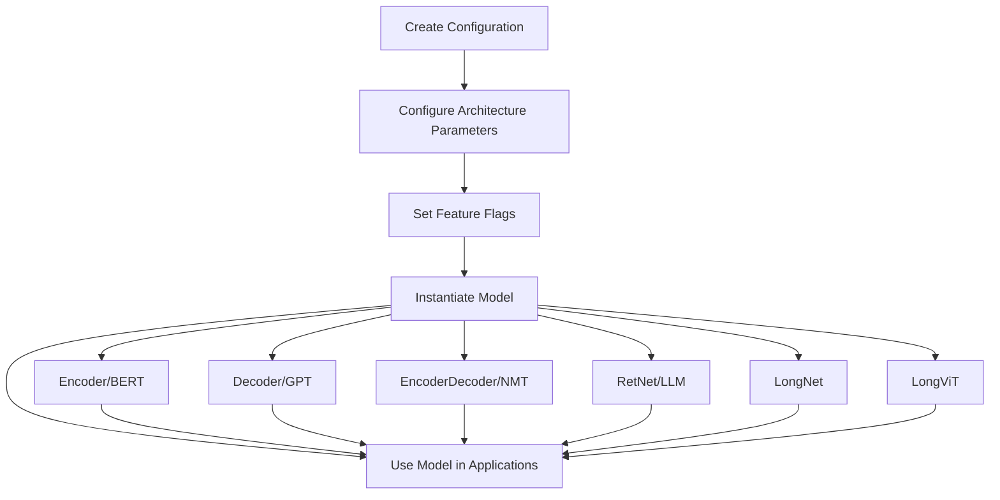

The diagram illustrates how to use TorchScale: first create a configuration with the desired parameters, then instantiate the model, and finally use it in various applications such as BERT pretraining, GPT language modeling, machine translation, or vision tasks with LongViT.

Sources: [README.md:152-159](), [README.md:162-186]()

## Integration Examples

TorchScale can be integrated with various frameworks and used for different tasks:

### Language
- Decoder/GPT models for language modeling
- Encoder-Decoder models for machine translation
- Encoder/BERT models for masked language modeling

### Vision
- LongViT for gigapixel image processing (computational pathology)

### Multimodal
- Multiway Transformers/BEiT-3 for multimodal tasks

Sources: [README.md:162-186]()

## Model Architecture Comparison

| Architecture | Primary Use Case | Key Components | Unique Features |
|--------------|------------------|----------------|-----------------|
| Encoder | Text understanding | Self-attention | BERT-like bidirectional context |
| Decoder | Text generation | Masked self-attention | GPT-like autoregressive generation |
| EncoderDecoder | Translation, summarization | Self-attention, cross-attention | Sequence-to-sequence tasks |
| RetNet | Language modeling | Multi-scale retention | Parallel, recurrent, and chunkwise modes |
| LongNet | Long-context processing | Dilated attention | Processing sequences up to 1B tokens |

Sources: [README.md:16-20](), [README.md:89-114]()

## Installation

TorchScale can be installed via pip:

```bash
pip install torchscale
```

For local development:

```bash
git clone https://github.com/microsoft/torchscale.git
cd torchscale
pip install -e .
```

For optimal performance, TorchScale can be installed with Flash Attention or xFormers for faster training on compatible GPUs.

Sources: [README.md:27-51](), [setup.py:1-25]()

## Conclusion

TorchScale provides a comprehensive library for scaling transformer models with various architectural innovations. Its modular design allows researchers and developers to easily experiment with different model architectures while benefiting from cutting-edge techniques for improving training stability, model generality, and computational efficiency.

For more detailed information about the different architectures, see [Architecture Overview](#2), or for specific components, see [Core Components](#4).

Sources: [README.md:1-264]()

---

# Page: Installation & Setup

# Installation & Setup

<details>
<summary>Relevant source files</summary>

The following files were used as context for generating this wiki page:

- [.gitignore](.gitignore)
- [README.md](README.md)
- [SUPPORT.md](SUPPORT.md)
- [setup.py](setup.py)
- [torchscale/component/relative_position_bias.py](torchscale/component/relative_position_bias.py)
- [torchscale/component/xpos_relative_position.py](torchscale/component/xpos_relative_position.py)

</details>


This page provides detailed instructions for installing and configuring TorchScale, a PyTorch library designed for efficiently scaling Transformer models. For information about specific architectural features or components, please refer to [Key Features](#1.2) and [Architecture Overview](#2).

## System Requirements

Before installing TorchScale, ensure your system meets the following requirements:

- Python >= 3.8
- PyTorch >= 1.8

## Installation Methods

### Installation Workflow

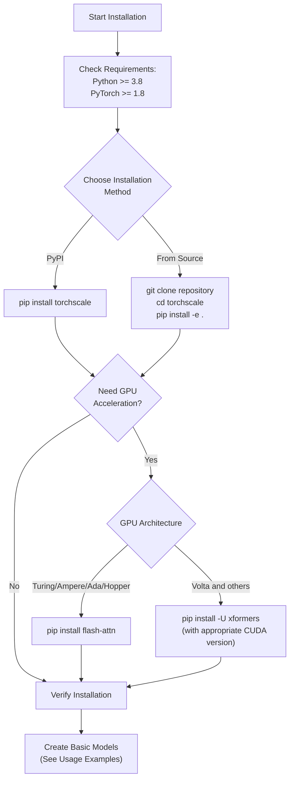

Sources: [README.md:27-51]()

### Method 1: Install from PyPI (Recommended)

The simplest way to install TorchScale is through pip:

```
pip install torchscale
```

This command installs the latest stable release along with required dependencies.

Sources: [README.md:29-32]()

### Method 2: Install from Source

For the latest development version or to contribute to the project:

```
git clone https://github.com/microsoft/torchscale.git
cd torchscale
pip install -e .
```

The `-e` flag installs the package in "editable" mode, allowing you to modify the source code with changes reflected immediately.

Sources: [README.md:34-39](), [setup.py:8-25]()

## Dependencies

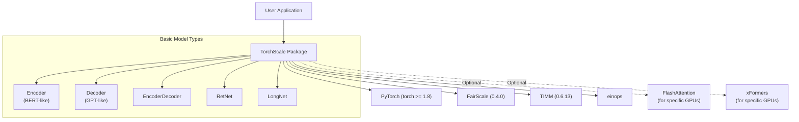

Sources: [setup.py:20](), [README.md:41-51]()

### Required Dependencies

TorchScale automatically installs the following dependencies:

| Dependency | Version Requirement | Purpose |
|------------|---------------------|---------|
| PyTorch    | >= 1.8              | Core deep learning framework |
| FairScale  | == 0.4.0            | Scaling neural networks |
| TIMM       | == 0.6.13           | PyTorch Image Models |
| einops     | (Latest)            | Tensor operations |

Sources: [setup.py:20]()

### Optional Dependencies for Performance

#### Flash Attention

For faster attention computation on Turing, Ampere, Ada, or Hopper NVIDIA GPUs:

```
pip install flash-attn
```

Sources: [README.md:41-44]()

#### xFormers

For efficient transformer operations on Volta, Turing, Ampere, Ada, or Hopper NVIDIA GPUs:

```
# For CUDA 11.8
pip install -U xformers --index-url https://download.pytorch.org/whl/cu118

# For CUDA 12.1
pip install -U xformers --index-url https://download.pytorch.org/whl/cu121
```

Sources: [README.md:45-51]()

## Verifying Installation

To verify that TorchScale is installed correctly, import the package in Python:

```python
import torchscale
# No errors should occur
```

## Basic Usage

After installation, you can quickly start using TorchScale with the following examples:

### Creating an Encoder (BERT-like) Model

```python
from torchscale.architecture.config import EncoderConfig
from torchscale.architecture.encoder import Encoder

config = EncoderConfig(vocab_size=64000)
model = Encoder(config)
```

Sources: [README.md:57-65]()

### Creating a Decoder (GPT-like) Model

```python
from torchscale.architecture.config import DecoderConfig
from torchscale.architecture.decoder import Decoder

config = DecoderConfig(vocab_size=64000)
model = Decoder(config)
```

Sources: [README.md:70-76]()

### Creating an Encoder-Decoder Model

```python
from torchscale.architecture.config import EncoderDecoderConfig
from torchscale.architecture.encoder_decoder import EncoderDecoder

config = EncoderDecoderConfig(vocab_size=64000)
model = EncoderDecoder(config)
```

Sources: [README.md:78-84]()

### Creating a RetNet Model

```python
from torchscale.architecture.config import RetNetConfig
from torchscale.architecture.retnet import RetNetDecoder

config = RetNetConfig(vocab_size=64000)
model = RetNetDecoder(config)
```

Sources: [README.md:89-98]()

### Creating a LongNet Model

For working with extremely long sequences (requires Flash Attention):

```python
from torchscale.architecture.config import EncoderConfig, DecoderConfig
from torchscale.model.longnet import LongNetEncoder, LongNetDecoder

# Encoder for long sequences
config = EncoderConfig(
    vocab_size=64000, 
    segment_length='[2048,4096]', 
    dilated_ratio='[1,2]', 
    flash_attention=True
)
model = LongNetEncoder(config)
```

Sources: [README.md:101-114]()

## Troubleshooting

If you encounter issues during installation:

1. Ensure your Python and PyTorch versions meet the requirements
2. Check that your CUDA version is compatible if using GPU acceleration
3. For Flash Attention or xFormers, verify your GPU architecture is supported
4. If installing from source, make sure all dependencies are properly installed

## Next Steps

After successful installation, you can explore TorchScale's key features and architecture:

- [Key Features](#1.2) - Learn about DeepNorm, SubLN, X-MoE, and other architectural innovations
- [Architecture Overview](#2) - Understand the different architectures available in TorchScale
- [Configuration System](#3) - Learn how to configure your models

---

# Page: Key Features

# Key Features

<details>
<summary>Relevant source files</summary>

The following files were used as context for generating this wiki page:

- [README.md](README.md)
- [torchscale/architecture/config.py](torchscale/architecture/config.py)
- [torchscale/component/xpos_relative_position.py](torchscale/component/xpos_relative_position.py)

</details>


This page provides a comprehensive overview of TorchScale's key architectural innovations and components that enable efficient scaling of transformer models. For installation instructions, see [Installation & Setup](#1.1).

TorchScale implements several architectural improvements that address common challenges in scaling transformer models, including training stability, computational efficiency, sequence length limitations, and multi-modality support.

## Core Technical Innovations

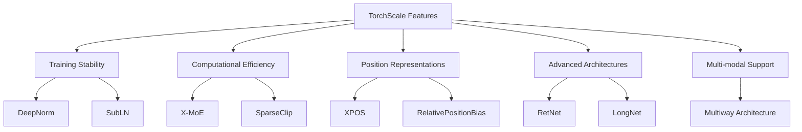

Sources: [README.md:116-148]()

## Training Stability Features

TorchScale offers two primary normalization strategies to improve training stability for deep transformer models:

### DeepNorm

DeepNorm enables stable training of transformers with hundreds or even thousands of layers by adjusting the residual connection scaling and initialization method based on the model architecture. It is an alternative to Pre-LayerNorm that maintains better performance for very deep networks.

When enabled, DeepNorm automatically:
- Disables the Pre-LayerNorm (encoder_normalize_before)
- Applies model-specific initialization based on network depth
- Uses a modified residual connection pattern

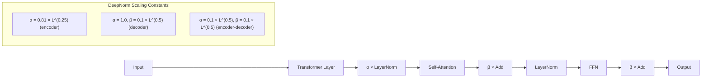

To enable DeepNorm in TorchScale:

```python
config = EncoderConfig(
    vocab_size=64000,
    deepnorm=True,
    # this will automatically set subln=False
)
```

Sources: [README.md:118-120](), [torchscale/architecture/config.py:74-77]()

### SubLN (Submodule LayerNorm)

SubLN introduces an additional LayerNorm to each sublayer (attention and feed-forward network) and adjusts initialization methods accordingly. This is enabled by default and provides better model generality and training stability.

When enabled, SubLN:
- Enforces Pre-LayerNorm (encoder_normalize_before=True)
- Applies LayerNorm at more points in the network
- Uses specialized initialization methods

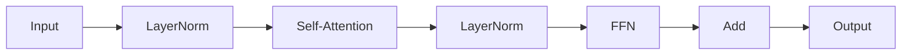

To enable SubLN (default behavior):

```python
config = EncoderConfig(
    vocab_size=64000,
    subln=True,
    # this will automatically set deepnorm=False
)
```

Sources: [README.md:122-125](), [torchscale/architecture/config.py:78-80]()

## Computational Efficiency Features

### X-MoE (Cross-Expert Mixture of Experts)

X-MoE addresses the representation collapse problem in sparse Mixture of Experts (MoE) models, enabling more efficient and finetunable sparse networks. It replaces feed-forward networks with expert layers at a configurable frequency.

Key X-MoE features:
- Improved expert specialization
- Better load balancing
- Prevents representation collapse
- Supports fine-tuning of expert layers

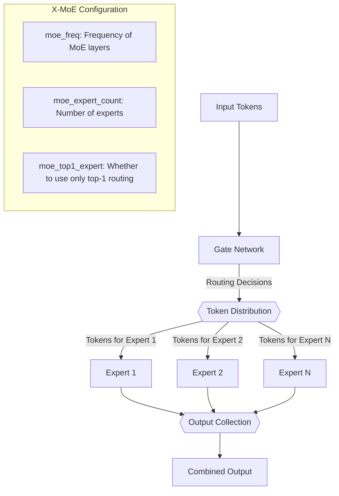

To enable X-MoE:

```python
config = EncoderConfig(
    vocab_size=64000,
    use_xmoe=True,
    moe_freq=2,  # every 2nd FFN is an MoE layer
    moe_expert_count=8,  # number of experts
)
```

Sources: [README.md:127-130](), [torchscale/architecture/config.py:81-84]()

### SparseClip

SparseClip improves gradient clipping for sparse MoE models, addressing the unique challenges of having both dense and sparse components in the network. TorchScale provides sample code for integration with training frameworks.

Sources: [README.md:141-142]()

## Position Representation Features

### XPOS (Extrapolatable Position Embedding)

XPOS enables transformer models to generalize to longer sequences than those seen during training by using a mathematically principled positional encoding that extrapolates better.

Key characteristics:
- Rotary position encoding with carefully designed decay
- Better extrapolation to unseen sequence lengths
- Integration with attention mechanism

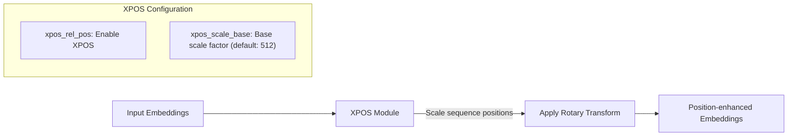

To enable XPOS:

```python
config = EncoderConfig(
    vocab_size=64000,
    xpos_rel_pos=True,
    xpos_scale_base=512,  # default value
)
```

Sources: [README.md:135-136](), [torchscale/component/xpos_relative_position.py:38-65]()

### Relative Position Bias

As an alternative to absolute position encoding, TorchScale supports relative position bias that represents the relative distance between tokens rather than their absolute positions. This often performs better for certain tasks and architectures.

To enable Relative Position Bias:

```python
config = EncoderConfig(
    vocab_size=64000,
    rel_pos_buckets=32,  # number of position buckets
    max_rel_pos=128,     # maximum relative position
)
```

Sources: [README.md:138-139]()

## Advanced Architectures

### RetNet (Retentive Network)

RetNet is designed as a successor to traditional transformer architectures for large language models, featuring multi-scale retention mechanisms that combine the advantages of recurrent neural networks and transformers.

Key characteristics:
- Three operating modes: parallel, recurrent, and chunkwise
- Multi-scale retention mechanism
- Better computational efficiency than traditional transformers
- Improved sequence modeling capabilities

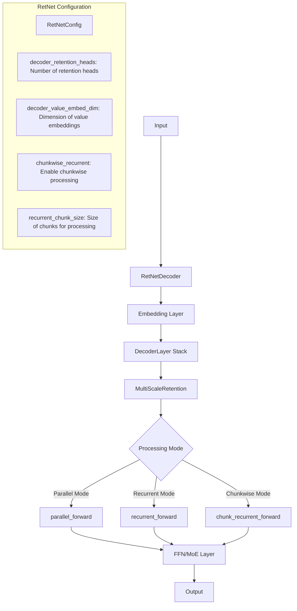

To create a RetNet model:

```python
from torchscale.architecture.config import RetNetConfig
from torchscale.architecture.retnet import RetNetDecoder

config = RetNetConfig(
    vocab_size=64000,
    decoder_retention_heads=8,
    decoder_value_embed_dim=1280,
)
retnet = RetNetDecoder(config)
```

Sources: [README.md:144-146](), [torchscale/architecture/config.py:249-297]()

### LongNet

LongNet is designed to scale transformers to extremely long contexts (up to 1 billion tokens) through dilated attention mechanisms and optimized memory usage.

Key characteristics:
- Segmented dilated attention pattern
- Flash attention integration for speed
- Support for extremely long contexts
- Configurable segment lengths and dilation ratios

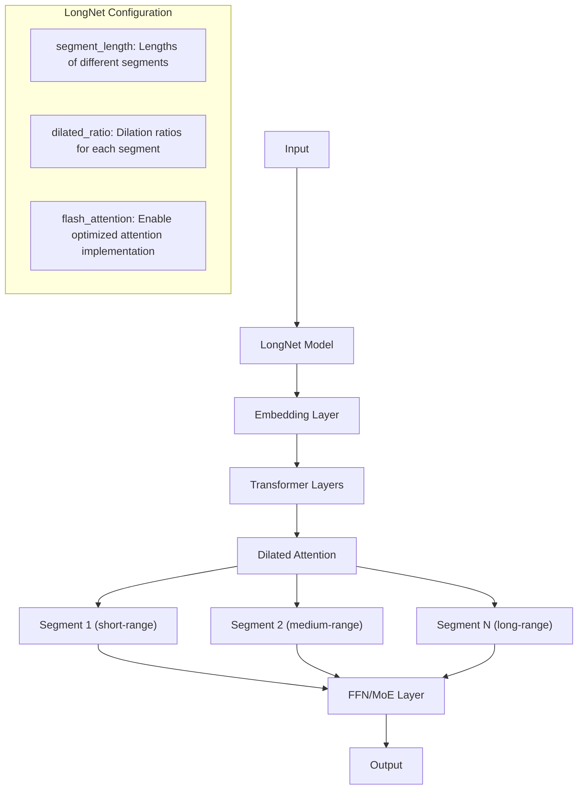

To create a LongNet model:

```python
from torchscale.architecture.config import EncoderConfig
from torchscale.model.longnet import LongNetEncoder

config = EncoderConfig(
    vocab_size=64000,
    segment_length='[2048,4096]',   # different segments for attention
    dilated_ratio='[1,2]',          # dilation ratio for each segment
    flash_attention=True,           # requires Flash Attention library
)
longnet = LongNetEncoder(config)
```

Sources: [README.md:147-148](), [torchscale/architecture/config.py:56-59]()

## Multi-modality Support

### Multiway Architecture

The multiway architecture enables models to handle multiple modalities (text, vision, speech, etc.) by providing specialized parameters for different input types while sharing core Transformer blocks.

To enable multiway architecture:

```python
config = EncoderConfig(
    vocab_size=64000,
    multiway=True,
)
```

Sources: [README.md:131-133]()

## Configuration System

TorchScale uses a unified configuration system that consistently applies these features across different model architectures through specialized config classes:

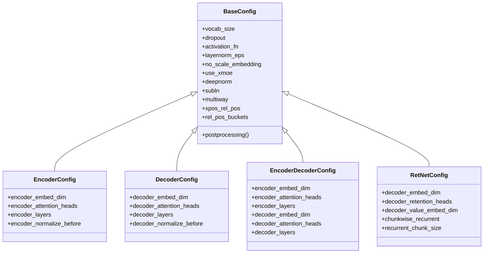

Sources: [torchscale/architecture/config.py:5-315]()

This unified configuration system simplifies the application of features across different model architectures, allowing researchers to easily experiment with different combinations of features.

---

# Page: Architecture Overview

# Architecture Overview

<details>
<summary>Relevant source files</summary>

The following files were used as context for generating this wiki page:

- [README.md](README.md)
- [torchscale/architecture/decoder.py](torchscale/architecture/decoder.py)
- [torchscale/architecture/encoder.py](torchscale/architecture/encoder.py)
- [torchscale/architecture/retnet.py](torchscale/architecture/retnet.py)
- [torchscale/component/multiscale_retention.py](torchscale/component/multiscale_retention.py)
- [torchscale/component/xpos_relative_position.py](torchscale/component/xpos_relative_position.py)

</details>


This page provides a high-level overview of the different architecture implementations available in TorchScale. We'll examine the core model architectures, how they relate to each other, and their key characteristics. For specific implementation details of individual architectures, see the dedicated pages for [Encoder Architecture](#2.1), [Decoder Architecture](#2.2), [RetNet Architecture](#2.3), and [LongNet Architecture](#2.4).

## Core Architecture Overview

TorchScale provides several foundational architectures that can be used as building blocks for various natural language processing and multimodal tasks:

1. **Encoder** - A bidirectional transformer encoder architecture (BERT-like)
2. **Decoder** - An autoregressive transformer decoder architecture (GPT-like)
3. **EncoderDecoder** - A combined encoder-decoder architecture (T5-like)
4. **RetNet** - A retention-based alternative to transformers
5. **LongNet** - A transformer variant for extremely long sequences

These architectures share common components while introducing specialized innovations for specific use cases.

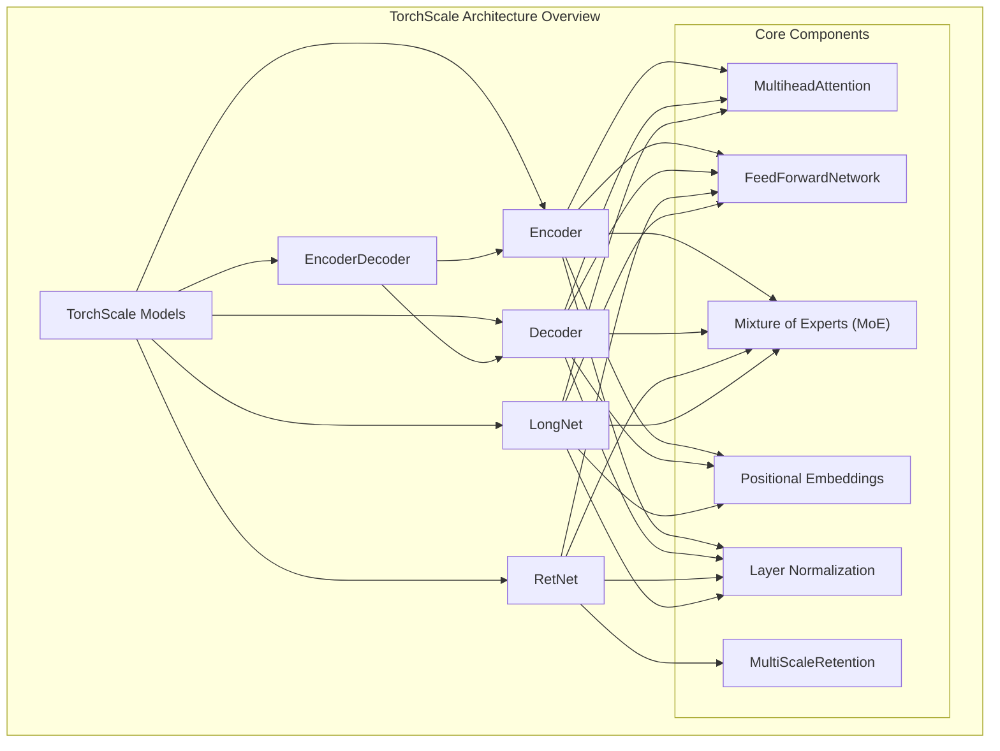

Sources: [README.md:56-85](), [torchscale/architecture/encoder.py:165-400](), [torchscale/architecture/decoder.py:210-482](), [torchscale/architecture/retnet.py:199-392]()

## Model Architecture Variations

TorchScale supports multiple variations of each architecture through a flexible configuration system, providing options for different model sizes, normalization techniques, and architectural enhancements.

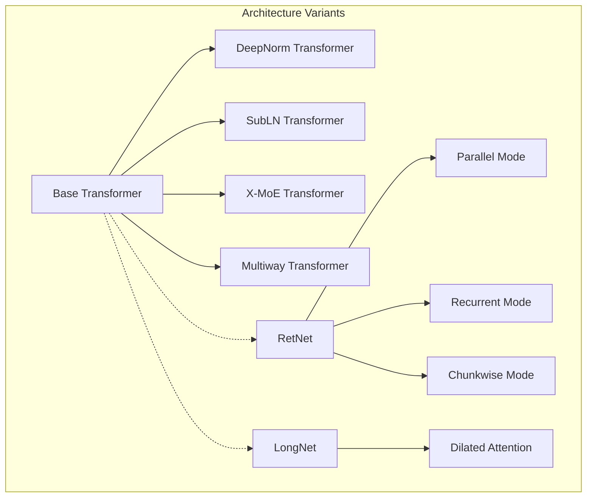

Sources: [README.md:115-147](), [torchscale/architecture/retnet.py:166-196]()

### Key Architecture Features

| Feature | Description | Enabled By |
|---------|-------------|------------|
| DeepNorm | Improves training stability of Post-LayerNorm Transformers | `deepnorm=True` |
| SubLN | Introduces another LayerNorm to each sublayer for stability and generality | `subln=True` (default) |
| X-MoE | Replaces FFN with Mixture of Experts for efficiency and scalability | `use_xmoe=True` |
| Multiway | Provides a pool of parameters for different modalities | `multiway=True` |
| XPOS | Extrapolatable position embedding | `xpos_rel_pos=True` |
| Relative Position Bias | Alternative positional encoding | Adjusting `rel_pos_buckets` and `max_rel_pos` |

Sources: [README.md:115-147]()

## Encoder Architecture

The Encoder architecture implements a bidirectional transformer encoder that processes all inputs simultaneously. It consists of multiple EncoderLayer instances stacked together.

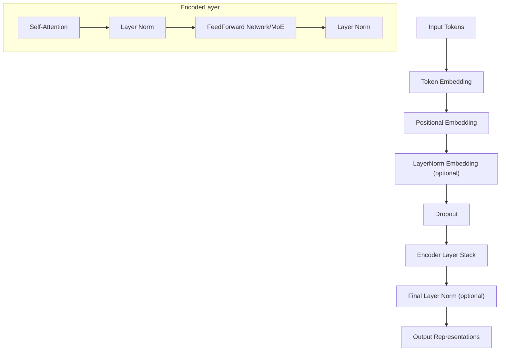

The encoder architecture is defined in [torchscale/architecture/encoder.py:165-400](), with the core layer implementation in [torchscale/architecture/encoder.py:25-162]().

Sources: [torchscale/architecture/encoder.py:165-400]()

## Decoder Architecture

The Decoder architecture implements an autoregressive transformer decoder that processes inputs sequentially. It consists of multiple DecoderLayer instances stacked together.

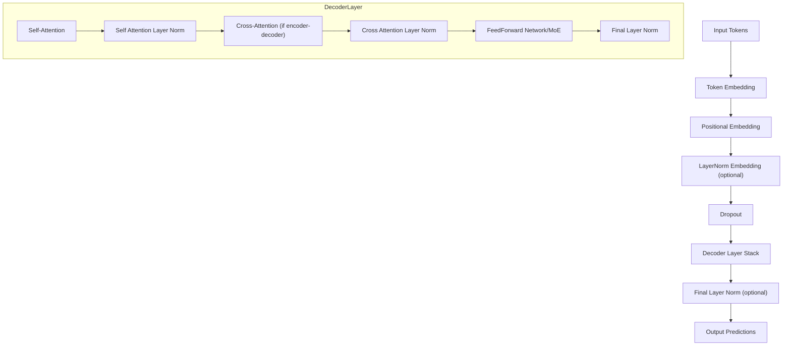

The decoder architecture is defined in [torchscale/architecture/decoder.py:210-482](), with the core layer implementation in [torchscale/architecture/decoder.py:23-208]().

Sources: [torchscale/architecture/decoder.py:210-482]()

## RetNet Architecture

RetNet (Retention Network) is a novel architecture proposed as a successor to Transformers for large language models. It replaces the attention mechanism with a Multi-Scale Retention mechanism.

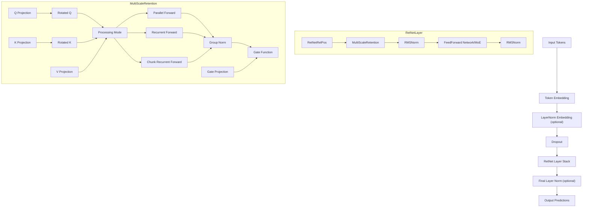

RetNet's key innovation is the MultiScaleRetention mechanism, which offers three processing modes:

1. **Parallel Mode** - Similar to attention but with O(n²) complexity
2. **Recurrent Mode** - Linear complexity O(n) for inference
3. **Chunkwise Recurrent Mode** - Balances between parallel and recurrent

The RetNet architecture is defined in [torchscale/architecture/retnet.py:199-392](), with the MultiScaleRetention implementation in [torchscale/component/multiscale_retention.py:39-204]().

Sources: [torchscale/architecture/retnet.py:199-392](), [torchscale/component/multiscale_retention.py:39-204]()

## LongNet Architecture

LongNet is designed to process extremely long sequences (up to 1 billion tokens) through a dilated attention pattern that groups tokens into segments with different dilation ratios.

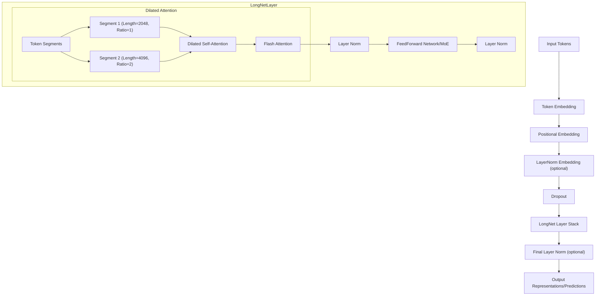

LongNet's key features:
- Segmented token representations with different dilation ratios
- Flash Attention for memory-efficient computation
- Support for sequences up to 1 billion tokens

LongNet's approach enables linear complexity relative to sequence length, making it suitable for extremely long context processing.

Sources: [README.md:102-114](), [README.md:144-148]()

## Data Flow Through Models

The following diagram illustrates how data flows through TorchScale models during forward passes:

```mermaid
flowchart TD
    Input["Input Data"] --> Config["Configuration"]
    Config --> ModelType{"Model Type"}
    
    ModelType -->|"Encoder"| Enc["Encoder Model"]
    ModelType -->|"Decoder"| Dec["Decoder Model"]
    ModelType -->|"EncoderDecoder"| EncDec["EncoderDecoder Model"]
    ModelType -->|"RetNet"| Ret["RetNet Model"]
    ModelType -->|"LongNet"| Long["LongNet Model"]
    
    Enc --> EncEmbed["Encoder Embedding"]
    EncEmbed --> EncLayers["Encoder Layers"]
    EncLayers --> EncOut["Encoder Output"]
    
    Dec --> DecEmbed["Decoder Embedding"]
    DecEmbed --> DecLayers["Decoder Layers"]
    DecLayers --> DecOut["Decoder Output"]
    
    EncDec --> EncEmbed2["Encoder Embedding"]
    EncDec --> DecEmbed2["Decoder Embedding"]
    EncEmbed2 --> EncLayers2["Encoder Layers"]
    EncLayers2 --> EncOut2["Encoder Output"]
    EncOut2 --> DecLayers2["Decoder Layers"]
    DecEmbed2 --> DecLayers2
    DecLayers2 --> EncDecOut["EncoderDecoder Output"]
    
    Ret --> RetEmbed["RetNet Embedding"]
    RetEmbed --> RetPos["RetNetRelPos"]
    RetPos --> RetLayers["RetNet Layers"]
    RetLayers --> RetOut["RetNet Output"]
    
    Long --> LongEmbed["LongNet Embedding"]
    LongEmbed --> DilAttn["Dilated Attention Layers"]
    DilAttn --> LongOut["LongNet Output"]
    
    subgraph "Layer Processing Pattern"
        LayerIn["Layer Input"] --> Norm1["Normalization"]
        Norm1 --> Attn["Attention/Retention"]
        Attn --> Drop1["Dropout"]
        Drop1 --> Add1["Residual Connection"]
        Add1 --> Norm2["Normalization"]
        Norm2 --> FFN["FFN/MoE"]
        FFN --> Drop2["Dropout"]
        Drop2 --> Add2["Residual Connection"]
        Add2 --> LayerOut["Layer Output"]
    end
```

Sources: [torchscale/architecture/encoder.py:327-399](), [torchscale/architecture/decoder.py:388-481](), [torchscale/architecture/retnet.py:328-391]()

## Extension and Configuration

TorchScale is designed to be easily configured and extended through its configuration system. Each architecture type has a corresponding configuration class that allows customization of model dimensions, number of layers, attention heads, and other architectural parameters.

```mermaid
graph TD
    subgraph "Configuration System"
        BaseConfig["Base Config Parameters"]
        BaseConfig --> EncoderConfig["EncoderConfig"]
        BaseConfig --> DecoderConfig["DecoderConfig"]
        BaseConfig --> EncoderDecoderConfig["EncoderDecoderConfig"]
        BaseConfig --> RetNetConfig["RetNetConfig"]
        
        subgraph "Common Parameters"
            VP1["vocab_size"]
            VP2["max_position_embeddings"]
            VP3["layernorm_eps"]
            VP4["dropout"]
            VP5["attention_dropout"]
            VP6["activation_fn"]
        end
        
        subgraph "Architecture Flags"
            AF1["deepnorm"]
            AF2["subln"]
            AF3["use_xmoe"]
            AF4["multiway"]
            AF5["xpos_rel_pos"]
            AF6["flash_attention"]
        end
    end
```

The configuration system provides a unified interface for creating and customizing different architectures, allowing users to easily experiment with architectural variations.

Sources: [README.md:52-159]()

## Component Relationships

The following diagram illustrates how various components in TorchScale interact with each other:

```mermaid
classDiagram
    class Encoder {
        +embed_tokens
        +embed_positions
        +layernorm_embedding
        +layers[]
        +layer_norm
        +relative_position
        +forward()
    }
    
    class Decoder {
        +embed_tokens
        +embed_positions
        +layernorm_embedding
        +layers[]
        +layer_norm
        +self_attn_relative_position
        +cross_attn_relative_position
        +forward()
    }
    
    class RetNetDecoder {
        +embed_tokens
        +layernorm_embedding
        +layers[]
        +layer_norm
        +retnet_rel_pos
        +forward()
    }
    
    class EncoderLayer {
        +self_attn
        +self_attn_layer_norm
        +ffn/moe_layer
        +final_layer_norm
        +forward()
    }
    
    class DecoderLayer {
        +self_attn
        +self_attn_layer_norm
        +encoder_attn
        +encoder_attn_layer_norm
        +ffn/moe_layer
        +final_layer_norm
        +forward()
    }
    
    class RetNetLayer {
        +retention
        +retention_layer_norm
        +ffn/moe_layer
        +final_layer_norm
        +forward()
    }
    
    class MultiheadAttention {
        +q_proj
        +k_proj
        +v_proj
        +out_proj
        +forward()
    }
    
    class MultiScaleRetention {
        +q_proj
        +k_proj
        +v_proj
        +g_proj
        +out_proj
        +parallel_forward()
        +recurrent_forward()
        +chunk_recurrent_forward()
        +forward()
    }
    
    class FeedForwardNetwork {
        +fc1
        +fc2
        +forward()
    }
    
    class MOELayer {
        +gate
        +experts[]
        +forward()
    }
    
    Encoder --> EncoderLayer
    Decoder --> DecoderLayer
    RetNetDecoder --> RetNetLayer
    
    EncoderLayer --> MultiheadAttention
    EncoderLayer --> FeedForwardNetwork
    EncoderLayer --> MOELayer
    
    DecoderLayer --> MultiheadAttention
    DecoderLayer --> FeedForwardNetwork
    DecoderLayer --> MOELayer
    
    RetNetLayer --> MultiScaleRetention
    RetNetLayer --> FeedForwardNetwork
    RetNetLayer --> MOELayer
```

Sources: [torchscale/architecture/encoder.py:25-400](), [torchscale/architecture/decoder.py:23-482](), [torchscale/architecture/retnet.py:72-392](), [torchscale/component/multiscale_retention.py:39-204]()

## Conclusion

TorchScale provides a comprehensive set of architectures for transformer-based models, with a focus on scalability, efficiency, and innovation. The library includes traditional transformer architectures (Encoder, Decoder, EncoderDecoder) as well as cutting-edge designs like RetNet and LongNet for specialized use cases.

Each architecture is highly configurable through a unified configuration system, allowing researchers and practitioners to easily experiment with different model variations. The shared components across architectures ensure consistency while enabling specific optimizations for different use cases.

For more details on specific architectures, refer to:
- [Encoder Architecture](#2.1)
- [Decoder Architecture](#2.2)
- [RetNet Architecture](#2.3)
- [LongNet Architecture](#2.4)

---

# Page: Encoder Architecture

# Encoder Architecture

<details>
<summary>Relevant source files</summary>

The following files were used as context for generating this wiki page:

- [torchscale/architecture/config.py](torchscale/architecture/config.py)
- [torchscale/architecture/encoder.py](torchscale/architecture/encoder.py)

</details>


## Purpose and Scope

This document provides a detailed technical overview of the encoder architecture within TorchScale. The encoder is the fundamental building block for transformer-based models that process input sequences, transforming them into contextual representations. This document covers the encoder's internal structure, components, configuration options, and key implementation details. For information about the decoder architecture, see [Decoder Architecture](#2.2). For RetNet and LongNet specific architectures, see their respective pages at [RetNet Architecture](#2.3) and [LongNet Architecture](#2.4).

## Overview

The TorchScale encoder follows the transformer architecture with several configurable enhancements including DeepNorm, SubLN normalization strategies, support for Mixture of Experts (MoE), and positional encoding variations. The encoder processes input sequences through a stack of identical layers, each containing self-attention and feedforward components with residual connections.

```mermaid
flowchart TD
    subgraph "Encoder Architecture"
        input["Input Tokens"] --> embeddings["Embed Tokens & Positions"]
        embeddings --> layernorm_embed["LayerNorm Embedding (optional)"]
        layernorm_embed --> encoder_stack["Encoder Layer Stack"]
        encoder_stack --> output_norm["Output LayerNorm (optional)"]
        output_norm --> output_proj["Output Projection (optional)"]
        output_proj --> output["Encoder Output"]
    end

    subgraph "EncoderLayer Components"
        layer_input["Layer Input"] --> attn_norm["Self-Attention LayerNorm"]
        attn_norm --> self_attn["MultiheadAttention"]
        self_attn --> dropout1["Dropout"]
        dropout1 --> residual1["Residual Connection"]
        residual1 --> ffn_norm["FFN LayerNorm"]
        ffn_norm --> ffn["FFN or MoE Layer"]
        ffn --> dropout2["Dropout"]
        dropout2 --> residual2["Residual Connection"]
        residual2 --> layer_output["Layer Output"]
    end
```

Sources: [torchscale/architecture/encoder.py:165-399](), [torchscale/architecture/encoder.py:25-162]()

## Configuration

The encoder is highly configurable through the `EncoderConfig` class, allowing for customization of dimensions, normalization strategies, dropout rates, and more.

| Parameter | Description | Default Value |
|-----------|-------------|---------------|
| `encoder_embed_dim` | Dimensionality of the encoder embeddings | 768 |
| `encoder_attention_heads` | Number of attention heads | 12 |
| `encoder_ffn_embed_dim` | Dimensionality of the feedforward network | 3072 |
| `encoder_layers` | Number of encoder layers | 12 |
| `encoder_normalize_before` | Apply layer norm before each encoder block | True |
| `normalize_output` | Apply layer norm to encoder output | True |
| `deepnorm` | Use DeepNorm initialization and scaling | False |
| `subln` | Use SubLN normalization strategy | True |
| `moe_freq` | Frequency of MoE layers in the stack (0 = no MoE) | 0 |
| `moe_expert_count` | Number of experts in MoE layers | 0 |
| `drop_path_rate` | Stochastic depth rate | 0.0 |
| `rel_pos_buckets` | Number of buckets for relative position bias | 0 |
| `max_rel_pos` | Maximum distance for relative position bias | 0 |
| `flash_attention` | Use Flash Attention for more efficient attention | False |

Sources: [torchscale/architecture/config.py:5-85]()

## Internal Structure

### Encoder Class Architecture

The `Encoder` class is the main implementation of the transformer encoder. It manages a stack of `EncoderLayer` instances and handles the overall flow of data through the model.

```mermaid
classDiagram
    class Encoder {
        +args: EncoderConfig
        +dropout_module: nn.Dropout
        +embed_scale: float
        +embed_tokens: nn.Embedding
        +embed_positions: PositionalEncoding
        +layernorm_embedding: LayerNorm
        +layers: nn.ModuleList
        +layer_norm: LayerNorm
        +relative_position: RelativePositionBias
        +output_projection: nn.Linear
        +forward(src_tokens, encoder_padding_mask, attn_mask, return_all_hiddens, token_embeddings, multiway_split_position)
        -forward_embedding(src_tokens, token_embedding, positions)
        -build_encoder_layer(args, depth, is_moe_layer, is_encoder_decoder)
        -build_output_projection(args)
    }
    
    class EncoderLayer {
        +args: EncoderConfig
        +embed_dim: int
        +self_attn: MultiheadAttention
        +self_attn_layer_norm: LayerNorm
        +dropout_module: nn.Dropout
        +drop_path: DropPath
        +normalize_before: bool
        +is_moe_layer: bool
        +ffn: FeedForwardNetwork or MOELayer
        +final_layer_norm: LayerNorm
        +alpha: float
        +forward(x, encoder_padding_mask, attn_mask, rel_pos, multiway_split_position)
        -build_self_attention(embed_dim, args)
        -build_ffn(embed_dim, args)
        -residual_connection(x, residual)
    }
    
    class EncoderConfig {
        +encoder_embed_dim: int
        +encoder_attention_heads: int
        +encoder_ffn_embed_dim: int
        +encoder_layers: int
        +encoder_normalize_before: bool
        +normalize_output: bool
        +deepnorm: bool
        +subln: bool
        +moe_freq: int
        +override(args)
        -postprocessing()
    }
    
    Encoder --> EncoderLayer : contains
    Encoder --> EncoderConfig : uses
    EncoderLayer --> EncoderConfig : uses
```

Sources: [torchscale/architecture/encoder.py:165-399](), [torchscale/architecture/encoder.py:25-162](), [torchscale/architecture/config.py:5-85]()

### Encoder Layer

Each encoder layer consists of a self-attention mechanism followed by a feedforward network (or an MoE layer), with residual connections and layer normalization.

```mermaid
flowchart TD
    subgraph "EncoderLayer"
        input["x"] --> conditional1{"normalize_before?"}
        conditional1 -->|"Yes"| ln1["self_attn_layer_norm"]
        ln1 --> attn["MultiheadAttention"]
        conditional1 -->|"No"| attn
        
        attn --> dropout1["Dropout"]
        dropout1 --> drop_path1["DropPath (optional)"]
        drop_path1 --> add1["+ x * alpha"]
        
        add1 --> conditional2{"normalize_before?"}
        conditional2 -->|"No"| ln2["self_attn_layer_norm"]
        ln2 --> ffn_input["FFN Input"]
        conditional2 -->|"Yes"| ffn_input
        
        ffn_input --> conditional3{"normalize_before?"}
        conditional3 -->|"Yes"| ln3["final_layer_norm"]
        ln3 --> branch{"is_moe_layer?"}
        conditional3 -->|"No"| branch
        
        branch -->|"No"| ffn["FeedForwardNetwork"]
        branch -->|"Yes"| moe["MOELayer"]
        
        ffn --> drop_path2["DropPath (optional)"]
        moe --> drop_path2
        
        drop_path2 --> add2["+ x * alpha"]
        
        add2 --> conditional4{"normalize_before?"}
        conditional4 -->|"No"| ln4["final_layer_norm"]
        ln4 --> output["Layer Output"]
        conditional4 -->|"Yes"| output
    end
```

Sources: [torchscale/architecture/encoder.py:25-162]()

## Key Components

### Embeddings and Input Processing

The encoder first converts input tokens into embeddings, optionally adds positional information, and passes them through a layer normalization and dropout:

```mermaid
flowchart LR
    input["src_tokens"] --> tokens["embed_tokens"]
    tokens --> scale["embed_scale * token_embedding"]
    positions["embed_positions"] --> add["+"]
    scale --> add
    add --> conditional{"layernorm_embedding?"}
    conditional -->|"Yes"| norm["layernorm_embedding"]
    norm --> dropout["dropout_module"]
    conditional -->|"No"| dropout
    dropout --> out["Embedded Output"]
```

Sources: [torchscale/architecture/encoder.py:308-325](), [torchscale/architecture/encoder.py:327-358]()

### Self-Attention Mechanism

The encoder uses the `MultiheadAttention` component for self-attention. This implementation supports standard attention patterns as well as relative position bias when configured:

```mermaid
flowchart TD
    query["Query (x)"] --> proj_q["q_proj"]
    key["Key (x)"] --> proj_k["k_proj"] 
    value["Value (x)"] --> proj_v["v_proj"]
    
    proj_q --> reshape_q["Reshape to [batch, heads, len, dim]"]
    proj_k --> reshape_k["Reshape to [batch, heads, len, dim]"]
    proj_v --> reshape_v["Reshape to [batch, heads, len, dim]"]
    
    reshape_q --> attn_weights["q @ k.transpose(-2, -1) / sqrt(head_dim)"]
    reshape_k --> attn_weights
    
    rel_pos["Relative Position Bias (optional)"] --> add_rel["+ rel_pos"]
    attn_weights --> add_rel
    
    mask["Key Padding Mask"] --> apply_mask["+ mask"]
    add_rel --> apply_mask
    
    apply_mask --> softmax["Softmax"]
    softmax --> attn_probs["Attention Probabilities"]
    
    attn_probs --> matmul["@ v"]
    reshape_v --> matmul
    
    matmul --> reshape_out["Reshape to [len, batch, embed_dim]"]
    reshape_out --> proj_out["out_proj"]
    proj_out --> output["Attention Output"]
```

Sources: [torchscale/architecture/encoder.py:102-111](), [torchscale/architecture/encoder.py:127-135]()

### Feedforward Network and MoE

The encoder supports both standard feedforward networks and Mixture of Experts (MoE) for more parameter-efficient scaling:

```mermaid
flowchart LR
    subgraph "Standard FFN"
        input_ffn["Input"] --> fc1["fc1 (Linear)"]
        fc1 --> activation["Activation (GELU)"]
        activation --> dropout["Dropout"]
        dropout --> fc2["fc2 (Linear)"]
        fc2 --> output_ffn["Output"]
    end
    
    subgraph "Mixture of Experts"
        input_moe["Input"] --> gate["Top1Gate/Top2Gate"]
        gate --> route["Route to Experts"]
        
        route --> expert1["Expert 1 (FFN)"]
        route --> expert2["Expert 2 (FFN)"]
        route --> expertN["Expert N (FFN)"]
        
        expert1 --> combine["Combine Outputs"]
        expert2 --> combine
        expertN --> combine
        combine --> output_moe["Output"]
    end
```

Sources: [torchscale/architecture/encoder.py:46-76](), [torchscale/architecture/encoder.py:91-100]()

### Normalization Strategies

TorchScale implements several normalization strategies, including Pre-LN (standard), DeepNorm, and SubLN:

```mermaid
flowchart TD
    subgraph "Pre-LN (normalize_before=True)"
        input1["Input"] --> ln1["LayerNorm"]
        ln1 --> sublayer1["Sublayer (Attention/FFN)"]
        sublayer1 --> add1["+ Input"]
        add1 --> output1["Output"]
    end
    
    subgraph "Post-LN (normalize_before=False)"
        input2["Input"] --> sublayer2["Sublayer (Attention/FFN)"]
        sublayer2 --> add2["+ Input"]
        add2 --> ln2["LayerNorm"]
        ln2 --> output2["Output"]
    end
    
    subgraph "DeepNorm (deepnorm=True)"
        input3["Input"] --> sublayer3["Sublayer (Attention/FFN)"]
        sublayer3 --> add3["+ Input * alpha"]
        add3 --> ln3["LayerNorm"]
        ln3 --> output3["Output"]
    end
    
    subgraph "SubLN (subln=True)"
        input4["Input"] --> ln4a["LayerNorm"]
        ln4a --> sublayer4["Sublayer (Attention/FFN)"]
        sublayer4 --> add4["+ Input"]
        add4 --> output4["Output"]
    end
```

Sources: [torchscale/architecture/encoder.py:113-163](), [torchscale/architecture/config.py:75-84]()

## Data Flow

The full data flow through the encoder during a forward pass is illustrated below:

```mermaid
sequenceDiagram
    participant Input as src_tokens
    participant Embed as Embedding Layer
    participant Layers as Encoder Layers
    participant Norm as Output LayerNorm
    participant Proj as Output Projection
    participant Output as Encoder Output
    
    Input->>Embed: forward_embedding(src_tokens)
    Note over Embed: Embed tokens, add positional embeddings
    Embed->>Layers: x (embedded tokens)
    
    loop For each encoder layer
        Layers->>Layers: Self-attention
        Layers->>Layers: Residual connection
        Layers->>Layers: FFN or MoE
        Layers->>Layers: Residual connection
    end
    
    Layers->>Norm: x (layer output)
    Note over Norm: Apply if layer_norm is not None
    Norm->>Proj: x (normalized output)
    Note over Proj: Apply if output_projection is not None
    Proj->>Output: encoder_out
    
    Note over Output: Return dict with encoder_out, encoder_embedding, encoder_padding_mask, encoder_states, l_aux
```

Sources: [torchscale/architecture/encoder.py:327-399]()

## Special Features

### Initialization Strategies

TorchScale supports special parameter initialization strategies to help with training very deep models:

1. **DeepNorm initialization**: Scales the weights of specific layers by a factor based on the depth of the network.
2. **SubLN initialization**: Scales weights by a factor derived from the logarithm of the network depth.
3. **BERT initialization**: Applies the standard BERT parameter initialization scheme.

```mermaid
flowchart TD
    subgraph "Initialization Strategies"
        net["Initialize Network"] --> cond{"Strategy?"}
        
        cond -->|"DeepNorm"| deep["Scale weights down by init_scale"]
        cond -->|"SubLN"| subln["Scale weights up by init_scale"]
        cond -->|"BERT"| bert["Apply init_bert_params"]
        
        deep --> calc1["init_scale = math.pow(8.0 * layers, 0.25)"]
        subln --> calc2["init_scale = math.sqrt(math.log(layers * 2))"]
    end
```

Sources: [torchscale/architecture/encoder.py:235-270]()

### Mixture of Experts Integration

When configured with `moe_freq > 0`, certain layers in the encoder stack are replaced with MoE layers. Each MoE layer routes tokens to different experts based on a gating mechanism:

```mermaid
flowchart TD
    subgraph "MoE Configuration"
        freq["moe_freq (e.g., 2)"] --> example["Example: In a 12-layer model, layers 2, 4, 6, 8, 10, 12 use MoE"]
        
        subgraph "MoE Layer Construction"
            gate_type{"moe_top1_expert?"}
            gate_type -->|"True"| top1["Top1Gate"]
            gate_type -->|"False"| top2["Top2Gate"]
            
            top1 --> experts1["Create experts"]
            top2 --> experts1
            experts1 --> moe["MOELayer"]
        end
    end
```

Sources: [torchscale/architecture/encoder.py:55-76](), [torchscale/architecture/encoder.py:205-215](), [torchscale/architecture/config.py:20-35]()

## Integration with Other Components

The encoder can be used in various configurations, including standalone (BERT-like models), paired with a decoder (transformer encoder-decoder models), or as part of more complex architectures like RetNet and LongNet.

```mermaid
flowchart LR
    encoder["Encoder"]
    
    encoder --> bert["BERT-like Models"]
    encoder --> ed["Encoder-Decoder Models"]
    encoder --> mm["Multiway Network for Multi-modal Tasks"]
    
    subgraph "Advanced Architectures"
        ed --> mt["Machine Translation"]
        ed --> summ["Summarization"]
        
        bert --> mlm["Masked Language Modeling"]
        bert --> class["Classification Tasks"]
    end
```

Sources: [torchscale/architecture/encoder.py:172-176](), [torchscale/architecture/config.py:37-38]()

## Performance Considerations

The encoder implementation includes several optimizations:

1. **Checkpoint Activations**: Optional gradient checkpointing to save memory
2. **Flash Attention**: Optimized attention implementation for faster processing and lower memory usage
3. **Sequence Parallel**: Distributing sequence dimensions across devices
4. **Fairscale Integration**: Support for Fully Sharded Data Parallel (FSDP)

Enabling these optimizations allows the encoder to scale to larger model sizes and sequence lengths efficiently.

Sources: [torchscale/architecture/config.py:50-60](), [torchscale/architecture/encoder.py:302-306]()

---

# Page: Decoder Architecture

# Decoder Architecture

<details>
<summary>Relevant source files</summary>

The following files were used as context for generating this wiki page:

- [torchscale/architecture/config.py](torchscale/architecture/config.py)
- [torchscale/architecture/decoder.py](torchscale/architecture/decoder.py)

</details>


## Purpose and Scope

This document details the decoder architecture in TorchScale, a modular and flexible implementation designed for both decoder-only and encoder-decoder transformer models. The decoder can be used as a standalone unit (as in GPT-style models) or in conjunction with an encoder (as in BERT-T5 style models). This page covers the implementation of the core decoder components, configuration options, and key architectural variations.

For information about the encoder architecture, see [Encoder Architecture](#2.1). For specialized architectures like RetNet and LongNet, see [RetNet Architecture](#2.3) and [LongNet Architecture](#2.4) respectively.

## Architecture Overview

The TorchScale decoder follows the standard transformer decoder architecture with several enhancements for scalability and performance. It consists of a series of stacked decoder layers, each containing self-attention mechanisms, optional cross-attention for encoder-decoder models, and feed-forward networks (which can be replaced with Mixture of Experts in specified layers).

```mermaid
flowchart TD
    subgraph "Decoder"
        Input["Input Tokens"] --> Embed["Token Embedding + Position Embedding"]
        Embed --> LNEmbed["LayerNorm Embedding (optional)"]
        LNEmbed --> DStack["DecoderLayer Stack"]
        DStack --> FinalLN["Final LayerNorm (if normalize_before)"]
        FinalLN --> OutProj["Output Projection (if not features_only)"]
        OutProj --> Output["Output"]
    end

    subgraph "DecoderLayer"
        In["Layer Input"] --> SelfAttnNorm["Self-Attention LayerNorm (if normalize_before)"]
        SelfAttnNorm --> SelfAttn["Self-Attention"]
        SelfAttn --> Dropout1["Dropout"]
        Dropout1 --> SelfAttnResid["Self-Attention Residual Connection"]
        SelfAttnResid --> CrossAttnNorm["Cross-Attention LayerNorm (if normalize_before & encoder-decoder)"]
        CrossAttnNorm --> CrossAttn["Cross-Attention (if encoder-decoder)"]
        CrossAttn --> Dropout2["Dropout (if encoder-decoder)"]
        Dropout2 --> CrossAttnResid["Cross-Attention Residual Connection (if encoder-decoder)"]
        CrossAttnResid --> FFNNorm["FFN LayerNorm (if normalize_before)"]
        FFNNorm --> FFN["Feed-Forward Network or MoE"]
        FFN --> Dropout3["Dropout"]
        Dropout3 --> FFNResid["FFN Residual Connection"]
        FFNResid --> Out["Layer Output"]
    end

    DStack -.-> DecoderLayer1["DecoderLayer 1"]
    DStack -.-> DecoderLayer2["DecoderLayer 2"]
    DStack -.-> DecoderLayerN["DecoderLayer N"]
```

Sources: [torchscale/architecture/decoder.py:210-482](), [torchscale/architecture/decoder.py:23-207]()

## Decoder Components

### Decoder Class

The `Decoder` class is the main container for the decoder architecture. It handles:

1. Token and position embeddings
2. Layer normalization of embeddings (if configured)
3. Creation and management of decoder layers
4. Final layer normalization
5. Output projection to vocabulary size
6. Support for relative position biases
7. Initialization strategies (BERT init, DeepNorm, SubLN)

```mermaid
classDiagram
    class Decoder {
        +embed_tokens
        +embed_positions
        +layernorm_embedding
        +layers[DecoderLayer]
        +layer_norm
        +self_attn_relative_position
        +cross_attn_relative_position
        +output_projection
        +forward(prev_output_tokens, encoder_out, etc)
        -forward_embedding(tokens)
        -build_decoder_layer(args, depth, is_moe_layer)
        -output_layer(features)
    }
    
    class DecoderLayer {
        +self_attn
        +self_attn_layer_norm
        +encoder_attn
        +encoder_attn_layer_norm
        +ffn/moe_layer
        +final_layer_norm
        +forward(x, encoder_out, etc)
    }
    
    Decoder --> "N" DecoderLayer : contains
```

Sources: [torchscale/architecture/decoder.py:210-482]()

### DecoderLayer

The `DecoderLayer` class implements a single transformer decoder layer with the following components:

1. Self-attention mechanism for attending to previous positions
2. Cross-attention mechanism for attending to encoder outputs (in encoder-decoder models)
3. Feed-forward network or Mixture of Experts (MoE) layer
4. Layer normalization and residual connections
5. Support for DropPath regularization

Sources: [torchscale/architecture/decoder.py:23-207]()

## Configuration Options

The decoder architecture is highly configurable through the `DecoderConfig` class, which provides the following key options:

| Parameter | Description | Default Value |
|-----------|-------------|---------------|
| `decoder_embed_dim` | Dimension of embedding vectors | 768 |
| `decoder_attention_heads` | Number of attention heads | 12 |
| `decoder_ffn_embed_dim` | Feed-forward network dimension | 3072 |
| `decoder_layers` | Number of decoder layers | 12 |
| `decoder_normalize_before` | Apply layer norm before each component | True |
| `dropout` | Dropout probability | 0.0 |
| `drop_path_rate` | DropPath regularization rate | 0.0 |
| `moe_freq` | Frequency of MoE layers | 0 |
| `moe_expert_count` | Number of experts in MoE layers | 0 |
| `deepnorm` | Use DeepNorm initialization and normalization | False |
| `subln` | Use SubLN initialization and normalization | True |
| `layernorm_embedding` | Apply layer norm after embeddings | False |
| `rel_pos_buckets` | Number of relative position buckets | 0 |
| `max_rel_pos` | Maximum relative position | 0 |
| `xpos_rel_pos` | Use XPOS relative positioning | False |
| `flash_attention` | Use optimized flash attention | False |

Sources: [torchscale/architecture/config.py:87-161]()

## Normalization Strategies

TorchScale implements multiple normalization strategies for improved stability and performance in deep transformer models:

```mermaid
flowchart LR
    subgraph "Normalization Strategies"
        direction TB
        
        A["Standard Pre-LayerNorm"] --> |"normalize_before=True"| A1["Apply LayerNorm before\nself-attention and FFN"]
        
        B["DeepNorm"] --> |"deepnorm=True"| B1["Post-LayerNorm with\nscaled residual connections"]
        B1 --> |"alpha = (2L)^0.25 or (3L)^0.25"| B2["x = alpha·residual + sublayer(x)"]
        
        C["SubLN"] --> |"subln=True"| C1["Pre-LayerNorm with\nscaled sublayer parameters"]
        C1 --> |"scale = sqrt(log(2L))\nor sqrt(log(3L))"| C2["Scale weights of Q,K,V\nand FFN projections"]
    end
```

Sources: [torchscale/architecture/decoder.py:87-96](), [torchscale/architecture/decoder.py:299-314](), [torchscale/architecture/config.py:152-157]()

## Mixture of Experts Integration

TorchScale supports Mixture of Experts (MoE) at configurable frequencies within the decoder. When activated, the feed-forward network in specified layers is replaced with a set of expert networks and a routing mechanism.

```mermaid
flowchart TD
    subgraph "Standard Decoder Layer"
        SelfAttn1["Self Attention"] --> FFN1["Feed-Forward Network"]
    end
    
    subgraph "MoE Decoder Layer"
        SelfAttn2["Self Attention"] --> MoERouter["Router (Top1Gate or Top2Gate)"]
        MoERouter --> Expert1["Expert 1"]
        MoERouter --> Expert2["Expert 2"]
        MoERouter --> ExpertN["Expert N"]
        Expert1 --> MoECombiner["Combine Outputs"]
        Expert2 --> MoECombiner
        ExpertN --> MoECombiner
    end
    
    ConfigMoE["moe_freq = X\nmoe_expert_count = N"] --> |"Controls which layers\nuse MoE"| MoERouter
```

The MoE implementation supports:
- Top-1 or Top-2 expert routing
- Configurable number of experts
- X-MoE for better performance and stability
- Load balancing and capacity control

Sources: [torchscale/architecture/decoder.py:57-85](), [torchscale/architecture/decoder.py:194-198](), [torchscale/architecture/config.py:101-112]()

## Position Representations

TorchScale provides multiple position representation methods for the decoder:

1. **Absolute Position Embeddings**: Standard learned position embeddings
2. **Relative Position Bias**: Adds relative position information to attention scores
3. **XPOS (Extrapolatable Position Embeddings)**: Improve generalization to longer sequences

```mermaid
flowchart LR
    subgraph "Position Representations"
        A["Absolute Positions"] --> |"Default"| A1["Learned position\nembeddings"]
        
        B["Relative Position Bias"] --> |"rel_pos_buckets > 0\nmax_rel_pos > 0"| B1["RelativePositionBias\ncomponent"]
        
        C["XPOS"] --> |"xpos_rel_pos=True"| C1["Extrapolatable\nPosition Embeddings"]
    end
```

Sources: [torchscale/architecture/decoder.py:267-281](), [torchscale/architecture/config.py:131-132]()

## Forward Pass and Data Flow

The forward pass through the decoder follows these steps:

```mermaid
flowchart TD
    Start["Start"] --> Embed["Token + Position Embedding"]
    Embed --> EmbedLN["Embedding LayerNorm (if configured)"]
    EmbedLN --> EmbedDrop["Embedding Dropout"]
    
    EmbedDrop --> PosRel["Calculate Relative Position Bias (if configured)"]
    
    PosRel --> Layers["Process through each DecoderLayer"]
    
    Layers --> FinalLN["Apply Final LayerNorm (if configured)"]
    
    FinalLN --> CheckFeatures{"features_only?"}
    CheckFeatures -->|"Yes"| ReturnFeatures["Return Features"]
    CheckFeatures -->|"No"| OutProj["Apply Output Projection"]
    OutProj --> ReturnOutputs["Return Outputs"]
```

### Incremental Decoding

For autoregressive generation, the decoder supports incremental decoding where tokens are generated one at a time, reusing cached states from previous steps:

```mermaid
flowchart TD
    Start["Start"] --> FirstStep{"First step?"}
    
    FirstStep -->|"Yes"| ProcessAll["Process all input tokens"]
    FirstStep -->|"No"| ProcessLast["Process only the last token"]
    
    ProcessAll --> CacheStates["Cache key/value states"]
    ProcessLast --> UseCache["Use cached states + new token"]
    
    CacheStates --> NextToken["Generate next token"]
    UseCache --> NextToken
    
    NextToken --> CheckDone{"Generation complete?"}
    CheckDone -->|"No"| ProcessLast
    CheckDone -->|"Yes"| End["End"]
```

Sources: [torchscale/architecture/decoder.py:351-381](), [torchscale/architecture/decoder.py:388-478]()

## Encoder-Decoder Integration

When used in an encoder-decoder setup, the decoder receives encoded representations from an encoder and processes them through the cross-attention mechanism:

```mermaid
flowchart LR
    subgraph "Encoder"
        EncInput["Input"] --> EncLayers["Encoder Layers"]
        EncLayers --> EncOut["Encoder Output"]
    end
    
    subgraph "Decoder"
        DecInput["Decoder Input"] --> SelfAttn["Self-Attention"]
        SelfAttn --> CrossAttn["Cross-Attention"]
        CrossAttn --> FFN["Feed-Forward Network"]
        FFN --> DecOut["Decoder Output"]
    end
    
    EncOut ---> CrossAttn
```

Cross-attention layers are only created when the decoder is initialized with `is_encoder_decoder=True`.

Sources: [torchscale/architecture/decoder.py:50-55](), [torchscale/architecture/decoder.py:169-189]()

## Performance Optimizations

TorchScale includes several optimizations for improving training and inference performance:

1. **Checkpoint Activations**: Reduces memory consumption during training by recomputing activations in the backward pass
2. **FSDP (Fully Sharded Data Parallel)**: Supports model parallelism across multiple devices
3. **Flash Attention**: Optional optimized attention implementation for faster computation
4. **Sequence Parallelism**: Option for improved parallel processing of long sequences

Sources: [torchscale/architecture/config.py:134-137](), [torchscale/architecture/decoder.py:345-348]()

## Initialization Strategies

The decoder supports multiple initialization strategies for improved training stability:

1. **BERT Initialization**: Initializes weights following the BERT strategy
2. **DeepNorm Initialization**: Scales output projection weights by a factor based on the number of layers
3. **SubLN Initialization**: Scales weights of Q, K, V, and FFN projections

These initialization strategies are particularly important for very deep models to ensure stable gradient flow.

Sources: [torchscale/architecture/decoder.py:283-314]()

---

# Page: RetNet Architecture

# RetNet Architecture

<details>
<summary>Relevant source files</summary>

The following files were used as context for generating this wiki page:

- [examples/fairseq/models/retnet.py](examples/fairseq/models/retnet.py)
- [torchscale/architecture/retnet.py](torchscale/architecture/retnet.py)
- [torchscale/component/multiscale_retention.py](torchscale/component/multiscale_retention.py)

</details>


## Purpose and Scope

This document provides a technical overview of RetNet (Retention Network), an architecture that replaces traditional Transformer self-attention with a retention mechanism. This document focuses on RetNet's core components, operating modes, and implementation details. For information about other architectures in TorchScale, see [Architecture Overview](#2).

## 1. RetNet Overview

RetNet is a neural network architecture designed as an alternative to Transformers, replacing self-attention with a retention mechanism while maintaining competitive performance. RetNet's key innovation is the MultiScaleRetention mechanism, which supports three distinct operational modes that enable flexible computation for different scenarios.

```mermaid
flowchart TD
    subgraph "RetNet Architecture"
        Input["Input Tokens"] --> Embedding["Token Embedding"]
        Embedding --> Layers["Decoder Layer Stack"]
        Layers --> Output["Output Projection"]
        
        subgraph "DecoderLayer"
            Input2["Layer Input"] --> Norm1["Retention LayerNorm"]
            Norm1 --> MSR["MultiScaleRetention"]
            MSR --> Dropout1["Dropout"]
            Dropout1 --> Res1["Residual Connection"]
            Res1 --> Norm2["FFN LayerNorm"]
            Norm2 --> FFN["Feedforward Network/MoE"]
            FFN --> Dropout2["Dropout"]
            Dropout2 --> Res2["Residual Connection"]
        end
    end
```

Sources: [torchscale/architecture/retnet.py:199-391](), [torchscale/architecture/retnet.py:71-196]()

## 2. Core Components

### 2.1 RetNetDecoder

The `RetNetDecoder` is the main class implementing the RetNet architecture. It manages:

- Token embedding layer
- Stack of decoder layers
- Positional encoding via `RetNetRelPos`
- Output projection

The decoder supports different operating modes and can be configured with various parameters such as embedding dimension, number of layers, and normalization strategies.

```mermaid
classDiagram
    class RetNetDecoder {
        +embed_tokens
        +layers[DecoderLayer]
        +retnet_rel_pos
        +output_projection
        +forward()
        +forward_embedding()
    }
    
    class DecoderLayer {
        +retention
        +ffn
        +moe_layer
        +forward()
    }
    
    class RetNetRelPos {
        +angle
        +decay
        +forward()
    }
    
    RetNetDecoder --> DecoderLayer : contains
    RetNetDecoder --> RetNetRelPos : uses
    DecoderLayer --> "MultiScaleRetention" : contains
```

Sources: [torchscale/architecture/retnet.py:199-391]()

### 2.2 DecoderLayer

Each `DecoderLayer` consists of:

1. A `MultiScaleRetention` module (replacing self-attention)
2. A feedforward network (FFN) or Mixture of Experts (MoE) layer
3. Layer normalization and residual connections

Like transformer layers, RetNet uses residual connections and normalization, but it can be configured to use different normalization strategies such as:
- DeepNorm, which scales residual connections by a factor related to network depth
- Layer normalization before or after each component

Sources: [torchscale/architecture/retnet.py:71-196]()

### 2.3 MultiScaleRetention

The `MultiScaleRetention` module is the core innovation of RetNet, replacing self-attention with a retention mechanism. Key features include:

- Query, key, value, and gate projections (`q_proj`, `k_proj`, `v_proj`, `g_proj`)
- Support for three distinct processing modes
- Rotary positional encoding integration via theta shifting
- Gating mechanism to control information flow

```mermaid
flowchart TD
    Input["Input"] --> QProj["q_proj\n(Query Projection)"]
    Input --> KProj["k_proj\n(Key Projection)"]
    Input --> VProj["v_proj\n(Value Projection)"]
    Input --> GProj["g_proj\n(Gate Projection)"]
    
    QProj --> ThetaQ["theta_shift\n(Query)"]
    KProj --> ThetaK["theta_shift\n(Key)"]
    
    ThetaQ --> Mode{"Processing Mode"}
    ThetaK --> Mode
    VProj --> Mode
    
    Mode -->|"Parallel"| PF["parallel_forward"]
    Mode -->|"Recurrent"| RF["recurrent_forward"]
    Mode -->|"Chunkwise"| CF["chunk_recurrent_forward"]
    
    PF --> GN["group_norm"]
    RF --> GN
    CF --> GN
    
    GN --> Gate["Gate Application"]
    GProj --> Gate
    
    Gate --> OutProj["out_proj"]
    OutProj --> Output["Output"]
```

Sources: [torchscale/component/multiscale_retention.py:39-202]()

### 2.4 RetNetRelPos

The `RetNetRelPos` class manages positional encoding for RetNet:

- Uses sine/cosine functions similar to transformers
- Supports exponential decay factors for different attention heads
- Generates different mask patterns for each processing mode
- Provides specialized patterns for chunkwise recurrent processing

Sources: [torchscale/architecture/retnet.py:22-69]()

## 3. Processing Modes

A key feature of RetNet is its support for three distinct processing modes, allowing flexible computation for different scenarios:

```mermaid
flowchart LR
    subgraph "RetNet Processing Modes"
        direction TB
        P["Parallel Mode"] --- Features["- Full parallelism\n- Higher memory usage\n- Better for training"]
        R["Recurrent Mode"] --- Features2["- Sequential processing\n- Lower memory usage\n- Better for inference"]
        C["Chunkwise Mode"] --- Features3["- Hybrid approach\n- Balanced efficiency\n- Processes chunks"]
    end
```

### 3.1 Parallel Mode

Parallel mode computes attention for all tokens simultaneously, similar to traditional transformers:

- Computes the full query-key matrix for the entire sequence
- Applies the scaled matrix to values
- Memory usage scales quadratically with sequence length
- Ideal for training where parallelism is beneficial

Implementation details:
```python
# Computes QK matrix and applies mask
qk_mat = qr @ kr.transpose(-1, -2)
qk_mat = qk_mat * mask
# Normalizes for stability
qk_mat = qk_mat / qk_mat.detach().abs().sum(dim=-1, keepdim=True).clamp(min=1, max=5e4)
# Matrix multiplication with values
output = torch.matmul(qk_mat, vr)
```

Sources: [torchscale/component/multiscale_retention.py:76-87]()

### 3.2 Recurrent Mode

Recurrent mode processes tokens sequentially, updating a persistent state:

- Maintains a state matrix that gets updated with each new token
- Memory usage scales linearly with sequence length
- Ideal for inference where tokens are processed one by one
- Uses decay factors to control how quickly past information is forgotten

Implementation details:
```python
# Update state with new key-value pair
if "prev_key_value" in incremental_state:
    prev_kv = incremental_state["prev_key_value"]
    prev_scale = incremental_state["scale"]
    scale = prev_scale * decay + 1
    kv = prev_kv * (prev_scale.sqrt() * decay / scale.sqrt()).view(self.num_heads, 1, 1) + kv / scale.sqrt().view(self.num_heads, 1, 1)
else:
    scale = torch.ones_like(decay)
```

Sources: [torchscale/component/multiscale_retention.py:89-112]()

### 3.3 Chunkwise Recurrent Mode

Chunkwise mode is a hybrid approach that processes the sequence in chunks:

- Divides the sequence into chunks of specified size (`recurrent_chunk_size`)
- Processes tokens within each chunk in parallel
- Processes relationships between chunks recurrently
- Balances computational efficiency and memory usage
- Configurable via `chunkwise_recurrent` and `recurrent_chunk_size` parameters

Implementation details:
- Computes inner-chunk attention (`inner_output`)
- Accumulates cross-chunk information using a recurrent state (`kv_state`)
- Combines both inner and cross information with appropriate scaling

Sources: [torchscale/component/multiscale_retention.py:114-165]()

## 4. Integration with Fairseq

RetNet integrates with the Fairseq library through model registration and architecture definitions:

```mermaid
flowchart TD
    subgraph "RetNet in Fairseq"
        FairseqLM["FairseqLanguageModel"] --> RetNetLM["RetNetLanguageModel"]
        RetNetLM --> Config["RetNetConfig"]
        RetNetLM --> Decoder["LMDecoder (RetNetDecoder)"]
        
        Register["@register_model('retnet')"] --> RetNetLM
        
        subgraph "Architecture Variants"
            Base["retnet_base"]
            Medium["retnet_medium"]
            XL["retnet_xl"]
            Large3B["retnet_3b"]
            Large7B["retnet_7b"]
            Large13B["retnet_13b"]
            Large65B["retnet_65b"]
        end
    end
```

The codebase provides several predefined model configurations:

| Architecture | Embed Dim | Value/FFN Dim | Heads | Layers | Approx. Parameters |
|--------------|-----------|---------------|-------|--------|-------------------|
| base         | 512       | 864           | 2     | 6      | ~10M              |
| medium       | 1024      | 1728          | 4     | 16     | ~100M             |
| xl           | 2048      | 3456          | 8     | 24     | ~1B               |
| 3b           | 2560      | 4280          | 10    | 32     | ~3B               |
| 7b           | 4096      | 6912          | 16    | 32     | ~7B               |
| 13b          | 5120      | 8560          | 20    | 40     | ~13B              |
| 65b          | 8192      | 13824         | 32    | 64     | ~65B              |

Sources: [examples/fairseq/models/retnet.py:1-387]()

## 5. Key Configuration Parameters

RetNet can be customized through various configuration parameters:

| Parameter | Description | Default |
|-----------|-------------|---------|
| `decoder_embed_dim` | Dimension of token embeddings | 512 |
| `decoder_value_embed_dim` | Dimension of value embeddings | 864 |
| `decoder_ffn_embed_dim` | Dimension of feedforward network | 864 |
| `decoder_retention_heads` | Number of retention heads | 2 |
| `decoder_layers` | Number of decoder layers | 6 |
| `decoder_normalize_before` | Apply normalization before each block | True |
| `chunkwise_recurrent` | Enable chunkwise recurrent mode | False |
| `recurrent_chunk_size` | Size of chunks in chunkwise mode | 512 |
| `deepnorm` | Use DeepNorm normalization strategy | False |
| `moe_freq` | Frequency of MoE layers | 0 |
| `activation_fn` | Activation function | "swish" |

Sources: [examples/fairseq/models/retnet.py:32-187](), [torchscale/architecture/retnet.py:199-267]()

## 6. Forward Pass Flow

The forward pass through RetNet follows these steps:

```mermaid
sequenceDiagram
    participant Input as "Input Tokens"
    participant Embed as "Embedding Layer"
    participant RelPos as "RetNetRelPos"
    participant Layers as "Decoder Layers"
    participant Output as "Output Projection"
    
    Input->>Embed: forward_embedding()
    Embed->>RelPos: retnet_rel_pos.forward()
    RelPos-->>Layers: retention_rel_pos
    
    loop Each Decoder Layer
        Layers->>Layers: retention.forward()
        Layers->>Layers: ffn/moe_layer()
    end
    
    Layers->>Output: output_layer()
```

1. Tokens are embedded using `forward_embedding()`
2. Positional encoding is computed using `retnet_rel_pos.forward()`
3. For each decoder layer:
   - Apply MultiScaleRetention with the appropriate mode
   - Apply feedforward network or MoE layer
   - Add residual connections and normalization
4. Apply final layer normalization if needed
5. Project to vocabulary size via the output projection

During inference, RetNet can operate in "incremental" mode, maintaining a state between forward passes to process tokens one by one efficiently.

Sources: [torchscale/architecture/retnet.py:328-391](), [torchscale/architecture/retnet.py:154-196]()

---

# Page: LongNet Architecture

# LongNet Architecture

<details>
<summary>Relevant source files</summary>

The following files were used as context for generating this wiki page:

- [README.md](README.md)
- [examples/fairseq/README.md](examples/fairseq/README.md)
- [examples/longvit/README.md](examples/longvit/README.md)
- [torchscale/component/xpos_relative_position.py](torchscale/component/xpos_relative_position.py)

</details>


## Purpose and Scope

This document provides a detailed explanation of the LongNet architecture in TorchScale. LongNet is designed to scale Transformer models to extremely long sequences—up to 1,000,000,000 tokens—by using dilated attention patterns. This document covers the architectural design, key components, configuration options, and implementation details of LongNet. For information about RetNet architecture, see [RetNet Architecture](#2.3).

## Architecture Overview

LongNet addresses the quadratic complexity problem of standard Transformer attention by introducing a segmented dilated attention mechanism. Instead of having each token attend to all other tokens (which would be computationally prohibitive for very long sequences), LongNet introduces a dilated attention pattern where tokens attend to other tokens at specific intervals.

```mermaid
graph TD
    subgraph "LongNet Architecture"
        Input["Input Sequence"] --> Segmentation["Sequence Segmentation"]
        Segmentation --> S1["Segment 1<br>Length: segment_length[0]<br>Dilation: dilated_ratio[0]"]
        Segmentation --> S2["Segment 2<br>Length: segment_length[1]<br>Dilation: dilated_ratio[1]"]
        S1 --> DA1["Dilated Attention"]
        S2 --> DA2["Dilated Attention"]
        DA1 --> FA["Flash Attention (Optional)"]
        DA2 --> FA
        FA --> FFN["Feed Forward Network"]
        FFN --> Output["Output Representation"]
    end
```

Sources: [README.md:19](), [README.md:101-114]()

## Dilated Attention Mechanism

The key innovation in LongNet is its dilated attention mechanism, which reduces the computational complexity while maintaining the model's ability to capture dependencies across long distances.

```mermaid
graph TD
    subgraph "Regular vs. Dilated Attention"
        T["Tokens: 0 1 2 3 4 5 6 7 8 9"]
        
        T --> R["Regular Attention (Dilation=1)<br>Token 0 attends to: 0,1,2,3,...<br>Token 1 attends to: 0,1,2,3,..."]
        T --> D1["Dilated Attention (Dilation=2)<br>Token 0 attends to: 0,2,4,6,8<br>Token 1 attends to: 1,3,5,7,9"]
        T --> D2["Dilated Attention (Dilation=4)<br>Token 0 attends to: 0,4,8<br>Token 1 attends to: 1,5,9<br>Token 2 attends to: 2,6<br>Token 3 attends to: 3,7"]
    end
```

When using dilated attention:

1. The input sequence is divided into segments based on the `segment_length` parameter
2. Each segment uses a different dilation ratio specified by the `dilated_ratio` parameter
3. Tokens only attend to other tokens at intervals determined by the dilation ratio
4. This creates a sparse attention pattern that scales better for long sequences

Sources: [README.md:148](), [README.md:107-108]()

## Implementation Details

In TorchScale, LongNet is implemented as two main classes:

```mermaid
graph TD
    subgraph "LongNet Implementation"
        TorchScale["TorchScale Library"] --> Models["Model Architectures"]
        Models --> LongNet["LongNet"]
        
        LongNet --> LNE["LongNetEncoder"]
        LongNet --> LND["LongNetDecoder"]
        
        LNE --> EC["EncoderConfig<br>segment_length<br>dilated_ratio<br>flash_attention"]
        LND --> DC["DecoderConfig<br>segment_length<br>dilated_ratio<br>flash_attention"]
        
        EC --> Component["TorchScale Components"]
        DC --> Component
        Component --> FA["Flash Attention"]
        Component --> DA["Dilated Attention"]
        Component --> FFN["Feed Forward Network"]
    end
```

The implementation builds on the standard TorchScale components but modifies the attention mechanism to support the dilated pattern. Flash Attention is recommended for efficiency when processing very long sequences.

Sources: [README.md:101-114]()

## Configuration Options

LongNet models require specific configuration parameters:

| Parameter | Description | Example |
|-----------|-------------|---------|
| `segment_length` | List of lengths for different segments | `'[2048,4096]'` |
| `dilated_ratio` | List of dilation ratios for each segment | `'[1,2]'` |
| `flash_attention` | Enable optimized attention implementation | `True` |

Here's how to instantiate LongNet models:

For an encoder:
```python
config = EncoderConfig(
    vocab_size=64000,
    segment_length='[2048,4096]',
    dilated_ratio='[1,2]',
    flash_attention=True
)
longnet = LongNetEncoder(config)
```

For a decoder:
```python
config = DecoderConfig(
    vocab_size=64000,
    segment_length='[2048,4096]',
    dilated_ratio='[1,2]',
    flash_attention=True
)
longnet = LongNetDecoder(config)
```

Sources: [README.md:107-113]()

## Flash Attention Integration

LongNet leverages Flash Attention for optimal performance. Flash Attention is a memory-efficient implementation that reduces the memory footprint and computational complexity of the attention operation.

To enable Flash Attention:
1. Install the Flash Attention library as described in [README.md:41-44]()
2. Set `flash_attention=True` in your configuration

```mermaid
graph TD
    subgraph "Flash Attention Integration"
        Input["Input Tensor"] --> Mask["Create Attention Mask"]
        Mask --> FA["Flash Attention Implementation"]
        FA --> Scale["Scale Attention Scores"]
        Scale --> Softmax["Softmax Normalization"]
        Softmax --> Output["Attention Output Tensor"]
    end
```

Flash Attention is particularly important for LongNet as it allows processing extremely long sequences that would otherwise be impractical due to memory constraints.

Sources: [README.md:41-44](), [README.md:108]()

## Applications and Use Cases

### Language Modeling

LongNet can be used for language modeling tasks with very long contexts:

```bash
python -m torch.distributed.launch --nproc_per_node=2 --nnodes=1 train.py \
    ${PATH_TO_DATA} \
    --tokens-per-sample 4096 \
    --flash-attention \
    --segment-length [2048,4096] \
    --dilated-ratio [1,2]
```

Sources: [examples/fairseq/README.md:254-290]()

### Vision Applications with LongViT

LongViT applies LongNet to vision tasks, particularly in computational pathology for processing gigapixel images:

1. Images as large as 32,768×32,768 pixels are split into millions of patches
2. These patches are processed as a long sequence using LongNet's dilated attention
3. The model has shown strong performance on cancer subtyping and survival prediction tasks

```mermaid
graph TD
    subgraph "LongViT Pipeline"
        GI["Gigapixel Image<br>(32,768×32,768)"] --> PS["Patch Splitting<br>(Up to 1M patches)"]
        PS --> LS["LongNet Sequence Processing"]
        LS --> DA["Dilated Attention<br>segment_length=[2048,4096]<br>dilated_ratio=[1,2]"]
        DA --> ET["Encoded Token Representations"]
        ET --> CT["Classification Token"]
        CT --> Tasks["Downstream Tasks<br>(Cancer Subtyping,<br>Survival Prediction)"]
    end
```

Sources: [examples/longvit/README.md:1-4]()

## Benefits and Limitations

### Benefits

1. **Scalability**: Handles sequences up to 1 billion tokens, far beyond standard Transformer capabilities
2. **Efficiency**: Reduces computational complexity from quadratic to sub-quadratic
3. **Flexibility**: Works for both encoder and decoder architectures
4. **Multimodal**: Applicable to text, vision, and potentially other modalities

### Limitations

1. **Hardware Requirements**: Still requires significant computational resources for very long sequences
2. **Flash Attention Dependency**: Optimal performance requires GPU hardware supporting Flash Attention
3. **Parameter Tuning**: Finding the optimal `segment_length` and `dilated_ratio` settings may require experimentation

Sources: [README.md:148]()

## Conclusion

LongNet represents a significant advancement in Transformer architecture design, enabling the processing of extremely long sequences that would be impossible with standard attention mechanisms. By using dilated attention patterns and leveraging optimized implementations like Flash Attention, LongNet makes it practical to work with sequences of unprecedented length, opening new possibilities for language modeling, vision processing, and multimodal applications.

Sources: [README.md:247-253]()

---

# Page: Configuration System

# Configuration System

<details>
<summary>Relevant source files</summary>

The following files were used as context for generating this wiki page:

- [README.md](README.md)
- [torchscale/architecture/config.py](torchscale/architecture/config.py)
- [torchscale/component/xpos_relative_position.py](torchscale/component/xpos_relative_position.py)

</details>


## Purpose and Overview

The Configuration System in TorchScale provides a unified interface for configuring different model architectures. It acts as the foundation for creating and customizing various transformer models with consistent parameter management. This system enables users to easily specify architectural details, normalization strategies, and advanced features like Mixture of Experts (MoE), RetNet configurations, and LongNet parameters.

This page covers the configuration classes, their parameters, and usage patterns. For specific architecture details, see [Architecture Overview](#2) and its sub-pages.

Sources: [torchscale/architecture/config.py:1-316]()

## Configuration Classes Hierarchy

TorchScale's configuration system is built around four primary configuration classes that correspond to the main architecture types supported by the library.

```mermaid
classDiagram
    class "EncoderConfig" {
        +encoder_embed_dim
        +encoder_attention_heads
        +encoder_ffn_embed_dim
        +encoder_layers
        +normalize_output
        +override(args)
        +postprocessing()
    }
    
    class "DecoderConfig" {
        +decoder_embed_dim
        +decoder_attention_heads
        +decoder_ffn_embed_dim
        +decoder_layers
        +override(args)
        +postprocessing()
    }
    
    class "EncoderDecoderConfig" {
        +encoder_embed_dim
        +encoder_attention_heads
        +decoder_embed_dim
        +decoder_attention_heads
        +share_all_embeddings
        +override(args)
        +postprocessing()
    }
    
    class "RetNetConfig" {
        +decoder_embed_dim
        +decoder_value_embed_dim
        +decoder_retention_heads
        +decoder_layers
        +chunkwise_recurrent
        +override(args)
        +postprocessing()
    }
```

**Configuration to Architecture Mapping Diagram**

```mermaid
flowchart LR
    subgraph "Configuration Classes"
        EC["EncoderConfig"]
        DC["DecoderConfig"]
        EDC["EncoderDecoderConfig"]
        RNC["RetNetConfig"]
    end
    
    subgraph "Model Architectures"
        E["Encoder\n(BERT-like models)"]
        D["Decoder\n(GPT-like models)"]
        ED["EncoderDecoder\n(Translation models)"]
        RN["RetNetDecoder"]
        LE["LongNetEncoder"]
        LD["LongNetDecoder"]
    end
    
    EC --> E
    EC --> LE
    DC --> D
    DC --> LD
    EDC --> ED
    RNC --> RN
    
    class EC,DC,EDC,RNC,E,D,ED,RN,LE,LD;
```

Sources: [torchscale/architecture/config.py:5-85](), [torchscale/architecture/config.py:87-161](), [torchscale/architecture/config.py:164-246](), [torchscale/architecture/config.py:249-315]()

## Common Configuration Parameters

All configuration classes share a set of common parameters that control fundamental aspects of the models. The following table shows the most important common parameters:

| Parameter | Description | Default | Used In |
|-----------|-------------|---------|---------|
| `*_embed_dim` | Model dimension | 768 | All configs |
| `*_attention_heads` | Number of attention heads | 12 | All configs |
| `*_ffn_embed_dim` | Feed-forward network dimension | 3072 | All configs |
| `*_layers` | Number of layers | 12 | All configs |
| `*_normalize_before` | Apply layer norm before blocks | True | All configs |
| `activation_fn` | Activation function | "gelu" | All configs |
| `dropout` | Dropout rate | 0.0 | All configs |
| `drop_path_rate` | Drop path rate | 0.0 | All configs |
| `attention_dropout` | Attention dropout rate | 0.0 | All configs |
| `activation_dropout` | Activation dropout rate | 0.0 | All configs |
| `deepnorm` | Enable DeepNorm | False | All configs |
| `subln` | Enable SubLN | True | All configs |
| `moe_freq` | MoE layer frequency | 0 | All configs |
| `moe_expert_count` | Number of MoE experts | 0 | All configs |
| `use_xmoe` | Enable X-MoE | False | All configs |
| `vocab_size` | Vocabulary size | -1 | All configs |
| `layernorm_eps` | LayerNorm epsilon | 1e-5/1e-6 | All configs |

Sources: [torchscale/architecture/config.py:5-85](), [torchscale/architecture/config.py:87-161](), [torchscale/architecture/config.py:164-246](), [torchscale/architecture/config.py:249-315]()

## Architecture-Specific Parameters

### EncoderConfig Specific Parameters

The `EncoderConfig` class includes parameters specific to encoder-only architectures:

- `normalize_output`: Whether to normalize the output embedding (default: True)
- `share_encoder_input_output_embed`: Share input and output embeddings (default: False)
- `max_source_positions`: Maximum sequence length (default: 1024)
- `no_output_layer`: Skip the final output projection layer (default: False)

### DecoderConfig Specific Parameters

The `DecoderConfig` class includes parameters specific to decoder-only architectures:

- `share_decoder_input_output_embed`: Share input and output embeddings (default: False)
- `max_target_positions`: Maximum sequence length (default: 1024)
- `no_output_layer`: Skip the final output projection layer (default: False)

### EncoderDecoderConfig Specific Parameters

The `EncoderDecoderConfig` class combines parameters from both `EncoderConfig` and `DecoderConfig`, with additional encoder-decoder specific parameters:

- `share_all_embeddings`: Share embeddings between encoder and decoder (default: False)
- `max_source_positions`: Maximum source sequence length (default: 1024)
- `max_target_positions`: Maximum target sequence length (default: 1024)

### RetNetConfig Specific Parameters

The `RetNetConfig` class includes parameters specific to RetNet architectures:

- `decoder_value_embed_dim`: Value embedding dimension (default: 1280)
- `decoder_retention_heads`: Number of retention heads (default: 3)
- `chunkwise_recurrent`: Enable chunkwise recurrent processing (default: False)
- `recurrent_chunk_size`: Chunk size for recurrent processing (default: 512)

Sources: [torchscale/architecture/config.py:5-85](), [torchscale/architecture/config.py:87-161](), [torchscale/architecture/config.py:164-246](), [torchscale/architecture/config.py:249-315]()

## Special Feature Configuration

**Feature Parameters Diagram**

```mermaid
flowchart TD
    Config["Configuration Object"]
    
    subgraph "Normalization Strategy"
        NS["Normalization Selection"]
        DN["DeepNorm\ndeepnorm=True"]
        SL["SubLN\nsubln=True"]
    end
    
    subgraph "Positional Encoding"
        PE["Position Encoding Options"]
        RPB["Relative Position Bias\nrel_pos_buckets > 0\nmax_rel_pos > 0"]
        XP["XPOS\nxpos_rel_pos=True"]
    end
    
    subgraph "Mixture of Experts"
        MoE["MoE Settings"]
        XMoE["X-MoE\nuse_xmoe=True"]
        MF["MoE Frequency\nmoe_freq > 0"]
        ME["MoE Experts\nmoe_expert_count > 0"]
    end
    
    subgraph "Advanced Architecture"
        AA["Architecture Features"]
        MW["Multiway\nmultiway=True"]
        BI["BERT Init\nbert_init=True"]
    end
    
    subgraph "LongNet Parameters"
        LN["LongNet Settings"]
        FA["Flash Attention\nflash_attention=True"]
        SL2["Segment Length\nsegment_length=[...]"]
        DR["Dilated Ratio\ndilated_ratio=[...]"]
    end
    
    Config --> NS
    Config --> PE
    Config --> MoE
    Config --> AA
    Config --> LN
    
    NS --> DN
    NS --> SL
    
    PE --> RPB
    PE --> XP
    
    MoE --> XMoE
    MoE --> MF
    MoE --> ME
    
    AA --> MW
    AA --> BI
    
    LN --> FA
    LN --> SL2
    LN --> DR
    
    class Config,NS,PE,MoE,AA,LN,DN,SL,RPB,XP,XMoE,MF,ME,MW,BI,FA,SL2,DR;
```

Sources: [torchscale/architecture/config.py:32-84](), [torchscale/architecture/config.py:152-161](), [torchscale/architecture/config.py:237-246](), [torchscale/architecture/config.py:306-315](), [torchscale/component/xpos_relative_position.py:38-65]()

### Normalization Strategies

TorchScale offers two main normalization strategies that can be configured:

1. **DeepNorm**: Improves training stability for Post-LayerNorm Transformers, especially for deep models. Enabled by setting `deepnorm=True`.

2. **SubLN**: Introduces an additional LayerNorm to each sublayer for improved model generality and training stability. Enabled by setting `subln=True` (default).

Note that DeepNorm and SubLN are mutually exclusive and cannot be enabled simultaneously. The `postprocessing()` method ensures proper configuration:

```python
if self.deepnorm:
    self.encoder_normalize_before = False
    self.subln = False
if self.subln:
    self.encoder_normalize_before = True
    self.deepnorm = False
```

Sources: [torchscale/architecture/config.py:75-80](), [torchscale/architecture/config.py:152-157](), [torchscale/architecture/config.py:237-242](), [torchscale/architecture/config.py:306-311]()

### Mixture of Experts (MoE) Configuration

TorchScale supports sparse Mixture of Experts (MoE) layers with X-MoE, a scalable and finetunable implementation. Key MoE parameters include:

- `moe_freq`: Frequency of MoE layers (e.g., 2 means every other FFN layer is an MoE layer)
- `moe_expert_count`: Number of experts
- `moe_top1_expert`: Whether to use only the top expert (default: False)
- `use_xmoe`: Enable X-MoE specific optimizations (default: False)

When `use_xmoe` is True, the configuration system automatically sets:
- `moe_normalize_gate_prob_before_dropping = True`
- `moe_second_expert_policy = "random"`

Sources: [torchscale/architecture/config.py:20-31](), [torchscale/architecture/config.py:81-84](), [torchscale/architecture/config.py:158-161](), [torchscale/architecture/config.py:243-246](), [torchscale/architecture/config.py:312-315]()

### Positional Encodings

TorchScale supports several positional encoding options:

1. **Relative Position Bias**: Configurable with `rel_pos_buckets` and `max_rel_pos` parameters.

2. **XPOS (Extrapolatable Position Embedding)**: Enabled by setting `xpos_rel_pos=True`. This provides better extrapolation to longer sequences than seen during training.

Sources: [torchscale/architecture/config.py:32-33](), [torchscale/architecture/config.py:54-55](), [torchscale/component/xpos_relative_position.py:38-65]()

### LongNet Configuration

LongNet models are configured using either `EncoderConfig` or `DecoderConfig` with specific parameters:

- `flash_attention`: Enable Flash Attention (required for LongNet, default: False)
- `segment_length`: List of segment lengths for dilated attention pattern (e.g., `[2048, 4096]`)
- `dilated_ratio`: List of dilation ratios corresponding to segment lengths (e.g., `[1, 2]`)

These parameters are processed by the `postprocessing()` method to convert from string representation to Python lists:

```python
if self.segment_length is not None and self.segment_length != '':
    self.segment_length = eval(self.segment_length)
if self.dilated_ratio is not None and self.dilated_ratio != '':
    self.dilated_ratio = eval(self.dilated_ratio)
```

Sources: [torchscale/architecture/config.py:57-59](), [torchscale/architecture/config.py:70-73](), [torchscale/architecture/config.py:147-150](), [torchscale/architecture/config.py:232-235]()

## Configuration Flow

The following diagram illustrates how configuration objects are created, processed, and used to instantiate models:

```mermaid
sequenceDiagram
    participant User
    participant Config as "Configuration Class"
    participant Post as "postprocessing()"
    participant Model as "Model Class"
    
    User->>Config: Create with parameters
    Config->>Post: Initialize defaults and call postprocessing()
    Post-->>Config: Process and validate settings
    User->>Config: override(args) [Optional]
    Config->>Post: Reprocess after override
    Post-->>Config: Re-validate settings
    User->>Model: Initialize with config object
    Model-->>User: Return initialized model
```

Sources: [torchscale/architecture/config.py:63-84](), [torchscale/architecture/config.py:140-161](), [torchscale/architecture/config.py:225-246](), [torchscale/architecture/config.py:299-315](), [README.md:57-114]()

## Usage Examples

### Creating a Basic Encoder Configuration

```python
from torchscale.architecture.config import EncoderConfig
from torchscale.architecture.encoder import Encoder

# Create a configuration with default parameters, only specifying vocab size
config = EncoderConfig(vocab_size=64000)
model = Encoder(config)
```

### Creating a DeepNorm-enabled Encoder

```python
from torchscale.architecture.config import EncoderConfig
from torchscale.architecture.encoder import Encoder

# Create a configuration with DeepNorm enabled
config = EncoderConfig(
    vocab_size=64000,
    deepnorm=True,
    encoder_layers=24  # DeepNorm helps with deeper models
)
model = Encoder(config)
```

### Creating an X-MoE Decoder

```python
from torchscale.architecture.config import DecoderConfig
from torchscale.architecture.decoder import Decoder

# Create a configuration with X-MoE enabled
config = DecoderConfig(
    vocab_size=64000,
    use_xmoe=True,
    moe_freq=2,            # Every other layer is MoE
    moe_expert_count=8     # 8 experts per MoE layer
)
model = Decoder(config)
```

### Creating a RetNet Configuration

```python
from torchscale.architecture.config import RetNetConfig
from torchscale.architecture.retnet import RetNetDecoder

# Create a RetNet configuration
config = RetNetConfig(
    vocab_size=64000,
    decoder_layers=24,
    decoder_embed_dim=1024,
    decoder_retention_heads=8,
    decoder_value_embed_dim=2048
)
retnet = RetNetDecoder(config)
```

### Creating a LongNet Configuration

```python
from torchscale.architecture.config import DecoderConfig
from torchscale.model.longnet import LongNetDecoder

# Create a LongNet configuration with dilated attention
config = DecoderConfig(
    vocab_size=64000,
    flash_attention=True,               # Required for LongNet
    segment_length='[2048, 4096]',      # Length of attention segments
    dilated_ratio='[1, 2]'              # Dilation ratios for each segment
)
longnet = LongNetDecoder(config)
```

Sources: [README.md:57-114]()

## Overriding Configurations

All configuration classes provide an `override()` method that allows updating configuration parameters from an argument object:

```python
# Create base configuration
config = EncoderConfig(vocab_size=64000)

# Later, override with arguments from argparse or other sources
args = some_argument_parser.parse_args()
config.override(args)
```

The `override()` method:
1. Iterates through all configuration parameters
2. Checks if the argument object has a matching attribute
3. Updates the configuration parameter if a match is found
4. Calls `postprocessing()` to ensure consistency after updates

Sources: [torchscale/architecture/config.py:63-67](), [torchscale/architecture/config.py:140-144](), [torchscale/architecture/config.py:225-229](), [torchscale/architecture/config.py:299-303]()

## Relationship with Model Architectures

**Configuration to Model Components Diagram**

```mermaid
flowchart TD
    subgraph "Configuration System"
        EC["EncoderConfig"]
        DC["DecoderConfig"]
        EDC["EncoderDecoderConfig"]
        RNC["RetNetConfig"]
    end
    
    subgraph "Encoder Components"
        EL["EncoderLayers"]
        ELD["Layer Depth"]
        DPN["DeepNorm/SubLN"]
        MH["Multi-head Attention"]
        EFFN["FFN/MoE"]
        EPE["Positional Encoding"]
    end
    
    subgraph "Decoder Components"
        DL["DecoderLayers"]
        DLD["Layer Depth"]
        DATN["Attention Type"]
        DFFN["FFN/MoE"]
        DPE["Positional Encoding"]
    end
    
    subgraph "RetNet Components"
        RL["RetNetLayers"]
        RLD["Layer Depth"]
        MSR["MultiScaleRetention"]
        RFFN["FFN/MoE"]
        RPE["RetNet Position Encoding"]
    end
    
    EC --> EL
    EC --> ELD
    EC --> DPN
    EC --> MH
    EC --> EFFN
    EC --> EPE
    
    DC --> DL
    DC --> DLD
    DC --> DATN
    DC --> DFFN
    DC --> DPE
    
    EDC --> EL
    EDC --> DL
    EDC --> ELD
    EDC --> DLD
    EDC --> DPN
    EDC --> MH
    EDC --> DATN
    EDC --> EFFN
    EDC --> DFFN
    EDC --> EPE
    EDC --> DPE
    
    RNC --> RL
    RNC --> RLD
    RNC --> MSR
    RNC --> RFFN
    RNC --> RPE
    
    class EC,DC,EDC,RNC,EL,ELD,DPN,MH,EFFN,EPE,DL,DLD,DATN,DFFN,DPE,RL,RLD,MSR,RFFN,RPE;
```

Sources: [torchscale/architecture/config.py:5-316](), [README.md:57-114]()

The configuration system provides the foundation for creating different architectures in TorchScale:

1. **Encoder Architecture**: Configured with `EncoderConfig`, influences layer depth, normalization strategy, attention mechanisms, and feed-forward networks. See [Encoder Architecture](#2.1) for details.

2. **Decoder Architecture**: Configured with `DecoderConfig`, controls similar aspects as the encoder but with decoder-specific components like causal self-attention. See [Decoder Architecture](#2.2) for more information.

3. **Encoder-Decoder Architecture**: Configured with `EncoderDecoderConfig`, combines parameters for both encoder and decoder parts, with additional controls for cross-attention and embedding sharing. 

4. **RetNet Architecture**: Configured with `RetNetConfig`, defines the parameters for the RetNet model, particularly focusing on retention mechanism parameters instead of traditional attention. See [RetNet Architecture](#2.3) for details.

5. **LongNet Architecture**: Uses `EncoderConfig` or `DecoderConfig` with specific dilated attention parameters. See [LongNet Architecture](#2.4) for more information.

Each configuration class contains parameters that directly map to the architectural components, allowing fine-grained control over model behavior and structure.

Sources: [torchscale/architecture/config.py:5-316](), [README.md:57-114]()

---

# Page: EncoderConfig & DecoderConfig

# EncoderConfig & DecoderConfig

<details>
<summary>Relevant source files</summary>

The following files were used as context for generating this wiki page:

- [torchscale/architecture/config.py](torchscale/architecture/config.py)
- [torchscale/architecture/decoder.py](torchscale/architecture/decoder.py)
- [torchscale/architecture/encoder.py](torchscale/architecture/encoder.py)

</details>


## Purpose and Scope

This document provides detailed information about the `EncoderConfig` and `DecoderConfig` classes in TorchScale. These configuration classes define the architecture and behavior of encoder and decoder models in the TorchScale library. They provide a structured way to initialize and customize transformer-based models with various architectural variations including DeepNorm, SubLN, and Mixture of Experts (MoE).

For information about combined encoder-decoder configurations, see [EncoderDecoderConfig & RetNetConfig](#3.2).

## Configuration Classes Overview

The `EncoderConfig` and `DecoderConfig` classes serve as centralized parameter storage for model initialization. They include default values for all parameters and provide methods to override these defaults and ensure configuration consistency.

```mermaid
classDiagram
    class "EncoderConfig" {
        +int encoder_embed_dim
        +int encoder_attention_heads
        +int encoder_ffn_embed_dim
        +int encoder_layers
        +bool encoder_normalize_before
        +bool normalize_output
        +str activation_fn
        +float dropout
        +__init__(kwargs)
        +override(args)
        +postprocessing()
    }
    
    class "DecoderConfig" {
        +int decoder_embed_dim
        +int decoder_attention_heads
        +int decoder_ffn_embed_dim
        +int decoder_layers
        +bool decoder_normalize_before
        +str activation_fn
        +float dropout
        +__init__(kwargs)
        +override(args)
        +postprocessing()
    }
    
    class "Encoder" {
        +build_encoder_layer()
        +forward()
    }
    
    class "Decoder" {
        +build_decoder_layer()
        +forward()
    }
    
    "EncoderConfig" --> "Encoder" : configures
    "DecoderConfig" --> "Decoder" : configures
```

Sources: [torchscale/architecture/config.py:5-85](), [torchscale/architecture/config.py:87-161]()

## Configuration Parameters

Both `EncoderConfig` and `DecoderConfig` share similar parameter categories, with naming differences reflecting their respective components.

### Common Parameter Categories

```mermaid
flowchart TD
    subgraph "Configuration Parameters"
        A["Model Dimensions"] --> A1["embed_dim"]
        A --> A2["attention_heads"]
        A --> A3["ffn_embed_dim"]
        A --> A4["layers"]
        
        B["Regularization"] --> B1["dropout"]
        B --> B2["drop_path_rate"]
        B --> B3["attention_dropout"]
        B --> B4["activation_dropout"]
        
        C["Normalization"] --> C1["normalize_before"]
        C --> C2["layernorm_embedding"]
        C --> C3["layernorm_eps"]
        C --> C4["normalize_output (encoder only)"]
        
        D["Architecture Variants"] --> D1["deepnorm"]
        D --> D2["subln"]
        D --> D3["bert_init"]
        D --> D4["multiway"]
        
        E["MoE Parameters"] --> E1["moe_freq"]
        E --> E2["moe_expert_count"]
        E --> E3["moe_top1_expert"]
        E --> E4["use_xmoe"]
        
        F["Position Encoding"] --> F1["rel_pos_buckets"]
        F --> F2["max_rel_pos"]
        F --> F3["xpos_rel_pos"]
        F --> F4["xpos_scale_base"]
        
        G["Advanced Features"] --> G1["flash_attention"]
        G --> G2["segment_length"]
        G --> G3["dilated_ratio"]
        G --> G4["seq_parallel"]
    end
```

Sources: [torchscale/architecture/config.py:5-61](), [torchscale/architecture/config.py:87-138]()

## Parameter Details

### 1. Model Dimensions

These parameters define the fundamental structure and size of the model:

| Parameter | EncoderConfig | DecoderConfig | Description | Default |
|-----------|---------------|---------------|-------------|---------|
| Embedding dimension | `encoder_embed_dim` | `decoder_embed_dim` | Size of the embedding vectors | 768 |
| Attention heads | `encoder_attention_heads` | `decoder_attention_heads` | Number of attention heads | 12 |
| FFN dimension | `encoder_ffn_embed_dim` | `decoder_ffn_embed_dim` | Hidden dimension size in feed-forward networks | 3072 |
| Layers | `encoder_layers` | `decoder_layers` | Number of layers | 12 |

Sources: [torchscale/architecture/config.py:7-10](), [torchscale/architecture/config.py:89-92]()

### 2. Normalization Options

TorchScale supports several normalization strategies:

| Parameter | Description | Default |
|-----------|-------------|---------|
| `*_normalize_before` | Apply layer normalization before attention and FFN blocks | True |
| `normalize_output` (encoder only) | Normalize the final output | True |
| `layernorm_embedding` | Apply layer normalization after embeddings | False |
| `layernorm_eps` | Epsilon value for layer normalization | 1e-5 |
| `deepnorm` | Use DeepNorm initialization scheme | False |
| `subln` | Use SubLN (Sandwich LayerNorm) initialization scheme | True |

Sources: [torchscale/architecture/config.py:11-12](), [torchscale/architecture/config.py:19](), [torchscale/architecture/config.py:34-35](), [torchscale/architecture/config.py:43]()

### 3. Mixture of Experts (MoE) Configuration

TorchScale supports sparse Mixture of Experts layers:

| Parameter | Description | Default |
|-----------|-------------|---------|
| `moe_freq` | How frequently to place MoE layers (0 for no MoE) | 0 |
| `moe_expert_count` | Number of experts in MoE layers | 0 |
| `moe_top1_expert` | Whether to use top-1 expert routing instead of top-2 | False |
| `use_xmoe` | Whether to use X-MoE routing algorithm | False |
| `moe_eval_capacity_token_fraction` | Token capacity fraction during evaluation | 0.25 |
| `moe_second_expert_policy` | Policy for selecting the second expert | "random" |
| `moe_normalize_gate_prob_before_dropping` | Whether to normalize probabilities before dropping tokens | False |

Sources: [torchscale/architecture/config.py:20-31](), [torchscale/architecture/config.py:101-112]()

### 4. Positional Encoding

| Parameter | Description | Default |
|-----------|-------------|---------|
| `rel_pos_buckets` | Number of buckets for relative position encoding | 0 |
| `max_rel_pos` | Maximum relative position considered | 0 |
| `xpos_rel_pos` | Whether to use XPOS relative position encoding | False |
| `xpos_scale_base` | Scale base for XPOS encoding | 512 |

Sources: [torchscale/architecture/config.py:32-33](), [torchscale/architecture/config.py:54-55]()

### 5. Advanced Features

| Parameter | Description | Default |
|-----------|-------------|---------|
| `flash_attention` | Use optimized flash attention implementation | False |
| `segment_length` | Segment length for dilated attention | None |
| `dilated_ratio` | Dilation ratio for dilated attention | None |
| `seq_parallel` | Enable sequence parallelism | False |
| `checkpoint_activations` | Use gradient checkpointing to save memory | False |
| `fsdp` | Use fully sharded data parallelism | False |

Sources: [torchscale/architecture/config.py:57-60](), [torchscale/architecture/config.py:134-137]()

## Configuration Processing Flow

The config classes include methods to override defaults and ensure configuration consistency:

```mermaid
flowchart LR
    A["__init__(kwargs)"] --> B["Default Parameters"]
    B --> C["override(args)"]
    C --> D["postprocessing()"]
    D --> E["Configuration Validation"]
    E --> F["Normalization Strategy Setup"]
    F --> G["MoE Setup"]
    
    subgraph "postprocessing()"
        E
        F
        G
    end
```

Sources: [torchscale/architecture/config.py:63-84](), [torchscale/architecture/config.py:140-161]()

### Normalization Strategy Setup

During `postprocessing()`, the configuration ensures consistent normalization settings:

```mermaid
flowchart TD
    A["postprocessing()"] --> B{"Is deepnorm=True?"}
    B -->|Yes| C["Set normalize_before=False<br>Set subln=False"]
    B -->|No| D{"Is subln=True?"}
    D -->|Yes| E["Set normalize_before=True<br>Set deepnorm=False"]
    D -->|No| F["Keep settings as is"]
```

Sources: [torchscale/architecture/config.py:69-80](), [torchscale/architecture/config.py:147-157]()

## Usage with Model Components

The configuration objects are used to initialize and configure `Encoder` and `Decoder` components:

```mermaid
sequenceDiagram
    participant App as Application
    participant EC as EncoderConfig
    participant DC as DecoderConfig
    participant Enc as Encoder
    participant Dec as Decoder
    participant EL as EncoderLayer
    participant DL as DecoderLayer
    
    App->>EC: Create with custom params
    App->>DC: Create with custom params
    EC->>EC: postprocessing()
    DC->>DC: postprocessing()
    
    App->>Enc: Initialize with EC
    App->>Dec: Initialize with DC
    
    Enc->>EL: build_encoder_layer()
    Note over EL: Uses params from EncoderConfig
    Dec->>DL: build_decoder_layer()
    Note over DL: Uses params from DecoderConfig
```

Sources: [torchscale/architecture/encoder.py:165-306](), [torchscale/architecture/decoder.py:210-349]()

## Special Configuration Patterns

### SubLN (Sandwich LayerNorm)

When `subln=True`, the model uses a Sandwich LayerNorm configuration:
- Sets `normalize_before=True`
- Applies normalization before attention and FFN
- Initializes weights with scaling based on layer depth

Sources: [torchscale/architecture/config.py:35](), [torchscale/architecture/config.py:77-79]()

### DeepNorm

When `deepnorm=True`, the model uses the DeepNorm configuration:
- Sets `normalize_before=False`
- Applies normalization after attention and FFN
- Initializes with a depth-dependent scaling factor
- Disables SubLN

Sources: [torchscale/architecture/config.py:34](), [torchscale/architecture/config.py:75-77]()

### X-MoE (eXpert Mixture of Experts)

When `use_xmoe=True`, the config enforces consistent MoE settings:
- Sets `moe_normalize_gate_prob_before_dropping=True`
- Sets `moe_second_expert_policy="random"`
- Requires `moe_freq > 0` and `moe_expert_count > 0`

Sources: [torchscale/architecture/config.py:31](), [torchscale/architecture/config.py:81-84]()

## Instantiation Example

Here's a conceptual example of how to use these configuration classes:

```python
# Create encoder config with custom parameters
encoder_config = EncoderConfig(
    encoder_embed_dim=1024,
    encoder_attention_heads=16,
    encoder_layers=24,
    dropout=0.1,
    subln=True
)

# Create decoder config with custom parameters
decoder_config = DecoderConfig(
    decoder_embed_dim=1024,
    decoder_attention_heads=16,
    decoder_layers=24,
    dropout=0.1,
    subln=True
)

# Initialize encoder and decoder with their respective configs
encoder = Encoder(encoder_config)
decoder = Decoder(decoder_config)
```

## Advanced Configuration: Dilated Attention

TorchScale supports dilated attention through these configuration parameters:

| Parameter | Description |
|-----------|-------------|
| `flash_attention` | Enables optimized attention implementation |
| `segment_length` | Sets the segment length for dilated attention |
| `dilated_ratio` | Controls the dilation pattern |

These parameters enable efficient processing of long sequences by applying attention in a dilated pattern.

Sources: [torchscale/architecture/config.py:57-59](), [torchscale/architecture/config.py:134-136]()

## Parameter Parsing in `postprocessing()`

The `postprocessing()` method handles special parameter processing:

1. For parameters like `segment_length` and `dilated_ratio`, it uses `eval()` to parse string representations into Python data structures
2. For normalization strategies, it enforces that only one of `deepnorm` or `subln` is active
3. For MoE configurations, it ensures all required MoE parameters are properly set

This ensures that the configuration is consistent before being used to initialize model components.

Sources: [torchscale/architecture/config.py:69-84](), [torchscale/architecture/config.py:147-161]()

---

# Page: EncoderDecoderConfig & RetNetConfig

# EncoderDecoderConfig & RetNetConfig

<details>
<summary>Relevant source files</summary>

The following files were used as context for generating this wiki page:

- [torchscale/architecture/config.py](torchscale/architecture/config.py)
- [torchscale/architecture/retnet.py](torchscale/architecture/retnet.py)
- [torchscale/component/multiscale_retention.py](torchscale/component/multiscale_retention.py)

</details>


## Purpose and Scope

This document provides a comprehensive explanation of two key configuration classes in TorchScale: `EncoderDecoderConfig` and `RetNetConfig`. These configuration classes serve as blueprints for creating encoder-decoder models and RetNet (Retention Network) models, respectively.

For information about individual encoder and decoder configurations, see [EncoderConfig & DecoderConfig](#3.1).

## Configuration Architecture Overview

```mermaid
flowchart TD
    subgraph "Configuration System"
        EC["EncoderConfig"]
        DC["DecoderConfig"]
        EDC["EncoderDecoderConfig"]
        RC["RetNetConfig"]
    end
    
    subgraph "Model Architectures"
        Enc["Encoder"]
        Dec["Decoder"]
        EncDec["EncoderDecoder"]
        RetNet["RetNetDecoder"]
    end
    
    EC --> Enc
    DC --> Dec
    EDC --> EncDec
    EncDec --> Enc
    EncDec --> Dec
    RC --> RetNet
    RetNet --> MSR["MultiScaleRetention"]
    
    subgraph "Processing Modes"
        PM1["Parallel Mode"]
        PM2["Recurrent Mode"]
        PM3["Chunkwise Mode"]
    end
    
    RC --> PM1
    RC --> PM2
    RC --> PM3
```

Sources: [torchscale/architecture/config.py:164-247](), [torchscale/architecture/config.py:249-315]()

## EncoderDecoderConfig

`EncoderDecoderConfig` provides a unified configuration for models that contain both encoder and decoder components, allowing coordination between the two components while maintaining flexibility for both.

### Key Parameters

| Parameter Group | Key Parameters | Description |
|-----------------|----------------|-------------|
| **Architecture Dimensions** | `encoder_embed_dim`, `encoder_attention_heads`, `encoder_ffn_embed_dim`, `decoder_embed_dim`, `decoder_attention_heads`, `decoder_ffn_embed_dim` | Control the size and capacity of the model |
| **Architecture Depth** | `encoder_layers`, `decoder_layers` | Control the depth of encoder and decoder |
| **Normalization** | `encoder_normalize_before`, `decoder_normalize_before`, `normalize_output`, `deepnorm`, `subln` | Configure normalization strategies |
| **Dropout** | `dropout`, `drop_path_rate`, `attention_dropout`, `activation_dropout` | Control regularization strength |
| **Mixture of Experts** | `moe_freq`, `moe_expert_count`, `moe_top1_expert` | Configure sparse MoE layers |
| **Positional Information** | `rel_pos_buckets`, `max_rel_pos`, `xpos_rel_pos` | Configure positional encoding |
| **Sequence Handling** | `max_source_positions`, `max_target_positions` | Maximum sequence lengths |
| **Performance** | `checkpoint_activations`, `fsdp` | Optimize training efficiency |
| **Dilated Attention** | `flash_attention`, `segment_length`, `dilated_ratio` | Configure dilated attention for long sequences |

Sources: [torchscale/architecture/config.py:164-247]()

### Example Parameter Relationship

```mermaid
flowchart LR
    subgraph "EncoderDecoderConfig"
        encoder_embed_dim["encoder_embed_dim: 768"]
        encoder_layers["encoder_layers: 12"]
        encoder_attention_heads["encoder_attention_heads: 12"]
        encoder_ffn_embed_dim["encoder_ffn_embed_dim: 3072"]
        
        decoder_embed_dim["decoder_embed_dim: 768"]
        decoder_layers["decoder_layers: 12"]
        decoder_attention_heads["decoder_attention_heads: 12"]
        decoder_ffn_embed_dim["decoder_ffn_embed_dim: 3072"]
        
        normalization["subln: True"]
        moe_settings["moe_freq: 0"]
    end
    
    subgraph "EncoderDecoder Model"
        enc["Encoder Block"]
        dec["Decoder Block"]
        
        subgraph "Encoder Layer (x12)"
            enc_attn["Self-Attention"]
            enc_ffn["FeedForward"]
        end
        
        subgraph "Decoder Layer (x12)"
            dec_self_attn["Self-Attention"]
            dec_cross_attn["Cross-Attention"]
            dec_ffn["FeedForward"]
        end
    end
    
    encoder_embed_dim --> enc
    encoder_layers --> enc
    encoder_attention_heads --> enc_attn
    encoder_ffn_embed_dim --> enc_ffn
    
    decoder_embed_dim --> dec
    decoder_layers --> dec
    decoder_attention_heads --> dec_self_attn
    decoder_attention_heads --> dec_cross_attn
    decoder_ffn_embed_dim --> dec_ffn
    
    normalization --> enc
    normalization --> dec
    moe_settings --> enc_ffn
    moe_settings --> dec_ffn
```

Sources: [torchscale/architecture/config.py:164-247]()

### Configuration Normalization Logic

The `postprocessing` method ensures configurations are consistent and valid:

```mermaid
flowchart TD
    start["postprocessing()"] --> eval_segments["Parse segment_length and dilated_ratio if provided"]
    eval_segments --> check_deepnorm{"deepnorm = True?"}
    
    check_deepnorm -->|Yes| disable_subln["Set encoder_normalize_before = False<br>Set subln = False"]
    check_deepnorm -->|No| check_subln{"subln = True?"}
    
    check_subln -->|Yes| enable_prenorm["Set encoder_normalize_before = True<br>Set deepnorm = False"]
    check_subln -->|No| check_xmoe{"use_xmoe = True?"}
    
    disable_subln --> check_xmoe
    enable_prenorm --> check_xmoe
    
    check_xmoe -->|Yes| setup_xmoe["Set moe_normalize_gate_prob_before_dropping = True<br>Set moe_second_expert_policy = 'random'<br>Assert moe_freq > 0 and moe_expert_count > 0"]
    check_xmoe -->|No| done["Done"]
    
    setup_xmoe --> done
```

Sources: [torchscale/architecture/config.py:231-246]()

## RetNetConfig

`RetNetConfig` configures RetNet (Retention Network) models, which offer an alternative to traditional transformer architectures by using a retention mechanism instead of the standard attention mechanism.

### Key RetNet-Specific Parameters

| Parameter | Default | Description |
|-----------|---------|-------------|
| `decoder_embed_dim` | 768 | Dimension of embedding vectors |
| `decoder_value_embed_dim` | 1280 | Dimension of value vectors in retention |
| `decoder_retention_heads` | 3 | Number of retention heads |
| `chunkwise_recurrent` | False | Enable chunkwise recurrent processing mode |
| `recurrent_chunk_size` | 512 | Size of chunks for chunkwise processing |

Sources: [torchscale/architecture/config.py:249-297]()

### RetNet Processing Modes

RetNet supports three processing modes controlled by the configuration:

```mermaid
flowchart TD
    RC["RetNetConfig"] --> RN["RetNetDecoder"]
    RN --> RL["RetNet Layers"]
    RL --> MSR["MultiScaleRetention"]
    
    MSR --> mode{"Processing Mode"}
    
    mode -->|"incremental_state != None"| recurrent["recurrent_forward()<br>O(d) memory<br>Streaming inference"]
    mode -->|"chunkwise_recurrent = True"| chunkwise["chunk_recurrent_forward()<br>O(√n) memory<br>Efficient training"]
    mode -->|"Default"| parallel["parallel_forward()<br>O(n) memory<br>Fast training"]
    
    RRP["RetNetRelPos"] --> MSR
    
    subgraph "Forward Pass Selection"
        RC --> RN_params["chunkwise_recurrent<br>recurrent_chunk_size"]
        RN_params --> mode
    end
```

Sources: [torchscale/component/multiscale_retention.py:76-202](), [torchscale/architecture/retnet.py:167-195]()

### RetNet Architecture and Configuration Flow

```mermaid
flowchart TD
    subgraph "RetNetConfig Parameters"
        embed_dim["decoder_embed_dim"]
        value_dim["decoder_value_embed_dim"]
        heads["decoder_retention_heads"]
        layers["decoder_layers"]
        chunk["recurrent_chunk_size"]
        mode["chunkwise_recurrent"]
    end
    
    subgraph "RetNetDecoder"
        embed["Embedding Layer"]
        layer_stack["DecoderLayer Stack"]
        rel_pos["RetNetRelPos"]
        norm["Final Normalization"]
        output["Output Projection"]
    end
    
    subgraph "DecoderLayer Structure"
        retention["MultiScaleRetention"]
        ffn["FeedForward Network/MoE"]
        norm1["RMSNorm"]
        norm2["RMSNorm"]
    end
    
    embed_dim --> embed
    embed_dim --> retention
    value_dim --> retention
    heads --> retention
    layers --> layer_stack
    chunk --> rel_pos
    mode --> rel_pos
    
    rel_pos --> retention
```

Sources: [torchscale/architecture/retnet.py:39-202](), [torchscale/architecture/retnet.py:199-392]()

## Configuration Initialization and Override

Both `EncoderDecoderConfig` and `RetNetConfig` follow the same pattern for initialization and overriding:

1. **Initialization**: Default values are set in the constructor
2. **Override**: The `override` method allows updating parameters from an args object
3. **Postprocessing**: The `postprocessing` method ensures configuration consistency

```mermaid
sequenceDiagram
    participant App as Application
    participant Config as Configuration Class
    
    App->>Config: Initialize with default parameters
    Note over Config: Set default values
    
    App->>Config: override(args)
    loop For each property
        Config->>Config: Check if args has property
        Config->>Config: Override if available
    end
    
    Config->>Config: postprocessing()
    Note over Config: Ensure configuration validity
    Note over Config: Apply normalization strategy rules
    Note over Config: Handle special cases (MoE, etc.)
    
    App->>Config: Access parameters for model initialization
```

Sources: [torchscale/architecture/config.py:225-246](), [torchscale/architecture/config.py:299-315]()

## Interaction with Model Components

The configurations directly influence which components are created and how they're connected:

```mermaid
flowchart TD
    subgraph "Configuration Parameters"
        moe_settings["moe_freq, moe_expert_count"]
        norm_settings["deepnorm, subln"]
        dim_settings["embed_dim, ffn_dim"]
        mode_settings["chunkwise_recurrent"]
    end
    
    subgraph "Model Construction"
        layer_creation["Create Model Layers"]
        mode_selection["Select Processing Mode"]
        norm_creation["Create Normalization"]
        moe_creation["Create MoE Layers"]
    end
    
    subgraph "Layer Behavior"
        forward_pass["Forward Pass Logic"]
        residual["Residual Connection Scaling"]
        initialization["Parameter Initialization"]
    end
    
    moe_settings --> moe_creation
    moe_settings --> layer_creation
    
    norm_settings --> norm_creation
    norm_settings --> residual
    norm_settings --> initialization
    
    dim_settings --> layer_creation
    
    mode_settings --> mode_selection
    mode_selection --> forward_pass
```

Sources: [torchscale/architecture/retnet.py:72-196](), [torchscale/architecture/retnet.py:199-392]()

## Best Practices for Configuration

When working with these configuration classes:

1. **Use as Foundation**: Begin with the provided configuration classes rather than creating custom ones
2. **Override Selectively**: Use the `override` method to selectively update parameters
3. **Consider Normalization Strategy**: Choose either DeepNorm or SubLN (default), not both
4. **MoE Configuration**: When using MoE, ensure `moe_freq > 0` and `moe_expert_count > 0`
5. **RetNet Processing Modes**:
   - For training: Use parallel mode (default) for speed
   - For memory-constrained training: Use chunkwise recurrent mode
   - For streaming inference: Use recurrent mode via incremental state

Sources: [torchscale/architecture/config.py:164-247](), [torchscale/architecture/config.py:249-315]()

---

# Page: Core Components

# Core Components

<details>
<summary>Relevant source files</summary>

The following files were used as context for generating this wiki page:

- [README.md](README.md)
- [torchscale/component/feedforward_network.py](torchscale/component/feedforward_network.py)
- [torchscale/component/multihead_attention.py](torchscale/component/multihead_attention.py)
- [torchscale/component/xmoe/moe_layer.py](torchscale/component/xmoe/moe_layer.py)
- [torchscale/component/xpos_relative_position.py](torchscale/component/xpos_relative_position.py)

</details>


This page provides an overview of the fundamental building blocks that power TorchScale's model architectures. These components serve as the critical internal machinery that enables the library's advanced transformer variants, including Encoders, Decoders, RetNet, and LongNet architectures.

For information about how these components are combined to form complete architectures, see [Architecture Overview](#2).

## Component Architecture Overview

The TorchScale library is built around a set of reusable neural network components that can be composed to create various transformer-based architectures. These components are designed to be highly configurable and support features like DeepNorm, SubLN, X-MoE, and various positional embedding schemes.

```mermaid
flowchart TD
    subgraph "Core Components"
        MHA["MultiheadAttention"]
        FFN["FeedForwardNetwork"]
        MOE["Mixture of Experts (MoE)"]
        FA["Flash Attention"]
        PE["Positional Embeddings"]
        MW["Multiway Network"]
    end

    subgraph "Positional Embedding Types"
        PE --> XPOS["XPOS"]
        PE --> RPB["RelativePositionBias"]
    end

    subgraph "Attention Optimizations"
        MHA --> FA
    end

    subgraph "FFN Variants"
        FFN --> Regular["Regular FFN"]
        FFN --> MOE
    end

    subgraph "Architecture Integration"
        MHA --> Encoder["Used in Encoder"]
        MHA --> Decoder["Used in Decoder"]
        MHA --> RetNet["Used in RetNet"]
        MHA --> LongNet["Used in LongNet"]
        
        FFN --> Encoder
        FFN --> Decoder
        FFN --> RetNet
        FFN --> LongNet
        
        PE --> Encoder
        PE --> Decoder
        PE --> RetNet
        
        MW --> Multimodal["Used in Multimodal Models"]
    end
```

Sources: [README.md:117-139]()

## MultiheadAttention

The `MultiheadAttention` module is a critical component in transformer architectures that enables the model to focus on different parts of the input sequence simultaneously. TorchScale's implementation supports both self-attention and encoder-decoder cross-attention, with additional features like XPOS relative positional embeddings and flash attention optimizations.

```mermaid
classDiagram
    class MultiheadAttention {
        +embed_dim: int
        +num_heads: int
        +head_dim: int
        +scaling: float
        +dropout: float
        +self_attention: bool
        +encoder_decoder_attention: bool
        +k_proj: Linear
        +v_proj: Linear
        +q_proj: Linear
        +out_proj: Linear
        +inner_attn_ln: LayerNorm
        +xpos: XPOS
        +forward(query, key, value, incremental_state, key_padding_mask, attn_mask, rel_pos, is_first_step, is_causal)
        +attention_ops(q, k, v, key_padding_mask, attn_mask, rel_pos, is_causal)
        +reset_parameters()
    }
```

Key features of the `MultiheadAttention` implementation:

1. **Query, Key, Value Projections**: Linear transformations that project the input embeddings into query, key, and value representations.
2. **Multiway Wrapper Support**: All projection layers are wrapped with `MultiwayWrapper` for multi-modal model support.
3. **SubLN Support**: Optional inner attention layer normalization for better training stability.
4. **XPOS Integration**: Optional extrapolatable positional embeddings.
5. **Flash Attention**: Optional high-performance attention implementation for faster training and inference.

The attention computation can follow either the standard attention algorithm or use the optimized flash attention implementation when available:

```mermaid
flowchart TD
    Input["Input Tensors\n(query, key, value)"] --> Projections["Apply Q, K, V\nProjections"]
    Projections --> AttentionType{"Flash Attention\nAvailable?"}
    
    AttentionType -->|"Yes"| FlashAttn["Use Flash Attention\nImplementation"]
    AttentionType -->|"No"| StandardAttn["Standard Attention\nComputation"]
    
    StandardAttn --> Scale["Scale Query"]
    Scale --> MatMul["Q·K^T"]
    MatMul --> Mask["Apply Attention Masks"]
    Mask --> RelPos["Add Relative Position\nBias (if used)"]
    RelPos --> Softmax["Softmax"]
    Softmax --> Dropout["Apply Dropout"]
    Dropout --> WeightedSum["Weighted Sum with Values"]
    
    FlashAttn --> OptimizedComp["Optimized Attention\nComputation"]
    
    WeightedSum --> Merge["Reshape and Merge\nAttention Heads"]
    OptimizedComp --> Merge
    
    Merge --> OutProj["Output Projection"]
    OutProj --> Output["Output Tensor"]
```

Sources: [torchscale/component/multihead_attention.py:20-171]()

## FeedForwardNetwork

The `FeedForwardNetwork` module implements the position-wise feed-forward networks used in transformer models. This component transforms each position's representation independently using two linear transformations with an activation function in between.

```mermaid
classDiagram
    class FeedForwardNetwork {
        +embed_dim: int
        +activation_fn: function
        +activation_dropout_module: Dropout
        +dropout_module: Dropout
        +fc1: Linear
        +fc2: Linear
        +ffn_layernorm: LayerNorm
        +forward(x)
        +reset_parameters()
    }
```

Key features of the `FeedForwardNetwork` implementation:

1. **Configurable Activation**: Supports multiple activation functions including ReLU, GELU, and SwiGLU.
2. **SubLN Support**: Optional layer normalization between the two linear transformations.
3. **Dropout**: Applied after both the activation function and the second linear transformation.

The feed-forward computation flow is:

```mermaid
flowchart LR
    Input["Input\nTensor"] --> FC1["First Linear\nTransformation"]
    FC1 --> Activation["Activation\nFunction"]
    Activation --> ActDropout["Activation\nDropout"]
    ActDropout --> Conditional{"SubLN\nEnabled?"}
    Conditional -->|"Yes"| LN["Layer\nNormalization"]
    Conditional -->|"No"| FC2["Second Linear\nTransformation"]
    LN --> FC2
    FC2 --> Dropout["Output\nDropout"]
    Dropout --> Output["Output\nTensor"]
```

Sources: [torchscale/component/feedforward_network.py:105-142]()

## Mixture of Experts (MoE)

TorchScale implements the X-MoE (Mixture of Experts) system, which allows for efficient scaling of transformer models by conditionally routing tokens to different expert networks. This approach enhances model capacity without significantly increasing computation for each token.

```mermaid
classDiagram
    class MOELayer {
        +gate: Module
        +experts: ModuleList
        +expert_group: ProcessGroup
        +all2all_group: ProcessGroup
        +world_size: int
        +all2all_size: int
        +num_local_experts: int
        +forward(input, input_padding_mask)
        +prepare_for_inference_()
        +all_to_all_wrapper(input)
        +record_all_to_all_stats()
    }
```

The MoE mechanism works as follows:

```mermaid
flowchart TD
    Input["Input Tokens"] --> Gate["Token Routing Gate"]
    Gate --> TokenDispatching["Token Dispatching\nto Experts"]
    
    subgraph "Distributed Experts"
        Expert1["Expert 1\n(FeedForwardNetwork)"]
        Expert2["Expert 2\n(FeedForwardNetwork)"]
        ExpertN["Expert N\n(FeedForwardNetwork)"]
    end
    
    TokenDispatching --> AllToAll["All-to-All\nCommunication"]
    AllToAll --> Expert1
    AllToAll --> Expert2
    AllToAll --> ExpertN
    
    Expert1 --> Collect["Collect Expert\nOutputs"]
    Expert2 --> Collect
    ExpertN --> Collect
    
    Collect --> AllToAll2["All-to-All\nCommunication"]
    AllToAll2 --> Combine["Combine Expert\nOutputs"]
    Combine --> Output["Output Tokens"]
```

Key features of the X-MoE implementation:

1. **Token Routing**: Uses a gating mechanism to determine which expert should process each token.
2. **Load Balancing**: Ensures that experts receive a balanced number of tokens.
3. **Distributed Processing**: Supports distributed training with experts distributed across multiple GPUs.
4. **Performance Optimizations**: Includes optional Tutel MoE optimizations for improved efficiency.

Sources: [torchscale/component/xmoe/moe_layer.py:68-308](), [torchscale/component/feedforward_network.py:43-91]()

## Positional Embeddings

TorchScale supports several types of positional embeddings, with a particular focus on extrapolatable position embeddings (XPOS) and relative position bias for improved handling of sequences of varying lengths.

### XPOS (Extrapolatable Position Embeddings)

XPOS is designed to help models generalize to longer sequences than seen during training:

```mermaid
classDiagram
    class XPOS {
        +head_dim: int
        +scale_base: int
        +scale: Buffer
        +forward(x, offset, downscale)
    }
```

The XPOS mechanism applies a rotary position encoding with a carefully designed scaling scheme:

```mermaid
flowchart LR
    Input["Input\nTensor"] --> CalculateScale["Calculate Position\nScaling Factors"]
    CalculateScale --> GenerateSinCos["Generate Sin/Cos\nBase Embeddings"]
    GenerateSinCos --> ApplyScaling["Apply Position-Dependent\nScaling"]
    ApplyScaling --> RotateVectors["Apply Rotary\nTransformation"]
    RotateVectors --> Output["Positionally-Encoded\nTensor"]
```

Sources: [torchscale/component/xpos_relative_position.py:38-66]()

## Flash Attention

Flash Attention is an optimization technique that significantly speeds up the attention computation by reducing memory I/O operations. TorchScale integrates Flash Attention as an optional component that can be enabled for models running on compatible hardware.

```mermaid
flowchart LR
    Query["Query\nTensor"] --> FlashAttn["flash_attn_func()"]
    Key["Key\nTensor"] --> FlashAttn
    Value["Value\nTensor"] --> FlashAttn
    
    FlashAttn --> Output["Attention\nOutput"]
    FlashAttn --> LSE["Log-Sum-Exp\n(for gradients)"]
```

Key benefits of Flash Attention:

1. **Memory Efficiency**: Reduces memory usage during attention computation
2. **Computation Speed**: Faster attention computation, especially for longer sequences
3. **Scalability**: Enables handling of longer sequences without quadratic memory growth

Flash Attention is particularly important for models like LongNet, which are designed to process extremely long sequences.

Sources: [torchscale/component/multihead_attention.py:97-105](), [README.md:43-44]()

## Multiway Network

The Multiway architecture is designed for multi-modal models, allowing different sets of parameters to be used for processing different modalities within the same model architecture.

```mermaid
flowchart TD
    Input["Input\n(from different modalities)"] --> MultiwayWrapper["MultiwayWrapper"]
    
    subgraph "Parameter Sets"
        TextParams["Text Parameters"]
        ImageParams["Image Parameters"]
        AudioParams["Audio Parameters"]
    end
    
    MultiwayWrapper --> ModalityDetection["Modality Detection"]
    ModalityDetection --> TextParams
    ModalityDetection --> ImageParams
    ModalityDetection --> AudioParams
    
    TextParams --> Output["Processed Output"]
    ImageParams --> Output
    AudioParams --> Output
```

The Multiway feature wraps standard modules like Linear layers and LayerNorm, allowing them to use different parameters depending on which modality is being processed. This creates a more flexible architecture that can handle diverse input types while maintaining shared knowledge across modalities.

Sources: [torchscale/component/multihead_attention.py:43-52](), [README.md:131-132]()

## Component Integration

These core components are assembled to build the various model architectures in TorchScale. Here's how they typically integrate in a transformer layer:

```mermaid
flowchart TD
    Input["Layer Input"] --> Choice{"Layer Type"}
    
    Choice -->|"Standard Layer"| Attention["MultiheadAttention"]
    Choice -->|"MoE Layer"| Attention2["MultiheadAttention"]
    
    Attention --> ResidualA["Residual Connection\n+ LayerNorm"]
    Attention2 --> ResidualA2["Residual Connection\n+ LayerNorm"]
    
    ResidualA --> FFN["FeedForwardNetwork"]
    ResidualA2 --> MOE["MoE Layer"]
    
    FFN --> ResidualF["Residual Connection\n+ LayerNorm"]
    MOE --> ResidualM["Residual Connection\n+ LayerNorm"]
    
    ResidualF --> Output["Layer Output"]
    ResidualM --> Output
```

Different architectures (Encoder, Decoder, RetNet, LongNet) use these components in different configurations, but the core building blocks remain the same across all model types.

Sources: [README.md:54-63](), [README.md:87-100]()

---

# Page: Multi-head Attention

# Multi-head Attention

<details>
<summary>Relevant source files</summary>

The following files were used as context for generating this wiki page:

- [torchscale/component/multihead_attention.py](torchscale/component/multihead_attention.py)

</details>


## Purpose and Scope

This document covers the Multi-head Attention component in TorchScale, a fundamental building block for all transformer-based architectures in the library. This implementation provides optimized attention mechanisms for both self-attention and encoder-decoder cross-attention patterns. For information about specific attention optimization techniques like Flash Attention, see [Flash Attention](#4.3).

## Overview

TorchScale's Multi-head Attention implementation extends the conventional transformer attention mechanism with several advanced features, including multiway capability, XPOS relative positional encoding, optional flash attention, and SubLN (Sub-LayerNorm) for better normalization.

```mermaid
graph TD
    subgraph "MultiheadAttention Class"
        A["Input Tensors<br/>(query, key, value)"] --> B["Projection Layers<br/>(q_proj, k_proj, v_proj)"]
        B --> C["Optional XPOS<br/>Position Encoding"]
        C --> D["Attention Operations"]
        D --> E["Optional Inner Attention<br/>LayerNorm (SubLN)"]
        E --> F["Output Projection<br/>(out_proj)"]
        F --> G["Output Tensor"]
    end
    
    subgraph "Attention Modes"
        H["Self-Attention<br/>(self_attention=True)"]
        I["Cross-Attention<br/>(encoder_decoder_attention=True)"]
    end
    
    subgraph "Attention Computation Paths"
        J["Regular Attention"] 
        K["Flash Attention"]
    end
    
    H --> D
    I --> D
    D --> J
    D --> K
```

Sources: [torchscale/component/multihead_attention.py:20-171]()

## Implementation Architecture

The `MultiheadAttention` class follows a modular design that supports multiple attention patterns and optimization techniques:

```mermaid
classDiagram
    class MultiheadAttention {
        +embed_dim: int
        +num_heads: int
        +head_dim: int
        +scaling: float
        +dropout: float
        +self_attention: bool
        +encoder_decoder_attention: bool
        +q_proj: MultiwayWrapper
        +k_proj: MultiwayWrapper
        +v_proj: MultiwayWrapper
        +out_proj: MultiwayWrapper
        +inner_attn_ln: MultiwayWrapper
        +xpos: XPOS
        +reset_parameters()
        +attention_ops()
        +forward()
    }
```

Sources: [torchscale/component/multihead_attention.py:20-62]()

### Key Components

The implementation consists of these main components:

1. **Projection Layers**: Linear projections for queries, keys, and values
2. **Attention Operations**: Core attention computation with options for standard or flash attention
3. **Optional Features**: XPOS, SubLN, multiway capability
4. **Output Processing**: Linear projection to produce the final output

Sources: [torchscale/component/multihead_attention.py:43-59]()

## Attention Computation

TorchScale supports two attention computation paths depending on whether Flash Attention is enabled:

### Standard Attention Path

The standard attention computation follows these steps:

1. Apply scaling to the query vectors
2. Compute attention weights with matrix multiplication: `attn_weights = torch.bmm(q, k.transpose(1, 2))`
3. Apply optional attention masks and padding masks
4. Apply optional relative positional bias
5. Apply softmax and dropout
6. Compute the output by multiplying attention probabilities with value vectors

### Flash Attention Path

When `flash_attention` is enabled:

1. Reshape tensors to the format required by Flash Attention
2. Call the optimized `flash_attn_func` for faster computation
3. Reshape the output back to the expected format

```mermaid
flowchart TD
    A["Query, Key, Value<br/>Tensors"] --> B{"flash_attention<br/>enabled?"}
    
    B -->|"No"| C["Standard Attention Path"]
    B -->|"Yes"| D["Flash Attention Path"]
    
    C --> C1["Scale Query"]
    C1 --> C2["Compute BMM<br/>q @ k.transpose"]
    C2 --> C3["Apply Masks"]
    C3 --> C4["Apply Relative<br/>Position Bias"]
    C4 --> C5["Softmax & Dropout"]
    C5 --> C6["BMM with Values"]
    
    D --> D1["Reshape Tensors<br/>for Flash Attention"]
    D1 --> D2["Call flash_attn_func"]
    D2 --> D3["Reshape Output"]
    
    C6 --> E["Reshape Output"]
    D3 --> E
    
    E --> F["Optional SubLN"]
    F --> G["Output Projection"]
```

Sources: [torchscale/component/multihead_attention.py:68-107]()

## Key Features

### Multiway Network Support

All projection layers are wrapped with `MultiwayWrapper`, enabling the attention module to be used in multiway networks where different "experts" or "paths" can be selected based on routing decisions. This is particularly useful for multi-modal or mixture-of-experts models.

Sources: [torchscale/component/multihead_attention.py:43-48]()

### XPOS Relative Positional Encoding

When enabled (`args.xpos_rel_pos`), the module uses XPOS (Extrapolatable Position Encoding) to inject positional information into queries and keys. This provides better extrapolation to longer sequences at inference time.

```mermaid
flowchart TD
    A["Input Tensors"] --> B["Project to QKV"]
    B --> C{"xpos<br/>enabled?"}
    
    C -->|"Yes"| D["Apply XPOS to Keys<br/>downscale=True"]
    D --> E["Apply XPOS to Queries<br/>downscale=False"]
    E --> F["Attention Operations"]
    
    C -->|"No"| F
    
    F --> G["Output Processing"]
```

Sources: [torchscale/component/multihead_attention.py:156-162]()

### SubLN (Sub-LayerNorm)

When `subln` is enabled and the module is used for self-attention, an additional LayerNorm is applied to the attention output before the final projection. This helps stabilize training for deeper networks.

Sources: [torchscale/component/multihead_attention.py:48-53](), [torchscale/component/multihead_attention.py:166-167]()

### Incremental Decoding Support

The module supports incremental decoding for generation tasks. When `incremental_state` is provided, it caches previous keys and values and appends new ones to enable efficient autoregressive generation.

Sources: [torchscale/component/multihead_attention.py:138-154]()

## Usage Patterns

### Self-Attention vs Cross-Attention

The module supports two mutually exclusive attention modes:

1. **Self-Attention**: Used within encoder or decoder self-attention layers where query, key, and value come from the same source.
2. **Encoder-Decoder Attention**: Used in cross-attention layers where queries come from the decoder and keys/values come from the encoder.

Sources: [torchscale/component/multihead_attention.py:27-41]()

### Input Arguments

The `forward` method accepts the following key arguments:

| Argument | Description |
|----------|-------------|
| `query` | Query tensor of shape `(batch_size, target_length, embed_dim)` |
| `key` | Key tensor of shape `(batch_size, source_length, embed_dim)` |
| `value` | Value tensor of shape `(batch_size, source_length, embed_dim)` |
| `incremental_state` | Optional dictionary for caching keys/values during generation |
| `key_padding_mask` | Mask for padding tokens in the input |
| `attn_mask` | General attention mask (e.g., causal mask for decoder) |
| `rel_pos` | Optional relative positional bias |
| `is_first_step` | Flag for first step in incremental decoding |
| `is_causal` | Flag for causal attention (prevents attending to future tokens) |

Sources: [torchscale/component/multihead_attention.py:109-120]()

## Integration with TorchScale Architecture

The MultiheadAttention module is a core component that is used across different TorchScale architectures:

```mermaid
flowchart TD
    subgraph "TorchScale Core Architectures"
        A["Encoder"] --> MA1["MultiheadAttention<br/>(self-attention)"]
        B["Decoder"] --> MA2["MultiheadAttention<br/>(self-attention)"]
        B --> MA3["MultiheadAttention<br/>(cross-attention)"]
        C["EncoderDecoder"] --> A
        C --> B
        D["RetNet"] --> MSR["MultiScaleRetention<br/>(alternative to attention)"]
        E["LongNet"] --> MA4["MultiheadAttention<br/>(with dilated patterns)"]
    end
    
    subgraph "MultiheadAttention Features"
        F["Standard Attention"]
        G["Flash Attention"]
        H["XPOS"]
        I["SubLN"]
        J["Multiway Capability"]
    end
    
    MA1 --> F
    MA2 --> F
    MA3 --> F
    MA4 --> F
    
    F --> G
    F --> H
    F --> I
    F --> J
```

Sources: [torchscale/component/multihead_attention.py:20-171]()

## Implementation Details

### Initialization

The attention module uses Xavier uniform initialization for all projection matrices, with a gain of `1/sqrt(2)` for query, key, and value projections to ensure stable gradients during training.

Sources: [torchscale/component/multihead_attention.py:61-66]()

### Attention Computation Logic

The core attention operation is implemented in the `attention_ops` method, which handles both standard and flash attention paths based on configuration:

1. For standard attention:
   - Apply scaling to queries
   - Compute attention scores via matrix multiplication
   - Apply masks and biases
   - Normalize with softmax and apply dropout
   - Compute weighted values

2. For flash attention:
   - Reshape tensors for compatibility with flash attention
   - Call optimized kernel
   - Reshape outputs back to expected format

Sources: [torchscale/component/multihead_attention.py:68-107]()

### Tensor Reshaping Operations

The module makes heavy use of reshaping operations to transform between:
- Batch-first format: `(batch_size, seq_length, embed_dim)`
- Head-separated format: `(batch_size, seq_length, num_heads, head_dim)`
- Batch-and-heads-merged format: `(batch_size*num_heads, seq_length, head_dim)`

These transformations enable efficient parallel computation across attention heads.

Sources: [torchscale/component/multihead_attention.py:134-136](), [torchscale/component/multihead_attention.py:96-100]()

## Conclusion

TorchScale's MultiheadAttention implementation extends the standard transformer attention mechanism with numerous optimizations and features that enable better performance, stability, and flexibility across different architectures and use cases. Its support for features like Flash Attention, XPOS, SubLN, and multiway capability make it particularly suitable for large-scale transformer training.

---

# Page: FeedForward Network

# FeedForward Network

<details>
<summary>Relevant source files</summary>

The following files were used as context for generating this wiki page:

- [torchscale/component/feedforward_network.py](torchscale/component/feedforward_network.py)
- [torchscale/component/gate_linear_unit.py](torchscale/component/gate_linear_unit.py)
- [torchscale/component/rms_norm.py](torchscale/component/rms_norm.py)
- [torchscale/component/xmoe/moe_layer.py](torchscale/component/xmoe/moe_layer.py)

</details>


This page documents the FeedForward Network (FFN) component in TorchScale, a fundamental building block in transformer-based architectures. For information about related components like Mixture of Experts, see [Mixture of Experts (MoE)](#4.4), or for positional embeddings, see [Positional Embeddings](#4.5).

## Overview

The FeedForward Network is a critical component in transformer architectures, typically consisting of two linear transformations with a non-linear activation function in between. In TorchScale, the FFN implementation provides flexibility through configurable activation functions, dropout rates, and normalization options.

Sources: [torchscale/component/feedforward_network.py:105-142](torchscale/component/feedforward_network.py:105-142)

## Architecture

### Basic Structure

The FeedForward Network applies a series of transformations to its input:
1. First linear projection (dimension expansion)
2. Non-linear activation
3. Optional layer normalization (SubLN variant)
4. Second linear projection (dimension reduction)
5. Dropout

**Diagram: FeedForward Network Architecture**
```mermaid
flowchart LR
    subgraph "FeedForwardNetwork"
        Input["Input (embed_dim)"] --> FC1["fc1 (Linear)"]
        FC1 --> Activation["activation_fn"]
        Activation --> ActDropout["activation_dropout"]
        ActDropout --> SubLN{"ffn_layernorm\n(optional)"}
        SubLN --> FC2["fc2 (Linear)"]
        FC2 --> Dropout["dropout_module"]
        Dropout --> Output["Output (embed_dim)"]
    end
    
    style FC1 stroke-width:2px
    style FC2 stroke-width:2px
    style Activation stroke-width:2px
```

Sources: [torchscale/component/feedforward_network.py:105-142](torchscale/component/feedforward_network.py:105-142)

### FFN in Transformer Layer Context

**Diagram: FFN Position in Transformer Layer**
```mermaid
flowchart TD
    Input["Layer Input"] --> Norm1["LayerNorm"]
    Norm1 --> Attention["Multi-head Attention"]
    Attention --> Add1["Add & Norm"]
    Add1 --> FFN["FeedForwardNetwork"]
    FFN --> Add2["Add & Norm"]
    Add2 --> Output["Layer Output"]
    
    classDef focus stroke-width:3px
    class FFN focus
```

Sources: [torchscale/component/feedforward_network.py:105-142](torchscale/component/feedforward_network.py:105-142)

## Implementation Details

### Class Structure

The `FeedForwardNetwork` class in TorchScale implements a configurable feed-forward network with the following parameters:

| Parameter | Type | Description |
|-----------|------|-------------|
| embed_dim | int | Dimensionality of input and output embeddings |
| ffn_dim | int | Dimensionality of inner feed-forward layer |
| activation_fn | str | Activation function to use (`relu`, `gelu`, or `swish`) |
| dropout | float | Dropout probability |
| activation_dropout | float | Dropout probability after activation |
| layernorm_eps | float | Epsilon for layer normalization |
| subln | bool | Whether to use subnet layer normalization |

Sources: [torchscale/component/feedforward_network.py:105-117](torchscale/component/feedforward_network.py:105-117)

### Core Components

The FeedForwardNetwork consists of several key components:

1. **Linear Layers**:
   - `fc1`: First linear transformation (embed_dim → ffn_dim)
   - `fc2`: Second linear transformation (ffn_dim → embed_dim)

2. **Activation Function**:
   - Configurable through the `activation_fn` parameter
   - Supports `relu`, `gelu`, and `swish` (silu)

3. **Dropout Modules**:
   - `activation_dropout_module`: Applied after activation
   - `dropout_module`: Applied to the final output

4. **Optional Normalization**:
   - `ffn_layernorm`: Only used when `subln=True`
   - Applied between activation and the second linear layer

Sources: [torchscale/component/feedforward_network.py:118-123](torchscale/component/feedforward_network.py:118-123)

### Forward Pass

The forward pass of the FeedForwardNetwork follows these steps:

1. Reshape input to 2D tensor (if necessary)
2. Apply first linear transformation (`fc1`)
3. Apply activation function (type-cast to float for precision)
4. Apply activation dropout
5. Apply layer normalization (if `subln=True`)
6. Apply second linear transformation (`fc2`)
7. Reshape back to original input shape
8. Apply final dropout

This sequence is optimized for both performance and numerical stability, particularly the float casting for activation.

**Diagram: Forward Pass Data Flow**
```mermaid
flowchart LR
    X["x (input)"] --> Reshape["Reshape to 2D"]
    Reshape --> FC1["fc1"]
    FC1 --> Cast["Cast to float"]
    Cast --> Activation["activation_fn"]
    Activation --> TypeAs["Type back to input"]
    TypeAs --> ActDrop["activation_dropout"]
    ActDrop --> CondLN{"if ffn_layernorm\nis not None"}
    CondLN -->|"Yes"| LN["ffn_layernorm"]
    CondLN -->|"No"| FC2["fc2"]
    LN --> FC2
    FC2 --> ReshapeBack["Reshape to original"]
    ReshapeBack --> Drop["dropout_module"]
    Drop --> Output["output"]
```

Sources: [torchscale/component/feedforward_network.py:131-142](torchscale/component/feedforward_network.py:131-142)

## SubLN Variant

The SubLN (subnet layer normalization) variant adds a layer normalization between the activation function and the second linear layer. This can help with training stability and model performance, especially in deeper networks.

**Diagram: Standard FFN vs SubLN FFN**
```mermaid
flowchart LR
    subgraph "Standard FFN"
        S_In["Input"] --> S_FC1["fc1"]
        S_FC1 --> S_Act["activation"]
        S_Act --> S_FC2["fc2"]
        S_FC2 --> S_Out["Output"]
    end
    
    subgraph "SubLN FFN"
        SL_In["Input"] --> SL_FC1["fc1"]
        SL_FC1 --> SL_Act["activation"]
        SL_Act --> SL_LN["ffn_layernorm"]
        SL_LN --> SL_FC2["fc2"]
        SL_FC2 --> SL_Out["Output"]
    end
```

Sources: [torchscale/component/feedforward_network.py:123](torchscale/component/feedforward_network.py:123), [torchscale/component/feedforward_network.py:137-138](torchscale/component/feedforward_network.py:137-138)

## Integration with Mixture of Experts

The FeedForwardNetwork can function as an expert in a Mixture of Experts (MoE) architecture. The `make_experts` function creates a list of FFN modules to be used as experts.

**Diagram: FFN as Experts in MoE Architecture**
```mermaid
flowchart TD
    Input["Input"] --> Router["Expert Router"]
    
    subgraph "MoE Layer"
        Router --> |"Routing Weights"| D["Dispatcher"]
        D --> |"Tokens"| E1["Expert 1 (FFN)"]
        D --> |"Tokens"| E2["Expert 2 (FFN)"]
        D --> |"Tokens"| E3["Expert 3 (FFN)"]
        D --> |"..."| E4["..."]
        D --> |"Tokens"| En["Expert N (FFN)"]
        
        E1 --> C["Combiner"]
        E2 --> C
        E3 --> C
        E4 --> C
        En --> C
    end
    
    C --> Output["Output"]
    
    classDef ffn fill:#f9f,stroke:#333,stroke-width:1px
    class E1,E2,E3,En ffn
```

Sources: [torchscale/component/feedforward_network.py:43-91](torchscale/component/feedforward_network.py:43-91), [torchscale/component/xmoe/moe_layer.py:68-308](torchscale/component/xmoe/moe_layer.py:68-308)

### Expert Creation

The `make_experts` function handles the creation of experts for MoE layers:

1. Determines the number of experts per device based on world size
2. Creates experts with consistent initialization through controlled random seeds
3. Supports both scenarios where:
   - Expert count ≥ world size (multiple experts per device)
   - Expert count < world size (experts distributed across devices)

The created experts are identical in structure to the standard FFN but are initialized with different random seeds to ensure diversity.

Sources: [torchscale/component/feedforward_network.py:43-91](torchscale/component/feedforward_network.py:43-91)

## Related Component: Gated Linear Unit (GLU)

TorchScale also provides a Gated Linear Unit (GLU) implementation as an alternative to the standard FFN. GLU introduces a gating mechanism that controls information flow through the network.

**Diagram: GLU vs Standard FFN**
```mermaid
flowchart LR
    subgraph "Standard FFN"
        S_In["Input"] --> S_FC1["fc1"]
        S_FC1 --> S_Act["activation_fn"]
        S_Act --> S_FC2["fc2"]
        S_FC2 --> S_Out["Output"]
    end
    
    subgraph "Gated Linear Unit (GLU)"
        G_In["Input"] --> G_FC1["fc1"]
        G_In --> G_Gate["gate"]
        G_FC1 --> G_Act["activation_fn"]
        G_Gate --> G_Mul["*"]
        G_Act --> G_Mul
        G_Mul --> G_FC2["fc2"]
        G_FC2 --> G_Out["Output"]
    end
```

Sources: [torchscale/component/gate_linear_unit.py:11-44](torchscale/component/gate_linear_unit.py:11-44)

## Usage in TorchScale Architectures

The FeedForwardNetwork is used in various architecture implementations within TorchScale:

1. As a standard component in encoder and decoder layers
2. As experts in MoE-based transformer variants
3. In RetNet and LongNet architectures

Each architecture may configure the FFN differently based on its specific requirements.

Sources: [torchscale/component/feedforward_network.py:105-142](torchscale/component/feedforward_network.py:105-142)

---

# Page: Flash Attention

# Flash Attention

<details>
<summary>Relevant source files</summary>

The following files were used as context for generating this wiki page:

- [torchscale/component/flash_attention.py](torchscale/component/flash_attention.py)
- [torchscale/component/multihead_attention.py](torchscale/component/multihead_attention.py)

</details>


## Purpose and Scope

This document explains the Flash Attention implementation in TorchScale. Flash Attention is a memory-efficient attention mechanism that significantly reduces memory usage and increases computation speed for transformer models. This page covers the implementation details, hardware requirements, and integration with other components in TorchScale. For information about the standard Multi-head Attention mechanism, see [Multi-head Attention](#4.1).

## Overview

Flash Attention optimizes the standard attention computation by avoiding materializing the full attention matrix in memory. This allows for processing longer sequences and training larger models with the same hardware resources. TorchScale provides a flexible implementation that adapts to different hardware capabilities.

```mermaid
flowchart TD
    A["Input Tensors (Q, K, V)"]
    B{"Available Hardware?"}
    C["Flash Attention\n(flash_attn_interface)"]
    D["Memory-Efficient Attention\n(xformers)"]
    E["Standard Attention\n(BMM + Softmax)"]
    F["Output Tensor"]
    
    A --> B
    B -->|"CUDA with\ncapability > 7"| C
    B -->|"CUDA with\ncapability ≤ 7"| D
    B -->|"CPU or\nno libraries"| E
    C --> F
    D --> F
    E --> F
```

**Diagram: Flash Attention Selection Path in TorchScale**

Sources: [torchscale/component/flash_attention.py:8-123]()

## Implementation Details

TorchScale implements Flash Attention through conditional imports based on hardware capabilities:

1. For NVIDIA GPUs with compute capability > 7 (Ampere, Hopper architectures), the implementation uses the optimized `flash_attn_func` from the Flash Attention library.

2. For older NVIDIA GPUs, TorchScale falls back to memory-efficient attention from the xformers library.

3. If neither is available, Flash Attention is disabled and standard attention is used.

### Hardware-Based Implementation Selection

```mermaid
graph TD
    subgraph "Flash Attention Implementation"
        A["Check CUDA\nAvailability"]
        B{"CUDA Compute\nCapability > 7?"}
        C["Import flash_attn_func\nfrom flash_attn library"]
        D["Import components\nfrom xformers.ops.fmha"]
        E["Define FlashAttnFunc\nusing xformers"]
        F["Set flash_attn_func\nto None"]
        
        A -->|"CUDA Available"| B
        A -->|"CUDA Unavailable"| F
        B -->|"Yes"| C
        B -->|"No"| D
        D --> E
        E -->|"Define"| G["flash_attn_func"]
        C -->|"Define"| G
    end
    
    subgraph "Integration with MultiheadAttention"
        H["MultiheadAttention.attention_ops"]
        I{"args.flash_attention\n&& flash_attn_func\nnot None?"}
        J["Standard Attention\nComputation"]
        K["Flash Attention\nComputation"]
        
        H --> I
        I -->|"Yes"| K
        I -->|"No"| J
    end
    
    G -.->|"Import"| H
```

**Diagram: Flash Attention Implementation and Integration**

Sources: [torchscale/component/flash_attention.py:8-123](), [torchscale/component/multihead_attention.py:68-107]()

### Core Implementation

The core Flash Attention implementation varies depending on hardware:

1. **High-end NVIDIA GPUs (>7.0 compute capability)**: Uses the original Flash Attention implementation:
   ```python
   def flash_attn_func(q, k, v, dropout=0.0, bias=None, softmax_scale=None, is_causal=False):
       assert bias is None
       attn, lse, _ = _flash_attn_func(q, k, v, dropout_p=dropout, softmax_scale=softmax_scale, causal=is_causal, return_attn_probs=True)
       return attn, lse
   ```

2. **Other NVIDIA GPUs**: Uses a custom autograd function `FlashAttnFunc` based on xformers' memory-efficient attention implementation, which handles both forward and backward passes.

Sources: [torchscale/component/flash_attention.py:13-16](), [torchscale/component/flash_attention.py:28-119]()

## Integration with MultiheadAttention

Flash Attention is integrated into the `MultiheadAttention` class through the `attention_ops` method. The method decides whether to use Flash Attention or standard attention based on the configuration.

```mermaid
flowchart TD
    subgraph "MultiheadAttention.forward" 
        A["Create Q, K, V\nthrough projections"]
        B["Apply XPOS\n(if enabled)"]
        C["Call attention_ops"]
        D["Apply inner_attn_ln\n(if enabled)"]
        E["Apply output projection"]
    end
    
    subgraph "attention_ops"
        F{"args.flash_attention?"}
        
        G["Standard Attention Path:\n1. Scale Q\n2. Compute QK^T\n3. Apply masks\n4. Apply rel_pos\n5. Softmax\n6. Compute Attention(Q,K,V)"]
        
        H["Flash Attention Path:\n1. Rearrange tensors\n2. Call flash_attn_func\n3. Rearrange output"]
    end
    
    A --> B
    B --> C
    C --> D
    D --> E
    
    C --> F
    F -->|"No"| G
    F -->|"Yes"| H
    G --> |"Return"| D
    H --> |"Return"| D
```

**Diagram: MultiheadAttention Data Flow with Flash Attention**

Sources: [torchscale/component/multihead_attention.py:68-107](), [torchscale/component/multihead_attention.py:109-171]()

### Key Components in the Integration

1. **Input Tensor Rearrangement**: Before passing to Flash Attention, the tensors are rearranged from `(batch_size * num_heads, seq_len, head_dim)` to `(batch_size, seq_len, num_heads, head_dim)`.

2. **Flash Attention Call**: The function is called with appropriate parameters including dropout rate and causality flag.

3. **Output Processing**: The output is rearranged back to the original shape and passed through the output projection.

## Tensor Operations Comparison

| Operation | Standard Attention | Flash Attention |
|-----------|-------------------|-----------------|
| Memory Complexity | O(N²) | O(N) |
| Time Complexity | O(N²) | O(N²) |
| Attention Matrix | Explicitly computed | Computed in tiles |
| Backward Pass | Standard autograd | Custom autograd function |
| Supported Hardware | All | CUDA-enabled GPUs |

Sources: [torchscale/component/multihead_attention.py:68-107]()

## Usage in TorchScale Architecture

Flash Attention is an optional optimization that can be enabled for any TorchScale model that uses `MultiheadAttention`, including Encoders, Decoders, RetNet, and LongNet. It's particularly valuable for LongNet which is designed to handle very long sequences.

```mermaid
graph TD
    subgraph "TorchScale Architecture"
        A["TorchScale Models"]
        B["Encoder"]
        C["Decoder"]
        D["RetNet"]
        E["LongNet"]
        
        A --> B
        A --> C
        A --> D
        A --> E
    end
    
    subgraph "Core Components"
        F["MultiheadAttention"]
        G["FeedForwardNetwork"]
        H["MixtureOfExperts"]
        I["FlashAttention"]
        
        F --> I
    end
    
    B --> F
    C --> F
    D --> F
    E --> F
```

**Diagram: Flash Attention in TorchScale Architecture**

Sources: [torchscale/component/multihead_attention.py:17](), [torchscale/component/multihead_attention.py:98-104]()

## Enabling Flash Attention

To enable Flash Attention in TorchScale models, set the `flash_attention` flag to `True` in the model configuration. This will cause the model to use Flash Attention where available based on the hardware capabilities.

Note that Flash Attention has some limitations:
1. It requires CUDA-enabled GPUs
2. It doesn't support all attention mask types
3. It doesn't work with relative position embeddings directly (must be applied separately)

## Performance Implications

Flash Attention can significantly improve the performance of transformer models by:

1. **Reducing Memory Usage**: By not materializing the full attention matrix, Flash Attention dramatically reduces memory footprint.
2. **Improving Training Speed**: The optimized implementation often leads to faster training times.
3. **Enabling Longer Sequences**: With reduced memory requirements, models can process longer sequences.

This is especially beneficial for LongNet and other models designed to work with very long sequences.

Sources: [torchscale/component/multihead_attention.py:98-104]()

---

# Page: Mixture of Experts (MoE)

# Mixture of Experts (MoE)

<details>
<summary>Relevant source files</summary>

The following files were used as context for generating this wiki page:

- [examples/fairseq/criterions/__init__.py](examples/fairseq/criterions/__init__.py)
- [examples/fairseq/criterions/masked_lm_moe.py](examples/fairseq/criterions/masked_lm_moe.py)
- [torchscale/component/feedforward_network.py](torchscale/component/feedforward_network.py)
- [torchscale/component/xmoe/global_groups.py](torchscale/component/xmoe/global_groups.py)
- [torchscale/component/xmoe/moe_layer.py](torchscale/component/xmoe/moe_layer.py)

</details>


## Purpose and Scope

This document describes TorchScale's implementation of Mixture of Experts (MoE), a technique that divides computation across a set of specialized neural network submodels ("experts"). Each expert processes a subset of the input data, as determined by a routing mechanism. This approach enables efficient scaling of model capacity while keeping computational costs manageable.

This page focuses on the MoE implementation in TorchScale, including its architecture, components, distributed training support, and integration with transformer models. For information about how MoE is used in specific architectures like Encoder and Decoder, see [Encoder Architecture](#2.1) and [Decoder Architecture](#2.2).

## 1. MoE Architecture Overview

The MoE implementation in TorchScale follows the approach described in the GShard paper, with a modular design that supports distributed training.

```mermaid
flowchart TD
    subgraph "MOELayer"
        Input["Input Tensor"] --> Gate["Gating Network"]
        Gate --> Dispatch["Token Dispatching"]
        Dispatch --> |"All-to-all if distributed"| ExpertRouting["Expert Routing"]
        
        subgraph "Experts"
            E1["Expert 1 (FFN)"]
            E2["Expert 2 (FFN)"]
            En["Expert n (FFN)"]
        end
        
        ExpertRouting --> |"Route tokens to experts"| Experts
        Experts --> |"Process tokens"| GatherResults["Gather Results"]
        GatherResults --> |"All-to-all if distributed"| Combine["Combine Outputs"]
        Combine --> Output["Output Tensor"]
        
        Gate --> |"Produces"| L_aux["Auxiliary Loss\n(Load Balancing)"]
    end
```

The main components of the MoE implementation are:

1. **Gating Network**: Determines which experts should process each token
2. **Experts**: Specialized feedforward networks that process subsets of tokens
3. **Token Dispatching/Combining**: Routes tokens to experts and combines their outputs
4. **Distributed Communication**: Handles token routing across multiple GPUs

Sources: [torchscale/component/xmoe/moe_layer.py:67-271]()

## 2. Expert Implementation

In TorchScale, each expert is implemented as a standard feed-forward network. The `make_experts` function creates a set of experts for each MoE layer.

```mermaid
classDiagram
    class FeedForwardNetwork {
        +embed_dim: int
        +ffn_dim: int
        +activation_fn: Function
        +dropout_module: Module
        +activation_dropout_module: Module
        +fc1: Linear
        +fc2: Linear
        +ffn_layernorm: LayerNorm
        +forward(x: Tensor): Tensor
    }
    
    class make_experts {
        +create experts based on world size
        +initialize experts with different seeds
        +return ModuleList of experts
    }
    
    make_experts --> FeedForwardNetwork : creates
```

### Expert Creation Logic

The expert creation process adapts to different distributed training scenarios:

1. **More experts than GPUs**: Each GPU hosts multiple experts
2. **More GPUs than experts**: Multiple GPUs collaborate on a single expert

```mermaid
flowchart TD
    Start["make_experts()"] --> CheckWorldSize{"Experts >= World Size?"}
    
    CheckWorldSize -->|"Yes"| ManyExperts["Create multiple experts per GPU\n(experts / world_size per GPU)"]
    CheckWorldSize -->|"No"| FewExperts["Create one expert per subset of GPUs\n(experts total)"]
    
    ManyExperts --> CreateExperts["Create FeedForwardNetwork\nwith different random seeds"]
    FewExperts --> CreateExperts
    
    CreateExperts --> Return["Return ModuleList of experts"]
```

Each expert is a `FeedForwardNetwork` with two linear transformations and a non-linearity in between, similar to the FFN block in a standard Transformer.

Sources: [torchscale/component/feedforward_network.py:43-91](), [torchscale/component/feedforward_network.py:105-142]()

## 3. MOELayer Implementation

The core `MOELayer` class orchestrates the entire MoE process. It takes a gate network and a set of experts as input and manages the routing and computation.

### 3.1 Forward Pass Flow

```mermaid
sequenceDiagram
    participant Input as Input Tensor
    participant Gate as Gating Network
    participant Dispatch as Token Dispatching
    participant A2A1 as All-to-All (First)
    participant Experts as Experts Processing
    participant A2A2 as All-to-All (Second)
    participant Combine as Output Combination
    
    Input->>Gate: Pass input to gate
    Gate->>Gate: Compute routing decisions
    Gate->>Dispatch: Produce dispatch mask & weights
    
    Dispatch->>A2A1: Prepare dispatched input
    A2A1->>Experts: Route tokens to correct device/expert
    
    Experts->>Experts: Process tokens through experts
    Experts->>A2A2: Collect expert outputs
    
    A2A2->>Combine: Route results back to source devices
    Combine->>Combine: Combine with weights from gate
    Combine->>Input: Return combined output & auxiliary loss
```

The forward pass of the `MOELayer` follows these steps:
1. **Reshaping input**: Flatten sequence dimension
2. **Gating**: Determine which experts should process each token and with what weight
3. **Dispatching**: Route tokens to their assigned experts
4. **All-to-all communication**: In distributed settings, send tokens to the right devices
5. **Expert computation**: Process tokens through their assigned experts
6. **Second all-to-all**: Return processed tokens to their source devices
7. **Combining**: Weight and sum the expert outputs

Sources: [torchscale/component/xmoe/moe_layer.py:108-271]()

### 3.2 Optimization with Tutel

TorchScale optionally integrates with Microsoft's Tutel library for optimized MoE operations:

```mermaid
flowchart TD
    Start["Forward Pass"] --> HasTutel{"Has Tutel?"}
    
    HasTutel -->|"Yes"| TutelPath["Use tutel_moe.fast_dispatcher\nfor token routing"]
    HasTutel -->|"No"| ManualPath["Use manual dispatch mask\nand combine weights"]
    
    TutelPath --> ProcessExperts["Process tokens through experts"]
    ManualPath --> ProcessExperts
    
    ProcessExperts --> HasTutel2{"Has Tutel?"}
    
    HasTutel2 -->|"Yes"| TutelCombine["Use tutel_dispatcher.decode\nto combine outputs"]
    HasTutel2 -->|"No"| ManualCombine["Use manual combination\nwith combine_weights"]
    
    TutelCombine --> Output["Return combined output"]
    ManualCombine --> Output
```

Sources: [torchscale/component/xmoe/moe_layer.py:205-262]()

## 4. Distributed Training Support

TorchScale's MoE implementation supports distributed training through specialized process groups.

### 4.1 Process Groups

Two types of process groups are used:
1. **MoE Group**: For parallel expert computation
2. **All-to-All Group**: For routing tokens between devices

```mermaid
flowchart TD
    subgraph "Process Groups"
        Start["Distributed Training"] --> WorldSize["Get world size"]
        
        WorldSize --> ExpertCount{"World Size <= Expert Count?"}
        
        ExpertCount -->|"Yes"| ManyExperts["Create one MoE group per GPU\nExperts divided across GPUs"]
        ExpertCount -->|"No"| FewExperts["Create one MoE group per expert\nMultiple GPUs per expert"]
        
        ManyExperts --> A2AGroups1["Create All-to-All groups\n(one group spanning all GPUs)"]
        FewExperts --> A2AGroups2["Create All-to-All groups\n(multiple groups of expert count size)"]
        
        A2AGroups1 --> Training["Execute distributed MoE training"]
        A2AGroups2 --> Training
    end
```

The global groups strategy adapts to the relationship between the number of experts and available GPUs:

- When there are **more experts than GPUs** (E > W), each GPU hosts multiple experts (E/W)
- When there are **more GPUs than experts** (W > E), multiple GPUs (W/E) collaborate on a single expert

Sources: [torchscale/component/xmoe/global_groups.py:11-61]()

### 4.2 All-to-All Communication

The `all_to_all_wrapper` method handles the communication of tokens between devices:

```mermaid
sequenceDiagram
    participant Dispatcher as Token Dispatcher
    participant A2A as _AllToAll Function
    participant RemoteExperts as Remote Experts
    
    Dispatcher->>Dispatcher: Record timing start
    Dispatcher->>A2A: Send tokens to appropriate devices
    A2A->>RemoteExperts: Route tokens to correct expert
    RemoteExperts->>A2A: Return processed tokens
    A2A->>Dispatcher: Return tokens to source device
    Dispatcher->>Dispatcher: Record timing end
```

This communication is a potential bottleneck in distributed MoE training, so TorchScale includes performance monitoring to track all-to-all communication times.

Sources: [torchscale/component/xmoe/moe_layer.py:276-307](), [torchscale/component/xmoe/moe_layer.py:48-63]()

## 5. Integration with Models

TorchScale provides a simple way to integrate MoE into transformer models by replacing standard feed-forward networks with MoE layers.

### Example Architecture with MoE

```mermaid
flowchart TD
    Input["Input"] --> Embed["Embedding Layer"]
    Embed --> Blocks["Transformer Blocks"]
    
    subgraph "Transformer Block"
        Attn["Self-Attention"] --> AttnOut["Attention Output"]
        AttnOut --> MoE["Mixture of Experts Layer\n(replaces standard FFN)"]
        MoE --> BlockOut["Block Output"]
    end
    
    Blocks --> Output["Output"]
    MoE --> AuxLoss["Auxiliary Loss\n(for load balancing)"]
```

The MoE layer can be used as a drop-in replacement for standard feed-forward networks in transformer architectures.

Sources: [torchscale/component/xmoe/moe_layer.py:67-86]()

## 6. MoE Training and Loss Calculation

When training MoE models, an auxiliary loss is typically added to encourage load balancing across experts. This is handled by specialized criterion classes.

```mermaid
flowchart LR
    Model["MoE Model"] --> Forward["Forward Pass"]
    Forward --> MainOutput["Main Output"]
    Forward --> AuxLoss["Auxiliary Loss"]
    
    MainOutput --> TaskLoss["Task-Specific Loss\n(e.g., cross-entropy)"]
    
    TaskLoss --> TotalLoss["Total Loss = Task Loss + λ·Aux Loss"]
    AuxLoss --> TotalLoss
    
    TotalLoss --> Backward["Backward Pass"]
    Backward --> Update["Parameter Update"]
```

In TorchScale's Fairseq integration, `MaskedLMMoECrossEntropyCriterion` extends the standard masked language modeling criterion to handle MoE auxiliary loss.

Sources: [examples/fairseq/criterions/masked_lm_moe.py:13-70]()

## 7. Performance Considerations

### 7.1 Load Balancing

Proper load balancing is crucial for MoE performance. Without it, a few experts might become overloaded while others remain underutilized. The auxiliary loss helps address this by encouraging a more balanced distribution of tokens across experts.

### 7.2 Communication Overhead

In distributed settings, the all-to-all communication can become a bottleneck. TorchScale includes performance monitoring to track this:

```mermaid
gantt
    title "All-to-All Communication Timeline"
    dateFormat s
    axisFormat %S
    
    section CPU Operations
    Prepare dispatch mask      :a1, 0, 0.1
    All-to-all (first)         :a2, after a1, 0.3
    Process by experts         :a3, after a2, 0.2
    All-to-all (second)        :a4, after a3, 0.3
    Combine outputs            :a5, after a4, 0.1
    
    section CUDA Events
    First all-to-all           :cuda1, 0.1, 0.4
    Second all-to-all          :cuda2, 0.6, 0.9
```

TorchScale records both CPU timing and CUDA events for all-to-all operations, allowing users to identify and address communication bottlenecks.

Sources: [torchscale/component/xmoe/moe_layer.py:295-307]()

## Summary

TorchScale's Mixture of Experts implementation provides a flexible and efficient way to scale model capacity while keeping computational costs manageable. Key features include:

1. Support for different expert-to-GPU ratios
2. Efficient token routing through gating networks
3. Optimized implementation with optional Tutel integration
4. Comprehensive distributed training support
5. Performance monitoring for all-to-all communication
6. Seamless integration with transformer architectures

By using MoE layers instead of standard feed-forward networks, TorchScale enables models to achieve greater parameter efficiency and potentially higher quality across a range of natural language processing tasks.

---

# Page: Positional Embeddings

# Positional Embeddings

<details>
<summary>Relevant source files</summary>

The following files were used as context for generating this wiki page:

- [README.md](README.md)
- [setup.py](setup.py)
- [torchscale/component/relative_position_bias.py](torchscale/component/relative_position_bias.py)
- [torchscale/component/xpos_relative_position.py](torchscale/component/xpos_relative_position.py)

</details>


This page provides a detailed explanation of the positional embedding mechanisms available in TorchScale. Positional embeddings are crucial components in transformer-based architectures as they provide information about token positions in a sequence, enabling the model to understand sequential relationships that would otherwise be lost in the position-invariant self-attention mechanism.

## Overview

TorchScale offers two main types of positional embeddings:

1. **Relative Position Bias (RPB)** - A bucketing-based approach that computes relative positional biases between query and key tokens
2. **eXtrapolatable POSition embedding (XPOS)** - A specialized rotary position embedding method that can extrapolate to longer sequences

Both positional embedding mechanisms can be configured through the model's configuration options and provide different advantages depending on the specific use case.

```mermaid
flowchart TD
    subgraph "TorchScale Positional Embeddings"
        A["Input Sequence"] --> B["Embedding Layer"]
        B --> C{"Positional Embedding Type?"}
        
        C -->|"xpos_rel_pos=True"| D["XPOS Embedding"]
        C -->|"rel_pos_buckets & max_rel_pos"| E["Relative Position Bias"]
        
        D --> F["Apply to Self-Attention"]
        E --> F
        
        F --> G["Model Output"]
    end
```

Sources: [README.md:135-139]()</file>, [torchscale/component/xpos_relative_position.py]()</file>, [torchscale/component/relative_position_bias.py]()</file>

## Relative Position Bias

The Relative Position Bias (RPB) mechanism in TorchScale implements a bucketing-based approach to compute attention biases based on the relative positions between tokens.

### Implementation Details

The `RelativePositionBias` class is defined in [torchscale/component/relative_position_bias.py]()</file> and computes biases between query and key positions based on their relative distances. The key aspects include:

1. Bucketing relative positions into a fixed number of buckets
2. Learning distinct biases for each attention head
3. Supporting both bidirectional and unidirectional contexts
4. Handling incremental decoding via a `step` parameter

```mermaid
flowchart LR
    subgraph "RelativePositionBias"
        A["Query Positions"] --> C["Calculate Relative Positions"]
        B["Key Positions"] --> C
        
        C --> D["_relative_position_bucket()"]
        D --> E["Map to Buckets"]
        
        E --> F["relative_attention_bias Embedding"]
        F --> G["Output Attention Bias Matrix"]
    end
```

Sources: [torchscale/component/relative_position_bias.py:10-83]()</file>

### Configuration Parameters

The `RelativePositionBias` class accepts several configuration parameters:

| Parameter | Description | Default |
|-----------|-------------|---------|
| `bidirectional` | Whether to use bidirectional context | `True` |
| `num_buckets` | Number of buckets for mapping relative positions | `32` |
| `max_distance` | Maximum distance to consider for logarithmic bucketing | `128` |
| `n_heads` | Number of attention heads | `12` |

The bucketing mechanism allows the model to share weights for similar relative positions while using a logarithmic scale to handle larger distances more efficiently.

Sources: [torchscale/component/relative_position_bias.py:11-19]()</file>

## XPOS (eXtrapolatable POSition embedding)

XPOS is an innovative positional embedding technique designed to help models extrapolate to longer sequences than seen during training, making it particularly useful for length generalization.

### Implementation Details

The `XPOS` class is defined in [torchscale/component/xpos_relative_position.py]()</file> and implements a rotary position embedding with scale factors. The key aspects include:

1. Generating sinusoidal embeddings through `fixed_pos_embedding`
2. Applying rotary transformations through `rotate_every_two` and `apply_rotary_pos_emb`
3. Incorporating scale factors that allow the model to extrapolate to longer sequences
4. Supporting offset parameters for handling sliding window attention

```mermaid
graph TD
    subgraph "XPOS Implementation"
        A["Input Tensor"] --> B["Generate Scale Factors"]
        B --> C["fixed_pos_embedding()"]
        C --> D["Generate sin/cos"]
        
        D --> E["apply_rotary_pos_emb()"]
        A --> E
        
        E --> F["rotate_every_two()"]
        E --> G["Scaled Output Tensor"]
    end
```

Sources: [torchscale/component/xpos_relative_position.py:8-65]()</file>

### Configuration Parameters

The `XPOS` class accepts the following configuration parameters:

| Parameter | Description | Default |
|-----------|-------------|---------|
| `head_dim` | Dimension of each attention head | Required |
| `scale_base` | Base value for scaling factor calculation | `512` |

Additionally, the `forward` method accepts optional parameters:

| Parameter | Description | Default |
|-----------|-------------|---------|
| `offset` | Position offset for sliding window attention | `0` |
| `downscale` | Whether to downscale (inverse) the scaling factors | `False` |

The scale factors are computed using the formula `(scale ** position) / scale_base`, where `scale` is a learnable parameter that varies along the head dimension.

Sources: [torchscale/component/xpos_relative_position.py:38-65]()</file>

## Integration with TorchScale Models

Positional embeddings are integrated into TorchScale models through the configuration system. The following diagram illustrates how positional embeddings are integrated into the self-attention mechanism:

```mermaid
graph TD
    subgraph "Positional Embedding in TorchScale Architecture"
        A["EncoderConfig/DecoderConfig"] --> B{Configuration Options}
        
        B -->|"xpos_rel_pos=True"| C["XPOS"]
        B -->|"rel_pos_buckets > 0"| D["RelativePositionBias"]
        
        C --> E["Encoder/Decoder Self-Attention"]
        D --> E
        
        E --> F["MultiheadAttention"]
        F --> G["Model Output"]
    end
```

Sources: [README.md:135-139]()</file>

## Usage Example

To enable different positional embedding options in TorchScale, you can configure them through the model configuration:

For Relative Position Bias:
```python
from torchscale.architecture.config import EncoderConfig
from torchscale.architecture.encoder import Encoder

# Configure with Relative Position Bias
config = EncoderConfig(
    vocab_size=64000,
    rel_pos_buckets=32,  # Number of buckets for relative position
    max_rel_pos=128      # Maximum relative position distance
)
model = Encoder(config)
```

For XPOS:
```python
from torchscale.architecture.config import EncoderConfig
from torchscale.architecture.encoder import Encoder

# Configure with XPOS
config = EncoderConfig(
    vocab_size=64000,
    xpos_rel_pos=True    # Enable XPOS
)
model = Encoder(config)
```

Sources: [README.md:135-139]()</file>

## When to Use Each Type

| Positional Embedding | Best For | Advantages |
|----------------------|----------|------------|
| Relative Position Bias | General use cases | Simple, effective for most tasks |
| XPOS | Length extrapolation | Can generalize to longer sequences than seen during training |

XPOS is particularly recommended when you expect to process sequences longer than those used during training, as it has better extrapolation capabilities. For standard sequence modeling where training and inference sequence lengths are similar, Relative Position Bias often provides sufficient performance.

## Implementation Details in Other TorchScale Models

Different TorchScale model architectures incorporate positional embeddings in slightly different ways:

1. **Encoder/Decoder**: Both can use either RPB or XPOS based on configuration
2. **RetNet**: Uses RetNetRelPos, a specialized variant for retention-based architectures
3. **LongNet**: Typically uses XPOS for better handling of extremely long sequences

Sources: [README.md:144-148]()</file>

## Summary

Positional embeddings are a critical component of transformer-based architectures in TorchScale, providing the model with information about token positions. The library offers two main types of positional embeddings: Relative Position Bias for general use cases and XPOS for improved length extrapolation. These components can be easily configured through the model configuration system and integrated with various TorchScale architectures.

---

# Page: Multiway Network

# Multiway Network

<details>
<summary>Relevant source files</summary>

The following files were used as context for generating this wiki page:

- [torchscale/component/embedding.py](torchscale/component/embedding.py)
- [torchscale/component/multiway_network.py](torchscale/component/multiway_network.py)
- [torchscale/model/BEiT3.py](torchscale/model/BEiT3.py)

</details>


## Overview

The Multiway Network component in TorchScale provides a mechanism for handling multi-modal inputs by allowing different parts of an input tensor to pass through different network pathways. This is particularly useful for models that need to process different types of data (such as text and images) simultaneously while maintaining specialized processing for each modality.

For information about Mixture of Experts (MoE), which is a different approach to parameter efficiency, see [Mixture of Experts (MoE)](#4.4).

```mermaid
graph TD
    subgraph "Multiway Network Architecture"
        Input["Input Tensor"] --> Split["Split Tensor at position"]
        Split --> A["Module A"]
        Split --> B["Module B"] 
        A --> Concat["Concatenate Outputs"]
        B --> Concat
        Concat --> Output["Output Tensor"]
    end
```

Sources: [torchscale/component/multiway_network.py:24-45]()

## Core Implementation

The Multiway Network component consists of two main classes and two utility functions:

1. `MultiwayNetwork`: The main implementation that creates two identical but separately parameterized modules
2. `MutliwayEmbedding`: A variant that works with two different pre-defined modules
3. `MultiwayWrapper`: A helper function to conditionally wrap modules with multiway functionality
4. `set_split_position`: A utility function to set the split position in multiway modules

### MultiwayNetwork Class

The `MultiwayNetwork` class duplicates a given module and distributes the processing between the two copies based on a configurable split position.

```mermaid
classDiagram
    class MultiwayNetwork {
        +int dim
        +Module A
        +Module B
        +int split_position
        +forward(x, **kwargs)
    }
    class nn.Module {
    }
    nn.Module <|-- MultiwayNetwork
```

Sources: [torchscale/component/multiway_network.py:24-45]()

Key features:

- Creates two instances of the same module: the original (A) and a copy with reset parameters (B)
- Uses the `split_position` parameter to determine how to split the input tensor
- When `split_position = -1`, only module A is used (default behavior)
- When `split_position = 0`, only module B is used
- Otherwise, splits the input at the specified position and processes each part through the respective module

The forward method implementation shows how the network handles input data based on the split position:

```python
def forward(self, x, **kwargs):
    if self.split_position == -1:
        return self.A(x, **kwargs)
    if self.split_position == 0:
        return self.B(x, **kwargs)
    x1, x2 = torch.split(
        x,
        [self.split_position, x.size(self.dim) - self.split_position],
        dim=self.dim,
    )
    y1, y2 = self.A(x1, **kwargs), self.B(x2, **kwargs)
    return torch.cat([y1, y2], dim=self.dim)
```

Sources: [torchscale/component/multiway_network.py:33-45]()

### MutliwayEmbedding Class

`MutliwayEmbedding` is a specialized variant that works with two different pre-defined modules rather than duplicating a single module.

```mermaid
classDiagram
    class MutliwayEmbedding {
        +int dim
        +Module A
        +Module B
        +int split_position
    }
    class MultiwayNetwork {
    }
    MultiwayNetwork <|-- MutliwayEmbedding
```

Sources: [torchscale/component/multiway_network.py:48-55]()

The key difference is in its initialization:

```python
def __init__(self, modules, dim=1):
    super(MultiwayNetwork, self).__init__()
    self.dim = dim
    assert len(modules) == 2
    self.A = modules[0]
    self.B = modules[1]
    self.split_position = -1
```

Unlike `MultiwayNetwork`, which creates a copy of a module, `MutliwayEmbedding` takes two pre-existing modules as input.

### Utility Functions

The component provides two utility functions:

1. `MultiwayWrapper`: A helper function that conditionally wraps a module with `MultiwayNetwork`:

```python
def MultiwayWrapper(args, module, dim=1):
    if args.multiway:
        return MultiwayNetwork(module, dim=dim)
    return module
```

2. `set_split_position`: A function that sets the split position in a module if it has the 'split_position' attribute:

```python
def set_split_position(position):
    def apply_fn(module):
        if hasattr(module, "split_position"):
            module.split_position = position
    return apply_fn
```

This function is typically used with the `apply()` method to set the split position across all multiway modules in a network.

Sources: [torchscale/component/multiway_network.py:10-21]()

## Data Flow

The following diagram illustrates how data flows through a Multiway Network:

```mermaid
flowchart TD
    Input["Input Tensor (x)"] --> CheckPos{"split_position?"}
    CheckPos -->|"-1"| ModuleA["Process with Module A"]
    CheckPos -->|"0"| ModuleB["Process with Module B"]
    CheckPos -->|"Other"| SplitOp["Split tensor at position"]
    SplitOp --> X1["x1 (first part)"]
    SplitOp --> X2["x2 (second part)"]
    X1 --> ProcessA["Process with Module A"]
    X2 --> ProcessB["Process with Module B"]
    ProcessA --> Y1["y1 (output of A)"]
    ProcessB --> Y2["y2 (output of B)"]
    Y1 --> ConcatOp["Concatenate outputs"]
    Y2 --> ConcatOp
    ConcatOp --> Output["Output Tensor"]
    ModuleA --> Output
    ModuleB --> Output
```

Sources: [torchscale/component/multiway_network.py:33-45]()

## Usage in Multi-Modal Models: BEiT3 Example

The Multiway Network component is particularly useful for multi-modal models. The BEiT3 model in TorchScale provides a good example of this usage:

```mermaid
graph TD
    subgraph "BEiT3 Multi-Modal Processing"
        Input["Input"] --> InputType{"Input Type?"}
        InputType -->|"Vision Only"| VisionEmbed["Vision Embedding"]
        InputType -->|"Text Only"| TextEmbed["Text Embedding"]
        InputType -->|"Both"| BothEmbed["Both Embeddings"]
        
        VisionEmbed --> SetSplit1["split_position = -1"]
        TextEmbed --> SetSplit2["split_position = 0"]
        BothEmbed --> SetSplit3["split_position = vision_length"]
        
        SetSplit1 --> Encoder["Multiway Encoder"]
        SetSplit2 --> Encoder
        SetSplit3 --> Encoder
        
        Encoder --> Output["Encoder Output"]
    end
```

Sources: [torchscale/model/BEiT3.py:16-96]()

In the BEiT3 model:

1. Different embedding modules process different types of inputs (text vs. vision)
2. The multiway split position is set based on the input type:
   - `-1` for vision-only inputs
   - `0` for text-only inputs
   - The length of the vision embedding for combined inputs
3. A positional embedding is implemented using `MutliwayEmbedding` with two different modules:
   ```python
   embed_positions = MutliwayEmbedding(
       modules=[
           PositionalEmbedding(self.vision_embed.num_position_embeddings() + 2, args.encoder_embed_dim),
           PositionalEmbedding(args.max_source_positions, args.encoder_embed_dim),
       ],
       dim=1,
   )
   ```

The `multiway_split_position` parameter is passed to the encoder to control which pathway processes each part of the input.

Sources: [torchscale/model/BEiT3.py:33-96]()

## Detailed Implementation Flow

To provide a clearer picture of how the Multiway Network functions in practice, here's a more detailed flow diagram:

```mermaid
sequenceDiagram
    participant Input as Input Tensor
    participant MN as MultiwayNetwork
    participant MA as Module A
    participant MB as Module B
    participant Output as Output Tensor
    
    Input->>MN: forward(x, **kwargs)
    
    alt split_position == -1
        MN->>MA: forward(x, **kwargs)
        MA->>Output: return result
    else split_position == 0
        MN->>MB: forward(x, **kwargs)
        MB->>Output: return result
    else other split_position
        MN->>MN: Split x into x1, x2
        MN->>MA: forward(x1, **kwargs)
        MN->>MB: forward(x2, **kwargs)
        MA-->>MN: return y1
        MB-->>MN: return y2
        MN->>MN: Concatenate y1, y2
        MN->>Output: return concatenated result
    end
```

Sources: [torchscale/component/multiway_network.py:33-45]()

## Implementation Considerations

When using the Multiway Network component, consider the following:

1. **Module Compatibility**: Both modules (A and B) should accept the same types of input arguments and keyword arguments.
2. **Dimension Consistency**: The output dimension of both modules should match to ensure proper concatenation.
3. **Split Position Management**: The split position needs to be properly managed across the network, especially when multiple multiway modules are used.
4. **Parameter Initialization**: In `MultiwayNetwork`, module B gets its parameters reset, while in `MutliwayEmbedding`, two separate modules are used directly.

## Summary

The Multiway Network component in TorchScale provides a flexible mechanism for processing different parts of an input tensor through separate network pathways. This is particularly valuable for multi-modal models that need to handle different types of data, such as text and vision inputs, within a unified architecture.

Key features:
- Ability to split input tensors at configurable positions
- Support for both identical modules with separate parameters and entirely different modules
- Simple integration into larger model architectures
- Controllable routing through different split position settings

This component enables more efficient specialized processing of different input modalities within a single model architecture, making it a valuable tool for implementing multi-modal AI systems.

---

# Page: Integration with Fairseq

# Integration with Fairseq

<details>
<summary>Relevant source files</summary>

The following files were used as context for generating this wiki page:

- [examples/fairseq/README.md](examples/fairseq/README.md)

</details>


This page provides an overview of how to integrate TorchScale with Fairseq, a sequence-to-sequence learning toolkit. TorchScale's integration with Fairseq enables the use of advanced architectural components like DeepNorm, MoE (Mixture of Experts), and LongNet for various natural language processing tasks including BERT pretraining, GPT language modeling, and machine translation.

For details about specific model architectures available in TorchScale, see [Architecture Overview](#2).

## Setup and Installation

Before using TorchScale with Fairseq, you need to set up your environment with the correct dependencies. The following steps outline the installation process:

```bash
# Install the repo as a package:
git clone https://github.com/microsoft/torchscale.git
cd torchscale
pip install -e .
pip install git+https://github.com/shumingma/fairseq.git@moe
pip install git+https://github.com/shumingma/infinibatch.git
pip install iopath
pip install numpy==1.23.0
```

Note that the integration uses a specific fork of Fairseq that includes MoE support.

Sources: [examples/fairseq/README.md:3-14]()

## Integration Architecture

The integration between TorchScale and Fairseq allows users to leverage TorchScale's optimized architectures within Fairseq's training framework. The diagram below shows the high-level architecture of this integration:

```mermaid
graph TD
    A["Fairseq Framework"] --> B["TorchScale Architecture"]
    B --> C1["Encoder/Decoder Models"]
    B --> C2["RetNet Models"]
    B --> C3["LongNet Models"]
    A --> D["Fairseq Tasks"]
    D --> D1["pretraining (BERT)"]
    D --> D2["language_modeling (GPT)"]
    D --> D3["translation (MT)"]
    A --> E["Command-line Arguments"]
    E --> E1["Model Config Arguments"]
    E --> E2["Training Arguments"]
    E1 --> F["TorchScale Config"]
    F --> F1["DeepNorm"]
    F --> F2["MoE Settings"]
    F --> F3["Positional Encoding"]
    F --> F4["FlashAttention"]
```

Sources: [examples/fairseq/README.md]()

## Supported Tasks and Model Variants

TorchScale integration with Fairseq supports three main tasks, each with several model variants:

| Task | Model Variants | Key TorchScale Features |
|------|----------------|-------------------------|
| BERT Pretraining | Dense, MoE (Sparse) | DeepNorm, X-MoE, Relative Positional Bias |
| GPT Language Modeling | Dense, MoE (Sparse), LongNet | DeepNorm, X-MoE, FlashAttention, Dilated Attention |
| Machine Translation | Dense, MoE (Sparse) | X-MoE |

Sources: [examples/fairseq/README.md:16-328]()

## Data Format Requirements

Depending on the task, the data format requirements vary:

### BERT Pretraining Data Format

For BERT pretraining, TorchScale with Fairseq uses a streaming dataloader based on Infinibatch. The data should be organized as follows:

```mermaid
graph TD
    A["Data Directory"] --> B["json/"]
    A --> C["shard/"]
    A --> D["dict.txt"]
    A --> E["sentencepiece.bpe.model"]
    B --> B1["train.json"]
    B --> B2["valid.json"]
    C --> C1["train/"]
    C --> C2["valid/"]
    C1 --> C11["00000.txt"]
    C1 --> C12["00001.txt"]
    C1 --> C13["..."]
    C2 --> C21["00000.txt"]
    C2 --> C22["00001.txt"]
    C2 --> C23["..."]
```

Each sharded file should contain no more than 10K lines with one sentence per line, and documents should be separated by empty lines.

Sources: [examples/fairseq/README.md:18-71]()

### GPT Pretraining Data Format

For GPT pretraining, TorchScale follows Fairseq's language modeling data format. The data needs to be preprocessed according to Fairseq's language modeling example.

Sources: [examples/fairseq/README.md:174-175]()

### Machine Translation Data Format

For machine translation, the data should be preprocessed following Fairseq's neural machine translation example.

Sources: [examples/fairseq/README.md:296-297]()

## Usage Examples

The following sections provide examples of how to use TorchScale with Fairseq for various tasks.

### BERT Pretraining

TorchScale supports both dense and sparse (MoE) variants for BERT pretraining.

#### Dense Model Training

```bash
python -m torch.distributed.launch --nproc_per_node=8 --nnodes=8 train.py ${PATH_TO_DATA} \
        --task pretraining  \
        --tokens-per-sample 512  \
        --mask-prob 0.15  \
        --span-length 3.0  \
        --leave-unmasked-prob 0.0  \
        --random-token-prob 0.0 \
        --criterion masked_lm  \
        --arch mlm_base  \
        --share-encoder-input-output-embed \
        --required-batch-size-multiple 8 \
        --spm-model ${PATH_TO_DATA}/sentencepiece.bpe.model \
        --dict-file ${PATH_TO_DATA}/dict.txt \
        --optimizer adam  \
        --adam-betas '(0.9,0.98)'  \
        --adam-eps 1e-6  \
        --clip-norm 2.0 \
        --lr-scheduler polynomial_decay  \
        --lr 0.0005  \
        --warmup-updates 10000  \
        --total-num-update 125000 \
        --max-update 125000 \
        --max-sentences 32  \
        --update-freq 1 \
        --log-format simple  \
        --log-interval 100 \
        --disable-validation \
        --save-interval-updates 5000 \
        --no-epoch-checkpoints \
        --fp16 \
        --fp16-init-scale 4 \
        --fp16-scale-window 256 \
        --min-loss-scale 0.0001 \
        --seed 1 \
        --save-dir ${PATH_TO_CKPT} \
        --ddp-backend=no_c10d \
        --distributed-no-spawn \
        --reset-dataloader \
        --batch-read-ahead 10000 \
        --rel-pos-buckets 32 \
        --max-rel-pos 128 \
        --deepnorm
```

Key TorchScale features used:
- `--deepnorm`: Enables DeepNorm initialization and scaling
- `--rel-pos-buckets 32` and `--max-rel-pos 128`: Configure the relative positional bias

Sources: [examples/fairseq/README.md:74-118]()

#### Sparse (MoE) Model Training

For MoE models, additional parameters are needed:

```bash
python -m torch.distributed.launch --nproc_per_node=8 --nnodes=8 train.py ${PATH_TO_DATA} \
        # [same base parameters as dense model]
        --deepnorm \
        --moe-expert-count 64 --moe-freq 2 \
        --moe-gating-use-fp32 --moe-second-expert-policy random --moe-normalize-gate-prob-before-dropping \
        --moe-eval-capacity-token-fraction -1.0 \
        --criterion masked_lm_moe_cross_entropy --moe-gate-loss-wt 0.01 --moe-gate-loss-combine-method sum \
        --use-xmoe --pad-to-max-length
```

Key TorchScale features used:
- `--moe-expert-count 64 --moe-freq 2`: Configure the number of experts and how often MoE layers are used
- `--use-xmoe`: Enable X-MoE implementation from TorchScale

Sources: [examples/fairseq/README.md:120-169]()

### GPT Pretraining

TorchScale supports dense, sparse (MoE), and LongNet variants for GPT language modeling.

#### Dense Model Training

```bash
python -m torch.distributed.launch --nproc_per_node=2 --nnodes=1 train.py \
    ${PATH_TO_DATA} \
    --num-workers 2 \
    --activation-fn gelu \
    --share-decoder-input-output-embed \
    --validate-interval-updates 1000 \
    --save-interval-updates 1000 \
    --no-epoch-checkpoints \
    --memory-efficient-fp16 \
    --fp16-init-scale 4 \
    --arch lm_base \
    --task language_modeling \
    --sample-break-mode none \
    --tokens-per-sample 128 \
    --optimizer adam --adam-betas "(0.9, 0.98)" \
    --adam-eps 1e-08 \
    --clip-norm 0.0 \
    --lr 5e-4 \
    --lr-scheduler polynomial_decay \
    --warmup-updates 750 \
    --dropout 0.1 \
    --attention-dropout 0.1 \
    --weight-decay 0.01 \
    --batch-size 4 \
    --update-freq 1 \
    --required-batch-size-multiple 1 \
    --total-num-update 50000 \
    --max-update 50000 \
    --seed 1 \
    --ddp-backend=c10d
```

Sources: [examples/fairseq/README.md:179-211]()

#### Sparse (MoE) Model Training

```bash
python -m torch.distributed.launch --nproc_per_node=2 --nnodes=1 train.py \
    ${PATH_TO_DATA} \
    # [same base parameters as dense model]
    --ddp-backend=no_c10d \
    --moe-expert-count 2 --moe-freq 2 \
    --moe-gating-use-fp32 --moe-second-expert-policy random --moe-normalize-gate-prob-before-dropping \
    --moe-eval-capacity-token-fraction -1.0 \
    --criterion moe_cross_entropy --moe-gate-loss-wt 0.01 --moe-gate-loss-combine-method sum \
    --use-xmoe
```

Key TorchScale features used:
- `--moe-expert-count 2 --moe-freq 2`: Configure a smaller number of experts for demonstration purposes
- `--use-xmoe`: Enable X-MoE implementation from TorchScale

Sources: [examples/fairseq/README.md:214-252]()

#### LongNet Model Training

```bash
python -m torch.distributed.launch --nproc_per_node=2 --nnodes=1 train.py \
    ${PATH_TO_DATA} \
    # [same base parameters as dense model, with these differences]
    --tokens-per-sample 4096 \
    --flash-attention \
    --segment-length [2048,4096] \
    --dilated-ratio [1,2]
```

Key TorchScale features used:
- `--tokens-per-sample 4096`: Support for longer sequences
- `--flash-attention`: Enable optimized flash attention implementation
- `--segment-length [2048,4096]` and `--dilated-ratio [1,2]`: Configure LongNet's dilated attention mechanism

Sources: [examples/fairseq/README.md:254-291]()

### Machine Translation

TorchScale supports both dense and sparse (MoE) variants for machine translation.

#### Dense Model Training

```bash
python -m torch.distributed.launch --nproc_per_node=2 --nnodes=1 train.py \
    ${PATH_TO_DATA} \
    --arch mt_base --share-decoder-input-output-embed \
    --optimizer adam --adam-betas '(0.9, 0.98)' --clip-norm 0.0 \
    --lr 5e-4 --lr-scheduler inverse_sqrt --warmup-updates 4000 \
    --dropout 0.3 --weight-decay 0.0001 \
    --max-tokens 4096 --fp16
```

Sources: [examples/fairseq/README.md:301-310]()

#### Sparse (MoE) Model Training

```bash
python -m torch.distributed.launch --nproc_per_node=2 --nnodes=1 train.py \
    ${PATH_TO_DATA} \
    --arch mt_base --share-decoder-input-output-embed \
    --optimizer adam --adam-betas '(0.9, 0.98)' --clip-norm 0.0 \
    --lr 5e-4 --lr-scheduler inverse_sqrt --warmup-updates 4000 \
    --dropout 0.3 --weight-decay 0.0001 \
    --moe-expert-count 2 --moe-freq 2 \
    --moe-gating-use-fp32 --moe-second-expert-policy random --moe-normalize-gate-prob-before-dropping \
    --moe-eval-capacity-token-fraction -1.0 \
    --criterion moe_cross_entropy --moe-gate-loss-wt 0.01 --moe-gate-loss-combine-method sum \
    --use-xmoe \
    --max-tokens 4096 --fp16
```

Sources: [examples/fairseq/README.md:313-328]()

## Key Configuration Parameters

TorchScale integration with Fairseq exposes various configuration parameters to enable its advanced features. The diagram below shows the key parameter categories and their relationship to TorchScale components:

```mermaid
graph TD
    A["TorchScale Parameters"] --> B["Architecture Parameters"]
    A --> C["MoE Parameters"]
    A --> D["Position Encoding Parameters"]
    A --> E["Optimization Parameters"]
    
    B --> B1["--arch mlm_base/lm_base/mt_base"]
    B --> B2["--deepnorm"]
    B --> B3["--flash-attention"]
    B --> B4["--segment-length [sizes]"]
    B --> B5["--dilated-ratio [ratios]"]
    
    C --> C1["--moe-expert-count N"]
    C --> C2["--moe-freq N"]
    C --> C3["--moe-gating-use-fp32"]
    C --> C4["--moe-second-expert-policy random"]
    C --> C5["--moe-normalize-gate-prob-before-dropping"]
    C --> C6["--moe-eval-capacity-token-fraction -1.0"]
    C --> C7["--use-xmoe"]
    
    D --> D1["--rel-pos-buckets N"]
    D --> D2["--max-rel-pos N"]
    
    E --> E1["--criterion masked_lm/moe_cross_entropy"]
    E --> E2["--moe-gate-loss-wt 0.01"]
    E --> E3["--moe-gate-loss-combine-method sum"]
```

Sources: [examples/fairseq/README.md]()

## Integration Workflow

The following diagram illustrates the workflow when using TorchScale with Fairseq:

```mermaid
sequenceDiagram
    participant User
    participant FairseqCLI as "Fairseq CLI (train.py)"
    participant FairseqTask as "Fairseq Task"
    participant TorchScaleArch as "TorchScale Architecture"
    participant TorchScaleComponents as "TorchScale Components"
    
    User->>FairseqCLI: Run with configuration
    FairseqCLI->>FairseqTask: Initialize task (pretraining/language_modeling/translation)
    FairseqCLI->>TorchScaleArch: Build model architecture (mlm_base/lm_base/mt_base)
    TorchScaleArch->>TorchScaleComponents: Configure components (DeepNorm/MoE/FlashAttention)
    TorchScaleArch->>FairseqCLI: Return initialized model
    FairseqCLI->>FairseqTask: Train model
    FairseqTask->>TorchScaleArch: Forward/backward passes
    FairseqCLI->>User: Save checkpoints and logs
```

Sources: [examples/fairseq/README.md]()

## Summary

TorchScale's integration with Fairseq provides a flexible and powerful framework for training various types of transformer-based models. Key benefits include:

1. Support for different model architectures (BERT, GPT, MT) with both dense and sparse (MoE) variants
2. Integration of advanced TorchScale features like DeepNorm, X-MoE, and LongNet
3. Efficient training with distributed capabilities
4. Support for long sequence processing with LongNet and FlashAttention

For more details about specific architectures, see [Encoder Architecture](#2.1), [Decoder Architecture](#2.2), [RetNet Architecture](#2.3), and [LongNet Architecture](#2.4).

For information about task-specific pretraining, see [BERT Pretraining](#5.1), [GPT & RetNet Language Models](#5.2), and [Machine Translation](#5.3).

Sources: [examples/fairseq/README.md]()

---

# Page: BERT Pretraining

# BERT Pretraining

<details>
<summary>Relevant source files</summary>

The following files were used as context for generating this wiki page:

- [examples/fairseq/README.md](examples/fairseq/README.md)
- [examples/fairseq/models/bert.py](examples/fairseq/models/bert.py)
- [examples/fairseq/tasks/data/mlm_loader.py](examples/fairseq/tasks/data/mlm_loader.py)
- [examples/fairseq/tasks/pretraining.py](examples/fairseq/tasks/pretraining.py)

</details>


This document provides a technical reference for pretraining BERT models using TorchScale integrated with the Fairseq framework. It covers the data preparation process, model configuration options, and command-line instructions for both dense and sparse (Mixture of Experts) BERT pretraining.

## System Overview

TorchScale provides efficient transformer model implementations that can be integrated with Fairseq for large-scale pretraining. The BERT pretraining system in TorchScale leverages the encoder architecture with support for advanced features like DeepNorm and Mixture of Experts (MoE).

```mermaid
graph TD
    subgraph "TorchScale Components"
        TS_Encoder["Encoder Architecture"]
        TS_Config["EncoderConfig"]
        TS_MoE["Mixture of Experts"]
        TS_DeepNorm["DeepNorm/SubLN"]
    end

    subgraph "Fairseq Integration"
        FS_Task["PLMTask (Pretraining)"]
        FS_BertModel["BertModel"]
        FS_Config["BertConfig"]
        FS_Loader["MLMLoader"]
    end

    subgraph "Data Processing"
        DP_Tokenization["SentencePiece Tokenization"]
        DP_Masking["Token Masking"]
        DP_SpanCorruption["Span Corruption"]
    end

    User["User Command"] --> FS_Task
    
    FS_Task --> FS_Loader
    FS_Loader --> DP_Tokenization
    FS_Loader --> DP_Masking
    FS_Loader --> DP_SpanCorruption
    
    FS_Task --> FS_BertModel
    FS_BertModel --> FS_Config
    FS_BertModel --> TS_Encoder
    
    TS_Encoder --> TS_Config
    TS_Encoder --> TS_MoE
    TS_Encoder --> TS_DeepNorm
```

**Diagram: BERT Pretraining System Architecture**

Sources: [examples/fairseq/models/bert.py:203-255](), [examples/fairseq/tasks/pretraining.py:125-156]()

## Data Preparation

TorchScale uses a streaming dataloader (InfiniBatch) to efficiently process large datasets by reading data on-the-fly from disk. This approach requires specific data formatting.

### Data Directory Structure

```mermaid
graph TD
    DataDir["Data/"] --> JsonDir["json/"]
    DataDir --> ShardDir["shard/"]
    DataDir --> Dict["dict.txt"]
    DataDir --> SPM["sentencepiece.bpe.model"]
    
    JsonDir --> TrainJson["train.json"]
    JsonDir --> ValidJson["valid.json"]
    
    ShardDir --> TrainShard["train/"]
    ShardDir --> ValidShard["valid/"]
    
    TrainShard --> TrainFiles["00000.txt, 00001.txt, ..."]
    ValidShard --> ValidFiles["00000.txt, 00001.txt, ..."]
```

**Diagram: BERT Pretraining Data Structure**

Sources: [examples/fairseq/README.md:20-39]()

### Data Format Requirements

1. **Shard Files**: Each data file should contain no more than 10,000 lines with one sentence per line
2. **Document Separation**: Two documents should be separated with an empty line
3. **JSON Metadata File**: Contains paths to the shard files and language information

Example JSON format:
```json
[
    {
        "source": [
            "shard/train/00000.txt",
            "shard/train/00001.txt",
            ...
        ],
        "source_lang": "en",
        "weight": 1.0
    }
]
```

Sources: [examples/fairseq/README.md:42-66]()

### Tokenization

The system uses SentencePiece for tokenization. A vocabulary file (`dict.txt`) is also required, which can be generated from the SentencePiece model.

```bash
spm_export_vocab --model=sentencepiece.bpe.model | sed 's/\t/ /g' | tail -n +4 > dict.txt
```

Sources: [examples/fairseq/README.md:68-71](), [examples/fairseq/tasks/pretraining.py:151-154]()

## Model Architecture

The BERT implementation in TorchScale consists of an encoder-only architecture with masked language modeling capabilities.

```mermaid
graph TD
    Input["Input Tokens"] --> Embedding["Token + Position Embedding"]
    Embedding --> EncoderStack["Encoder Layer Stack"]
    EncoderStack --> Output["Encoder Output"]
    Output --> LMHead["LM Head"]
    LMHead --> Predictions["Token Predictions"]
    
    subgraph "Encoder Layer"
        SelfAttn["Self Attention"]
        FFN["Feed Forward Network"]
        LN1["Layer Norm"]
        LN2["Layer Norm"]
        
        SelfAttn --> LN1
        LN1 --> FFN
        FFN --> LN2
    end
    
    subgraph "MoE Layer Variant"
        SelfAttn2["Self Attention"]
        MoE["Mixture of Experts"]
        LN3["Layer Norm"]
        LN4["Layer Norm"]
        
        SelfAttn2 --> LN3
        LN3 --> MoE
        MoE --> LN4
    end
```

**Diagram: BERT Model Architecture in TorchScale**

Sources: [examples/fairseq/models/bert.py:204-267](), [examples/fairseq/models/bert.py:417-442]()

### Configuration Options

BERT models in TorchScale can be configured with various parameters defined in the `BertConfig` class:

| Parameter | Description | Default Value |
|-----------|-------------|---------------|
| encoder_embed_dim | Embedding dimension | 768 |
| encoder_ffn_embed_dim | FFN embedding dimension | 3072 |
| encoder_layers | Number of encoder layers | 12 |
| encoder_attention_heads | Number of attention heads | 12 |
| dropout | Dropout probability | 0.1 |
| attention_dropout | Attention dropout probability | 0.0 |
| activation_fn | Activation function | gelu |
| max_source_positions | Maximum sequence length | 1024 |
| deepnorm | Whether to use DeepNorm | False |
| subln | Whether to use SubLN | False |

Sources: [examples/fairseq/models/bert.py:33-200](), [examples/fairseq/models/bert.py:445-488]()

### Masking Strategy

The pretraining task implements masked language modeling with customizable masking parameters:

| Parameter | Description | Default Value |
|-----------|-------------|---------------|
| mask_prob | Probability of replacing a token with mask | 0.15 |
| leave_unmasked_prob | Probability that a masked token is unmasked | 0.1 |
| random_token_prob | Probability of replacing a token with a random token | 0.1 |
| span_length | Average span length for masking | 3.0 |

Sources: [examples/fairseq/tasks/pretraining.py:39-98](), [examples/fairseq/tasks/data/mlm_loader.py:226-298]()

## Mixture of Experts (MoE) Integration

TorchScale supports Mixture of Experts (MoE) for BERT pretraining, allowing for larger and more efficient models.

```mermaid
flowchart TD
    Input["Input Tokens"] --> Encoder["Encoder Layers"]
    Encoder --> MoELayers["MoE Layers"]
    
    subgraph "MoE Layer"
        Tokens["Token Features"] --> Router["Router"]
        Router --> ExpertSelection["Expert Selection"]
        ExpertSelection --> E1["Expert 1"]
        ExpertSelection --> E2["Expert 2"]
        ExpertSelection --> E3["Expert 3"]
        ExpertSelection --> EN["Expert N"]
        
        E1 --> Combine["Combine Outputs"]
        E2 --> Combine
        E3 --> Combine
        EN --> Combine
        
        Combine --> Output["Layer Output"]
    end
```

**Diagram: Mixture of Experts Architecture in BERT**

Sources: [examples/fairseq/models/bert.py:133-193]()

### MoE Configuration Parameters

| Parameter | Description | Default |
|-----------|-------------|---------|
| moe_freq | Frequency of MoE layers in the network | 0 |
| moe_expert_count | Number of experts in each MoE layer | 0 |
| moe_top1_expert | Whether to use top-1 gating instead of top-2 | False |
| moe_gating_use_fp32 | Use FP32 computations in MoE gating | False |
| moe_second_expert_policy | Policy for second expert selection | "sampling" |
| moe_eval_capacity_token_fraction | Fraction of tokens as capacity during validation | 0.25 |

Sources: [examples/fairseq/models/bert.py:133-193]()

## Training Commands

### Dense BERT Model

```bash
python -m torch.distributed.launch --nproc_per_node=8 --nnodes=8 train.py ${PATH_TO_DATA} \
        --task pretraining  \
        --tokens-per-sample 512  \
        --mask-prob 0.15  \
        --span-length 3.0  \
        --leave-unmasked-prob 0.0  \
        --random-token-prob 0.0 \
        --criterion masked_lm  \
        --arch mlm_base  \
        --share-encoder-input-output-embed \
        --required-batch-size-multiple 8 \
        --spm-model ${PATH_TO_DATA}/sentencepiece.bpe.model \
        --dict-file ${PATH_TO_DATA}/dict.txt \
        --optimizer adam  \
        --adam-betas '(0.9,0.98)'  \
        --adam-eps 1e-6  \
        --clip-norm 2.0 \
        --lr-scheduler polynomial_decay  \
        --lr 0.0005  \
        --warmup-updates 10000  \
        --total-num-update 125000 \
        --max-update 125000 \
        --max-sentences 32  \
        --update-freq 1 \
        --fp16 \
        --deepnorm
```

Sources: [examples/fairseq/README.md:74-118]()

### Sparse (MoE) BERT Model

To train a model with Mixture of Experts, additional parameters are required:

```bash
python -m torch.distributed.launch --nproc_per_node=8 --nnodes=8 train.py ${PATH_TO_DATA} \
        --task pretraining  \
        --tokens-per-sample 512  \
        --mask-prob 0.15  \
        --span-length 3.0  \
        --leave-unmasked-prob 0.0  \
        --random-token-prob 0.0 \
        --arch mlm_base  \
        --share-encoder-input-output-embed \
        --required-batch-size-multiple 8 \
        --spm-model ${PATH_TO_DATA}/sentencepiece.bpe.model \
        --dict-file ${PATH_TO_DATA}/dict.txt \
        --optimizer adam  \
        --lr 0.0005  \
        --warmup-updates 10000  \
        --total-num-update 125000 \
        --max-update 125000 \
        --max-sentences 32  \
        --fp16 \
        --deepnorm \
        --moe-expert-count 64 --moe-freq 2 \
        --moe-gating-use-fp32 --moe-second-expert-policy random --moe-normalize-gate-prob-before-dropping \
        --moe-eval-capacity-token-fraction -1.0 \
        --criterion masked_lm_moe_cross_entropy --moe-gate-loss-wt 0.01 --moe-gate-loss-combine-method sum \
        --use-xmoe --pad-to-max-length
```

Sources: [examples/fairseq/README.md:120-169]()

## Data Loading and Processing Pipeline

The data loading and processing pipeline for BERT pretraining in TorchScale follows these steps:

```mermaid
sequenceDiagram
    participant User as "User Script"
    participant PLMTask as "PLMTask"
    participant MLMLoader as "MLMLoader"
    participant Tokenizer as "SentencePiece Tokenizer"
    participant DataShard as "Data Shards"
    
    User->>PLMTask: setup_task()
    PLMTask->>PLMTask: Load dictionary
    PLMTask->>Tokenizer: Initialize
    
    User->>PLMTask: load_dataset()
    PLMTask->>PLMTask: Load JSON metadata
    
    User->>PLMTask: get_batch_iterator()
    PLMTask->>MLMLoader: Create loader
    
    MLMLoader->>DataShard: Read documents
    DataShard->>MLMLoader: Raw text
    MLMLoader->>Tokenizer: Tokenize text
    Tokenizer->>MLMLoader: Token IDs
    
    MLMLoader->>MLMLoader: Apply masking
    MLMLoader->>MLMLoader: Create batches
    MLMLoader->>User: Return batches
    
    User->>PLMTask: forward pass
    PLMTask->>User: Loss and predictions
```

**Diagram: BERT Pretraining Data Flow**

Sources: [examples/fairseq/tasks/pretraining.py:157-209](), [examples/fairseq/tasks/data/mlm_loader.py:15-53](), [examples/fairseq/tasks/data/mlm_loader.py:161-220]()

## Key Components and Their Interactions

### PLMTask (Pretraining Language Model Task)

The `PLMTask` class handles the pretraining task for masked language modeling:

- Loads dictionary and tokenizer
- Sets up data loading
- Manages the batch iterator

Sources: [examples/fairseq/tasks/pretraining.py:125-156]()

### MLMLoader

The `MLMLoader` class implements the data loading mechanism:

- Reads and tokenizes documents from disk
- Implements masking strategies (standard masking and span corruption)
- Creates batches for training

Sources: [examples/fairseq/tasks/data/mlm_loader.py:15-53](), [examples/fairseq/tasks/data/mlm_loader.py:226-298]()

### BertModel

The `BertModel` class is the core model implementation:

- Integrates with TorchScale's encoder architecture
- Manages the language modeling head
- Handles optional classification heads

Sources: [examples/fairseq/models/bert.py:204-387]()

### LMHead

The `LMHead` class provides the masked language modeling projection:

- Projects encoder outputs to vocabulary space
- Applies transformations specific to masked token prediction

Sources: [examples/fairseq/models/bert.py:417-442]()

## Conclusion

This document has covered the technical aspects of BERT pretraining using TorchScale integrated with Fairseq. The system provides a flexible architecture for both dense and sparse (MoE) BERT models, with support for advanced features like DeepNorm. The data format and processing pipeline are designed for efficient large-scale pretraining.

For information about other model types like GPT and RetNet language models, see [GPT & RetNet Language Models](#5.2).

---

# Page: GPT & RetNet Language Models

# GPT & RetNet Language Models

<details>
<summary>Relevant source files</summary>

The following files were used as context for generating this wiki page:

- [examples/fairseq/README.md](examples/fairseq/README.md)
- [examples/fairseq/models/language_modeling.py](examples/fairseq/models/language_modeling.py)
- [examples/fairseq/models/retnet.py](examples/fairseq/models/retnet.py)

</details>


This document provides a detailed guide on training GPT and RetNet language models using TorchScale with Fairseq integration. It covers model architectures, configuration options, and practical training examples. For information about BERT pretraining, see [BERT Pretraining](#5.1), and for machine translation models, see [Machine Translation](#5.3).

## Introduction to GPT & RetNet Models in TorchScale

TorchScale provides implementations for training both traditional decoder-only transformer language models (like GPT) and RetNet (Retention Network) language models. These models serve as powerful foundation models for various natural language processing tasks.

### Key Architecture Comparison

```mermaid
graph TD
    subgraph "Architecture Types"
        GPT["GPT (Decoder-only Transformer)"]
        RET["RetNet (Retention Network)"]
    end
    
    subgraph "GPT Components"
        GA["Self-Attention"]
        GF["Feed-Forward Network"]
        GP["Positional Embeddings"]
    end
    
    subgraph "RetNet Components"
        RA["Multi-Scale Retention"]
        RF["Feed-Forward Network"]
        RP["RetNet Positional Encoding"]
    end
    
    subgraph "Processing Modes (RetNet)"
        PM1["Parallel Mode"]
        PM2["Recurrent Mode"]
        PM3["Chunkwise Recurrent Mode"]
    end
    
    GPT --> GA
    GPT --> GF
    GPT --> GP
    
    RET --> RA
    RET --> RF
    RET --> RP
    
    RA --> PM1
    RA --> PM2
    RA --> PM3
    
    classDef default stroke:#333,stroke-width:1px;
```

Sources: [examples/fairseq/models/retnet.py:235-242](), [examples/fairseq/models/language_modeling.py:279-286]()

### Model Configuration Options

Both GPT and RetNet models in TorchScale offer several variants:

1. **Dense Models**: Standard model architectures without parameter sharing
2. **Sparse (MoE) Models**: Models with Mixture of Experts layers for increased parameter count without proportional computation
3. **LongNet Models** (GPT only): Models designed for handling extremely long contexts using dilated attention

```mermaid
flowchart TD
    subgraph "TorchScale Language Models"
        GPT["GPT-style Models"]
        RetNet["RetNet Models"]
    end
    
    subgraph "GPT Variants"
        GPT_DENSE["Dense GPT"]
        GPT_MOE["Sparse MoE GPT"]
        GPT_LONG["LongNet GPT"]
    end
    
    subgraph "RetNet Variants"
        RET_DENSE["Dense RetNet"]
        RET_MOE["Sparse MoE RetNet"]
        RET_CHUNK["Chunkwise RetNet"]
    end
    
    GPT --> GPT_DENSE
    GPT --> GPT_MOE
    GPT --> GPT_LONG
    
    RetNet --> RET_DENSE
    RetNet --> RET_MOE
    RetNet --> RET_CHUNK
    
    GPT_DENSE --> |"DecoderConfig"| LC["LanguageModel Class"]
    GPT_MOE --> |"DecoderConfig + MoE"| LC
    GPT_LONG --> |"DecoderConfig + LongNet"| LN["LongNetLMDecoder Class"]
    
    RET_DENSE --> |"RetNetConfig"| RC["RetNetLanguageModel Class"] 
    RET_MOE --> |"RetNetConfig + MoE"| RC
    RET_CHUNK --> |"RetNetConfig + Chunkwise"| RC
    
    classDef default stroke:#333,stroke-width:1px;
```

Sources: [examples/fairseq/models/language_modeling.py:215-288](), [examples/fairseq/models/retnet.py:189-242]()

## Data Preparation

### GPT Models Data Format

GPT models in TorchScale use the standard Fairseq language modeling data format. The data needs to be preprocessed using Fairseq's preprocessing tools as described in their [language modeling example](https://github.com/facebookresearch/fairseq/tree/main/examples/language_model).

Sources: [examples/fairseq/README.md:174-175]()

## Model Architecture Details

### GPT Architecture

The GPT models in TorchScale follow the standard decoder-only transformer architecture, with the following components:

- **Embedding Layer**: Token and optional positional embeddings
- **Decoder Layers**: Series of self-attention and feed-forward layers
- **Output Projection**: Linear projection to vocabulary size

The model supports various optimizations like DeepNorm, SubLN, and MoE integration, as well as LongNet for extended context length.

Sources: [examples/fairseq/models/language_modeling.py:295-302](), [examples/fairseq/models/language_modeling.py:333-395]()

### RetNet Architecture

RetNet replaces the traditional self-attention mechanism with a multi-scale retention mechanism, offering three distinct processing modes:

1. **Parallel Mode**: Similar to transformer's self-attention in parallelizable computation
2. **Recurrent Mode**: Sequential processing with a state-based approach
3. **Chunkwise Recurrent Mode**: Hybrid approach processing chunks in recurrent fashion

```mermaid
flowchart TD
    IN["Input Tokens"] --> EMB["Embedding Layer"]
    EMB --> MSR["Multi-Scale Retention"]
    MSR --> FFN["Feed-Forward Network"]
    FFN --> OUT["Output Projection"]
    
    subgraph "Multi-Scale Retention Modes"
        PM["parallel_forward"]
        RM["recurrent_forward"]
        CM["chunk_recurrent_forward"]
    end
    
    MSR --> PM
    MSR --> RM
    MSR --> CM
    
    classDef default stroke:#333,stroke-width:1px;
```

Sources: [examples/fairseq/models/retnet.py:249-264](), [examples/fairseq/models/retnet.py:162-166]()

## Model Size Configurations

### RetNet Model Sizes

TorchScale provides several pre-defined RetNet model configurations ranging from base to 65B parameters:

| Model Name | Embed Dim | Value Embed Dim | FFN Embed Dim | Retention Heads | Layers |
|------------|-----------|-----------------|---------------|-----------------|--------|
| Base       | 512       | 864             | 864           | 2               | 6      |
| Medium     | 1024      | 1728            | 1728          | 4               | 16     |
| XL         | 2048      | 3456            | 3456          | 8               | 24     |
| 3B         | 2560      | 4280            | 4280          | 10              | 32     |
| 7B         | 4096      | 6912            | 6912          | 16              | 32     |
| 13B        | 5120      | 8560            | 8560          | 20              | 40     |
| 65B        | 8192      | 13824           | 13824         | 32              | 64     |

Sources: [examples/fairseq/models/retnet.py:267-386]()

## Training Models with Fairseq

### Dense GPT Model Training

To train a standard GPT model:

```mermaid
flowchart LR
    TD["Training Data"] --> PP["Fairseq Preprocessor"]
    PP --> TR["Trainer"]
    TR --> M["GPT Model"]
    
    subgraph "Key Components"
        M
        CF["lm_base Architecture"]
        O["Adam Optimizer"]
        S["Polynomial Decay Scheduler"]
    end
    
    M --> CF
    TR --> O
    TR --> S
    
    classDef default stroke:#333,stroke-width:1px;
```

The command for training a dense GPT model includes many configuration parameters:

```
python -m torch.distributed.launch --nproc_per_node=2 --nnodes=1 train.py \
    ${PATH_TO_DATA} \
    --arch lm_base \
    --task language_modeling \
    --optimizer adam \
    --lr 5e-4 \
    --lr-scheduler polynomial_decay \
    [additional parameters]
```

Key parameters include model architecture (`lm_base`), optimizer, learning rate, and scheduler type.

Sources: [examples/fairseq/README.md:179-211]()

### Sparse (MoE) GPT Model Training

Training a Mixture of Experts GPT model requires additional MoE-specific parameters:

```
python -m torch.distributed.launch --nproc_per_node=2 --nnodes=1 train.py \
    ${PATH_TO_DATA} \
    --arch lm_base \
    --moe-expert-count 2 --moe-freq 2 \
    --moe-gating-use-fp32 --moe-second-expert-policy random \
    --criterion moe_cross_entropy --moe-gate-loss-wt 0.01 \
    --use-xmoe
    [additional parameters]
```

The MoE parameters control the number of experts, frequency of MoE layers, gating mechanism, and loss functions.

Sources: [examples/fairseq/README.md:214-252]()

### LongNet GPT Model Training

LongNet extends GPT to handle very long sequences using dilated attention:

```
python -m torch.distributed.launch --nproc_per_node=2 --nnodes=1 train.py \
    ${PATH_TO_DATA} \
    --arch lm_base \
    --task language_modeling \
    --tokens-per-sample 4096 \
    --flash-attention \
    --segment-length [2048,4096] \
    --dilated-ratio [1,2]
    [additional parameters]
```

The LongNet-specific parameters include long token sequences (4096), flash attention optimization, segment length, and dilated ratio settings.

Sources: [examples/fairseq/README.md:254-291]()

### RetNet Model Training

RetNet models can be trained using the `retnet` architecture with specific configurations:

```mermaid
flowchart TD
    TD["Training Data"] --> TR["Trainer"]
    TR --> RM["RetNet Model"]
    
    subgraph "RetNet Components"
        RM --> |"Uses"| MSR["MultiScaleRetention"]
        RM --> |"LMDecoder"| PF["parallel_forward()"]
        RM --> |"LMDecoder"| RF["recurrent_forward()"]
        RM --> |"LMDecoder"| CF["chunk_recurrent_forward()"]
    end
    
    subgraph "Configuration"
        RNC["RetNetConfig"]
        EMB["Embedding Dimension"]
        VAL["Value Embedding Dimension"]
        FFN["FFN Dimension"]
        RH["Retention Heads"]
        L["Layers"]
        CR["Chunkwise Recurrent"]
    end
    
    RM --> RNC
    RNC --> EMB
    RNC --> VAL
    RNC --> FFN
    RNC --> RH
    RNC --> L
    RNC --> CR
    
    classDef default stroke:#333,stroke-width:1px;
```

To train a RetNet model, use the `retnet` architecture with specific configuration arguments:

```
python -m torch.distributed.launch --nproc_per_node=2 --nnodes=1 train.py \
    ${PATH_TO_DATA} \
    --arch retnet_base \  # or other size variants
    --task language_modeling \
    --chunkwise-recurrent \  # optional for chunkwise mode
    --recurrent-chunk-size 512
```

RetNet architecture offers unique parameters for controlling the retention network configuration, including the chunk size for chunkwise recurrent mode.

Sources: [examples/fairseq/models/retnet.py:235-242](), [examples/fairseq/models/retnet.py:162-166]()

## Key Implementation Classes

The implementation includes several key classes for GPT and RetNet models:

| Model Type | Main Model Class | Decoder Class | Architecture Config |
|------------|------------------|---------------|---------------------|
| GPT (Dense/MoE) | `LanguageModel` | `LMDecoder` | `DecoderConfig` |
| GPT (LongNet) | `LanguageModel` | `LongNetLMDecoder` | `DecoderConfig` with LongNet params |
| RetNet | `RetNetLanguageModel` | `LMDecoder` (RetNet) | `RetNetConfig` |

Sources: [examples/fairseq/models/language_modeling.py:215-288](), [examples/fairseq/models/retnet.py:189-242]()

## Common Configuration Options

Both GPT and RetNet models support several common configuration options:

1. **Model Size Parameters**: Embedding dimensions, FFN dimensions, number of layers, heads
2. **Training Parameters**: Dropout, activation function, attention dropout
3. **Optimization Features**: DeepNorm, SubLN, checkpointing activations
4. **MoE Parameters**: Expert count, expert frequency, gating parameters
5. **Positional Encoding**: Different options for positional embeddings

Sources: [examples/fairseq/models/language_modeling.py:34-211](), [examples/fairseq/models/retnet.py:33-187]()

## Conclusion

TorchScale provides comprehensive support for training state-of-the-art language models, including GPT variants and the innovative RetNet architecture. The integration with Fairseq makes it easy to train these models at scale with various optimizations like MoE and LongNet for extended context. The codebase offers multiple model size configurations from base to 65B parameters, making it suitable for a wide range of applications and compute budgets.

---

# Page: Machine Translation

# Machine Translation

<details>
<summary>Relevant source files</summary>

The following files were used as context for generating this wiki page:

- [examples/fairseq/README.md](examples/fairseq/README.md)
- [examples/fairseq/models/machine_translation.py](examples/fairseq/models/machine_translation.py)

</details>


This document explains how to use TorchScale to train neural machine translation (MT) models using the Fairseq integration. It covers the architecture components, available model variants (dense and sparse with Mixture of Experts), data preparation, and training commands. For information about language model training, see [GPT & RetNet Language Models](#5.2).

## Architecture Overview

TorchScale implements a Transformer-based encoder-decoder architecture for machine translation tasks. The implementation follows the standard Transformer architecture with additional capabilities from TorchScale, such as DeepNorm, SubLN, and Mixture of Experts (MoE) integration.

```mermaid
graph TD
    subgraph "Machine Translation Model"
        A["TranslationModel"] --> B["MTEncoder"]
        A --> C["MTDecoder"]
        B --> D["Encoder Layers"]
        C --> E["Decoder Layers"]
        C --> F["Cross-Attention"]
        F --> B
    end

    subgraph "Input/Output Processing"
        G["Source Tokens"] --> B
        H["Target Tokens"] --> C
        C --> I["Output Projections"]
        I --> J["Translation Output"]
    end

    D --> K["Self-Attention"]
    D --> L["Feed-Forward Network"]
    E --> M["Self-Attention"]
    E --> N["Feed-Forward Network"]
    F --> P["Cross-Attention Mechanism"]

    subgraph "Optional Components"
        Q["Mixture of Experts (MoE)"]
        R["DeepNorm"]
        S["SubLN"]
    end

    L -.-> Q
    N -.-> Q
    D -.-> R
    E -.-> R
    D -.-> S
    E -.-> S
```

Sources: [examples/fairseq/models/machine_translation.py:37-364]()

The translation model is registered in Fairseq as `"mt"` with the architecture `"mt_base"`. It builds upon TorchScale's `Encoder` component for the encoder and reuses the `LMDecoder` (renamed as `MTDecoder`) for the decoder part.

## Model Components

The machine translation model consists of these key components:

```mermaid
classDiagram
    class TranslationModel {
        +encoder: MTEncoder
        +decoder: MTDecoder
        +forward()
        +get_normalized_probs()
    }
    
    class MTEncoder {
        +forward()
        +reorder_encoder_out()
        +max_positions()
    }
    
    class MTDecoder {
        +forward()
        +output_layer()
    }
    
    class EncoderDecoderConfig {
        +encoder_embed_dim
        +encoder_ffn_embed_dim
        +encoder_layers
        +encoder_attention_heads
        +decoder_embed_dim
        +decoder_ffn_embed_dim
        +decoder_layers
        +decoder_attention_heads
        +moe_freq
        +moe_expert_count
    }
    
    TranslationModel --> MTEncoder
    TranslationModel --> MTDecoder
    MTEncoder ..> EncoderDecoderConfig
    MTDecoder ..> EncoderDecoderConfig
```

Sources: [examples/fairseq/models/machine_translation.py:37-65](), [examples/fairseq/models/machine_translation.py:366-396]()

### Encoder Architecture

The encoder (`MTEncoder`) extends TorchScale's `Encoder` and Fairseq's `FairseqEncoder`. It processes source tokens and generates a representation that the decoder can use through cross-attention.

Key features:
- Self-attention mechanisms
- Feed-forward networks
- Optional DeepNorm or SubLN normalizations
- Optional Mixture of Experts integration

Sources: [examples/fairseq/models/machine_translation.py:366-396]()

### Decoder Architecture

The decoder (imported as `MTDecoder` from the language modeling module) processes target tokens while attending to the encoder's output. It generates probabilities for output tokens.

Key features:
- Self-attention mechanisms
- Cross-attention to encoder outputs
- Feed-forward networks
- Output projection to vocabulary
- Optional DeepNorm or SubLN normalizations
- Optional Mixture of Experts integration

## Model Variants

TorchScale supports two main variants for machine translation:

### Dense Model

The standard Transformer-based encoder-decoder without Mixture of Experts. This is the traditional architecture where each layer has fixed parameters that process all inputs.

### Sparse (MoE) Model

A variant using Mixture of Experts layers that replace standard feed-forward networks at specified frequencies. MoE layers contain multiple "expert" networks, with a routing mechanism that selects which experts to use for each token.

```mermaid
graph TD
    subgraph "Dense Model"
        A1["Encoder Layer"] --> B1["Self-Attention"]
        A1 --> C1["Standard FFN"]
        D1["Decoder Layer"] --> E1["Self-Attention"]
        D1 --> F1["Cross-Attention"]
        D1 --> G1["Standard FFN"]
    end

    subgraph "Sparse MoE Model"
        A2["Encoder Layer"] --> B2["Self-Attention"]
        A2 --> C2["MoE Layer"]
        C2 --> X1["Expert 1"]
        C2 --> X2["Expert 2"]
        C2 --> X3["Expert N"]
        D2["Decoder Layer"] --> E2["Self-Attention"]
        D2 --> F2["Cross-Attention"]
        D2 --> G2["MoE Layer"]
        G2 --> Y1["Expert 1"]
        G2 --> Y2["Expert 2"]
        G2 --> Y3["Expert N"]
    end
```

Sources: [examples/fairseq/models/machine_translation.py:142-179](), [examples/fairseq/README.md:299-328]()

## Data Preparation

TorchScale follows Fairseq's data format for machine translation. To prepare your data:

1. Follow the [neural machine translation example](https://github.com/facebookresearch/fairseq/tree/main/examples/translation#training-a-new-model) from Fairseq to preprocess your dataset.
2. The preprocessing typically involves:
   - Tokenization
   - Building vocabulary for source and target languages
   - Binarization for efficient training

Sources: [examples/fairseq/README.md:295-297]()

## Training Models

### Training a Dense Translation Model

Use the following command to train a standard dense Transformer-based translation model:

```bash
cd examples/fairseq/
python -m torch.distributed.launch --nproc_per_node=2 --nnodes=1 train.py \
    ${PATH_TO_DATA} \
    --arch mt_base --share-decoder-input-output-embed \
    --optimizer adam --adam-betas '(0.9, 0.98)' --clip-norm 0.0 \
    --lr 5e-4 --lr-scheduler inverse_sqrt --warmup-updates 4000 \
    --dropout 0.3 --weight-decay 0.0001 \
    --max-tokens 4096 --fp16
```

Sources: [examples/fairseq/README.md:300-310]()

### Training a Sparse (MoE) Translation Model

For training a model with Mixture of Experts layers:

```bash
cd examples/fairseq/
python -m torch.distributed.launch --nproc_per_node=2 --nnodes=1 train.py \
    ${PATH_TO_DATA} \
    --arch mt_base --share-decoder-input-output-embed \
    --optimizer adam --adam-betas '(0.9, 0.98)' --clip-norm 0.0 \
    --lr 5e-4 --lr-scheduler inverse_sqrt --warmup-updates 4000 \
    --dropout 0.3 --weight-decay 0.0001 \
    --moe-expert-count 2 --moe-freq 2 \
    --moe-gating-use-fp32 --moe-second-expert-policy random --moe-normalize-gate-prob-before-dropping \
    --moe-eval-capacity-token-fraction -1.0 \
    --criterion moe_cross_entropy --moe-gate-loss-wt 0.01 --moe-gate-loss-combine-method sum \
    --use-xmoe \
    --max-tokens 4096 --fp16
```

Sources: [examples/fairseq/README.md:313-328]()

## Configuration Options

The machine translation model supports various configuration options through command-line arguments:

| Parameter | Description | Default |
|-----------|-------------|---------|
| `--encoder-embed-dim` | Dimension of encoder embedding | 512 |
| `--encoder-ffn-embed-dim` | Dimension of encoder FFN | 2048 |
| `--encoder-layers` | Number of encoder layers | 6 |
| `--encoder-attention-heads` | Number of encoder attention heads | 8 |
| `--decoder-embed-dim` | Dimension of decoder embedding | 512 |
| `--decoder-ffn-embed-dim` | Dimension of decoder FFN | 2048 |
| `--decoder-layers` | Number of decoder layers | 6 |
| `--decoder-attention-heads` | Number of decoder attention heads | 8 |
| `--dropout` | Dropout probability | 0.1 |
| `--share-decoder-input-output-embed` | Share decoder input/output embeddings | False |
| `--moe-expert-count` | Number of experts in MoE layers | 0 |
| `--moe-freq` | Frequency of MoE layers | 0 |
| `--deepnorm` | Enable DeepNorm initialization | False |
| `--subln` | Enable SubLN normalization | False |

Sources: [examples/fairseq/models/machine_translation.py:399-453]()

### MoE-Specific Options

When using MoE models, additional parameters control the behavior of expert routing and load balancing:

| Parameter | Description |
|-----------|-------------|
| `--moe-second-expert-policy` | Policy for selecting the second expert (random, sampling) |
| `--moe-gating-use-fp32` | Use FP32 computations in gating function |
| `--moe-normalize-gate-prob-before-dropping` | When to normalize gate probabilities |
| `--moe-eval-capacity-token-fraction` | Fraction of tokens as capacity during evaluation |
| `--moe-gate-loss-wt` | Weight for the auxiliary loss in MoE training |
| `--use-xmoe` | Enable X-MoE implementation |

Sources: [examples/fairseq/models/machine_translation.py:142-179]()

## Model Creation Process

The creation of a machine translation model follows this sequence:

```mermaid
flowchart TD
    A["Start"] --> B["Parse arguments & config"]
    B --> C["Build dictionaries"]
    C --> D1["Build embeddings"]
    D1 --> D2["Build positional embeddings"]
    D2 --> E["Create encoder"]
    E --> F["Create decoder"]
    F --> G["Create output projection"]
    G --> H["Instantiate TranslationModel"]
    H --> I["Return model"]
    
    subgraph "build_model"
        B
        C
        D1
        D2
        E
        F
        G
        H
    end
```

Sources: [examples/fairseq/models/machine_translation.py:194-296]()

## Setup and Installation

Before training translation models, you need to set up the environment:

```bash
# Install the repo as a package:
git clone https://github.com/microsoft/torchscale.git
cd torchscale
pip install -e .
pip install git+https://github.com/shumingma/fairseq.git@moe
pip install git+https://github.com/shumingma/infinibatch.git
pip install iopath
pip install numpy==1.23.0
```

Sources: [examples/fairseq/README.md:5-14]()

This installs TorchScale and the required dependencies, including a specific fork of Fairseq that supports Mixture of Experts and other TorchScale features.

---

# Page: LongViT for Vision Applications

# LongViT for Vision Applications

<details>
<summary>Relevant source files</summary>

The following files were used as context for generating this wiki page:

- [examples/longvit/README.md](examples/longvit/README.md)

</details>


## Purpose and Scope

This document provides detailed information about LongViT, a vision Transformer architecture designed to process gigapixel images end-to-end. LongViT integrates TorchScale's LongNet architecture to efficiently handle extremely long sequences, enabling analysis of images up to 32,768×32,768 pixels (1M patches). This page focuses on LongViT's architecture, implementation, and applications in computational pathology. For information about the underlying LongNet architecture, see [LongNet Architecture](#2.4).

## Introduction to LongViT

LongViT extends vision transformers to handle gigapixel-scale images by leveraging TorchScale's LongNet architecture. Traditional vision transformers struggle with very large images due to the quadratic complexity of self-attention. LongViT overcomes this limitation by applying dilated attention patterns from LongNet, enabling efficient processing of millions of image patches in a single forward pass.

```mermaid
graph TD
    subgraph "LongViT in TorchScale Ecosystem"
        A["TorchScale Library"] --> B["LongNet Architecture"]
        A --> C["Flash Attention"]
        B --> D["LongViT"]
        C --> D
        D --> E["Gigapixel Image Applications"]
        E --> F["Cancer Subtyping"]
        E --> G["Survival Prediction"]
    end
```

Sources: [examples/longvit/README.md:1-5]()

## LongViT Architecture

LongViT employs a hierarchical approach to process gigapixel images by dividing them into patches and applying the LongNet architecture to model the resulting long sequence.

```mermaid
flowchart TD
    A["Gigapixel Image\n(up to 32,768×32,768)"] --> B["Patch Embedding\n(32×32 patches)"]
    B --> C["Sequence of Patches\n(up to 1M tokens)"]
    C --> D["LongViT Transformer"]
    
    subgraph "LongViT Transformer"
        D1["LongNet-based\nTransformer Layers"]
        D2["Dilated Attention\nMechanism"]
        D3["Position Embeddings"]
        D4["Feed-Forward Networks"]
    end
    
    D --> D1
    D1 --> D2
    D1 --> D3
    D1 --> D4
    
    D --> E["Global Representation"]
    E --> F["Task-Specific Head"]
    F --> G1["Cancer Subtyping"]
    F --> G2["Survival Prediction"]
```

The standard LongViT model has the following specifications:
- 12 transformer layers
- 384 hidden dimensions
- 4× FFN expansion factor
- 16 attention heads
- 32×32 patch size

Sources: [examples/longvit/README.md:16-19]()

## Preprocessing and Image Handling

Processing gigapixel images requires specialized handling to manage the extreme number of patches:

```mermaid
flowchart LR
    A["Whole Slide Image\n(WSI)"] --> B["Image Tiling\n(32×32 patches)"]
    B --> C["Patch Embedding"]
    C --> D["1D Sequence\n(up to 1M tokens)"]
    D --> E["LongViT\nProcessing"]
    
    subgraph "Memory Optimization"
        F["Dilated Attention\nPatterns"]
        G["Efficient Sequence\nHandling"]
        H["Flash Attention"]
    end
    
    E --> F
    E --> G
    E --> H
```

Sources: [examples/longvit/README.md:3-4]()

## Training Methodology

LongViT employs a two-stage training approach:

1. **Self-supervised pretraining**: Using DINO (DIstillation with NO labels) objective on TCGA diagnostic slides
2. **Task-specific fine-tuning**: For cancer subtyping or survival prediction

This approach allows the model to learn general pathology image features before specializing in specific diagnostic tasks.

```mermaid
flowchart TD
    A["TCGA Diagnostic\nSlides Dataset"] --> B["Self-supervised\nPretraining (DINO)"]
    B --> C["Pretrained LongViT\nModel"]
    
    C --> D1["Fine-tuning for\nCancer Subtyping"]
    C --> D2["Fine-tuning for\nSurvival Prediction"]
    
    D1 --> E1["Cancer Subtype\nClassification Model"]
    D2 --> E2["Survival Prediction\nModel"]
```

Sources: [examples/longvit/README.md:14-29]()

## Applications in Computational Pathology

LongViT has been primarily applied to two key tasks in computational pathology:

| Task | Description | Image Size | Approach |
|------|-------------|------------|----------|
| Cancer Subtyping | Classification of cancer subtypes from whole slide images | Up to 32,768×32,768 | End-to-end using full gigapixel images |
| Survival Prediction | Predicting patient survival based on histopathology | Up to 32,768×32,768 | End-to-end using full gigapixel images |

The ability to process entire gigapixel images end-to-end is a significant advancement over prior methods that relied on patch-based or multi-stage approaches, potentially capturing global patterns and relationships that might be missed in patch-based methods.

Sources: [examples/longvit/README.md:22-29]()

## Technical Implementation

LongViT is implemented as part of the TorchScale ecosystem, building upon several key technologies:

```mermaid
classDiagram
    class LongViT {
        +forward(x)
        +pretrain_dino()
        +finetune_subtyping()
        +finetune_survival()
    }
    
    class LongNet {
        +forward(x)
        +dilated_attention()
    }
    
    class VisionTransformer {
        +patch_embedding()
        +position_embedding()
        +transformer_layers()
    }
    
    class AttentionMechanism {
        +flash_attention()
        +dilated_attention_pattern()
    }
    
    VisionTransformer <|-- LongViT
    LongNet <|-- LongViT
    LongViT --> AttentionMechanism : uses
```

The implementation integrates techniques from:
- BEiT-3 (for vision transformer foundation)
- MCAT and HIPT (for pathology-specific adaptations)
- DINO (for self-supervised pretraining)
- TorchScale's LongNet (for handling extremely long sequences)

Sources: [examples/longvit/README.md:59-61]()

## Installation and Usage

To use LongViT, the following dependencies need to be installed:

```
pip install -r requirements.txt
pip install git+https://github.com/shumingma/fairseq.git@moe
pip install -v -U git+https://github.com/facebookresearch/xformers.git@v0.0.20#egg=xformers
```

A pretrained model is available at the repository specified in the README. Detailed instructions for pretraining, fine-tuning for cancer subtyping, and fine-tuning for survival prediction are provided in separate documentation files.

Sources: [examples/longvit/README.md:6-29]()

## Performance and Capabilities

LongViT represents a significant advancement in handling gigapixel images:

- Processes images up to 32,768×32,768 pixels
- Handles up to 1 million patches in a single forward pass
- End-to-end processing without patch aggregation or multi-stage pipelines
- Applied successfully to complex medical imaging tasks in computational pathology

The direct processing of entire gigapixel images enables the model to capture both local and global patterns that may be critical for accurate diagnosis and prognosis in pathology applications.

Sources: [examples/longvit/README.md:3-5](), [examples/longvit/README.md:22-29]()

## Relation to Other TorchScale Components

LongViT is built on top of TorchScale's core technologies, particularly LongNet, which enables efficient processing of extremely long sequences through dilated attention mechanisms. By applying these techniques to vision transformers, LongViT extends TorchScale's capabilities into the domain of gigapixel image processing for medical applications.

Sources: [examples/longvit/README.md:3-4](), [examples/longvit/README.md:42-48]()

---

# Page: Architecture & Use Cases

# Architecture & Use Cases

<details>
<summary>Relevant source files</summary>

The following files were used as context for generating this wiki page:

- [examples/longvit/README.md](examples/longvit/README.md)
- [examples/longvit/datasets.py](examples/longvit/datasets.py)

</details>


This document covers the architecture of LongViT and its applications in computational pathology. LongViT is a specialized vision transformer built on TorchScale's LongNet architecture, designed specifically for processing extremely large gigapixel medical images. For information about the core LongNet architecture that powers LongViT, see [LongNet Architecture](#2.4).

## LongViT Architecture Overview

LongViT is a vision transformer designed specifically to handle gigapixel-scale medical images (up to 32,768×32,768 pixels) in an end-to-end manner. Unlike conventional vision transformers that struggle with extremely large images, LongViT leverages the dilated attention mechanism from LongNet to efficiently model sequences of millions of patches.

```mermaid
flowchart TD
    subgraph "LongViT Architecture"
        input["Gigapixel Image Input\n(Up to 32,768×32,768 pixels)"]
        patching["Image Patching\n(32×32 patches)"]
        embedding["Patch Embedding\n(Position + Content)"]
        longnet["LongNet Transformer Layers\n(Dilated Attention)"]
        classifier["Classification Head/\nRegression Head"]
        output["Output\n(Subtype or Survival Prediction)"]
        
        input --> patching
        patching --> embedding
        embedding --> longnet
        longnet --> classifier
        classifier --> output
    end
```

Sources: [examples/longvit/README.md:3-3]()

The core LongViT model consists of:
- **Patch Size**: 32×32 pixels
- **Architecture**: 12 transformer layers
- **Hidden Dimension**: 384
- **Feed-Forward Network Factor**: 4×
- **Attention Heads**: 16

This architecture allows LongViT to process up to 1 million patches (32K×32K images) in a single forward pass, making it suitable for whole-slide image analysis in computational pathology.

Sources: [examples/longvit/README.md:19-19]()

## Image Processing Pipeline

LongViT processes gigapixel images through a specialized pipeline that handles the extreme sequence lengths:

```mermaid
flowchart LR
    subgraph "LongViT Image Processing Pipeline"
        A["Whole Slide\nImage (.svs)"] --> B["Image\nPatching"]
        B --> C["Patch\nEmbedding"]
        C --> D["LongNet with\nDilated Attention"]
        D --> E1["Cancer Subtype\nClassification"]
        D --> E2["Survival\nPrediction"]
        
        subgraph "Dilated Attention Pattern"
            F1["Local\nAttention"]
            F2["Dilated\nAttention"]
            F3["Random\nAttention"]
            F1 --- F2
            F2 --- F3
        end
        
        D -.-> F1
    end
```

Sources: [examples/longvit/README.md:3-3](), [examples/longvit/datasets.py:147-156](), [examples/longvit/datasets.py:245-258]()

The key innovation in LongViT is its ability to process the entire whole-slide image at once, rather than using patch-based or multi-resolution approaches. This provides the model with complete context across the entire slide, which is crucial for accurate diagnosis and prognosis in computational pathology.

## Data Handling Architecture

LongViT supports multiple dataset types for different computational pathology tasks, primarily focusing on The Cancer Genome Atlas (TCGA) datasets:

```mermaid
classDiagram
    class BaseDataset {
        +data_path
        +items
        +transform
        +split
        +__getitem__(index)
        +__len__()
    }
    
    class TCGASubtypingDataset {
        +k_fold
        +image_dir
        +seq_parallel
        +get_index_files(split, k_fold, task)
        +__getitem__(index)
        +_get_image(image_path)
    }
    
    class TCGASurvivalDataset {
        +k_fold
        +image_dir
        +seq_parallel
        +get_index_files(split, k_fold, task)
        +__getitem__(index)
        +_get_image(image_path)
    }
    
    BaseDataset <|-- TCGASubtypingDataset
    BaseDataset <|-- TCGASurvivalDataset
```

Sources: [examples/longvit/datasets.py:30-81](), [examples/longvit/datasets.py:124-157](), [examples/longvit/datasets.py:223-258]()

The dataset architecture follows a clear hierarchy:
1. `BaseDataset`: Provides common functionality for all dataset types
2. Task-specific datasets:
   - `TCGASubtypingDataset`: For cancer subtyping tasks
   - `TCGASurvivalDataset`: For survival prediction tasks

Each dataset loads giant whole-slide images and their corresponding labels, and handles the specific requirements of the corresponding task.

## Primary Use Cases

LongViT has been designed for and demonstrated on two primary use cases in computational pathology:

### 1. Cancer Subtyping

LongViT has been applied to the classification of cancer subtypes across multiple tissue types:

| Cancer Type | Subtypes | Input Image Resolution |
|-------------|----------|------------------------|
| Lung        | LUAD, LUSC | Up to 32K×32K |
| Kidney      | KICH, KIRC, KIRP | Up to 32K×32K |
| Breast      | IDC, ILC, Other | Up to 32K×32K |

This task involves classifying whole-slide pathology images into specific cancer subtypes, which is crucial for treatment planning and prognosis.

Sources: [examples/longvit/datasets.py:370-372]()

### 2. Survival Prediction

LongViT has also been applied to predicting patient survival outcomes:

| Cancer Type | Task | Input Image Resolution |
|-------------|------|------------------------|
| Endometrial (UCEC) | Survival prediction | Up to 32K×32K |
| Lung adenocarcinoma (LUAD) | Survival prediction | Up to 32K×32K |
| Breast (BRCA) | Survival prediction | Up to 32K×32K |

This task involves predicting patient survival time and censorship status, which is a more challenging regression/ranking task than classification.

Sources: [examples/longvit/datasets.py:373-375]()

## Model Training and Workflow

LongViT follows a two-phase approach for training:

```mermaid
flowchart TD
    subgraph "LongViT Training Workflow"
        A["TCGA Whole Slide\nImages"] --> B["Self-Supervised\nPretraining (DINO)"]
        B --> C["Pretrained\nLongViT Model"]
        C --> D1["Fine-tuning for\nCancer Subtyping"]
        C --> D2["Fine-tuning for\nSurvival Prediction"]
        D1 --> E1["Cancer Subtype\nClassification Model"]
        D2 --> E2["Survival Prediction\nModel"]
    end
```

Sources: [examples/longvit/README.md:14-16](), [examples/longvit/README.md:22-24](), [examples/longvit/README.md:27-29]()

1. **Self-supervised Pretraining**: 
   - Uses the DINO (self-DIstillation with NO labels) objective
   - Pretrains on TCGA diagnostic slides without using labels
   - Builds a robust representation of pathology image features

2. **Task-specific Fine-tuning**:
   - Cancer subtyping: Fine-tuned for multi-class classification
   - Survival prediction: Fine-tuned to predict survival time and censorship

This two-phase approach allows LongViT to leverage large unlabeled datasets before specializing for specific diagnostic tasks.

## Integration with TorchScale

LongViT is built on top of the TorchScale library, specifically leveraging the LongNet architecture for handling extremely long sequences. The relationship between LongViT and the broader TorchScale ecosystem is illustrated below:

```mermaid
flowchart TD
    subgraph "TorchScale Library"
        core["Core TorchScale\nComponents"]
        longnet["LongNet Architecture"]
        
        core --> longnet
    end
    
    subgraph "LongViT Application"
        vision["Vision Transformer\nComponents"]
        datasets["Pathology Datasets\n(TCGA)"]
        tasks["Pathology Tasks\n(Subtyping & Survival)"]
        
        vision --> datasets
        datasets --> tasks
    end
    
    longnet --> vision
```

Sources: [examples/longvit/README.md:3-3]()

LongViT exemplifies how specialized domain applications can be built on top of TorchScale's core architectures. By extending the LongNet architecture to the vision domain and adapting it for pathology-specific tasks, LongViT demonstrates the flexibility and scalability of the underlying TorchScale library.

## Implementation Considerations

When working with LongViT, several technical considerations should be taken into account:

1. **Memory Requirements**: Processing gigapixel images requires substantial GPU memory. LongViT's efficient attention mechanism helps mitigate this, but it still requires powerful hardware.

2. **Sequence Parallelism**: The implementation supports sequence parallelism for distributing the processing of extremely long sequences across multiple GPUs.
   ```python
   # Sequence parallelism is enabled via configuration
   opt_kwargs["seq_parallel"] = args.seq_parallel
   ```

3. **Data Augmentation Caching**: To improve training efficiency, the implementation supports cached random augmentations:
   ```python
   opt_kwargs["cached_randaug"] = args.cached_randaug
   ```

Sources: [examples/longvit/datasets.py:438-440]()

4. **K-fold Cross-validation**: The implementation supports k-fold cross-validation for robust evaluation:
   ```python
   opt_kwargs["k_fold"] = args.k_fold
   ```

Sources: [examples/longvit/datasets.py:437-437]()

These implementation details highlight the practical considerations for deploying LongViT in real-world computational pathology scenarios.

---

# Page: Data Preprocessing

# Data Preprocessing

<details>
<summary>Relevant source files</summary>

The following files were used as context for generating this wiki page:

- [examples/longvit/README.md](examples/longvit/README.md)
- [examples/longvit/data_preprocessing/cache_transformed_images.py](examples/longvit/data_preprocessing/cache_transformed_images.py)
- [examples/longvit/data_preprocessing/convert_wsi_to_images.py](examples/longvit/data_preprocessing/convert_wsi_to_images.py)
- [examples/longvit/data_preprocessing/create_tcga_subtyping_index.py](examples/longvit/data_preprocessing/create_tcga_subtyping_index.py)
- [examples/longvit/data_preprocessing/create_tcga_survival_index.py](examples/longvit/data_preprocessing/create_tcga_survival_index.py)
- [examples/longvit/data_preprocessing/generate_1024_crops.py](examples/longvit/data_preprocessing/generate_1024_crops.py)
- [examples/longvit/data_preprocessing/split_to_small_images.py](examples/longvit/data_preprocessing/split_to_small_images.py)

</details>


## Purpose and Scope

This document details the data preprocessing techniques and workflows used for LongViT, a vision Transformer designed to process gigapixel-scale images (up to 32,768×32,768 pixels) for computational pathology applications. The preprocessing steps focus on handling Whole Slide Images (WSI), creating appropriate training inputs, and organizing dataset indices for cancer subtyping and survival prediction tasks.

## Overview of Data Preprocessing for LongViT

LongViT requires specialized preprocessing due to the enormous size of pathology whole slide images. Standard computer vision pipelines cannot handle gigapixel-scale images directly, necessitating custom preprocessing approaches.

```mermaid
flowchart TD
    A["Raw Pathology Slides (.svs)"] --> B["WSI Conversion"]
    B --> C["Image Splitting/Cropping"]
    C --> D["Image Transformation"]
    D --> E["Dataset Indexing"]
    E --> F["Training Ready Data"]
    
    subgraph "Tasks"
    G["Cancer Subtyping"]
    H["Survival Prediction"]
    end
    
    F --> G
    F --> H
```

Sources: [examples/longvit/README.md:3-3](), [examples/longvit/data_preprocessing/convert_wsi_to_images.py:10-17]()

## Handling Whole Slide Images (WSI)

### Converting WSI to Standard Image Formats

The first step in preprocessing involves converting proprietary slide formats (typically `.svs`) to standard image formats. This is handled by the `convert_wsi_to_images.py` script.

```mermaid
flowchart LR
    A["openslide.open_slide()"] --> B["slide.read_region()"]
    B --> C["Convert to RGB"]
    C --> D["Resize Image"]
    D --> E["Save as JPEG"]
    
    subgraph "convert_wsi_to_images.py"
    A
    B
    C
    D
    E
    end
```

The conversion process:
1. Opens the slide file using OpenSlide library
2. Reads the specified region at the desired pyramid level
3. Converts the image to RGB format
4. Resizes to the target dimensions
5. Saves as a standard image format (JPEG)

Sources: [examples/longvit/data_preprocessing/convert_wsi_to_images.py:10-17]()

### Generating Random Crops

For training and data augmentation purposes, random crops are generated from whole slide images using the `generate_1024_crops.py` script.

```mermaid
flowchart TD
    A["Input Slide"] --> B["Random Crop Selection"]
    B --> C{"Background Check"}
    C -->|"Too much background"| B
    C -->|"Valid tissue content"| D["Save Crop"]
    
    subgraph "Crop Parameters"
    E["Min Crop Size"]
    F["Max Crop Size"]
    G["Crop Number"]
    end
    
    E --> B
    F --> B
    G --> D
```

This process:
1. Selects random coordinates and dimensions for cropping
2. Extracts the crop from the WSI
3. Checks if the crop should be discarded (e.g., too much background)
4. Saves valid crops to the output directory

Background detection is performed by checking pixel similarity to a target background color (typically white/gray in pathology slides).

Sources: [examples/longvit/data_preprocessing/generate_1024_crops.py:23-86]()

## Processing Gigapixel Images

### Splitting Large Images

For extremely large images that exceed memory constraints, the `split_to_small_images.py` script divides them into manageable segments.

```mermaid
flowchart TD
    A["Gigapixel Image"] --> B["Calculate Split Dimensions"]
    B --> C["Iterate Through Splits"]
    C --> D["Crop Image Segment"]
    D --> E["Save Image Segment"]
    
    subgraph "Parameters"
    F["Number of Splits"]
    end
    
    F --> B
```

The splitting process:
1. Opens the large image using PIL with increased maximum pixel limit
2. Calculates dimensions for each split (typically horizontal strips)
3. Crops each segment
4. Saves individual segments as separate files

The script handles images up to 6.4 billion pixels by setting `Image.MAX_IMAGE_PIXELS = 6400000000`.

Sources: [examples/longvit/data_preprocessing/split_to_small_images.py:11-28]()

### Applying Image Transformations

After converting or splitting images, various transformations are applied using the `cache_transformed_images.py` script to prepare them for model training.

```mermaid
flowchart LR
    A["Input Image"] --> B["RandomResizedCrop"]
    B --> C["RandomHorizontalFlip"]
    C --> D["Save Transformed Image"]
    
    subgraph "build_transform()"
    B
    C
    end
```

Key transformations include:
1. Random resized cropping with scaling (0.5 to 1.0) using bicubic interpolation
2. Random horizontal flipping
3. Saving the transformed images for training

Sources: [examples/longvit/data_preprocessing/cache_transformed_images.py:14-22]()

## Dataset Organization

### TCGA Subtyping Dataset Preparation

The Cancer Genome Atlas (TCGA) dataset is organized for cancer subtyping tasks using the `create_tcga_subtyping_index.py` script.

```mermaid
flowchart TD
    A["TCGA Data"] --> B["TCGASubtypingDataset.make_dataset_index()"]
    B --> C["Breast Cancer (BRCA)"]
    B --> D["Lung Cancer (LUNG)"]
    B --> E["Kidney Cancer (KIDNEY)"]
    
    subgraph "Label Dictionaries"
    F["BRCA: IDC(0), ILC(1)"]
    G["LUNG: LUAD(0), LUSC(1)"]
    H["KIDNEY: CCRCC(0), PRCC(1), CHRCC(2)"]
    end
    
    C --- F
    D --- G
    E --- H
```

Dataset indexing involves:
1. Reading CSV files containing slide information
2. Organizing data according to 10-fold cross-validation splits
3. Handling class labels and ignoring specific subtypes
4. Creating index files for training, validation, and testing

Sources: [examples/longvit/data_preprocessing/create_tcga_subtyping_index.py:1-37]()

### TCGA Survival Prediction Dataset Preparation

For survival prediction tasks, dataset indices are created using the `create_tcga_survival_index.py` script.

```mermaid
flowchart LR
    A["TCGA Survival Data"] --> B["TCGASurvivalDataset.make_dataset_index()"]
    B --> C["UCEC Dataset"]
    B --> D["LUAD Dataset"]
    B --> E["BRCA Dataset"]
    
    subgraph "Cross-Validation"
    F["5-fold CV"]
    end
    
    F --> B
```

The survival dataset organization:
1. Processes survival data from TCGA for uterine, lung, and breast cancers
2. Implements 5-fold cross-validation splitting
3. Creates index files for model training and evaluation

Sources: [examples/longvit/data_preprocessing/create_tcga_survival_index.py:1-11]()

## Complete Preprocessing Workflow

The full preprocessing pipeline for LongViT combines all these steps into a cohesive workflow:

```mermaid
flowchart TD
    A["Raw WSI (.svs)"] --> B["convert_wsi_to_images.py"]
    A --> C["generate_1024_crops.py"]
    
    B --> D["Large JPG Images"]
    C --> E["1024px Tissue Crops"]
    
    D --> F["split_to_small_images.py"]
    D --> G["cache_transformed_images.py"]
    E --> G
    
    F --> H["Image Segments"]
    H --> G
    
    G --> I["Transformed Images"]
    
    I --> J["create_tcga_subtyping_index.py"]
    I --> K["create_tcga_survival_index.py"]
    
    J --> L["Subtyping Dataset"]
    K --> M["Survival Dataset"]
    
    L --> N["LongViT Training"]
    M --> N
```

This workflow enables LongViT to process gigapixel-scale pathology images efficiently by:
1. Converting proprietary formats to standard ones
2. Breaking down enormous images into manageable pieces
3. Applying appropriate transformations
4. Organizing data for specific computational pathology tasks

Sources: [examples/longvit/README.md:14-29](), [examples/longvit/data_preprocessing/convert_wsi_to_images.py:10-17](), [examples/longvit/data_preprocessing/generate_1024_crops.py:45-75](), [examples/longvit/data_preprocessing/split_to_small_images.py:11-28](), [examples/longvit/data_preprocessing/cache_transformed_images.py:14-53]()

## Technical Considerations

### Memory Management

Working with gigapixel images requires careful memory management:

- The `split_to_small_images.py` script raises PIL's maximum pixel limit: `Image.MAX_IMAGE_PIXELS = 6400000000`
- Multiprocessing is used in all preprocessing scripts to handle large workloads efficiently
- Images are processed in chunks or segments to avoid out-of-memory errors

Sources: [examples/longvit/data_preprocessing/split_to_small_images.py:8-8](), [examples/longvit/data_preprocessing/cache_transformed_images.py:1-12]()

### Quality Control

Quality control measures ensure that only informative image regions are used:

| Function | Purpose | Implementation |
|----------|---------|----------------|
| `should_discard_image()` | Removes background-dominated crops | Measures pixel similarity to background color |
| `random_crop()` | Generates diverse tissue samples | Random selection with size variations |
| `is_similar_pixel()` | Identifies background pixels | Euclidean distance threshold |

Sources: [examples/longvit/data_preprocessing/generate_1024_crops.py:23-42]()

## Conclusion

The data preprocessing pipeline for LongViT addresses the unique challenges of working with gigapixel pathology images. Through systematic conversion, cropping, transformation, and organization, it enables end-to-end training of vision transformers on extremely large images for computational pathology applications.