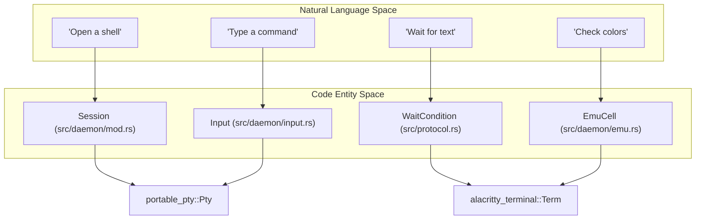
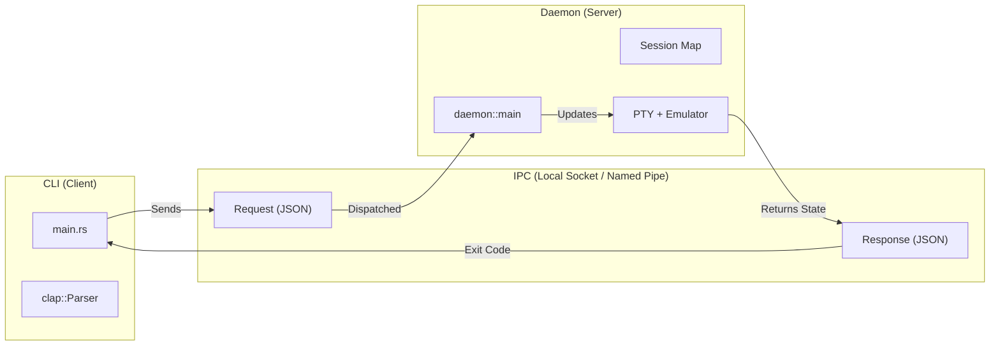

<!-- source: DeepWiki mcp.deepwiki.com · repo microsoft/tui-test · page 1 Overview · fetched 2026-10-26 -->

# Overview

<details>
<summary>Relevant source files</summary>

The following files were used as context for generating this wiki page:

- [.github/workflows/ci.yml](.github/workflows/ci.yml)
- [Cargo.toml](Cargo.toml)
- [README.md](README.md)
- [SKILL.md](SKILL.md)

</details>


`shell-use` is a Rust-powered headless terminal CLI and daemon designed for controlling, inspecting, testing, and recording shell sessions and TUI applications [README.md:1-6](). It provides a robust interface for automation and AI agents to interact with real terminal environments across Windows, Linux, and macOS [README.md:6-6]().

The system operates on a client-daemon model where a stateless CLI communicates with a background process that manages a Pseudo-Terminal (PTY) and a full terminal emulator [SKILL.md:8-14]().

### Key Capabilities

- **Session Management**: Spawn persistent shell sessions (Bash, Zsh, PowerShell, etc.) or run TUI programs like `vim` directly [README.md:122-131]().
- **Terminal Inspection**: Query the rendered state of the terminal, including viewport text, cursor position, and per-cell attributes (colors, characters) [README.md:132-141]().
- **Input Simulation**: Send literal text, named key combinations (e.g., `Ctrl+C`), and complex mouse actions (clicks, drags, scrolls) [README.md:142-152]().
- **Assertions and Waiting**: Block execution until specific text appears, the screen becomes idle, or a command finishes. Assert on exit codes, output, or visual snapshots [SKILL.md:97-113]().
- **Observability**: Capture full-color SVG screenshots and retrieve standard `asciinema` v2 recordings of any session [SKILL.md:117-123]().

---

### High-Level Architecture

The architecture bridges the gap between high-level user commands and the low-level PTY/Emulator state.

#### System Context: Natural Language to Code Entities
This diagram illustrates how user-facing concepts map to the underlying Rust implementation.


**Sources:** [src/daemon/mod.rs:1-20](), [src/daemon/emu.rs:1-15](), [src/protocol.rs:1-50]()

#### Client-Daemon Communication
The CLI is stateless; it sends a `Request` to the daemon over a local IPC socket and receives a `Response`.


**Sources:** [src/main.rs:1-30](), [src/daemon/mod.rs:40-100](), [src/protocol.rs:100-200]()

---

### Core Components

| Component | Description | Reference |
| :--- | :--- | :--- |
| **CLI** | The entry point for users and scripts. It handles argument parsing and IPC transport. | [CLI Reference](#2) |
| **Daemon** | A background process that manages the lifecycle of multiple named sessions and their PTYs. | [Daemon and Internal Architecture](#3) |
| **PTY/Emulator** | Uses `portable-pty` and `alacritty_terminal` to turn raw bytes into a queryable grid. | [PTY and Terminal Emulation](#3.2) |
| **Bindings** | Python and JavaScript libraries that wrap the CLI/Daemon protocol for programmatic use. | [Language Bindings](#5) |

For details on the client-daemon model and session lifecycle, see [Core Concepts and Architecture](#1.2).

### AI and Agent Integration
`shell-use` is designed to be "AI native." It provides self-documenting commands that output machine-readable context for LLMs to understand the available toolset without manual prompt engineering [README.md:51-58]().

- `shell-use agent-context`: Returns a JSON schema of all commands and flags [SKILL.md:20-22]().
- `shell-use skill`: Outputs the [SKILL.md]() guide for RAG or few-shot prompting [SKILL.md:24-24]().
- **Stable Exit Codes**: A strictly defined taxonomy (0-5) allows agents to distinguish between assertion failures, usage errors, and internal system issues [SKILL.md:41-54]().

For details on integrating with agents, see [Agent Integration](#6).

### Getting Started
To begin using `shell-use`, you can install it via Homebrew or Winget and run a basic session.

```bash
shell-use open
shell-use submit "echo 'Hello World'"
shell-use expect text "Hello World"
shell-use close
```

For detailed installation instructions and more examples, see [Installation and Quick Start](#1.1).

**Sources:** [README.md:1-100](), [SKILL.md:1-150](), [Cargo.toml:1-30]()

---

