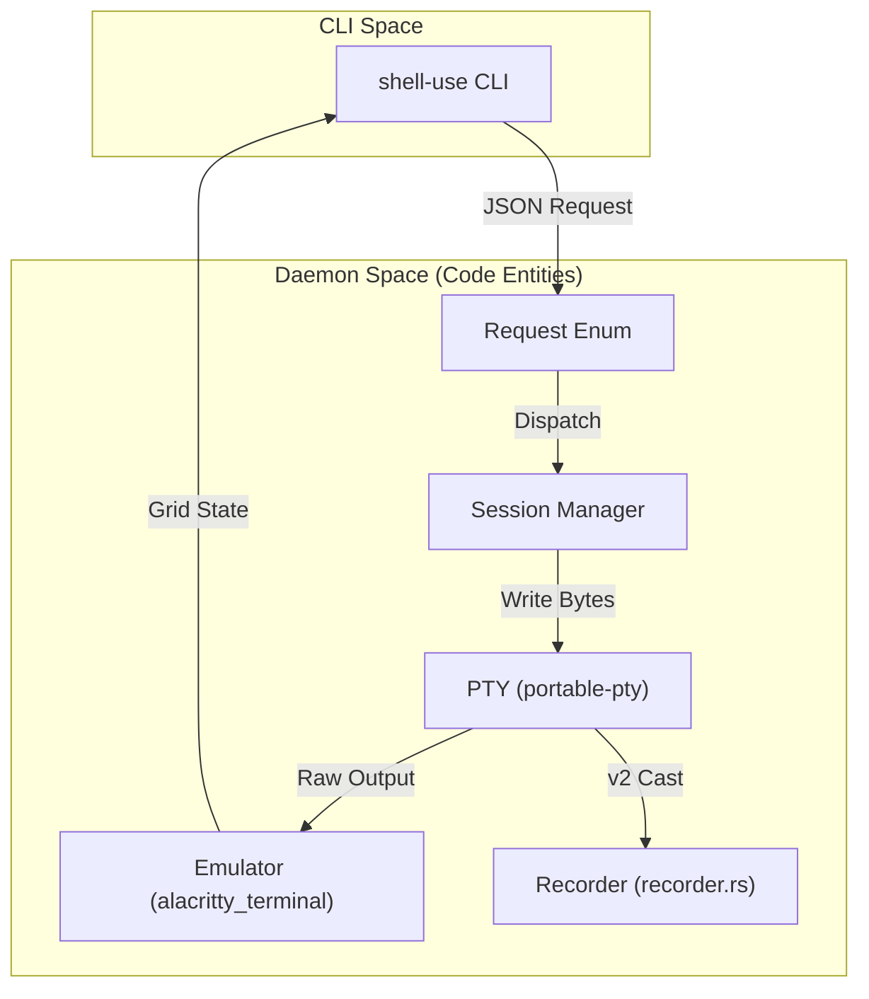
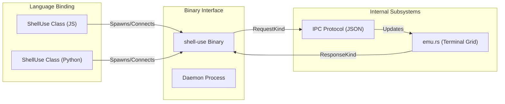

<!-- source: DeepWiki mcp.deepwiki.com · repo microsoft/tui-test · page 1.1 Installation and Quick Start · fetched 2026-10-26 -->

# Installation and Quick Start

<details>
<summary>Relevant source files</summary>

The following files were used as context for generating this wiki page:

- [.cargo/config.toml](.cargo/config.toml)
- [.github/workflows/ci.yml](.github/workflows/ci.yml)
- [.github/workflows/release.yml](.github/workflows/release.yml)
- [Formula/shell-use.rb](Formula/shell-use.rb)
- [README.md](README.md)

</details>


This page provides a technical guide for installing `shell-use` across different operating systems and executing initial workflows for both standard shell sessions and interactive Terminal User Interface (TUI) applications.

## Installation Methods

`shell-use` is distributed as a statically linked binary for major platforms. The installation process places the `shell-use` executable on the system `PATH`, which is a prerequisite for both CLI usage and programmatic bindings [README.md:71-72]().

### Homebrew (macOS and Linux)
The project maintains a custom tap for Homebrew. This installs the binary and manages updates [README.md:10-15]().

```sh
brew tap microsoft/shell-use https://github.com/microsoft/shell-use
brew install shell-use
```

### Winget (Windows)
For Windows users, `shell-use` is available via the Windows Package Manager [README.md:17-21]().

```sh
winget install Microsoft.ShellUse
```

### Manual Download
Pre-compiled binaries are available for multiple architectures via GitHub Releases [README.md:23-25](). The release pipeline targets the following environments:

| Platform | Architecture | Target Triple |
| :--- | :--- | :--- |
| **Linux** | x86_64 / aarch64 | `unknown-linux-gnu` & `unknown-linux-musl` |
| **macOS** | x86_64 / aarch64 | `apple-darwin` |
| **Windows** | x86_64 / aarch64 | `pc-windows-msvc` |

**Sources:** [README.md:8-25](), [.github/workflows/release.yml:15-31](), [Formula/shell-use.rb:7-27]()

---

## Quick Start: Shell Sessions

The most common use case for `shell-use` is automating a standard shell (e.g., Bash, Zsh, or PowerShell). The CLI follows a client-daemon architecture where the first command (typically `open`) lazily starts the background daemon [README.md:32]().

### Workflow Example
The following sequence demonstrates opening a session, executing a command, and asserting the state.

```sh
shell-use open                  # Start session & daemon
shell-use submit "echo hello"   # Type string + Enter
shell-use wait command          # Wait for prompt return
shell-use expect text "hello"   # Verify output exists
shell-use expect exit-code 0    # Verify success
shell-use close                 # Cleanup session
```

### Implementation Logic: Command Submission
When `submit` is called, the CLI communicates with the daemon to simulate keyboard input followed by a carriage return. The `wait command` instruction utilizes shell integration (OSC sequences) to detect when the shell has returned to an idle prompt state.

**Sources:** [README.md:29-38](), [README.md:147](), [README.md:162]()

---

## Quick Start: TUI Programs

`shell-use` can drive complex, full-screen TUI applications like `vim` or `htop`. Unlike standard shell commands, TUI interactions often rely on `wait idle` to ensure the terminal emulator has finished rendering frames [README.md:44]().

### Workflow Example: Editing with Vim
```sh
shell-use run vim file.txt       # Direct execution without shell
shell-use wait idle              # Wait for UI to render
shell-use press i                # Enter Insert mode
shell-use type "some text"       # Input literal text
shell-use press Escape : w q Enter # Save and quit
shell-use wait exit              # Wait for process termination
```

### Terminal State Data Flow
The diagram below illustrates how a TUI command like `press i` moves through the system to update the internal terminal representation.

**TUI Input and Rendering Pipeline**


**Sources:** [README.md:42-49](), [README.md:148](), [README.md:127]()

---

## Programmatic Quick Start

While the CLI is useful for scripts, `shell-use` provides native bindings for Python and JavaScript/TypeScript. These libraries encapsulate the IPC logic and daemon management [README.md:69-71]().

### Language Comparison

| Feature | Python (`shell-use`) | JavaScript (`@microsoft/shell-use`) |
| :--- | :--- | :--- |
| **Install** | `pip install shell-use` | `npm install @microsoft/shell-use` |
| **Context** | `async with ShellUse()` | `const su = new ShellUse()` |
| **Runtimes** | Python 3.x | Node.js, Bun, Deno |

### Binding Architecture
The bindings serve as a bridge between the high-level language and the Rust-based `shell-use` binary.

**Bridge: Language Space to Code Entity Space**


**Sources:** [README.md:73-114](), [.github/workflows/ci.yml:61-88](), [README.md:71]()

---

## Verifying Installation

To verify that the installation and the daemon architecture are functioning correctly, use the `daemon status` command:

```sh
shell-use daemon status
```

This confirms the CLI can communicate with the background process and reports the version and active session count [README.md:130]().

**Sources:** [README.md:130](), [Formula/shell-use.rb:33-35]()

---

