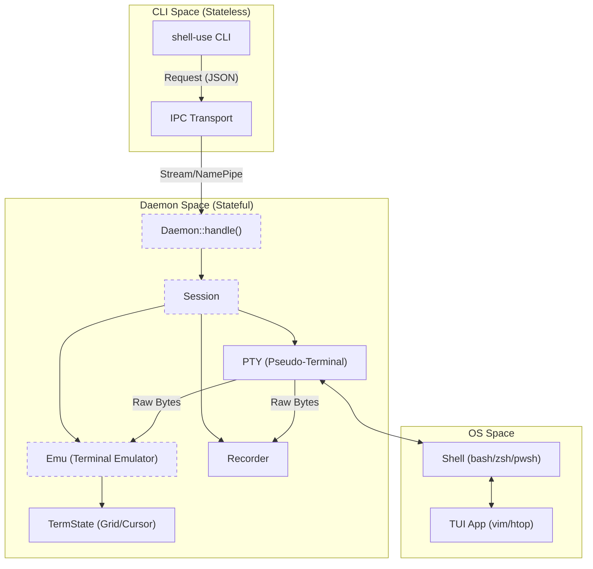

<!-- source: DeepWiki mcp.deepwiki.com · repo microsoft/tui-test · page 1.2 Core Concepts and Architecture · fetched 2026-10-26 -->

# Core Concepts and Architecture

Relevant source files

The following files were used as context for generating this wiki page:

- [.github/workflows/ci.yml](.github/workflows/ci.yml)
- [Cargo.lock](Cargo.lock)
- [README.md](README.md)
- [src/daemon/mod.rs](src/daemon/mod.rs)
- [src/ipc/mod.rs](src/ipc/mod.rs)
- [src/protocol.rs](src/protocol.rs)

`shell-use` is built on a client-daemon architecture designed to provide a stateless, scriptable interface to stateful terminal sessions. It decouples the CLI invocation from the long-running shell process, allowing users and AI agents to inspect and control terminal applications across multiple commands or language-binding calls.

## Client-Daemon Model

The system is split into two primary components: a stateless CLI (the "client") and a background process (the "daemon").

1.  **The Client**: Every time a user runs `shell-use <command>`, a short-lived process is spawned. It identifies the target session, connects to the daemon via IPC, sends a request, waits for a response, prints the result, and exits.
2.  **The Daemon**: A per-session process that manages the lifecycle of the actual shell or program. It owns the PTY (Pseudo-Terminal), runs a terminal emulator to maintain the screen state, and records the session to an `asciinema` cast.

### Data Flow: CLI to Daemon

The CLI communicates with the daemon using a JSON-over-local-socket protocol. This allows the CLI to remain completely stateless while the daemon maintains the complex, mutable state of the terminal grid.

Terminal Pipeline and Entity Mapping

**Sources:** [src/daemon/mod.rs:28-34](), [src/daemon/mod.rs:172-197](), [src/protocol.rs:5-103]()

## Session Lifecycle

A session is identified by a unique name (defaulting to `default`). The daemon's lifecycle is managed automatically by the CLI:

*   **Lazy Start**: When `shell-use open` or `shell-use run` is called, the CLI checks if a daemon is already listening on the session's socket [src/ipc/mod.rs:36-41](). If not, it spawns a new daemon process in the background.
*   **Active Management**: The `Daemon` struct in `src/daemon/mod.rs` manages a `Mutex<Option<Session>>` [src/daemon/mod.rs:30](). A session is created via `Session::open()` which initializes the PTY and the terminal emulator [src/daemon/mod.rs:208-217]().
*   **Idle Watchdog**: To prevent resource leaks, the daemon runs a background thread that monitors `last_activity`. If no IPC requests are received for a configured timeout (defaulting to several hours), the daemon kills the session and exits [src/daemon/mod.rs:111-127]().
*   **Cleanup**: Upon receiving a `Request::Close` or hitting an idle timeout, the daemon removes its PID file and socket [src/daemon/mod.rs:101-106]().

**Sources:** [src/daemon/mod.rs:45-99](), [src/daemon/mod.rs:111-127](), [src/ipc/mod.rs:36-41]()

## IPC Transport and Protocol

The IPC layer abstracts platform differences between Unix-like systems and Windows.

*   **Transport**: On macOS and Linux, `shell-use` uses Unix Domain Sockets. On Windows, it uses Named Pipes [src/ipc/mod.rs:11-17]().
*   **Framing**: The protocol is line-delimited JSON. Each connection typically handles exactly one `Request` and one `Response` [src/ipc/mod.rs:1-3]().
*   **Request Types**: Defined in the `Request` enum, including `Ping`, `Open`, `Write`, `Press`, `WaitText`, and `Snapshot` [src/protocol.rs:8-103]().
*   **Response Types**: Every response includes an `ok` boolean and an optional `ErrorKind` to help the CLI determine the correct exit code [src/protocol.rs:181-192]().

**Sources:** [src/ipc/mod.rs:11-17](), [src/protocol.rs:8-103](), [src/protocol.rs:154-177]()

## PTY and Terminal Emulator Pipeline

The core of `shell-use` is its ability to turn a stream of raw PTY bytes into a queryable, structured grid.

1.  **PTY (Pseudo-Terminal)**: The daemon spawns the shell process using `portable-pty`. This creates a master/slave pair where the daemon reads the master end.
2.  **Terminal Emulator (`Emu`)**: Raw bytes from the PTY are fed into an internal terminal emulator based on `alacritty_terminal` [Cargo.lock:21-24](). This emulator maintains a grid of `EmuCell` objects.
3.  **State Inspection**: When a user runs `shell-use text` or `shell-use state`, the daemon locks the session, reads the current grid from the emulator, and converts it into the requested format (e.g., plain text via `rows_to_strings`) [src/daemon/mod.rs:23]().
4.  **Input Injection**: Input commands (like `type` or `press`) are converted by the daemon into the specific ANSI escape sequences or UTF-8 bytes that the PTY expects, effectively "typing" into the shell.

Code Entity Space Mapping
| System Component | Rust Module / Entity | Responsibility |
| :--- | :--- | :--- |
| **Daemon Entry** | `daemon::run` | Socket listening and request dispatching. |
| **Session Logic** | `daemon::session::Session` | Orchestrates PTY, Emulator, and Recording. |
| **Emulator** | `terminal::emu::Emu` | Processes ANSI escapes into a grid of cells. |
| **IPC Protocol** | `protocol::Request` | Enum defining all valid CLI-to-Daemon actions. |
| **IPC Transport** | `ipc::send` / `ipc::listen` | Platform-agnostic socket/pipe management. |
| **Recording** | `daemon::session::Recorder` | Writes PTY traffic to `asciinema` v2 files. |

**Sources:** [src/daemon/mod.rs:28-42](), [src/daemon/mod.rs:172-197](), [src/protocol.rs:8-103](), [Cargo.lock:21-24]()

---

