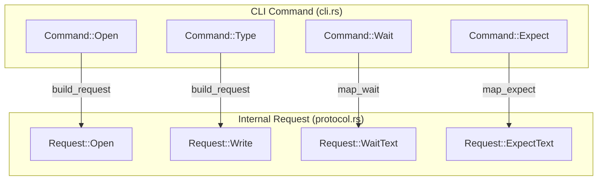
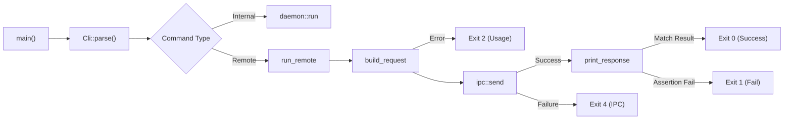

<!-- source: DeepWiki mcp.deepwiki.com · repo microsoft/tui-test · page 2 CLI Reference · fetched 2026-10-26 -->

# CLI Reference

Relevant source files

The following files were used as context for generating this wiki page:

- [src/cli.rs](src/cli.rs)
- [src/main.rs](src/main.rs)

The `shell-use` command-line interface provides a comprehensive set of tools for controlling headless terminal sessions. The CLI operates on a client-daemon architecture where most commands communicate with a background process via a local socket [src/main.rs:79-86](). It is designed for both human use and AI agent integration, featuring a stable exit-code taxonomy and machine-readable outputs.

## Command Architecture

The CLI is structured into several functional groups, all accessible via the primary `shell-use` binary. Global flags such as `--session` allow targeting specific named environments, while `--json` enables machine-readable responses [src/cli.rs:8-15]().

### Natural Language to Code Mapping

The following diagram illustrates how high-level CLI commands map to internal `Request` types sent to the daemon.

"CLI to Daemon Request Mapping"

Sources: [src/main.rs:89-159](), [src/cli.rs:27-201]()

## Command Groups

### Session and Process Commands
These commands manage the lifecycle of terminal sessions. `open` initializes a shell, while `run` executes a specific program directly [src/cli.rs:28-65](). The daemon is automatically started if not already running when a session command is issued [src/main.rs:74-77]().
For details, see [Session and Process Commands](#2.1).

### Input Commands
Input is handled through high-level abstractions like `type` for literal strings and `press` for named key combinations (e.g., `Ctrl+C`) [src/cli.rs:118-138](). It also supports complex mouse interactions including clicks, drags, and scrolling [src/cli.rs:140-143]().
For details, see [Input Commands](#2.2).

### Inspection and Wait Commands
Inspection commands like `state` and `text` retrieve the current status of the terminal emulator [src/cli.rs:79-86](). The `wait` family allows scripts to block until specific conditions are met, such as the screen becoming `idle` or specific `text` appearing [src/cli.rs:167-170]().
For details, see [Inspection and Wait Commands](#2.3).

### Assertion Commands
The `expect` group provides testing capabilities by asserting the state of the terminal. It supports regex matching, color-aware assertions (foreground/background), and snapshot-based testing to ensure UI consistency [src/cli.rs:172-175]().
For details, see [Assertion Commands](#2.4).

### Observability Commands
Observability tools facilitate debugging and recording. `monitor` provides a live view of a session [src/cli.rs:188](), while `screenshot` can generate full-color SVG images [src/cli.rs:89-98](). `get-recording` exports the session history in asciinema v2 format [src/cli.rs:180-183]().
For details, see [Observability Commands](#2.5).

## Exit Code Taxonomy

`shell-use` employs a stable exit-code taxonomy to allow callers (especially AI agents) to programmatically distinguish between different types of outcomes [src/main.rs:35-61]().

| Code | Meaning | Description |
| :--- | :--- | :--- |
| `0` | Success | Command completed successfully. |
| `1` | Assertion Failure | An `expect` command condition was not met. |
| `2` | Usage Error | Invalid CLI arguments or malformed input. |
| `3` | Session Missing | The target session does not exist or is closed. |
| `4` | IPC Error | Communication with the daemon failed. |
| `5` | Internal Error | An unexpected error occurred within the daemon. |

"Process Lifecycle and Exit Flow"

Sources: [src/main.rs:26-62](), [src/main.rs:65-87]()

## Global Options

The CLI supports several global flags that modify the behavior of all subcommands:

*   `--session <NAME>`: Targets a specific named session. If omitted, the daemon uses a default session name or the `SHELL_USE_SESSION` environment variable [src/cli.rs:9-11](), [src/main.rs:28]().
*   `--json`: Formats the output as a JSON object for easier parsing by scripts [src/cli.rs:13-15]().
*   `--verbose`: Enables detailed logging of PTY data, useful for debugging terminal emulation issues [src/cli.rs:17-20]().

Sources: [src/main.rs:1-215](), [src/cli.rs:1-226]()

---

