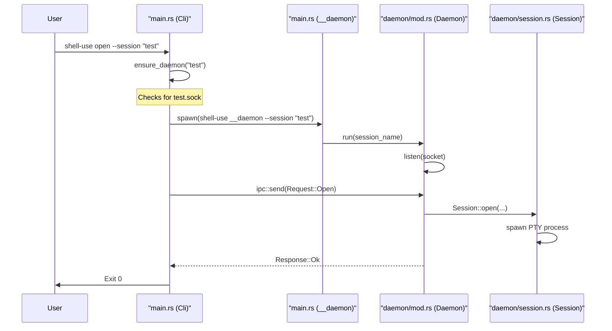
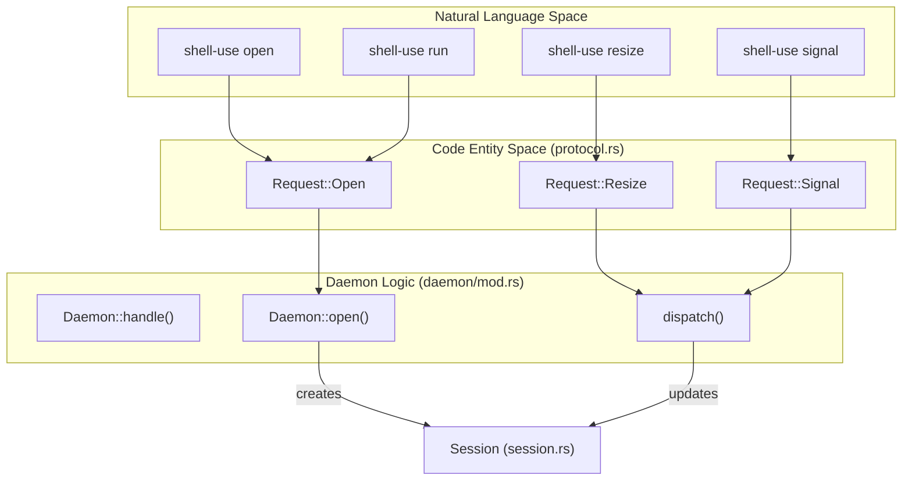

<!-- source: DeepWiki mcp.deepwiki.com · repo microsoft/tui-test · page 2.1 Session and Process Commands · fetched 2026-10-26 -->

# Session and Process Commands

Relevant source files

The following files were used as context for generating this wiki page:

- [src/cli.rs](src/cli.rs)
- [src/config.rs](src/config.rs)
- [src/daemon/mod.rs](src/daemon/mod.rs)
- [src/main.rs](src/main.rs)

This page documents the commands used to manage the lifecycle of shell sessions and their underlying PTY processes. It covers session creation, process signaling, terminal resizing, and the mechanics of the auto-starting daemon.

## Session Lifecycle Overview

`shell-use` operates on a client-daemon model. A "session" represents a single PTY process (either a shell or a direct program) managed by a background daemon.

### Named Sessions
Sessions are identified by a name. If no name is provided via the `--session` flag or the `SHELL_USE_SESSION` environment variable, the system defaults to the name `"default"` [src/config.rs:75-79]().

### Daemon Auto-Starting
The CLI is designed to be stateless. When a command is issued (e.g., `open`), the CLI checks if a daemon for that session is already running. If not, it lazily spawns a detached daemon process [src/main.rs:74-77]().

1.  **Check**: The CLI attempts to connect to the session's socket [src/ipc.rs:136-146]().
2.  **Spawn**: If connection fails, the CLI re-executes its own binary with the hidden `__daemon` command [src/cli.rs:199-200]() and the `--session` name [src/main.rs:36-42]().
3.  **Detachment**: The daemon process detaches and creates a PID file at `~/.shell-use/<session>.pid` [src/daemon/mod.rs:50-54]().
4.  **Handshake**: The CLI waits for the socket to become available before sending the initial `Request` [src/main.rs:80-86]().

### Idle Watchdog
To prevent resource leaks, the daemon includes an `idle_watchdog` thread. If no IPC requests are received for `IDLE_TIMEOUT_MS` (default 4 hours), the daemon kills the child process, removes its socket/PID files, and exits [src/daemon/mod.rs:111-127]().

---

## Command Reference

### open
Spawns a new shell session.
*   **Behavior**: If a session is already open, this returns an error. Otherwise, it initializes the terminal emulator and PTY [src/daemon/mod.rs:208-232]().
*   **Options**:
    *   `--shell`: Choose between `bash`, `zsh`, `fish`, `powershell`, etc. [src/cli.rs:29-32]().
    *   `--cols`, `--rows`: Set initial terminal dimensions (default 80x30) [src/cli.rs:33-38]().
    *   `--cwd`: Set the initial working directory [src/cli.rs:39-41]().
    *   `--env`: Pass environment variables as `KEY=VALUE` [src/cli.rs:42-44]().

### run
Spawns a session running a specific program directly instead of an interactive shell.
*   **Behavior**: Similar to `open`, but bypasses shell integration scripts and executes the provided binary and arguments directly in the PTY [src/main.rs:105-123]().

### close
Terminates a session.
*   **Behavior**: Sends a `Request::Close` to the daemon. The daemon kills the PTY child process and shuts itself down [src/daemon/mod.rs:187-193]().
*   **Options**:
    *   `--all`: If specified, the CLI iterates through all active sockets in the `home_dir` and sends shutdown signals to every daemon [src/main.rs:57-57]().

### sessions
Lists all currently active sessions.
*   **Implementation**: Scans the `~/.shell-use/` directory for active socket files and verifies connectivity [src/main.rs:56-56]().

### resize
Changes the dimensions of the terminal grid and the underlying PTY.
*   **Implementation**: Sends `Request::Resize`. The daemon updates the `alacritty_terminal` grid and issues a `TIOCSWINSZ` ioctl (on Unix) or `SetConsoleScreenBufferInfoEx` (on Windows) to the PTY [src/cli.rs:145-150](), [src/main.rs:146-146]().

### signal & kill
Sends OS signals to the process group leader inside the PTY.
*   **signal**: Allows sending `INT`, `TERM`, `KILL`, or `QUIT` [src/cli.rs:204-215]().
*   **kill**: A shorthand for `signal KILL` [src/main.rs:151-153]().

**Sources:** [src/main.rs:35-159](), [src/cli.rs:26-78](), [src/daemon/mod.rs:45-127](), [src/config.rs:3-14]()

---

## Implementation Diagrams

### Command Dispatch Flow
The following diagram illustrates how a CLI command like `open` transitions from user input to daemon execution.

**Sources:** [src/main.rs:65-87](), [src/daemon/mod.rs:45-99](), [src/daemon/session.rs:65-100]()

### Session State Management
This diagram maps the CLI commands to the internal `Request` variants and the `Daemon` methods that handle them.

**Sources:** [src/main.rs:89-159](), [src/protocol.rs:18-60](), [src/daemon/mod.rs:171-197]()

---

## Data Structures

### Request Mapping
The `build_request` function in `src/main.rs` is the primary translation layer between CLI subcommands and the IPC protocol.

| CLI Command | Request Variant | Key Parameters |
| :--- | :--- | :--- |
| `open` | `Request::Open` | `shell`, `cols`, `rows`, `cwd`, `env` |
| `run` | `Request::Open` | `program` (Vec), `cols`, `rows`, `cwd`, `env` |
| `close` | `Request::Close` | N/A |
| `resize` | `Request::Resize` | `cols`, `rows` |
| `signal` | `Request::Signal` | `name` (e.g., "INT", "KILL") |

**Sources:** [src/main.rs:89-159](), [src/protocol.rs:18-60]()

### Process Environment
When a session is opened, environment variables are merged. The system takes variables from the caller's environment and applies overrides provided via the `--env` flag [src/main.rs:103-121]().

**Sources:** [src/main.rs:89-123](), [src/cli.rs:42-44]()

---

