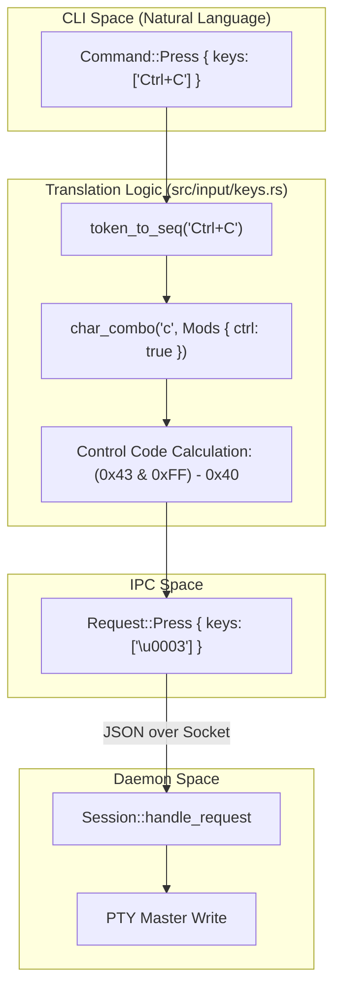
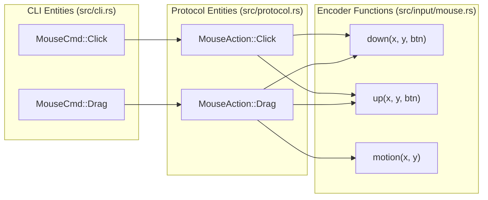

<!-- source: DeepWiki mcp.deepwiki.com · repo microsoft/tui-test · page 2.2 Input Commands · fetched 2026-10-26 -->

# Input Commands

Relevant source files

The following files were used as context for generating this wiki page:

- [src/cli.rs](src/cli.rs)
- [src/input/keys.rs](src/input/keys.rs)
- [src/input/mod.rs](src/input/mod.rs)
- [src/input/mouse.rs](src/input/mouse.rs)
- [src/main.rs](src/main.rs)

Input commands provide the primary interface for interacting with a terminal session in `shell-use`. These commands allow for typing literal text, sending complex key combinations with modifiers, and simulating mouse interactions (clicks, drags, and scrolling). All input commands are processed by the CLI, converted into escape sequences or structured requests, and sent via IPC to the daemon, which writes them directly to the PTY.

## Keyboard Input

Keyboard input is handled through four primary commands that range from literal text entry to low-level byte injection.

### Command Variants

| Command | Purpose | Implementation Detail |
| :--- | :--- | :--- |
| `type` | Sends literal text. | Maps to `Request::Write` [src/main.rs:139-139](). |
| `write` | Sends raw bytes. | Maps to `Request::Write` [src/main.rs:147-147](). |
| `submit` | Types text followed by a return key. | Maps to `Request::Submit` [src/main.rs:140-140](). |
| `press` | Sends named keys or combos (e.g., `Ctrl+C`). | Maps to `Request::Press` [src/main.rs:141-141](). |
| `keys` | Alias for `press` for a single combination. | Maps to `Request::Press` [src/main.rs:142-142](). |

### Key Name Syntax and Modifiers

The `press` and `keys` commands use a string-based syntax to represent non-printable characters and modified keys. The translation logic resides in `src/input/keys.rs`.

*   **Modifiers**: Supported modifiers include `Ctrl` (or `Control`), `Alt` (or `Option`, `Meta`), and `Shift` [src/input/keys.rs:257-259]().
*   **Combinations**: Joined by a `+` sign, e.g., `Ctrl+Alt+Delete`.
*   **Named Keys**: Common keys like `Enter`, `Escape`, `BackSpace`, `Tab`, `Home`, `End`, `PageUp`, `PageDown`, `Insert`, `Delete`, and function keys `F1`-`F12` are supported [src/input/keys.rs:27-215]().

### Data Flow: Natural Language to PTY Bytes

The following diagram illustrates how a natural language command like `press Ctrl+C` is transformed into the ASCII Control-C character (`\x03`) and delivered to the PTY.

**Keyboard Input Pipeline**

Sources: [src/main.rs:141-142](), [src/input/keys.rs:221-241](), [src/input/keys.rs:244-266]()

---

## Mouse Commands

`shell-use` supports terminal mouse protocol simulation (SGR mode). Mouse actions are defined in the `MouseCmd` enum [src/cli.rs:232-261]() and converted to `MouseAction` protocol objects [src/main.rs:172-208]().

### Mouse Actions

| Action | Description | Parameters |
| :--- | :--- | :--- |
| `click` | Press and release. | `x`, `y`, `button`, `clicks` |
| `move` | Move cursor (hover). | `x`, `y` |
| `down` | Press button. | `x`, `y`, `button` |
| `up` | Release button. | `x`, `y`, `button` |
| `drag` | Press at point A, move, release at B. | `x1`, `y1`, `x2`, `y2`, `button` |
| `scroll` | Simulate scroll wheel. | `direction` (up/down), `amount` |

### SGR Encoding Implementation

The daemon converts these actions into standard SGR mouse escape sequences (`CSI < ... M/m`) before writing to the PTY.

*   **Coordinates**: 0-based in the CLI, but converted to 1-based for the SGR protocol [src/input/mouse.rs:7-24]().
*   **Buttons**: Left (0), Middle (1), Right (2) [src/input/mouse.rs:5-6]().
*   **Scroll**: Encoded as buttons 64 (Up) and 65 (Down) [src/input/mouse.rs:21-23]().

**Mouse Command Entity Mapping**

Sources: [src/cli.rs:232-261](), [src/main.rs:172-208](), [src/input/mouse.rs:1-29]()

---

## Implementation Details

### Modifier Parameter Calculation
For named keys (like `Home` or `ArrowUp`), `shell-use` calculates the modifier parameter `p` using the formula `1 + shift + 2*alt + 4*ctrl` [src/input/keys.rs:18-20](). This follows the standard XTerm modifier encoding:
*   No modifiers: `1`
*   Shift: `2`
*   Alt: `3`
*   Ctrl: `5`
*   Ctrl+Shift: `6`
*   Ctrl+Alt: `7`
*   Ctrl+Alt+Shift: `8`

This parameter is then injected into the CSI sequence, for example: `\x1b[1;5H` for `Ctrl+Home` [src/input/keys.rs:28-30]().

### Escape Sequence Constants
The system uses standard terminal constants for building sequences:
*   `ESC`: `\u{1b}` [src/input/keys.rs:3]()
*   `CSI`: `\u{1b}[` [src/input/keys.rs:4]()

Sources: [src/input/keys.rs:1-21](), [src/input/mouse.rs:1-4]()

---

