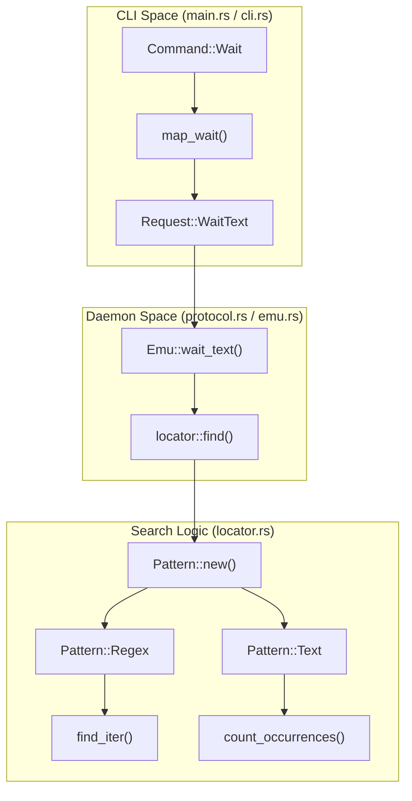
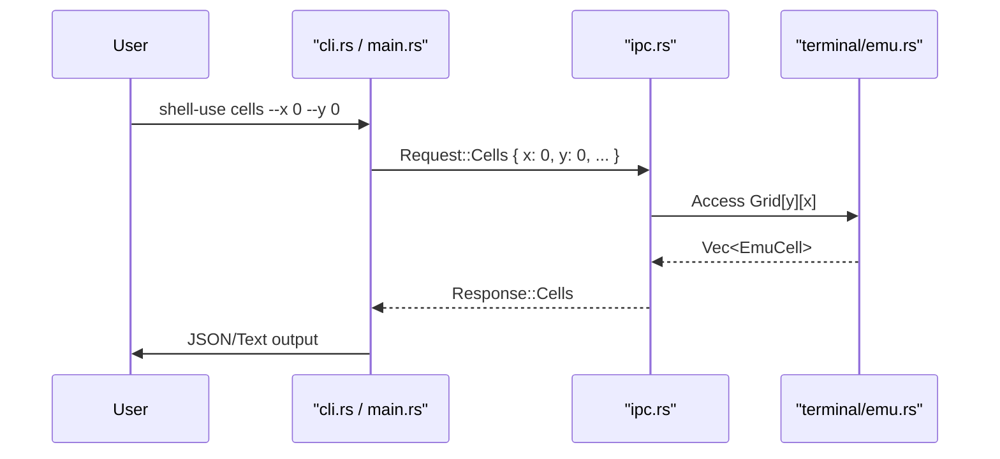

<!-- source: DeepWiki mcp.deepwiki.com · repo microsoft/tui-test · page 2.3 Inspection and Wait Commands · fetched 2026-10-26 -->

# Inspection and Wait Commands

Relevant source files

The following files were used as context for generating this wiki page:

- [src/cli.rs](src/cli.rs)
- [src/main.rs](src/main.rs)
- [src/terminal/locator.rs](src/terminal/locator.rs)
- [src/terminal/mod.rs](src/terminal/mod.rs)

Inspection and wait commands allow users and automated agents to observe the state of a terminal session and synchronize actions based on that state. These commands bridge the gap between the asynchronous nature of terminal output and the synchronous requirements of testing and automation.

## Inspection Commands

Inspection commands provide point-in-time snapshots of the terminal's state, including text content, cell attributes, and metadata like cursor position or exit codes.

### `state`
The `state` command returns a comprehensive summary of the session's current status [src/cli.rs:79-80](). This includes the current working directory (CWD), terminal dimensions, cursor position, the last executed command, its exit code (if available via shell integration), and a text snapshot of the visible viewport.

### `text`
The `text` command extracts the plain text from the terminal grid [src/cli.rs:81-86]().
*   **Viewport only**: By default, it returns only the currently visible rows.
*   **Full scrollback**: The `--full` flag includes the entire scrollback buffer maintained by the emulator [src/cli.rs:84-85]().

### `cells`
The `cells` command allows for low-level inspection of specific grid coordinates [src/cli.rs:99-111](). It returns detailed attributes for each cell in the specified region (x, y, width, height), including:
*   The character (`ch`).
*   Foreground and background colors.
*   Styling flags (bold, italic, etc.).

### `get`
The `get` command retrieves specific structured fields from the session [src/cli.rs:112-117](). Supported fields include:
*   `command`: The last command detected via OSC 133 sequences.
*   `output`: The output of the last command.
*   `exit-code`: The exit status of the last command.
*   `cwd`: The current working directory (reported via OSC 7).
*   `cursor`: Current `(x, y)` cursor coordinates.
*   `size`: Current terminal dimensions `(cols, rows)`.

### `screenshot`
Captures the terminal state [src/cli.rs:87-98](). If a path is provided via `--out` or `--path`, it generates a full-color SVG image [src/cli.rs:89-94](). Without a path, it behaves similarly to `text`, dumping the content to stdout.

---

## Wait Commands

Wait commands block execution until a specific condition is met or a timeout is reached. This is critical for handling the variable latency of CLI programs and network operations.

### Wait Family Overview

| Command | Condition | Use Case |
| :--- | :--- | :--- |
| `wait text` | Specific text appears on screen. | Synchronizing with TUI rendering or prompts. |
| `wait idle` | No PTY activity for a period (default 200ms). | Waiting for a command's output to "settle". |
| `wait command` | OSC 133 "Command Finished" sequence received. | Precise synchronization with shell prompts. |
| `wait exit` | The session's primary process terminates. | Waiting for a program (like `vim`) to close. |

### Implementation and Polling
Wait commands are processed by the daemon. For text-based waits, the daemon utilizes the `locator` module to perform regex or string matching against the terminal grid [src/terminal/locator.rs:39-43]().

#### Natural Language to Code Entity Mapping: Wait Logic
The following diagram illustrates how a CLI `wait` command is transformed into a daemon request and handled by the terminal emulator's search logic.

**Sources:** [src/main.rs:154](), [src/main.rs:210-235](), [src/terminal/locator.rs:8-28](), [src/terminal/locator.rs:39-43]()

---

## Technical Details: The Locator Module

The `locator` module is responsible for finding text within the `EmuCell` grid. It flattens the 2D grid into a 1D character array for searching, then maps the resulting match indices back to grid coordinates `(x, y)` [src/terminal/locator.rs:48-63]().

### Search Behavior
1.  **Text vs Regex**: Supports literal string matching or Rust-style regex [src/terminal/locator.rs:8-11]().
2.  **Strict Mode**: If `strict` is enabled, the search will fail if more than one match is found on the screen, preventing ambiguous interactions [src/terminal/locator.rs:75-80]().
3.  **Coordinate Mapping**: Once a match is found in the flat buffer, the system calculates the original `x` and `y` positions for every character in the match [src/terminal/locator.rs:106-119]().

#### Data Flow: Grid Inspection
This diagram shows how the `cells` and `text` commands flow from the user request into the internal `EmuCell` representation.

**Sources:** [src/cli.rs:99-111](), [src/main.rs:135](), [src/terminal/emu.rs:1-6](), [src/terminal/locator.rs:31-35]()

### Wait Options
All wait commands support a `--timeout` (in milliseconds). If the condition is not met within this window, the command exits with a non-zero status code (typically 1 for assertion/timeout failure) [src/main.rs:210-235]().

**Sources:**
*   [src/main.rs:129-158]() - Request building logic.
*   [src/main.rs:210-235]() - Mapping wait commands to protocol requests.
*   [src/cli.rs:79-117]() - Definition of inspection subcommands.
*   [src/cli.rs:164-170]() - Definition of wait subcommands.
*   [src/terminal/locator.rs:1-121]() - Implementation of grid searching and pattern matching.

---

