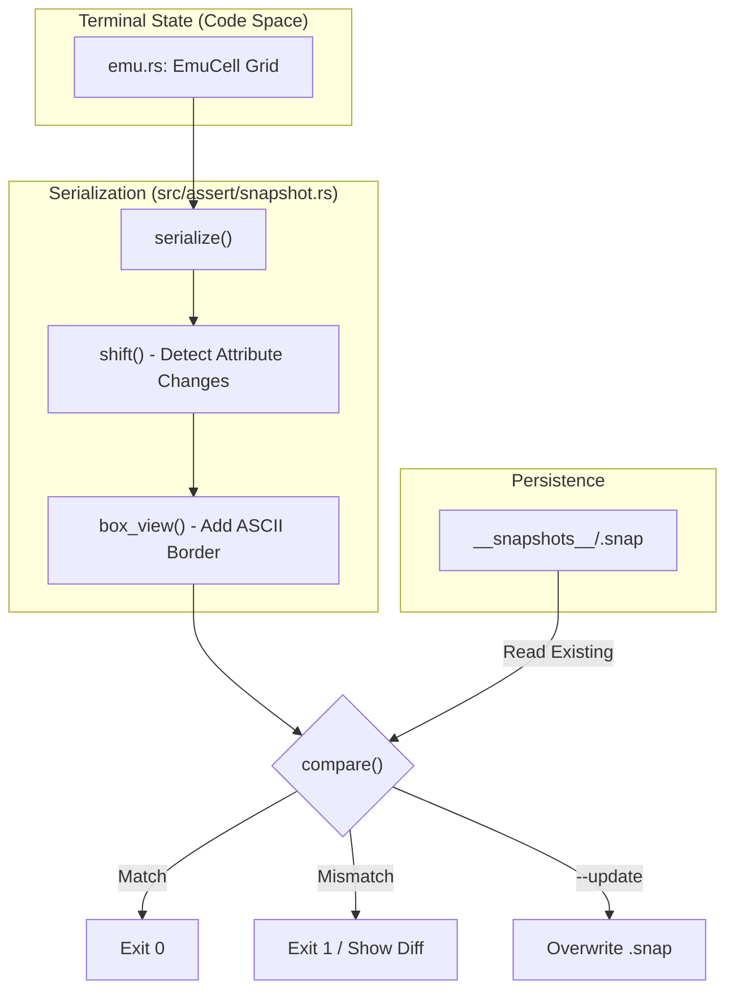
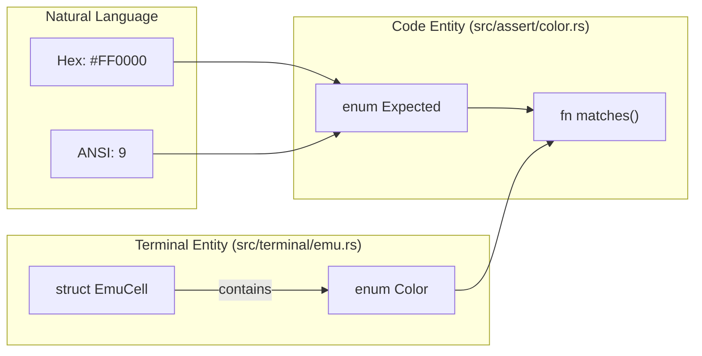

<!-- source: DeepWiki mcp.deepwiki.com · repo microsoft/tui-test · page 2.4 Assertion Commands · fetched 2026-10-26 -->

# Assertion Commands

Relevant source files

The following files were used as context for generating this wiki page:

- [src/assert/color.rs](src/assert/color.rs)
- [src/assert/mod.rs](src/assert/mod.rs)
- [src/assert/snapshot.rs](src/assert/snapshot.rs)
- [src/cli.rs](src/cli.rs)
- [src/main.rs](src/main.rs)

Assertion commands provide a mechanism for validating the state of a shell session. Unlike `wait` commands which block until a condition is met, `expect` commands evaluate the current state of the terminal emulator immediately and return a binary result: exit code `0` for success and `1` for failure [src/main.rs:60-61]().

## The Expect Family

The `expect` family of commands is defined in the CLI as subcommands of `ExpectCmd` [src/cli.rs:172-175](). These requests are mapped from CLI arguments to protocol `Request` variants in the `map_expect` function [src/main.rs:237-244]().

### Text and Regex Assertions
`expect text` validates the presence or absence of strings within the terminal grid.

| Argument | Description |
| :--- | :--- |
| `text` | The string or regex pattern to search for. |
| `--regex` | Interpret the input text as a regular expression. |
| `--full` | Search the entire scrollback buffer instead of just the visible viewport. |
| `--not` | Invert the logic: fail if the text is found. |
| `--no-strict` | Disable strict matching (e.g., allow for minor whitespace variations). |

### Color Assertions
The `expect text` command supports attribute-aware assertions using the `--fg` (foreground) and `--bg` (background) flags [src/main.rs:245-246](). 

The `src/assert/color.rs` module handles the parsing and comparison logic for these attributes:
- **Supported Formats**: ANSI 256 indices (`0-255`), Hex codes (`#rrggbb`), and RGB triples (`r,g,b`) [src/assert/color.rs:13-29]().
- **Color Space Mapping**: The system automatically translates between ANSI indices and RGB space to allow cross-format comparison [src/assert/color.rs:115-159]().

### Exit-Code and Output Assertions
- `expect exit-code <code>`: Validates the exit code of the last completed command (requires shell integration for OSC 133 support).
- `expect output <text>`: Validates the output of the last command specifically, excluding the prompt and subsequent input.

## Snapshots

Snapshots allow for regression testing of complex terminal layouts (e.g., TUI applications). The `expect snapshot <name>` command compares the current terminal state against a stored `.snap` file [src/assert/snapshot.rs:1-3]().

### Snapshot Workflow Data Flow
The following diagram illustrates how terminal cells are transformed into serialized snapshots and compared against the filesystem.

**Snapshot Comparison Pipeline**

Sources: [src/assert/snapshot.rs:86-112](), [src/assert/snapshot.rs:129-155]()

### Snapshot Format
Snapshots are stored in a human-readable format that includes:
1. **The View**: A boxed ASCII representation of the terminal text [src/assert/snapshot.rs:114-124]().
2. **The Attribute Map**: If colors are included, a JSON object maps `x,y` coordinates to "shifts" in terminal attributes (fg, bg, bold, etc.) [src/assert/snapshot.rs:38-68]().

## Implementation Details

### Color Matching Logic
The `matches` function in `src/assert/color.rs` determines if a terminal cell's color satisfies the expected criteria, handling the `Color::Default` and `Color::Idx` vs `Color::Rgb` abstractions used by the `alacritty_terminal` emulator.

**Entity Mapping: Color Assertion**

Sources: [src/assert/color.rs:6-10](), [src/assert/color.rs:56-75](), [src/terminal/emu.rs:1-10]()

### Key Functions
- `serialize(rows, cols, include_colors)`: Converts the internal `EmuCell` grid into the snapshot string format [src/assert/snapshot.rs:86]().
- `compare(base, name, content, update)`: Handles file I/O, directory creation (`__snapshots__`), and the logic for updating or failing the assertion [src/assert/snapshot.rs:129]().
- `Expected::parse(s)`: A robust parser for multiple color string formats [src/assert/color.rs:13]().

Sources:
- [src/main.rs:237-260]() (Mapping CLI to Request)
- [src/cli.rs:172-175]() (CLI Subcommands)
- [src/assert/snapshot.rs:9-14]() (Snapshot Status types)
- [src/assert/snapshot.rs:86-112]() (Serialization logic)
- [src/assert/color.rs:56-75]() (Color matching logic)

---

