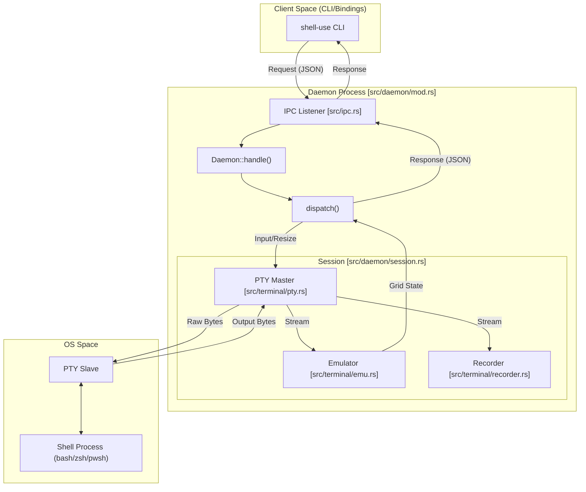

<!-- source: DeepWiki mcp.deepwiki.com · repo microsoft/tui-test · page 3 Daemon and Internal Architecture · fetched 2026-10-26 -->

# Daemon and Internal Architecture

Relevant source files

The following files were used as context for generating this wiki page:

- [Cargo.lock](Cargo.lock)
- [src/daemon/mod.rs](src/daemon/mod.rs)

The `shell-use` daemon is a headless Rust process that manages the lifecycle of a single terminal session. It acts as the bridge between the CLI (or language bindings) and the underlying pseudo-terminal (PTY). The daemon is responsible for terminal emulation, input injection, state inspection, and session recording.

## System Architecture

The daemon operates as a background process, typically spawned lazily by the CLI. It uses a request-response model over a local IPC socket to service commands.

The following diagram illustrates the internal pipeline from the IPC layer down to the PTY:

### Internal Data Flow

Sources: [src/daemon/mod.rs:79-95](), [src/daemon/session.rs:200-220](), [src/terminal/pty.rs:1-15]()

## Core Subsystems

### 1. Daemon Lifecycle and Session Management
The daemon is designed to be ephemeral. It starts when a session is opened and terminates via an explicit `Shutdown` request or an idle watchdog. It manages a PID file and a platform-specific socket (Unix Domain Socket or Windows Named Pipe) to allow the CLI to locate and communicate with it.

For details, see [Daemon Lifecycle and Session Management](#3.1).

**Key Entities:**
- `Daemon`: The top-level coordinator [src/daemon/mod.rs:28-34]().
- `spawn_idle_watchdog`: Monitors `last_activity` and exits after 10 minutes of inactivity [src/daemon/mod.rs:111-127]().
- `cleanup`: Removes PID and socket files on exit [src/daemon/mod.rs:101-106]().

### 2. PTY and Terminal Emulation
The daemon wraps a native PTY using `portable-pty`. Raw output from the shell is fed into an internal terminal emulator based on `alacritty_terminal`. This allows `shell-use` to maintain a logical grid of cells, including colors and attributes, which can be queried without a physical display.

For details, see [PTY and Terminal Emulation](#3.2).

**Key Entities:**
- `Pty`: Manages the fork and file descriptors [src/terminal/pty.rs:17-25]().
- `Emulator`: Wraps the Alacritty grid logic [src/terminal/emu.rs:32-35]().
- `EmuCell`: Represents a single character with its metadata [src/terminal/emu.rs:142-148]().

### 3. IPC Protocol and Transport
Communication between the CLI and the daemon uses a JSON-based protocol. The `Request` enum defines all possible actions (e.g., `Type`, `WaitText`, `GetField`), and the `Response` enum carries the result or error state.

For details, see [IPC Protocol and Transport](#3.3).

**Key Entities:**
- `Request` / `Response`: The primary wire format [src/protocol.rs:12-100]().
- `ipc::listen`: Sets up the local socket [src/ipc.rs:26-35]().

### 4. Session Recording and Tracing
Every session is automatically recorded in the `asciinema` v2 format. The `Recorder` intercepts the PTY byte stream and writes it to a `.cast` file with millisecond-precision timestamps. Additionally, a verbose logger can be enabled to trace internal state transitions.

For details, see [Session Recording and Tracing](#3.4).

**Key Entities:**
- `Recorder`: Handles the `.cast` file generation [src/terminal/recorder.rs:13-18]().
- `Logger`: Provides debug event tracing to a file [src/daemon/logger.rs:11-14]().

## Component Interaction Map

This table maps the conceptual responsibilities to the primary code entities implementing them.

| Responsibility | Code Entity | Implementation File |
| :--- | :--- | :--- |
| **Request Routing** | `Daemon::handle` | [src/daemon/mod.rs:172-197]() |
| **Command Execution** | `dispatch` | [src/daemon/session.rs:268-350]() |
| **State Persistence** | `TermState` | [src/daemon/session.rs:46-55]() |
| **Byte Processing** | `Session::process_pty_output` | [src/daemon/session.rs:232-248]() |
| **Socket Management** | `ipc::listen` / `ipc::connect` | [src/ipc.rs:26-45]() |

Sources: [src/daemon/mod.rs:28-34](), [src/daemon/session.rs:26-44](), [src/terminal/emu.rs:32-40]()

---

