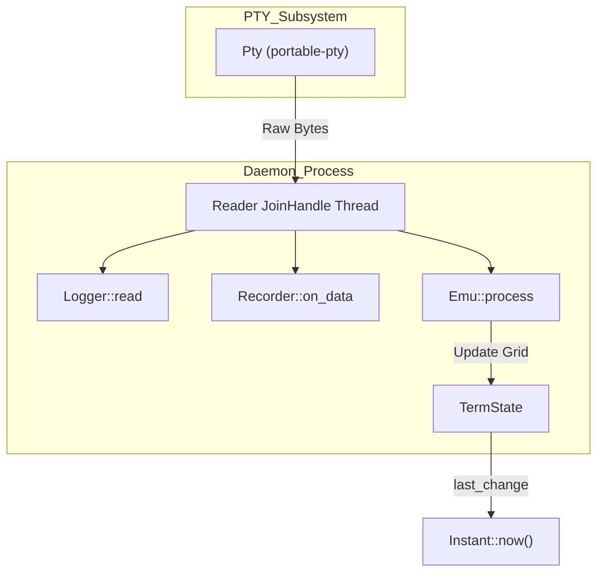
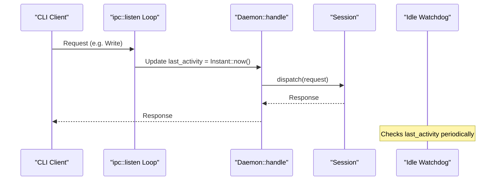

<!-- source: DeepWiki mcp.deepwiki.com · repo microsoft/tui-test · page 3.1 Daemon Lifecycle and Session Management · fetched 2026-10-26 -->

# Daemon Lifecycle and Session Management

Relevant source files

The following files were used as context for generating this wiki page:

- [src/config.rs](src/config.rs)
- [src/daemon/logger.rs](src/daemon/logger.rs)
- [src/daemon/mod.rs](src/daemon/mod.rs)
- [src/daemon/session.rs](src/daemon/session.rs)

The `shell-use` daemon is a background process responsible for managing a single terminal session. It encapsulates a Pseudo-Terminal (PTY), a terminal emulator, and a request handler that services IPC calls from the CLI. Each named session (e.g., "default", "test-1") runs its own dedicated daemon process to ensure isolation and persistence.

## Lifecycle Overview

The daemon is designed to be lazily started by the CLI. When a user executes a command for a session that does not yet have an active daemon, the CLI spawns the daemon process in a detached state.

### Startup and Initialization
When `daemon::run` is invoked [src/daemon/mod.rs:45-45](), it performs the following sequence:
1.  **Home Directory Setup**: Ensures the `~/.shell-use` directory exists [src/daemon/mod.rs:46-46]().
2.  **Recording Cleanup**: Invokes `sweep_recordings` to delete stale `.cast` files from previous crashed or finished sessions [src/daemon/mod.rs:47-47]().
3.  **Socket Binding**: Creates a local IPC socket (Unix Domain Socket or Windows Named Pipe) based on the session name [src/daemon/mod.rs:48-49]().
4.  **PID Persistence**: Writes the current process ID to a `.pid` file in the home directory [src/daemon/mod.rs:50-54]().
5.  **Logging**: If verbosity is enabled, initializes a `Logger` that writes to a `.log` file [src/daemon/mod.rs:56-63]().
6.  **Watchdog Activation**: Spawns a background thread to monitor for inactivity [src/daemon/mod.rs:77-77]().

### Daemon Process Management
| Entity | Role | File Reference |
| :--- | :--- | :--- |
| `Daemon` | Main struct holding the `Session`, `Logger`, and activity timestamps. | [src/daemon/mod.rs:28-34]() |
| `run` | The entry point for the daemon process loop. | [src/daemon/mod.rs:45-99]() |
| `cleanup` | Removes the PID file and socket on exit. | [src/daemon/mod.rs:101-106]() |
| `sweep_recordings` | Garbage collects `.cast` files for sessions no longer running. | [src/daemon/mod.rs:133-150]() |

**Sources:** [src/daemon/mod.rs:28-150](), [src/config.rs:32-73]()

## Session Management

A `Session` represents the active terminal instance. It is created via a `Request::Open` IPC call.

### The `Session` Struct
The `Session` [src/daemon/session.rs:21-30]() coordinates:
*   **PTY**: The raw process interface [src/terminal/pty.rs]().
*   **Emu**: The `alacritty_terminal` based emulator that tracks grid state [src/terminal/emu.rs]().
*   **Recorder**: The `asciinema` v2 logger [src/trace/recorder.rs]().
*   **Reader Thread**: A dedicated thread that pulls bytes from the PTY and updates the emulator and recorder [src/daemon/session.rs:85-114]().

### Session State Transitions
The daemon transitions through three primary states regarding its session:
1.  **Empty**: Daemon is running but no shell/program has been opened yet (`session: Mutex<Option<Session>>` is `None`).
2.  **Active**: A session is running and processing PTY data.
3.  **Exited**: The PTY process has terminated, but the daemon remains alive to serve the final terminal buffer and exit code until closed or timed out [src/daemon/session.rs:111-114]().

### Data Flow: PTY to Emulator
The following diagram illustrates how data flows from the underlying PTY into the daemon's internal state.

**PTY Data Ingestion Flow**

**Sources:** [src/daemon/session.rs:85-114](), [src/daemon/mod.rs:39-42]()

## IPC and Activity Watchdog

The daemon uses an "Idle Watchdog" to prevent orphaned processes from consuming system resources indefinitely.

### Idle Watchdog
The watchdog thread [src/daemon/mod.rs:111-127]() sleeps for `IDLE_CHECK_INTERVAL_MS` (5 minutes) [src/config.rs:14-14](). On wake, it checks the `last_activity` timestamp [src/daemon/mod.rs:114-114](). If the elapsed time exceeds `IDLE_TIMEOUT_MS` (4 hours) [src/config.rs:12-12](), the daemon:
1.  Kills the child PTY process [src/daemon/mod.rs:121-121]().
2.  Deletes its `.pid` and socket files [src/daemon/mod.rs:123-123]().
3.  Exits the process [src/daemon/mod.rs:124-124]().

### Request Handling
Every IPC request received via the `listener` resets the `last_activity` timer [src/daemon/mod.rs:85-85]().

**Request Lifecycle**

**Sources:** [src/daemon/mod.rs:77-95](), [src/daemon/mod.rs:111-127](), [src/config.rs:10-14]()

## Shutdown Sequence

The daemon exits under three conditions:
1.  **Explicit Shutdown**: A `Request::Shutdown` is received [src/daemon/mod.rs:178-178]().
2.  **Session Close**: A `Request::Close` is received, which kills the session and breaks the listener loop [src/daemon/mod.rs:187-193]().
3.  **Idle Timeout**: The watchdog triggers an exit [src/daemon/mod.rs:124-124]().

### Cleanup Logic
The `cleanup` function [src/daemon/mod.rs:101-106]() ensures the environment is sanitized:
*   **PID File**: Removed so CLI tools know the daemon is inactive [src/daemon/mod.rs:102-102]().
*   **Socket**: On Unix, the socket file is unlinked [src/daemon/mod.rs:104-104](). (On Windows, named pipes are cleaned up by the OS).

**Sources:** [src/daemon/mod.rs:101-106](), [src/daemon/mod.rs:172-197]()

---

