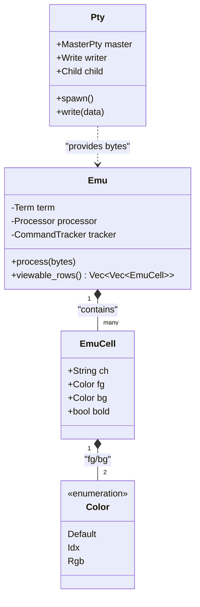

<!-- source: DeepWiki mcp.deepwiki.com · repo microsoft/tui-test · page 3.2 PTY and Terminal Emulation · fetched 2026-10-26 -->

# PTY and Terminal Emulation

<details>
<summary>Relevant source files</summary>

The following files were used as context for generating this wiki page:

- [Cargo.lock](Cargo.lock)
- [src/terminal/emu.rs](src/terminal/emu.rs)
- [src/terminal/mod.rs](src/terminal/mod.rs)
- [src/terminal/pty.rs](src/terminal/pty.rs)

</details>


The PTY and Terminal Emulation subsystem is responsible for the low-level lifecycle of shell processes and the transformation of raw ANSI byte streams into a structured, queryable grid. This pipeline allows `shell-use` to inspect terminal state, colors, and cursor positions as if it were a physical display.

## PTY Management

The PTY (Pseudo-Terminal) layer is implemented in `src/terminal/pty.rs` using the `portable-pty` crate [Cargo.lock:22-43](). It abstracts platform-specific process spawning (Unix `forkpty` vs. Windows `ConPTY`).

### The Pty Struct
The `Pty` struct [src/terminal/pty.rs:9-13]() manages the master end of the PTY, the input writer, and the child process handle.

*   **Spawning**: The `Pty::spawn` function [src/terminal/pty.rs:25-69]() initializes the `native_pty_system`, opens a new PTY pair with specific dimensions, and configures the environment (defaulting `TERM` to `xterm-256color`).
*   **Input**: Data is sent to the process via `Pty::write` [src/terminal/pty.rs:87-90](), which writes directly to the master PTY's input stream.
*   **Resizing**: The `Pty::resize` method [src/terminal/pty.rs:92-100]() updates the window size in the kernel/OS, triggering `SIGWINCH` in the child process.

### Signal Handling
Because `portable-pty` provides a cross-platform abstraction, signal delivery is normalized in `Pty::signal` [src/terminal/pty.rs:112-120]():
*   `SIGINT` is delivered by writing the ASCII ETX byte (`\x03`) to the PTY [src/terminal/pty.rs:115-115]().
*   `SIGTERM`, `SIGKILL`, and `SIGQUIT` result in a direct process kill [src/terminal/pty.rs:116-116]().

**Sources:** [src/terminal/pty.rs:1-130](), [Cargo.lock:22-43]()

## Terminal Emulation

The emulation layer, found in `src/terminal/emu.rs`, wraps `alacritty_terminal` [Cargo.lock:21-43]() to maintain an in-memory representation of the terminal screen.

### The Emu Instance
The `Emu` struct [src/terminal/emu.rs:97-104]() acts as the central coordinator for state. It contains:
1.  **`Term`**: The Alacritty terminal state machine [src/terminal/emu.rs:98-98]().
2.  **`ansi::Processor`**: The parser that consumes raw bytes and drives state changes in `Term` [src/terminal/emu.rs:99-99]().
3.  **`CommandTracker`**: An integration hook for semantic shell sequences (OSC 133/7) [src/terminal/emu.rs:100-100]().

### Data Flow: Bytes to Grid
The transformation of data follows a strict pipeline:

Title: PTY Data Processing Pipeline
```mermaid
graph LR
    subgraph "External Process"
        "ChildProcess"
    end

    subgraph "PTY Subsystem"
        "PtyReader[Read]"
    end

    subgraph "Emu Subsystem"
        "Emu::process" --> "ansi::Processor::advance"
        "ansi::Processor::advance" --> "Alacritty::Term"
        "Emu::process" --> "CommandTracker::feed"
    end

    "ChildProcess" -- "Raw ANSI Bytes" --> "PtyReader[Read]"
    "PtyReader[Read]" -- "bytes" --> "Emu::process"
    "Alacritty::Term" -- "Internal Grid" --> "EmuCell"
```
**Sources:** [src/terminal/emu.rs:128-131](), [src/terminal/pty.rs:29-29]()

### Grid and Cell Representation
The emulator exposes the grid via `EmuCell` [src/terminal/emu.rs:39-51](), which flattens Alacritty's internal flags into a simplified structure:
*   **Colors**: Represented by the `Color` enum [src/terminal/emu.rs:18-23](), supporting `Default`, `Idx(u8)` (256-color palette), and `Rgb(u8, u8, u8)`.
*   **Attributes**: Boolean flags for `bold`, `italic`, `underline`, `inverse`, etc. [src/terminal/emu.rs:44-50]().
*   **Wide Characters**: The `cell_from_alac` function [src/terminal/emu.rs:53-80]() handles Alacritty's `WIDE_CHAR_SPACER` logic, ensuring that multi-column characters (like Emojis) are correctly represented as a single character followed by empty cells.

**Sources:** [src/terminal/emu.rs:18-80]()

## State Inspection

The `Emu` struct provides methods to query the terminal state for assertions and snapshots.

| Method | Description | Implementation |
| :--- | :--- | :--- |
| `cursor()` | Returns `(x, y)` coordinates | Clamps `grid.cursor.point` to bounds [src/terminal/emu.rs:157-162]() |
| `viewable_rows()` | Returns the current screen | Uses `rows_in_range` for the visible area [src/terminal/emu.rs:165-167]() |
| `full_rows()` | Returns history + screen | Calculates scrollback offset [src/terminal/emu.rs:170-176]() |
| `rows_to_strings()` | Flattens cells to text | Maps `EmuCell.ch` to `String`, replacing blanks with spaces [src/terminal/emu.rs:194-202]() |

### Capture Proxy
The `CaptureProxy` [src/terminal/emu.rs:83-85]() implements Alacritty's `EventListener` [src/terminal/emu.rs:87-95](). It captures `Event::PtyWrite` events—bytes the terminal emulator wants to send back to the PTY (e.g., in response to a Device Status Report query). These are stored in a `pending` buffer and retrieved via `take_pending_writes()` [src/terminal/emu.rs:138-143]() to be written back to the PTY master.

Title: Terminal State Entity Mapping

**Sources:** [src/terminal/emu.rs:18-104](), [src/terminal/pty.rs:9-13]()

---

