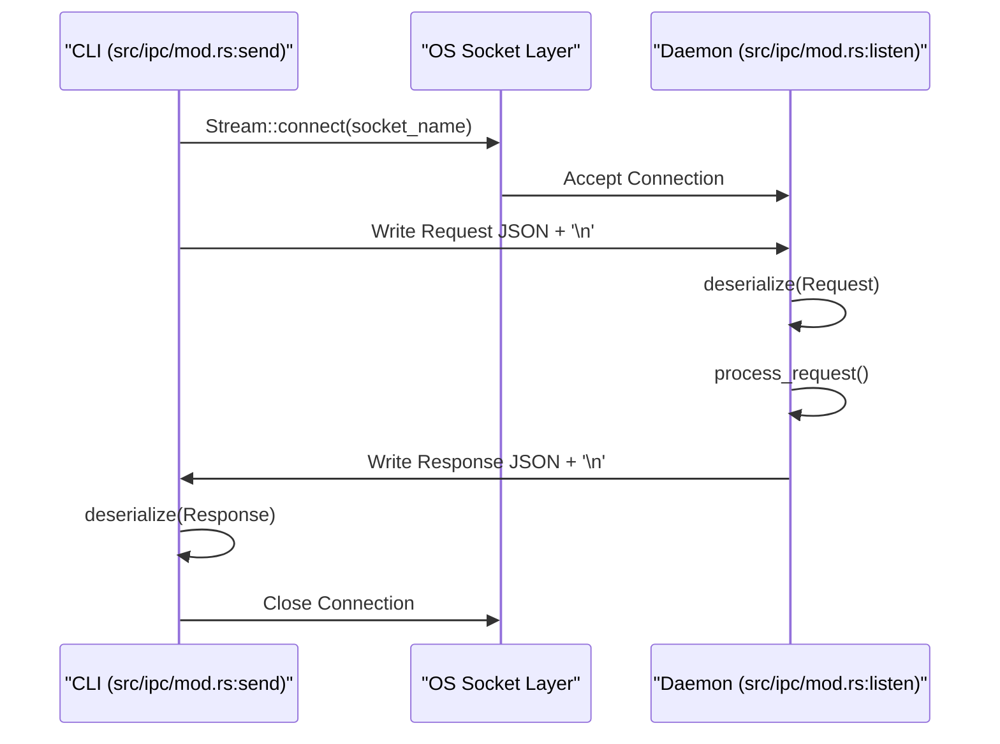
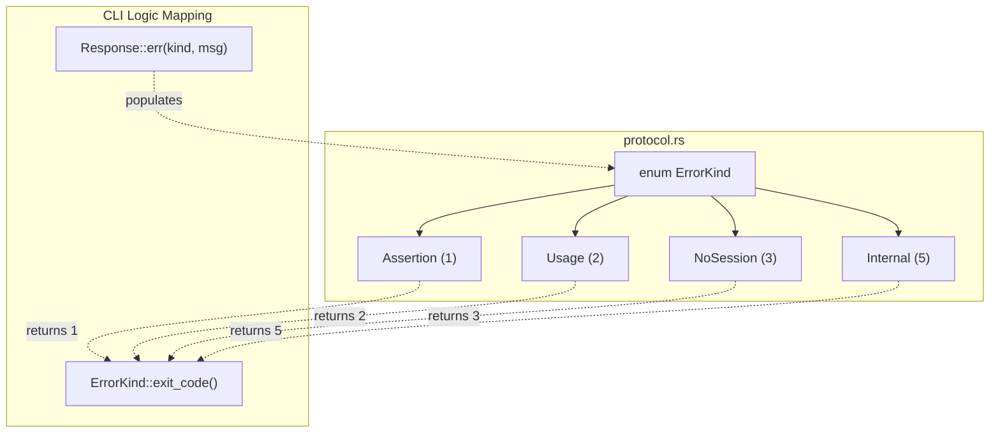

<!-- source: DeepWiki mcp.deepwiki.com · repo microsoft/tui-test · page 3.3 IPC Protocol and Transport · fetched 2026-10-26 -->

# IPC Protocol and Transport

<details>
<summary>Relevant source files</summary>

The following files were used as context for generating this wiki page:

- [src/ipc/mod.rs](src/ipc/mod.rs)
- [src/protocol.rs](src/protocol.rs)

</details>


The `shell-use` architecture relies on a stateless CLI that communicates with a long-running daemon via a local IPC (Inter-Process Communication) mechanism. This transport layer facilitates the exchange of JSON-encoded commands and results, allowing the CLI to remain lightweight while the daemon manages complex PTY and terminal emulation state.

### Transport Layer

The transport is implemented using the `interprocess` crate, providing a unified API for local sockets across different operating systems [src/ipc/mod.rs:1-9](). The communication model is generally **request-response**: the CLI opens a connection, sends a single JSON-encoded `Request`, receives a single JSON-encoded `Response`, and closes the connection [src/ipc/mod.rs:19-33]().

#### Socket Naming and Platform Differences
The daemon identifies sessions by a socket name. The underlying transport mechanism varies by platform to adhere to OS-specific conventions:

| Feature | Unix (Linux/macOS) | Windows |
| :--- | :--- | :--- |
| **Mechanism** | Unix Domain Sockets (UDS) | Named Pipes |
| **Namespace** | Filesystem Path | `\\.\pipe\` Namespace |
| **Implementation** | `GenericFilePath` [src/ipc/mod.rs:15]() | `GenericNamespaced` [src/ipc/mod.rs:13]() |
| **Cleanup** | Stale socket files are manually removed [src/ipc/mod.rs:51-53]() | Handled by OS |

#### IPC Connection Lifecycle
The following diagram illustrates the lifecycle of a single IPC exchange between the CLI and the Daemon.

**IPC Request-Response Flow**

Sources: [src/ipc/mod.rs:19-33](), [src/ipc/mod.rs:50-57](), [src/ipc/mod.rs:69-75]()

---

### Protocol Schema

The protocol uses a tagged JSON format. Every message is a single line of text terminated by a newline (`\n`) [src/ipc/mod.rs:25]().

#### The Request Enum
The `Request` enum defines all valid commands the CLI can send to the daemon. It uses a `snake_case` tag named `kind` to differentiate command types [src/protocol.rs:6-8]().

Key Request types include:
*   **Session Management**: `Open`, `Close`, `Shutdown` [src/protocol.rs:10-18, 102]()
*   **Input Injection**: `Write` (raw strings), `Submit` (strings + enter), `Press` (key combos), `Mouse` [src/protocol.rs:33-44]()
*   **Inspection**: `Text` (screen scrape), `Cells` (raw grid data), `Get` (metadata like CWD or cursor) [src/protocol.rs:21-32]()
*   **Synchronization**: `WaitText`, `WaitIdle`, `WaitCommand`, `WaitExit` [src/protocol.rs:52-67]()
*   **Assertions**: `ExpectText`, `ExpectExitCode`, `ExpectOutput`, `Snapshot` [src/protocol.rs:68-93]()

#### The Response Struct
The `Response` struct is the standard envelope for all daemon replies [src/protocol.rs:180-192]().

```rust
pub struct Response {
    pub ok: bool,                     // Success/Failure indicator
    pub data: Option<Value>,          // JSON payload for successful queries
    pub message: Option<String>,      // Human-readable error/failure message
    pub kind: Option<ErrorKind>,      // Classification for CLI exit codes
}
```
Sources: [src/protocol.rs:5-103](), [src/protocol.rs:180-192]()

---

### Error Handling and Exit Codes

The protocol includes a specific `ErrorKind` taxonomy. This allows the daemon to communicate *why* a request failed so the CLI can map the failure to a stable process exit code [src/protocol.rs:153-156]().

**Error Mapping to Code Entities**


| ErrorKind | Exit Code | Description |
| :--- | :--- | :--- |
| `Assertion` | `1` | An `expect` or `wait` condition was not met within the timeout [src/protocol.rs:171](). |
| `Usage` | `2` | Invalid arguments (e.g., malformed regex or invalid color name) [src/protocol.rs:172](). |
| `NoSession` | `3` | The target session socket exists but no active session is running [src/protocol.rs:173](). |
| `Internal` | `5` | I/O errors, PTY failures, or rendering issues [src/protocol.rs:174](). |

Sources: [src/protocol.rs:154-177](), [src/protocol.rs:213-245]()

---

### Specialized Transports

While most commands use the standard request-response cycle, some features require persistent connections.

#### Monitor Mode
The `Monitor` request [src/protocol.rs:98-101]() transitions the connection into a streaming mode. Instead of a single response, the daemon streams terminal updates to the CLI to provide a live view of the session. The CLI uses `ipc::connect` to establish this raw stream [src/ipc/mod.rs:44-47]().

#### Implementation Summary
*   **Serialization**: Handled by `serde_json` [src/ipc/mod.rs:24, 31]().
*   **Buffering**: `BufReader` is used to efficiently handle line-based reading from the socket [src/ipc/mod.rs:23, 61]().
*   **Synchronous I/O**: The current IPC implementation uses synchronous `std::io` traits via the `interprocess` sync API [src/ipc/mod.rs:55]().

Sources: [src/ipc/mod.rs:1-76](), [src/protocol.rs:1-151]()

---

