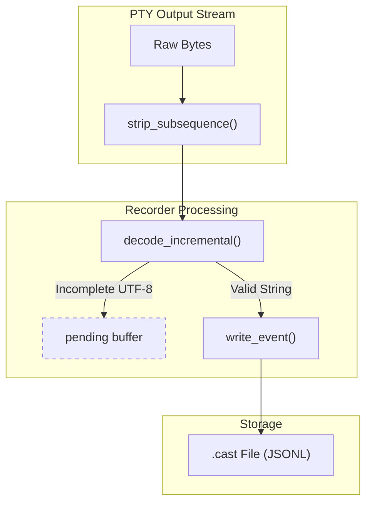
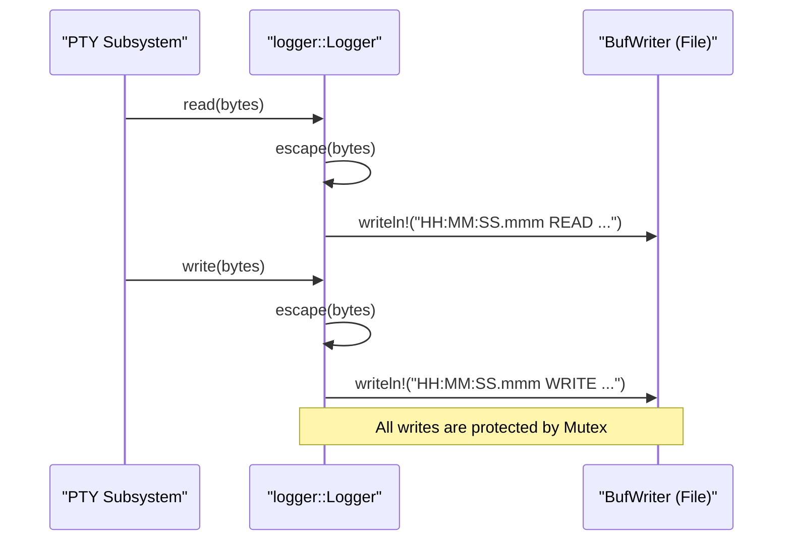

<!-- source: DeepWiki mcp.deepwiki.com · repo microsoft/tui-test · page 3.4 Session Recording and Tracing · fetched 2026-10-26 -->

# Session Recording and Tracing

Relevant source files

The following files were used as context for generating this wiki page:

- [src/daemon/logger.rs](src/daemon/logger.rs)
- [src/trace/mod.rs](src/trace/mod.rs)
- [src/trace/recorder.rs](src/trace/recorder.rs)

The `shell-use` daemon provides always-on session recording and diagnostic tracing to ensure that every interaction with the headless terminal is durable, reproducible, and debuggable. This is achieved through two primary mechanisms: an asciinema-compatible session recorder and a verbose PTY logger.

## Session Recording (Recorder)

The `Recorder` struct in `src/trace/recorder.rs` implements always-on recording of terminal sessions using the **asciinema v2 cast format**. This format is a line-delimited JSON format that allows for streaming updates, ensuring that recordings are readable even if the daemon crashes [src/trace/recorder.rs:1-6]().

### Data Flow and Lifecycle

When a session is opened, a `.cast` file is created. The recorder captures three main types of data:
1.  **Header**: Initial terminal dimensions (columns/rows) and environment variables [src/trace/recorder.rs:55-76]().
2.  **Output ("o")**: Raw bytes read from the PTY, decoded into UTF-8 [src/trace/recorder.rs:79-89]().
3.  **Resize ("r")**: Changes to the terminal window size [src/trace/recorder.rs:92-94]().

### Incremental UTF-8 Decoding

Because PTY reads may split multi-byte UTF-8 sequences (e.g., emojis or box-drawing characters) across separate chunks, the `Recorder` maintains a `pending` buffer [src/trace/recorder.rs:20-21](). The `decode_incremental` function ensures that incomplete sequences are held until the remaining bytes arrive, preventing corruption in the recording [src/trace/recorder.rs:98-127]().

### Recording Logic Diagram

The following diagram illustrates how raw PTY data is transformed into an asciinema event.

| Component | Responsibility |
| :--- | :--- |
| `strip_subsequence` | Removes internal sequences like `WIN32_INPUT_MODE` [src/trace/recorder.rs:140-150](). |
| `decode_incremental` | Buffers split UTF-8 sequences in `pending: Vec<u8>` [src/trace/recorder.rs:98-127](). |
| `write_event` | Appends a timestamped JSON array to the `.cast` file [src/trace/recorder.rs:129-137](). |

Sources: [src/trace/recorder.rs:79-137](), [src/trace/recorder.rs:140-150]()

## Verbose PTY Logging (Logger)

While the `Recorder` focuses on the final visual output for playback, the `Logger` in `src/daemon/logger.rs` provides a developer-centric view of the PTY's raw communication. It is modeled after `inshellisense`'s data logs [src/daemon/logger.rs:1-3]().

### Log Tags
The logger categorizes every entry with a specific tag to clarify the direction and nature of the data:
*   `READ`: Bytes received from the PTY (the application's output) [src/daemon/logger.rs:47-51]().
*   `WRITE`: Bytes sent to the PTY (user input/keystrokes) [src/daemon/logger.rs:53-57]().
*   `REPLY`: Data written back to the PTY in response to terminal capability queries [src/daemon/logger.rs:59-63]().
*   `EVENT`: Lifecycle milestones such as session `open`, `resize`, or `exit` [src/daemon/logger.rs:43-45]().

### Escaping and Formatting
To make control sequences (like ANSI escape codes) visible in text editors, the `escape` function transforms non-printable bytes into readable representations (e.g., `\e`, `\n`, `\r`, or hex escapes like `\x1b`) [src/daemon/logger.rs:88-102]().

### Logger Implementation Diagram

Sources: [src/daemon/logger.rs:17-19](), [src/daemon/logger.rs:47-72](), [src/daemon/logger.rs:88-102]()

## Storage and Retrieval

### File Locations
Recordings and logs are typically stored in a temporary or session-specific directory managed by the daemon. 
*   **Recordings**: `.cast` files are created using `OpenOptions` with `truncate(true)` to ensure fresh starts [src/trace/recorder.rs:39-45]().
*   **Logs**: Log files are created similarly, providing a chronological trace of the session [src/daemon/logger.rs:28-37]().

### Durability
Both the `Recorder` and `Logger` utilize `BufWriter` and perform a `flush()` operation after every write event [src/trace/recorder.rs:136](), [src/daemon/logger.rs:69](). This ensures that data is committed to disk immediately, which is critical for debugging sessions that may hang or crash.

| Feature | `Recorder` | `Logger` |
| :--- | :--- | :--- |
| **Format** | Asciinema v2 (JSONL) | Timestamped Text |
| **Primary Use** | Visual Playback / Audit | Technical Debugging |
| **Encoding** | UTF-8 String | Escaped Raw Bytes |
| **Events** | Output, Resize | Read, Write, Reply, Event |

Sources: [src/trace/recorder.rs:7-11](), [src/trace/recorder.rs:136](), [src/daemon/logger.rs:1-9](), [src/daemon/logger.rs:65-71]()

---

