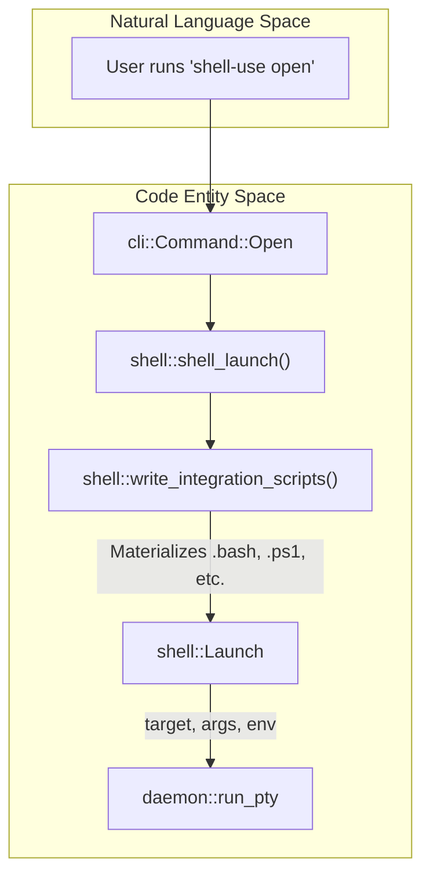

<!-- source: DeepWiki mcp.deepwiki.com · repo microsoft/tui-test · page 4 Shell Integration · fetched 2026-10-26 -->

# Shell Integration

<details>
<summary>Relevant source files</summary>

The following files were used as context for generating this wiki page:

- [shell/shellIntegration.nu](shell/shellIntegration.nu)
- [shell/shellIntegration.xsh](shell/shellIntegration.xsh)
- [src/cli.rs](src/cli.rs)
- [src/main.rs](src/main.rs)
- [src/shell/mod.rs](src/shell/mod.rs)

</details>


`shell-use` provides deep visibility into shell sessions by injecting integration scripts that enable semantic tracking. This allows the daemon to distinguish between the shell prompt, user input, and command output using standard terminal escape sequences.

The integration primarily leverages two types of Operating System Command (OSC) sequences:
- **OSC 133**: Semantic prompt tracking (e.g., marking the start of a prompt, the start of output, and the exit code of the last command).
- **OSC 7**: Reporting the Current Working Directory (CWD) to the terminal emulator.

### Integration Flow

The following diagram illustrates how the `shell-use` CLI prepares the environment and launches a shell with these integrations active.

**Shell Launch Sequence**

**Sources:** [src/main.rs:91-104](), [src/shell/mod.rs:137-226](), [src/shell/mod.rs:65-114]()

---

## Integration Architecture and Script Materialization

When a session is opened, `shell-use` does not rely on pre-installed global scripts. Instead, it "materializes" bundled scripts from the binary into a local directory (`~/.shell-use/shell/`) using `write_integration_scripts()` [src/shell/mod.rs:65-114]().

The `shell_launch()` function determines the specific execution arguments and environment variables required to force the shell to load these scripts [src/shell/mod.rs:137-226]().

### Key Mechanisms
- **ZDOTDIR Redirection**: For Zsh, `shell-use` creates a temporary directory and sets the `ZDOTDIR` environment variable to point there, allowing it to override shell startup without touching the user's global config [src/shell/mod.rs:186-195]().
- **Windows Discovery**: On Windows, the system attempts to locate `git-bash` or appropriate `.exe` wrappers to ensure a consistent environment [src/shell/mod.rs:144-156]().
- **Init Files**: Most shells are launched with flags like `--init-file` (Bash) or `-rc` (Elvish) to source the integration immediately [src/shell/mod.rs:152-154](), [src/shell/mod.rs:209-215]().

For details, see [Integration Architecture and Script Materialization](#4.1).

**Sources:** [src/shell/mod.rs:65-114](), [src/shell/mod.rs:137-226](), [src/shell/mod.rs:116-128]()

---

## Supported Shells

`shell-use` supports a wide variety of shells, each with a custom integration script designed to hook into the prompt and command execution lifecycle.

| Shell | Mechanism | Primary File |
| :--- | :--- | :--- |
| **Bash** | `--init-file` | `shellIntegration.bash` |
| **Zsh** | `ZDOTDIR` redirection | `shellIntegration-rc.zsh` |
| **Fish** | `--init-command` | `shellIntegration.fish` |
| **PowerShell** | `-command` sourcing | `shellIntegration.ps1` |
| **Nushell** | `source` command | `shellIntegration.nu` |
| **Xonsh** | `@events` hooks | `shellIntegration.xsh` |
| **Elvish** | `-rc` flag | `shellIntegration.elv` |

### Semantic Sequences (OSC 133)
The scripts are responsible for emitting specific sequences that the `alacritty_terminal` based emulator interprets:
- `OSC 133 ; A ST`: Prompt start.
- `OSC 133 ; B ST`: Prompt end / Input start.
- `OSC 133 ; C ST`: Command start / Output start.
- `OSC 133 ; D ; <ExitCode> ST`: Command finished with exit code.

**Example: Xonsh Event Integration**
The Xonsh integration uses Python-based event decorators to trigger these sequences.
```python
@events.on_precommand
def __su_pre(cmd, **kw):
    __su_osc('C') # Mark command start

@events.on_postcommand
def __su_post(cmd, rtn, **kw):
    __su_osc(f'D;{rtn}') # Mark command end with return code
```
**Sources:** [shell/shellIntegration.xsh:12-19](), [src/shell/mod.rs:10-20]()

### CWD Reporting (OSC 7)
Most integrations also emit `OSC 7;file://<hostname><path>` to ensure the `Get(Cwd)` command returns the accurate current directory of the shell [shell/shellIntegration.xsh:9-10]().

For details, see [Per-Shell Integration Scripts](#4.2).

**Sources:** [shell/shellIntegration.nu:1-15](), [shell/shellIntegration.xsh:1-26](), [src/shell/mod.rs:10-20]()

---

