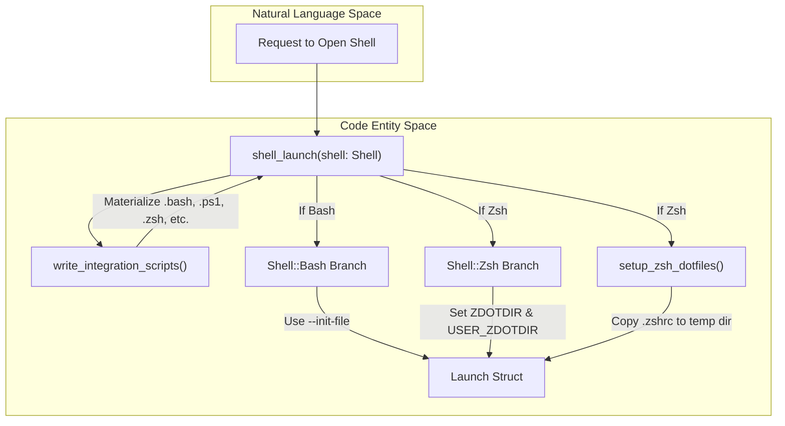
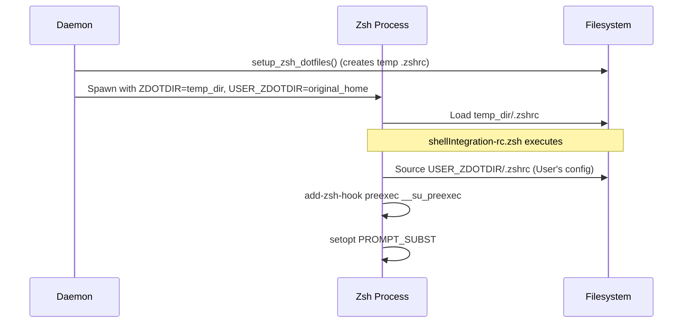

<!-- source: DeepWiki mcp.deepwiki.com · repo microsoft/tui-test · page 4.1 Integration Architecture and Script Materialization · fetched 2026-10-26 -->

# Integration Architecture and Script Materialization

Relevant source files

The following files were used as context for generating this wiki page:

- [shell/shellIntegration-env.zsh](shell/shellIntegration-env.zsh)
- [shell/shellIntegration-login.zsh](shell/shellIntegration-login.zsh)
- [shell/shellIntegration-profile.zsh](shell/shellIntegration-profile.zsh)
- [shell/shellIntegration-rc.zsh](shell/shellIntegration-rc.zsh)
- [shell/shellIntegration.nu](shell/shellIntegration.nu)
- [shell/shellIntegration.xsh](shell/shellIntegration.xsh)
- [src/shell/mod.rs](src/shell/mod.rs)

The `shell-use` system relies on semantic integration with various shells to provide reliable command tracking and state inspection. This is achieved by injecting specialized scripts into the shell process at startup. These scripts use terminal escape sequences (OSC 133 and OSC 7) to signal command boundaries, exit codes, and current working directory changes to the underlying terminal emulator.

## The Launch Sequence

The core of the shell integration logic resides in `src/shell/mod.rs`. When a new session is initiated, the system must determine the correct executable path, command-line arguments, and environment variables required to wrap the shell with `shell-use` hooks.

### The `Launch` Struct
The `Launch` struct is the primary data carrier for process creation parameters:
[src/shell/mod.rs:130-134]()

| Field | Type | Description |
| :--- | :--- | :--- |
| `target` | `String` | The path to the shell executable (e.g., `/bin/zsh` or `pwsh.exe`). |
| `args` | `Vec<String>` | CLI flags used to force the shell to source integration scripts. |
| `env` | `Vec<(String, String)>` | Environment variables, such as `ZDOTDIR` for Zsh redirection. |

### `shell_launch()` Implementation
The `shell_launch()` function is the entry point for preparing a shell session. It performs three critical tasks:
1.  **Materialization**: Calls `write_integration_scripts()` to ensure the latest scripts exist on disk [src/shell/mod.rs:138-138]().
2.  **Specialization**: Branches based on the `Shell` enum to handle syntax differences (e.g., `--init-file` for Bash vs `-rc` for Elvish) [src/shell/mod.rs:142-223]().
3.  **Environment Setup**: Configures shell-specific variables like `USER_ZDOTDIR` or `PROMPT` [src/shell/mod.rs:192-193]().

**Shell Launch Logic Flow**

Sources: [src/shell/mod.rs:130-226]()

---

## Script Materialization

Because `shell-use` is distributed as a single binary, the shell integration scripts are embedded into the Rust executable using the `include_str!` macro.

### `write_integration_scripts()`
This function creates a directory (returned by `scripts_dir()`, typically `~/.shell-use/shell`) and writes the embedded script contents to individual files [src/shell/mod.rs:56-58](), [src/shell/mod.rs:65-114]().

Supported scripts include:
*   `shellIntegration.bash`
*   `shellIntegration.ps1`
*   `shellIntegration.xsh` (Xonsh)
*   `shellIntegration.nu` (Nushell)
*   Multiple `.zsh` files for the Zsh redirection logic.

Sources: [src/shell/mod.rs:56-114]()

---

## Zsh Integration and ZDOTDIR Redirection

Zsh integration is more complex than other shells because it does not provide a standard `--init-file` flag that bypasses user configuration while still allowing it to load. To solve this, `shell-use` uses `ZDOTDIR` redirection.

1.  **Redirection**: `shell_launch` creates a temporary directory and sets the `ZDOTDIR` environment variable to point to it [src/shell/mod.rs:192-192]().
2.  **Proxying**: Inside this temporary directory, `shell-use` materializes a `.zshrc` file (from `shellIntegration-rc.zsh`) that manually sources the user's original `.zshrc` located at `USER_ZDOTDIR` [shell/shellIntegration-rc.zsh:3-7]().
3.  **Hooking**: After sourcing the user's config, the script applies `add-zsh-hook` for `preexec` and `precmd` to emit the required OSC sequences [shell/shellIntegration-rc.zsh:29-30]().

**ZDOTDIR Data Flow**

Sources: [src/shell/mod.rs:116-128](), [src/shell/mod.rs:186-195](), [shell/shellIntegration-rc.zsh:1-30]()

---

## Windows Discovery Logic

On Windows, `shell-use` must handle the discovery of shell executables that may not be in the standard PATH or require specific extensions.

### `windows_exe()`
A utility function that appends `.exe` to the command name when running on Windows platforms [src/shell/mod.rs:232-236]().

### `git_bash_path()`
For Bash on Windows, the system specifically looks for Git Bash, as it provides a compatible Unix-like environment. The logic (not fully shown in snippets but referenced) handles locating `bash.exe` within the Git installation directory [src/shell/mod.rs:145-145]().

### Command-Line Arguments for Windows Shells
*   **PowerShell/Pwsh**: Uses `-NoLogo -NoProfile -noexit -command` to source the integration script [src/shell/mod.rs:168-172]().
*   **Cmd**: Sets the `PROMPT` environment variable to `$G ` and executes `/k cls` to clear the initial banner [src/shell/mod.rs:197-201]().

Sources: [src/shell/mod.rs:144-175](), [src/shell/mod.rs:196-202](), [src/shell/mod.rs:232-236]()

---

## Semantic Prompt Hooks

Each materialized script implements a set of common hooks. While the implementation varies (e.g., Python for Xonsh, shell functions for Zsh), the emitted sequences are standardized.

| Sequence | Purpose | Example (Xonsh) |
| :--- | :--- | :--- |
| `OSC 133; A` | Prompt Start | `__su_osc('A')` [shell/shellIntegration.xsh:21-21]() |
| `OSC 133; B` | Command Start | `\033]133;B\007` [shell/shellIntegration.xsh:23-23]() |
| `OSC 133; C` | Execution Start | `__su_osc('C')` [shell/shellIntegration.xsh:14-14]() |
| `OSC 133; D;{rc}` | Execution End (Exit Code) | `__su_osc(f'D;{rtn}')` [shell/shellIntegration.xsh:18-18]() |
| `OSC 7; {url}` | Current Working Directory | `__su_cwd()` [shell/shellIntegration.xsh:10-10]() |

### Nushell Special Case
Nushell provides native support for these sequences. The `shellIntegration.nu` script simply enables the built-in `osc133` and `osc7` flags in `$env.config` rather than manually printing sequences [shell/shellIntegration.nu:4-7]().

Sources: [shell/shellIntegration.xsh:6-26](), [shell/shellIntegration.nu:1-15]()

---

