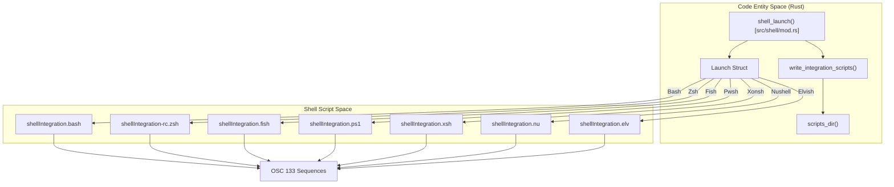

<!-- source: DeepWiki mcp.deepwiki.com · repo microsoft/tui-test · page 4.2 Per-Shell Integration Scripts · fetched 2026-10-26 -->

# Per-Shell Integration Scripts

Relevant source files

The following files were used as context for generating this wiki page:

- [shell/shellIntegration.bash](shell/shellIntegration.bash)
- [shell/shellIntegration.elv](shell/shellIntegration.elv)
- [shell/shellIntegration.fish](shell/shellIntegration.fish)
- [shell/shellIntegration.nu](shell/shellIntegration.nu)
- [shell/shellIntegration.ps1](shell/shellIntegration.ps1)
- [shell/shellIntegration.xsh](shell/shellIntegration.xsh)
- [src/shell/mod.rs](src/shell/mod.rs)

This page documents the specific implementation details of the shell integration scripts used by `shell-use`. These scripts are injected into shell sessions to enable semantic tracking via **OSC 133** (Shell Integration) and **OSC 7** (Current Working Directory) escape sequences.

The integration allows the terminal emulator to distinguish between the prompt, the command being typed, and the resulting output, which is critical for the `wait command` and `expect output` functionality.

### Integration Architecture Overview

The `shell-use` daemon materializes these scripts from its binary into a local directory before launching a shell. The `Shell` enum in `src/shell/mod.rs` defines the supported environments.

| Shell | Script File | Hook Mechanism |
| :--- | :--- | :--- |
| **Bash** | `shellIntegration.bash` | `PROMPT_COMMAND` & `trap DEBUG` |
| **Zsh** | `shellIntegration-rc.zsh` | `ZDOTDIR` redirection |
| **Fish** | `shellIntegration.fish` | `--on-event` hooks |
| **PowerShell** | `shellIntegration.ps1` | `Prompt` function override & `PSReadLine` wrapper |
| **Xonsh** | `shellIntegration.xsh` | `@events.on_precommand` / `on_postcommand` |
| **Nushell** | `shellIntegration.nu` | Native `$env.config.shell_integration` |
| **Elvish** | `shellIntegration.elv` | `edit:after-command` & `edit:before-readline` |
| **Cmd** | N/A (Internal) | Static `PROMPT` environment variable |

**Diagram: Integration Script Flow**
This diagram shows how the `shell_launch` function prepares the environment and which shell-specific script is invoked.

Sources: [src/shell/mod.rs:130-134](), [src/shell/mod.rs:137-226]()

---

### Bash Integration
The Bash script uses `PROMPT_COMMAND` to execute logic before the prompt is displayed and a `DEBUG` trap to detect command execution.

*   **Prompt (OSC 133;A/B):** Set inside `__su_precmd` via `PS1`. It brackets the `> ` string. [shell/shellIntegration.bash:32-32]()
*   **Command Start (OSC 133;C):** Triggered by `trap '__su_preexec_invoke' DEBUG` which fires just before a command runs. [shell/shellIntegration.bash:22-24]()
*   **Command End (OSC 133;D):** Captured in `__su_precmd` by checking the exit code `$?` of the previous command. [shell/shellIntegration.bash:27-30]()

Sources: [shell/shellIntegration.bash:15-36]()

### Zsh Integration
Zsh integration is unique because `shell-use` forces a custom `ZDOTDIR`.
1.  `shell_launch` creates a temporary directory containing `.zshrc`, `.zprofile`, etc. [src/shell/mod.rs:116-128]()
2.  It sets the `ZDOTDIR` environment variable to this temporary path, while preserving the original in `USER_ZDOTDIR`. [src/shell/mod.rs:192-193]()
3.  The scripts then source the user's original configuration to maintain their environment while overlaying the OSC sequences.

Sources: [src/shell/mod.rs:186-195]()

### Fish Integration
Fish uses its native event system for clean integration without overriding user functions.

*   **Pre-exec:** `function __su_preexec --on-event fish_preexec` emits `OSC 133;C`. [shell/shellIntegration.fish:3-3]()
*   **Post-exec:** `function __su_postexec --on-event fish_postexec` emits `OSC 133;D;$status`. [shell/shellIntegration.fish:4-4]()
*   **Prompt:** The `fish_prompt` function is redefined to wrap the output in `OSC 133;A` and `OSC 133;B`. [shell/shellIntegration.fish:5-5]()

Sources: [shell/shellIntegration.fish:1-6]()

### PowerShell (Pwsh/Windows PowerShell)
PowerShell requires wrapping the `Prompt` function and potentially the `PSConsoleHostReadLine` function to handle the input phase.

*   **State Management:** Uses a global variable `$Global:__su_state` to track if it is currently executing a command. [shell/shellIntegration.ps1:9-14]()
*   **CWD Reporting:** Uses `[System.Environment]::MachineName` and `$pwd.ProviderPath` to construct the `OSC 7` URI. [shell/shellIntegration.ps1:41-43]()
*   **PSReadLine Hook:** If `PSReadLine` is present, it intercepts the `PSConsoleHostReadLine` call to emit `OSC 133;C` immediately after the user presses Enter. [shell/shellIntegration.ps1:58-63]()

Sources: [shell/shellIntegration.ps1:1-64]()

### Xonsh Integration
Xonsh integration is implemented in Python using the `@events` decorator system.

*   **Events:** It hooks `on_precommand` to emit `OSC 133;C` and `on_postcommand` to emit `OSC 133;D;{rtn}`. [shell/shellIntegration.xsh:12-18]()
*   **Prompt:** The `$PROMPT` variable is assigned a function `__su_prompt` that returns the prompt string wrapped in sequences. [shell/shellIntegration.xsh:20-25]()

Sources: [shell/shellIntegration.xsh:1-26]()

### Nushell Integration
Nushell provides native support for these sequences, so the integration script primarily acts as a configuration toggle.

*   **Native Flags:** Sets `$env.config.shell_integration.osc133 = true` and `osc7 = true`. [shell/shellIntegration.nu:6-7]()
*   **Minimalism:** Disables the banner and forces a simple `> ` prompt to ensure predictable terminal state for tests. [shell/shellIntegration.nu:8-12]()

Sources: [shell/shellIntegration.nu:1-15]()

### Elvish Integration
Elvish integration utilizes the `edit` module hooks.

*   **Hooks:** It uses `edit:before-readline`, `edit:after-readline`, and `edit:after-command`. [shell/shellIntegration.elv:36-38]()
*   **Exit Status:** The `__su_after_command` function extracts the exit status from the `cmd-info` map, handling nested error structures. [shell/shellIntegration.elv:21-32]()

Sources: [shell/shellIntegration.elv:1-39]()

### Windows Command Prompt (Cmd)
`Cmd.exe` does not support complex scripting or hooks. `shell-use` implements a "best effort" integration by setting the `PROMPT` environment variable to `$G ` (a simple `> `). It does not currently support semantic OSC 133 sequences for Cmd.

Sources: [src/shell/mod.rs:197-201]()

---

### Sequence Mapping Reference

This table describes how the integration scripts map shell states to terminal escape sequences.

| Sequence | Name | Meaning | Code Example (Elvish) |
| :--- | :--- | :--- | :--- |
| `\e]133;A\a` | Prompt Start | The shell is about to display the prompt. | `__su_osc "133;A"` [shell/shellIntegration.elv:12]() |
| `\e]133;B\a` | Prompt End | The prompt has ended; user input begins. | `__su_osc "133;B"` [shell/shellIntegration.elv:14]() |
| `\e]133;C\a` | Command Start | The user submitted a command; output begins. | `__su_osc "133;C"` [shell/shellIntegration.elv:18]() |
| `\e]133;D;{n}\a` | Command End | The command finished with exit code `{n}`. | `__su_osc "133;D;"$status` [shell/shellIntegration.elv:31]() |
| `\e]7;file://...` | CWD | Reports the current working directory. | `__su_osc "7;file://"$p` [shell/shellIntegration.elv:8]() |

**Diagram: Shell State Transitions**
Associating shell events with the specific functions in the integration scripts.

```mermaid
stateDiagram-v2
    [*] --> PromptState : Shell Starts
    PromptState --> InputState : "OSC 133;A (e.g. __su_precmd)"
    InputState --> ExecutingState : "OSC 133;C (e.g. __su_preexec)"
    ExecutingState --> PromptState : "OSC 133;D (e.g. __su_postexec)"
    
    note right of PromptState
        Bash: __su_precmd
        Fish: fish_prompt
        Pwsh: Global:Prompt
    end note

    note right of ExecutingState
        Bash: __su_preexec_invoke
        Xonsh: __su_pre
        Elvish: __su_after_readline
    end note
```

Sources: [shell/shellIntegration.bash:26-36](), [shell/shellIntegration.fish:1-5](), [shell/shellIntegration.ps1:18-50](), [shell/shellIntegration.elv:11-32]()

---

