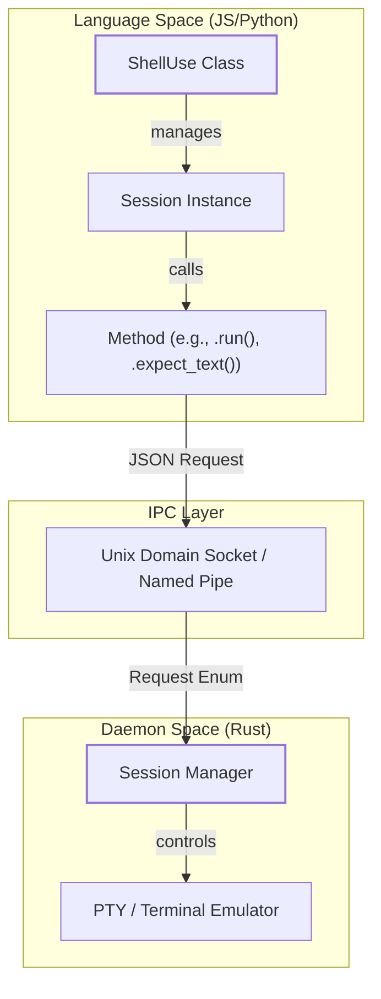
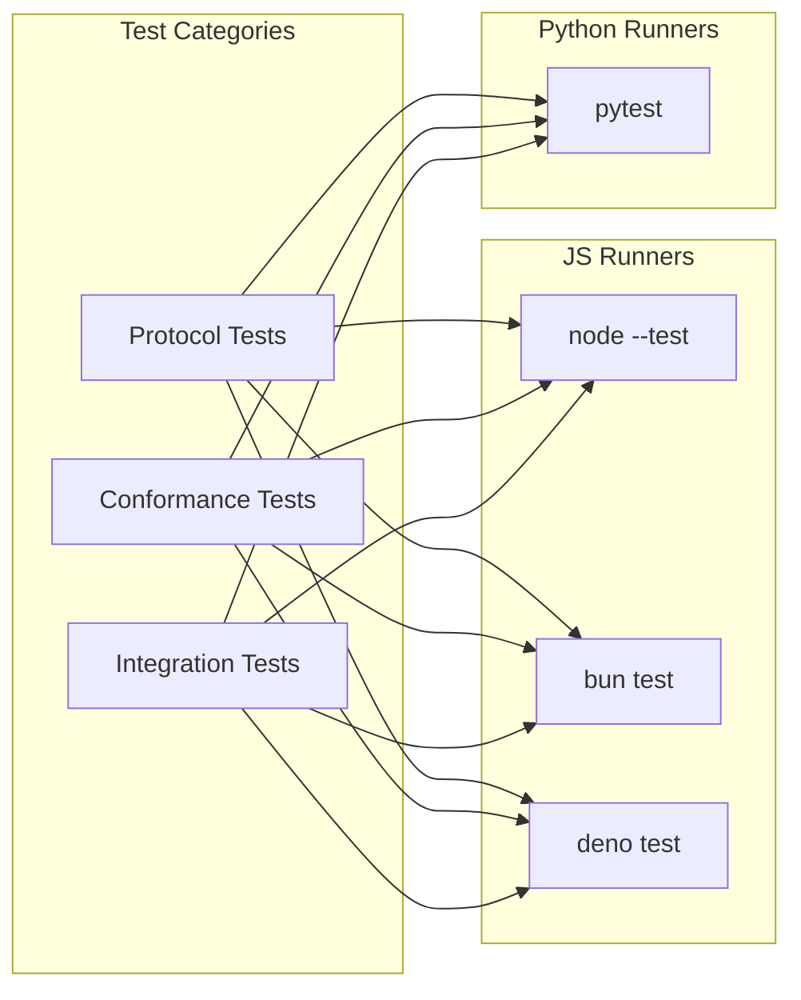

<!-- source: DeepWiki mcp.deepwiki.com · repo microsoft/tui-test · page 5 Language Bindings · fetched 2026-10-26 -->

# Language Bindings

Relevant source files

The following files were used as context for generating this wiki page:

- [bindings/js/package.json](bindings/js/package.json)
- [bindings/python/pyproject.toml](bindings/python/pyproject.toml)

The `shell-use` ecosystem provides high-level client libraries for JavaScript/TypeScript and Python. These bindings wrap the underlying JSON-over-local-socket IPC protocol, allowing developers to programmatically control, inspect, and test terminal sessions without manually managing sockets or raw PTY streams.

### Binding Architecture Overview

Both libraries implement a consistent `ShellUse` class pattern that communicates with the `shell-use` daemon. They handle the lifecycle of the daemon process, session creation, and the serialization of requests into the protocol format expected by the Rust backend.

#### System Mapping

The following diagram bridges the high-level language constructs to the internal protocol and daemon entities.

**Entity Mapping: Client to Daemon**

**Sources:**
- `bindings/js/package.json:2-4`()
- `bindings/python/pyproject.toml:6-8`()

---

### JavaScript / TypeScript Bindings

The `@microsoft/shell-use` package provides a native TypeScript interface for Node.js, Bun, and Deno environments. It leverages modern asynchronous patterns to provide a seamless developer experience for TUI testing and shell automation.

| Feature | Detail |
| :--- | :--- |
| **Package Name** | `@microsoft/shell-use` [bindings/js/package.json:2-2]() |
| **Requirements** | Node.js >= 20 [bindings/js/package.json:18-18]() |
| **Runtimes** | Node, Bun, Deno [bindings/js/package.json:26-29]() |
| **Primary Class** | `ShellUse` |

For detailed API documentation, transport layer specifics, and runtime-specific configuration, see [JavaScript / TypeScript Bindings](#5.1).

**Sources:**
- `bindings/js/package.json:1-30`()

---

### Python Bindings

The `shell-use` Python package offers an `asyncio`-based client library. It is designed to integrate easily into Python testing frameworks like `pytest` or for use in AI agent toolsets.

| Feature | Detail |
| :--- | :--- |
| **Package Name** | `shell-use` [bindings/python/pyproject.toml:6-6]() |
| **Requirements** | Python >= 3.8 [bindings/python/pyproject.toml:10-10]() |
| **Build System** | Hatchling [bindings/python/pyproject.toml:2-3]() |
| **Primary Class** | `ShellUse` |

For details on the async API, session management, and configuration options, see [Python Bindings](#5.2).

**Sources:**
- `bindings/python/pyproject.toml:1-26`()

---

### Conformance and Testing

To ensure parity between the Rust daemon and the various language bindings, a shared test suite validates protocol conformance and integration behavior across all supported platforms.

**Testing Matrix**

For information on how to run these suites and the specific behaviors they validate, see [Bindings Test Suites](#5.3).

**Sources:**
- `bindings/js/package.json:25-29`()

---

