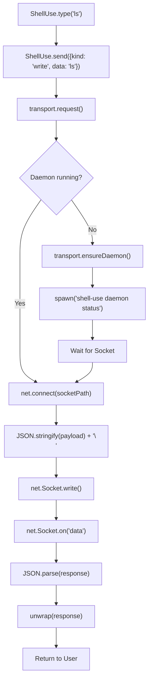
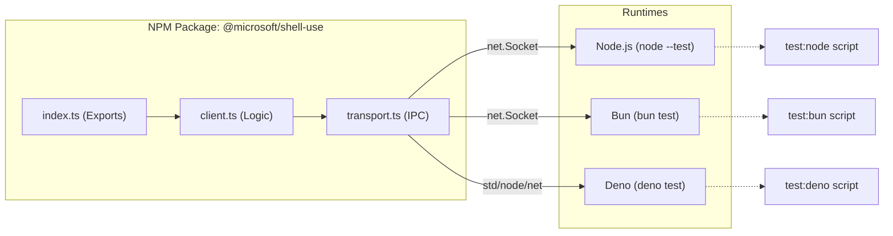

<!-- source: DeepWiki mcp.deepwiki.com · repo microsoft/tui-test · page 5.1 JavaScript / TypeScript Bindings · fetched 2026-10-26 -->

# JavaScript / TypeScript Bindings

Relevant source files

The following files were used as context for generating this wiki page:

- [bindings/js/package.json](bindings/js/package.json)
- [bindings/js/src/client.ts](bindings/js/src/client.ts)
- [bindings/js/src/config.ts](bindings/js/src/config.ts)
- [bindings/js/src/errors.ts](bindings/js/src/errors.ts)
- [bindings/js/src/index.ts](bindings/js/src/index.ts)
- [bindings/js/src/protocol.ts](bindings/js/src/protocol.ts)
- [bindings/js/src/sessions.ts](bindings/js/src/sessions.ts)
- [bindings/js/src/transport.ts](bindings/js/src/transport.ts)
- [bindings/js/src/types.ts](bindings/js/src/types.ts)
- [bindings/js/src/version.ts](bindings/js/src/version.ts)

The `@microsoft/shell-use` npm package provides high-level JavaScript and TypeScript bindings for the `shell-use` terminal daemon. It allows developers to programmatically control, inspect, and automate terminal sessions using a promise-based API. The package is designed to work across multiple runtimes including Node.js, Bun, and Deno.

## Core API: The `ShellUse` Class

The primary entry point for the library is the `ShellUse` class, which manages the lifecycle of a specific shell session and provides methods for interaction and inspection.

### Initialization and Configuration
When a `ShellUse` instance is created, it resolves the session name and binary path from options or environment variables [bindings/js/src/client.ts:112-117]().

| Option | Environment Variable | Default | Description |
| :--- | :--- | :--- | :--- |
| `session` | `SHELL_USE_SESSION` | `"default"` | The name of the session to connect to [bindings/js/src/config.ts:9-11](). |
| `binary` | `SHELL_USE_BIN` | `"shell-use"` | Path to the `shell-use` executable [bindings/js/src/config.ts:13-15](). |
| `home` | `SHELL_USE_HOME` | `~/.shell-use` | Directory for sockets and logs [bindings/js/src/config.ts:17-23](). |

### Session Management
The class provides methods to start shells or specific programs:
*   **`open(opts)`**: Starts a shell (e.g., `bash`, `pwsh`) with optional dimensions and environment [bindings/js/src/client.ts:137-147]().
*   **`run(program, args, opts)`**: Starts a specific command directly without a shell wrapper [bindings/js/src/client.ts:149-159]().
*   **`close()`**: Terminates the session and disconnects from the daemon [bindings/js/src/client.ts:161-173]().

### Interaction and Inspection
Interaction is handled via high-level methods that wrap the underlying JSON-RPC protocol:
*   **Input**: `type(text)`, `press(...keys)`, and `submit(text)` [bindings/js/src/client.ts:175-193]().
*   **Mouse**: A nested `mouse` object provides `click`, `drag`, `scroll`, and `move` [bindings/js/src/client.ts:41-103]().
*   **State**: `state()` returns the full terminal state, while `text()` retrieves the visible grid as a string [bindings/js/src/client.ts:207-216]().
*   **Assertions**: `expectText()` and `waitText()` allow for polling the terminal for specific output with timeout support [bindings/js/src/client.ts:260-280]().

**Sources:** [bindings/js/src/client.ts:41-280](), [bindings/js/src/config.ts:1-30]()

---

## Transport Layer and Protocol

The library communicates with the Rust daemon over local sockets (Unix Domain Sockets on Linux/macOS, Named Pipes on Windows).

### Data Flow: Client to Daemon
The `ShellUse` class uses a private `send` method to route all requests through the `transport` module.

Terminal Command Execution Flow

### Version Checking
To prevent compatibility issues, the client performs a lazy version check during the first request. It calls `checkVersion` to compare the daemon's reported version against the hardcoded `VERSION` constant [bindings/js/src/version.ts:3-13](). If they mismatch, a `VersionMismatchError` is thrown [bindings/js/src/client.ts:125-135]().

**Sources:** [bindings/js/src/transport.ts:81-130](), [bindings/js/src/client.ts:119-135](), [bindings/js/src/version.ts:1-13]()

---

## Error Handling

The library defines a hierarchy of error types that map to specific daemon failure modes. Every `ShellUseError` includes an `exitCode` property corresponding to the project's stable exit-code taxonomy [bindings/js/src/errors.ts:9-18]().

| Error Class | `ErrorKind` | Exit Code | Trigger |
| :--- | :--- | :--- | :--- |
| `ExpectationError` | `assertion` | 1 | `expectText` failed to match [bindings/js/src/errors.ts:21-25](). |
| `UsageError` | `usage` | 2 | Invalid arguments passed to API [bindings/js/src/errors.ts:27-31](). |
| `NoSessionError` | `no_session` | 3 | Target session does not exist [bindings/js/src/errors.ts:33-37](). |
| `DaemonError` | `daemon` | 4 | IPC or daemon startup failure [bindings/js/src/errors.ts:39-43](). |
| `InternalError` | `internal` | 5 | Unexpected daemon crash/error [bindings/js/src/errors.ts:51-55](). |

The `unwrap` function in `protocol.ts` is responsible for converting daemon error responses into these typed JavaScript exceptions [bindings/js/src/protocol.ts:4-9]().

**Sources:** [bindings/js/src/errors.ts:1-70](), [bindings/js/src/protocol.ts:1-9]()

---

## Multi-Runtime Support

The package is distributed as an ESM module [bindings/js/package.json:5]() and targets environments with Node.js 20 or higher [bindings/js/package.json:18](). It uses standard `node:net` and `node:child_process` modules, which are also supported by Bun and Deno.

### Code-to-Runtime Association
The following diagram shows how package exports and test scripts map to runtime capabilities.

Binding Runtime Architecture

The `package.json` defines specific test targets for each runtime to ensure cross-platform transport stability [bindings/js/package.json:25-29]().

**Sources:** [bindings/js/package.json:1-53](), [bindings/js/src/transport.ts:1-7]()

---

## Global Session Utilities

Beyond the `ShellUse` class, the package provides standalone functions for managing the daemon environment:

*   **`sessions(opts)`**: Scans the `homeDir` for `.pid` files and attempts to connect to each to return a list of active sessions [bindings/js/src/sessions.ts:9-28]().
*   **`closeAll(opts)`**: Iterates through all active sessions and sends a `close` command to each [bindings/js/src/sessions.ts:30-40]().
*   **`daemonStop(session, opts)`**: Sends a `shutdown` command to a specific session's daemon [bindings/js/src/sessions.ts:52-60]().
*   **`getRecording(session, opts)`**: Reads the `.cast` (asciinema) file associated with a session from the `recordingDir` [bindings/js/src/sessions.ts:62-76]().

**Sources:** [bindings/js/src/sessions.ts:1-76](), [bindings/js/src/config.ts:42-51]()

---

