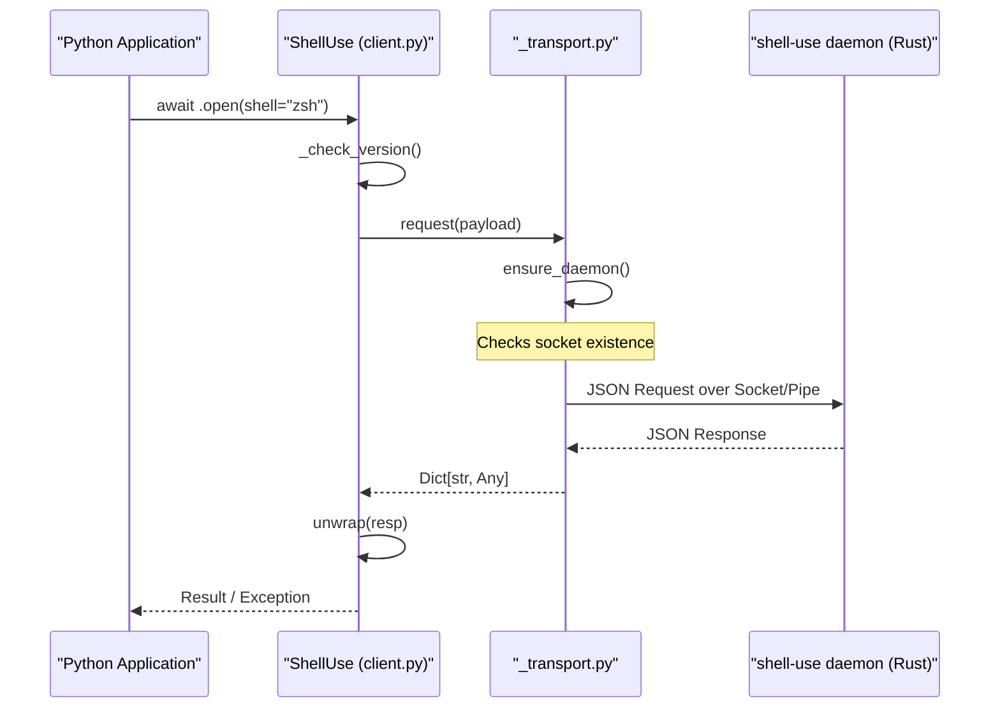
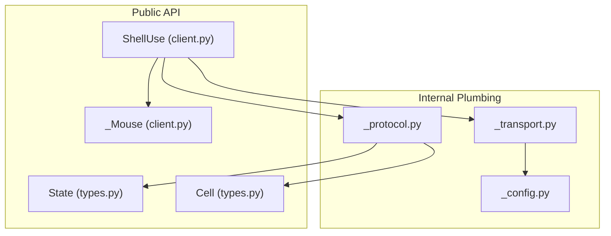

<!-- source: DeepWiki mcp.deepwiki.com · repo microsoft/tui-test · page 5.2 Python Bindings · fetched 2026-10-26 -->

# Python Bindings

Relevant source files

The following files were used as context for generating this wiki page:

- [bindings/python/pyproject.toml](bindings/python/pyproject.toml)
- [bindings/python/src/shell_use/__init__.py](bindings/python/src/shell_use/__init__.py)
- [bindings/python/src/shell_use/_config.py](bindings/python/src/shell_use/_config.py)
- [bindings/python/src/shell_use/_protocol.py](bindings/python/src/shell_use/_protocol.py)
- [bindings/python/src/shell_use/_transport.py](bindings/python/src/shell_use/_transport.py)
- [bindings/python/src/shell_use/client.py](bindings/python/src/shell_use/client.py)
- [bindings/python/src/shell_use/errors.py](bindings/python/src/shell_use/errors.py)
- [bindings/python/src/shell_use/types.py](bindings/python/src/shell_use/types.py)

The `shell-use` Python package provides an asynchronous client for interacting with the `shell-use` terminal daemon. It abstracts the underlying JSON-over-IPC protocol into a high-level `ShellUse` class, enabling programmatic control of terminal sessions, TUI automation, and terminal state inspection.

## Architecture and Data Flow

The Python binding acts as a thin wrapper around the Rust daemon. It manages the lifecycle of the daemon (auto-starting it if necessary), handles the platform-specific IPC transport (Unix Sockets or Windows Named Pipes), and serializes/deserializes the JSON protocol.

### Communication Pipeline

The diagram below illustrates how a method call on the `ShellUse` class traverses the transport layer to reach the `shell-use` daemon.

**Client-Daemon Interaction Flow**

**Sources:** [bindings/python/src/shell_use/client.py:107-110](), [bindings/python/src/shell_use/_transport.py:79-105]()

## The `ShellUse` Class

The `ShellUse` class is the primary entry point for the library. It is designed for `asyncio` and maintains the configuration for a specific session.

### Configuration and Initialization
When initialized, `ShellUse` resolves its environment using a set of priority-based configuration helpers:
1.  **Session Name**: Defaults to the `SHELL_USE_SESSION` environment variable, or `"default"` [bindings/python/src/shell_use/_config.py:16-17]().
2.  **Binary Path**: Defaults to `SHELL_USE_BIN` or simply `"shell-use"` on the system PATH [bindings/python/src/shell_use/_config.py:20-21]().
3.  **Home Directory**: Defaults to `~/.shell-use` (Unix) or `SHELL_USE_HOME` [bindings/python/src/shell_use/_config.py:28-29]().

### Version Checking
To ensure protocol compatibility, the client performs a lazy version check during the first `send()` call [bindings/python/src/shell_use/client.py:112-120](). It compares the client's `VERSION` constant [bindings/python/src/shell_use/_config.py:8]() against the `version` field returned by the daemon's `status` command. A mismatch raises a `VersionMismatchError` [bindings/python/src/shell_use/client.py:13-20]().

**Sources:** [bindings/python/src/shell_use/client.py:89-102](), [bindings/python/src/shell_use/_config.py:1-56]()

## Transport Layer

The `_transport.py` module handles the low-level IPC mechanics.

| Platform | Mechanism | Path Implementation |
| :--- | :--- | :--- |
| **Unix/macOS** | Unix Domain Socket | `~/.shell-use/{session}.sock` |
| **Windows** | Named Pipe | `\\.\pipe\shell-use-{session}.sock` |

**Sources:** [bindings/python/src/shell_use/_config.py:32-35](), [bindings/python/src/shell_use/_transport.py:14-29]()

### Daemon Autostart
If a request is made and the socket does not exist, the `ensure_daemon` function attempts to spawn the `shell-use` binary with the `daemon status` command [bindings/python/src/shell_use/_transport.py:49-76](). This command is designed to start the daemon in the background if it is not already running. The client then polls the connection for up to 5 seconds before failing [bindings/python/src/shell_use/_transport.py:72-76]().

## Protocol and Error Handling

### Request Wrapping
All high-level methods (e.g., `.type()`, `.press()`, `.state()`) wrap their arguments into a dictionary with a `kind` field and send it via `ShellUse.send()` [bindings/python/src/shell_use/client.py:107-110]().

### Response Unwrapping
The `unwrap()` function in `_protocol.py` inspects the daemon's response. If the `ok` field is `False`, it maps the `kind` string provided by the daemon to a specific Python exception type [bindings/python/src/shell_use/_protocol.py:10-13]().

**Error Mapping Table**
| Daemon `kind` | Python Exception | Exit Code |
| :--- | :--- | :--- |
| `assertion` | `ExpectationError` | 1 |
| `usage` | `UsageError` | 2 |
| `no_session` | `NoSessionError` | 3 |
| `daemon` | `DaemonError` | 4 |
| `internal` | `InternalError` | 5 |

**Sources:** [bindings/python/src/shell_use/errors.py:15-56](), [bindings/python/src/shell_use/_protocol.py:10-13]()

## Key Code Entities

The following diagram maps the logical system components to the specific Python classes and modules.

**Entity Mapping**

**Sources:** [bindings/python/src/shell_use/client.py:89-102](), [bindings/python/src/shell_use/types.py:9-49](), [bindings/python/src/shell_use/_transport.py:1-12]()

## API Summary

### Session Management
*   `open(shell, cols, rows, cwd, env)`: Starts a new shell session [bindings/python/src/shell_use/client.py:122-141]().
*   `run(program, *args, ...)`: Starts a specific executable instead of a shell [bindings/python/src/shell_use/client.py:143-162]().
*   `close()`: Terminates the session [bindings/python/src/shell_use/client.py:164-170]().

### Input
*   `type(text)` / `write(data)`: Sends raw strings to the PTY [bindings/python/src/shell_use/client.py:172-176]().
*   `press(*keys)`: Sends key combinations (e.g., `"ctrl+c"`) [bindings/python/src/shell_use/client.py:181-182]().
*   `mouse.click(x, y, ...)`: Performs mouse interactions [bindings/python/src/shell_use/client.py:27-48]().

### Inspection
*   `state()`: Returns a `State` dataclass containing cursor position, ready status, and terminal dimensions [bindings/python/src/shell_use/client.py:196-197]().
*   `text(full=False)`: Returns the visible text of the terminal [bindings/python/src/shell_use/client.py:199-200]().
*   `cells(x, y, w, h)`: Returns a list of `Cell` objects containing character and styling data (colors, bold, etc.) [bindings/python/src/shell_use/client.py:202-204]().

**Sources:** [bindings/python/src/shell_use/client.py:122-220](), [bindings/python/src/shell_use/types.py:9-49]()

---

