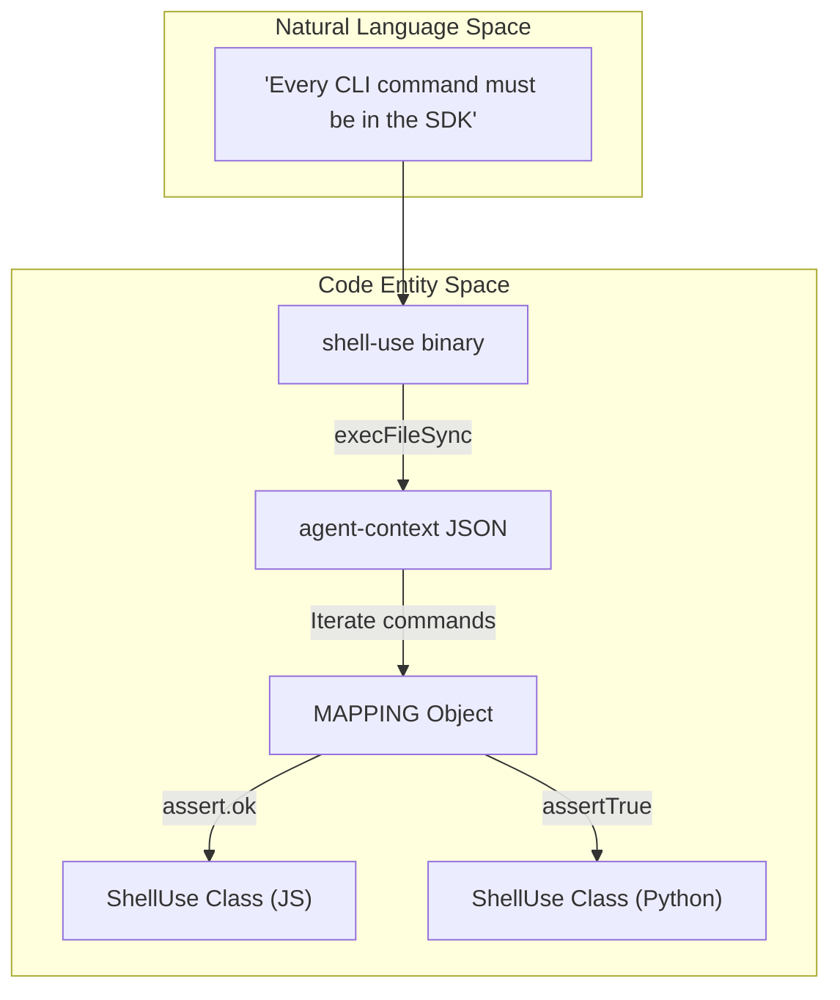
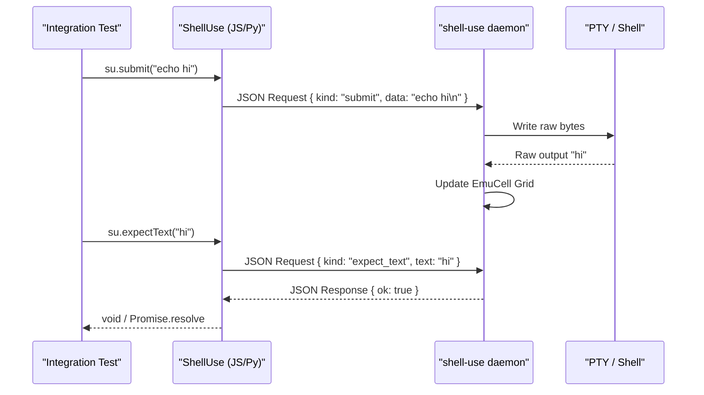

<!-- source: DeepWiki mcp.deepwiki.com · repo microsoft/tui-test · page 5.3 Bindings Test Suites · fetched 2026-10-26 -->

# Bindings Test Suites

<details>
<summary>Relevant source files</summary>

The following files were used as context for generating this wiki page:

- [bindings/js/test/conformance.test.mjs](bindings/js/test/conformance.test.mjs)
- [bindings/js/test/integration.test.mjs](bindings/js/test/integration.test.mjs)
- [bindings/js/test/protocol.test.mjs](bindings/js/test/protocol.test.mjs)
- [bindings/python/tests/test_conformance.py](bindings/python/tests/test_conformance.py)
- [bindings/python/tests/test_integration.py](bindings/python/tests/test_integration.py)
- [bindings/python/tests/test_protocol.py](bindings/python/tests/test_protocol.py)

</details>


The `shell-use` project maintains a rigorous testing strategy for its language bindings (JavaScript and Python) to ensure they remain synchronized with the Rust daemon's CLI and IPC protocol. The test suites are categorized into **Conformance**, **Protocol**, and **Integration** tests.

## Conformance Testing

Conformance tests ensure that the language SDKs provide full coverage of the features available in the `shell-use` CLI. They dynamically validate the SDK surface area against the daemon's own self-documentation.

### Mechanism
The tests execute the `shell-use agent-context` command [bindings/js/test/conformance.test.mjs:10-13]() [bindings/python/tests/test_conformance.py:50-51]() to retrieve a JSON schema of all supported CLI commands and exit codes.

1.  **Command Mapping**: Every command in the CLI (e.g., `open`, `wait`, `expect`) must have a corresponding method in the SDK `ShellUse` class or module exports [bindings/js/test/conformance.test.mjs:22-45]() [bindings/python/tests/test_conformance.py:11-34]().
2.  **Exclusion List**: Commands intended only for interactive use (like `monitor`) or self-documentation (like `usage`) are explicitly excluded from SDK requirements [bindings/js/test/conformance.test.mjs:47]() [bindings/python/tests/test_conformance.py:36]().
3.  **Error Taxonomy**: The tests verify that SDK-specific error classes (e.g., `ExpectationError`, `UsageError`) map to the correct numeric exit codes defined in the core taxonomy [bindings/js/test/conformance.test.mjs:66-72]() [bindings/python/tests/test_conformance.py:70-74]().

### Natural Language to Code Entity Space: Conformance
This diagram shows how the "Natural Language" requirement for feature parity is enforced by comparing the CLI schema against SDK classes.


Sources: [bindings/js/test/conformance.test.mjs:10-64](), [bindings/python/tests/test_conformance.py:49-64]()

---

## Protocol Testing

Protocol tests validate the serialization of requests and the handling of responses without requiring a running daemon. They use a mock transport to inspect the JSON payloads sent over the wire.

### Key Validations
*   **Payload Structure**: Ensures that methods like `open()` build the correct JSON structure, including environment variables and terminal dimensions [bindings/js/test/protocol.test.mjs:19-31]() [bindings/python/tests/test_protocol.py:53-67]().
*   **Kebab-Case Mapping**: Validates that camelCase or snake_case SDK methods correctly map to kebab-case protocol fields (e.g., `getExitCode` -> `exit-code`) [bindings/js/test/protocol.test.mjs:54-59]() [bindings/python/tests/test_protocol.py:89-93]().
*   **Default Values**: Verifies that default timeouts (e.g., 5s for `waitText`, 30s for `waitCommand`) are correctly injected into the payload [bindings/js/test/protocol.test.mjs:70-87]() [bindings/python/tests/test_protocol.py:113-139]().
*   **Version Handshaking**: Tests the `checkVersion` logic to ensure it throws a `VersionMismatchError` if the daemon's version does not match the SDK's expected version [bindings/js/test/protocol.test.mjs:97-107]() [bindings/python/tests/test_protocol.py:141-152]().

### Implementation: CapturingClient
Both JS and Python suites implement a `CapturingClient` that overrides the `send` method to store payloads in an array for assertion [bindings/js/test/protocol.test.mjs:7-17]() [bindings/python/tests/test_protocol.py:19-28]().

Sources: [bindings/js/test/protocol.test.mjs:1-108](), [bindings/python/tests/test_protocol.py:1-156]()

---

## Integration Testing

Integration tests perform end-to-end validation by spawning a real `shell-use` daemon and executing shell commands.

### Test Scenarios
*   **Echo Roundtrip**: Opens a session, submits `echo hello-sdk`, waits for the command to finish, and asserts that the text appears in the terminal grid [bindings/js/test/integration.test.mjs:12-27]() [bindings/python/tests/test_integration.py:26-37]().
*   **Session Management**: Verifies that the `sessions()` module function correctly lists active sessions managed by the daemon [bindings/js/test/integration.test.mjs:29-40]() [bindings/python/tests/test_integration.py:39-49]().
*   **Snapshot Workflow**: Validates that `expectSnapshot` correctly writes files to the client's current working directory (CWD) rather than the daemon's CWD [bindings/js/test/integration.test.mjs:42-63]() [bindings/python/tests/test_integration.py:51-72]().

### Data Flow: Integration Execution
This diagram traces the flow from an SDK call to the actual terminal emulator and back.


Sources: [bindings/js/test/integration.test.mjs:12-27](), [bindings/python/tests/test_integration.py:26-37]()

---

## Running the Tests

Tests are executed using the native test runners for each language. They require the `SHELL_USE_BIN` environment variable to point to a compiled `shell-use` binary for integration and conformance suites.

### JavaScript
The JS suite uses the Node.js native test runner.
```bash
# From bindings/js
export SHELL_USE_BIN=../../target/debug/shell-use
npm test
```
Sources: [bindings/js/test/integration.test.mjs:9-10]()

### Python
The Python suite uses `unittest`.
```bash
# From bindings/python
export SHELL_USE_BIN=../../target/debug/shell-use
python3 -m unittest discover tests
```
Sources: [bindings/python/tests/test_integration.py:10-17]()

## Summary of Test Coverage

| Category | Validates | Dependency |
| :--- | :--- | :--- |
| **Conformance** | SDK method parity with CLI commands | `shell-use` binary |
| **Protocol** | JSON payload structure & serialization | None (Mocked) |
| **Integration** | Real-world PTY interaction & snapshots | `shell-use` binary + Shell |

Sources: [bindings/js/test/conformance.test.mjs:22-45](), [bindings/js/test/protocol.test.mjs:19-31](), [bindings/js/test/integration.test.mjs:12-27]()

---

