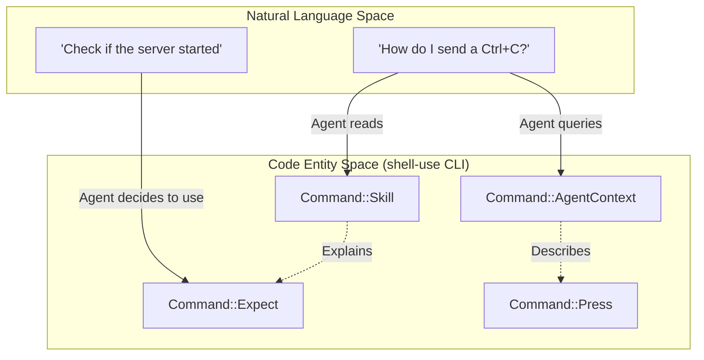
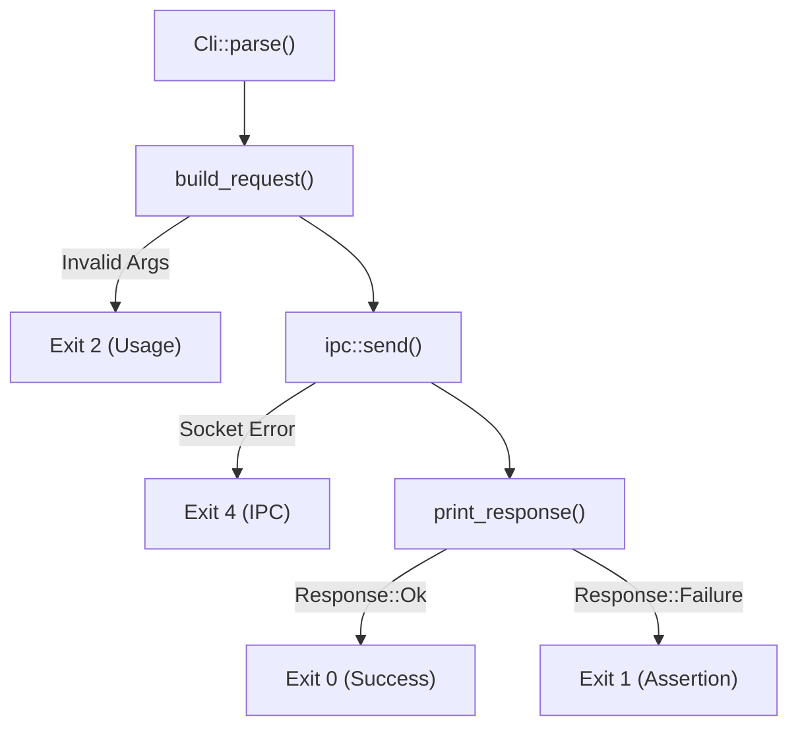

<!-- source: DeepWiki mcp.deepwiki.com · repo microsoft/tui-test · page 6 Agent Integration · fetched 2026-10-26 -->

# Agent Integration

<details>
<summary>Relevant source files</summary>

The following files were used as context for generating this wiki page:

- [.github/workflows/ci.yml](.github/workflows/ci.yml)
- [README.md](README.md)
- [SKILL.md](SKILL.md)
- [src/agent_context.rs](src/agent_context.rs)
- [src/cli.rs](src/cli.rs)
- [src/main.rs](src/main.rs)

</details>


`shell-use` is designed as an "AI-native" CLI, providing structured interfaces that allow LLM-based agents to discover capabilities, understand the CLI surface without manual documentation parsing, and handle errors via stable machine-readable signals.

### Agent Discovery and Self-Documentation

The CLI provides three primary commands to bridge the gap between Natural Language instructions and the technical command space. These commands allow an agent to self-correct and explore the tool's surface area dynamically.

*   **`agent-context`**: Prints a versioned JSON schema of the entire CLI. This includes every command, argument, flag, default value, and enum option [src/agent_context.rs:13-34]().
*   **`usage`**: Provides a high-level, human-readable cheatsheet of common patterns [src/main.rs:43-46]().
*   **`skill`**: Outputs a long-form workflow guide (based on `SKILL.md`) that explains the mental model of sessions, PTY interaction, and assertions [src/main.rs:51-54]().

For details on the JSON schema and how to use these commands for prompt injection, see [Agent Context and Self-Documentation](#6.1).

### Integration Workflow

The following diagram illustrates how an Agent interacts with the `shell-use` ecosystem, moving from natural language intent to specific code entities via the self-documentation commands.

**Natural Language to Code Entity Mapping**

**Sources:** [src/main.rs:35-60](), [src/cli.rs:27-201]()

### Skill Quick-Start

To enable an agent (like GitHub Copilot or Claude Dev) to use `shell-use` effectively within a repository, the `SKILL.md` can be projected into standard agent skill directories:

```sh
# Install the workflow guide for the agent to reference
mkdir -p .agents/skills/shell-use && shell-use skill > .agents/skills/shell-use/SKILL.md
```
**Sources:** [README.md:59-65]()

### Stable Exit-Code Taxonomy

Unlike standard CLIs that often return `1` for all errors, `shell-use` implements a stable taxonomy. This allows agents to distinguish between a logical failure (e.g., an assertion failed) and a transport failure (e.g., the daemon crashed).

| Code | Meaning | Logic in Code |
| :--- | :--- | :--- |
| `0` | Success | `Response::Ok` |
| `1` | Assertion/Wait Failure | `Response::Failure` |
| `2` | Usage Error | `anyhow::Result` during `build_request` |
| `3` | Session Missing | Daemon cannot find target socket |
| `4` | IPC/Daemon Error | `ipc::send` failure |
| `5` | Internal Error | Panic or unexpected state |

For a complete mapping of `ResponseKind` to these codes, see [Exit Code Taxonomy](#6.2).

**Error Handling Flow**

**Sources:** [src/main.rs:26-62](), [src/agent_context.rs:36-45]()

## Child Pages
- [Agent Context and Self-Documentation](#6.1) — Details on the `agent-context` JSON schema, versioning, and the `SKILL.md` content.
- [Exit Code Taxonomy](#6.2) — Comprehensive list of exit codes and how the CLI maps internal `Response` types to process exit statuses.

---

