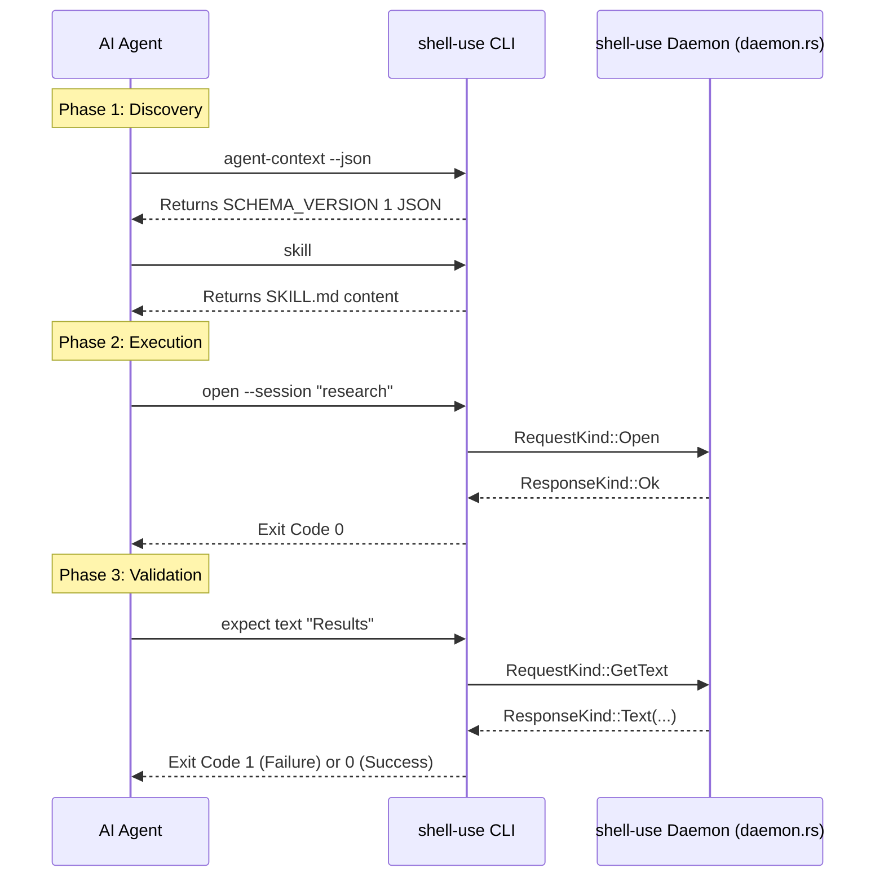

<!-- source: DeepWiki mcp.deepwiki.com · repo microsoft/tui-test · page 6.1 Agent Context and Self-Documentation · fetched 2026-10-26 -->

# Agent Context and Self-Documentation

<details>
<summary>Relevant source files</summary>

The following files were used as context for generating this wiki page:

- [.github/workflows/ci.yml](.github/workflows/ci.yml)
- [README.md](README.md)
- [SKILL.md](SKILL.md)
- [src/agent_context.rs](src/agent_context.rs)

</details>


`shell-use` is designed as an "AI-native" CLI, providing structured metadata and documentation directly to Large Language Models (LLMs) and autonomous agents. This eliminates the need for agents to rely on brittle scraping of help text or outdated training data. Instead, the tool provides a versioned JSON schema of its entire command surface, ensuring the agent always has an accurate view of the current binary's capabilities.

## Self-Documentation Commands

The system provides three primary entry points for an agent to discover how to use the tool:

| Command | Output Format | Purpose |
| :--- | :--- | :--- |
| `agent-context` | JSON | Machine-readable schema of every command, flag, enum, and exit code. |
| `usage` | Plain Text | A concise, one-screen cheatsheet for quick reference. |
| `skill` | Markdown | The full workflow guide (`SKILL.md`) containing best practices and examples. |

**Sources:** [README.md:51-57](), [SKILL.md:16-24]()

---

## Agent Context JSON Schema

The `agent-context` command generates a comprehensive JSON document derived directly from the `clap` command model in the Rust source code. This ensures that the documentation is always in sync with the implementation.

### Implementation Details
The context is generated by the `render()` function in `src/agent_context.rs`. It reflects the `Cli` struct defined in the crate's CLI module.

**Data Flow: Code to JSON**
1. The `Cli::command()` factory is invoked to retrieve the `clap::Command` definition [src/agent_context.rs:14-14]().
2. Global flags (e.g., `--session`, `--json`) are extracted using `is_global_set()` [src/agent_context.rs:17-21]().
3. The command hierarchy is recursively traversed via `commands_json` to build a map of subcommands [src/agent_context.rs:48-57]().
4. Argument metadata (types, defaults, enums) is serialized via `arg_json` [src/agent_context.rs:80-139]().

### Schema Structure
The output follows a versioned format (currently `schema_version: "1"`) [src/agent_context.rs:10-10]().

```json
{
  "schema_version": "1",
  "name": "shell-use",
  "version": "0.1.0",
  "about": "Drive, inspect, assert on, record, and watch a real terminal...",
  "exit_codes": {
    "0": "success",
    "1": "assertion or wait condition not met",
    "3": "no active session",
    "...": "..."
  },
  "global_flags": [...],
  "commands": {
    "open": {
      "about": "Spawn a shell session",
      "args": [...]
    },
    "expect": {
      "subcommands": {
        "text": { ... }
      }
    }
  }
}
```

### Argument Type Mapping
The generator maps internal Rust types to a simplified set for agents:
*   **`bool`**: Flags using `ArgAction::SetTrue` [src/agent_context.rs:82-82]().
*   **`enum`**: Arguments with a defined list of possible values (e.g., signal types like `INT`, `TERM`) [src/agent_context.rs:92-93]().
*   **`value`**: Positional arguments [src/agent_context.rs:94-95]().
*   **`string`**: Standard named options [src/agent_context.rs:97-97]().

**Sources:** [src/agent_context.rs:1-139]()

---

## Skill Injection (SKILL.md)

The `SKILL.md` file is a specialized workflow guide intended to be injected into an agent's "skill" directory. This allows agents (like GitHub Copilot or Claude) to understand high-level workflows, such as driving a TUI or handling session persistence.

### Injection Cheatsheet
To provide `shell-use` capabilities to an agent, the output of `shell-use skill` should be redirected to the agent's specific skill path:

```sh
# For GitHub Copilot / Codex
mkdir -p .agents/skills/shell-use && shell-use skill > .agents/skills/shell-use/SKILL.md

# For Claude
mkdir -p .claude/skills/shell-use && shell-use skill > .claude/skills/shell-use/SKILL.md
```

**Sources:** [README.md:59-65](), [SKILL.md:1-124]()

---

## System Mapping Diagrams

### Diagram 1: Discovery Data Flow
This diagram illustrates how the `Cli` definition in the Rust source code is transformed into various documentation formats for the Agent.

```mermaid
graph TD
    subgraph "Code Entity Space"
        CLI_DEF["Cli::command() (clap::Command)"]
        AC_MOD["src/agent_context.rs"]
        SKILL_FILE["SKILL.md"]
    end

    subgraph "Natural Language Space"
        AGENT_JSON["agent-context (JSON)"]
        USAGE_TEXT["usage (Cheatsheet)"]
        SKILL_MD["skill (Workflow Guide)"]
    end

    CLI_DEF -->|Reflected by| AC_MOD
    AC_MOD -->|render()| AGENT_JSON
    CLI_DEF -->|Short Help| USAGE_TEXT
    SKILL_FILE -->|Stdout| SKILL_MD

    AGENT_JSON -.->|Informs| AgentLogic["AI Agent / LLM"]
    SKILL_MD -.->|Context for| AgentLogic
```
**Sources:** [src/agent_context.rs:13-34](), [README.md:51-57]()

### Diagram 2: Agent Interaction Lifecycle
This diagram shows how an agent uses the self-documentation to perform a task, bridging the gap between documentation and execution.


**Sources:** [SKILL.md:126-134](), [src/agent_context.rs:36-45](), [README.md:32-37]()

---

## Usage Cheatsheet
The `usage` command provides a condensed version of the following table for human and agent quick-reference:

| Category | Key Commands |
| :--- | :--- |
| **Lifecycle** | `open`, `run`, `close`, `sessions`, `daemon status` |
| **Input** | `type`, `submit`, `press`, `keys`, `mouse click` |
| **Inspection** | `state`, `text`, `screenshot`, `cells`, `get` |
| **Wait** | `wait text`, `wait idle`, `wait command`, `wait exit` |
| **Assertion** | `expect text`, `expect exit-code`, `expect output`, `expect snapshot` |

**Sources:** [SKILL.md:55-123](), [README.md:122-160]()

---

