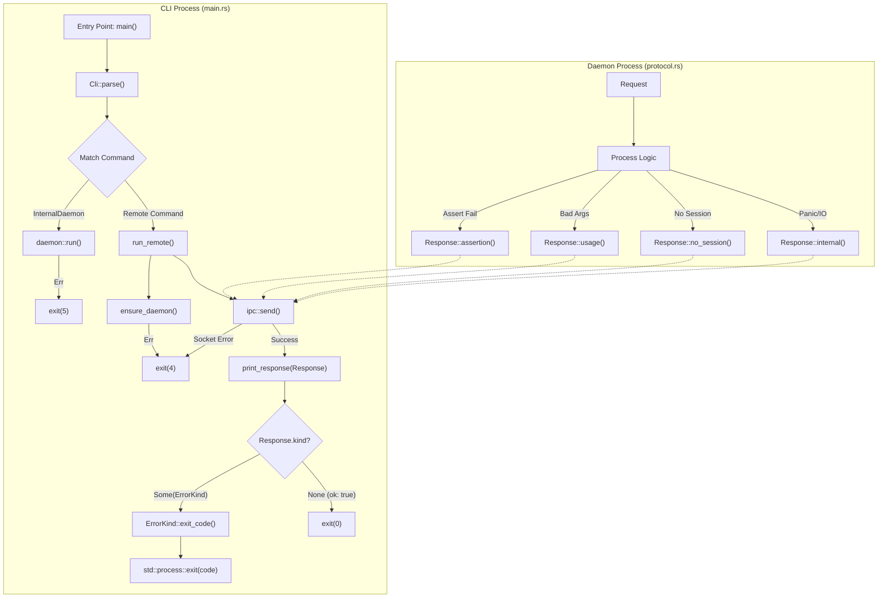
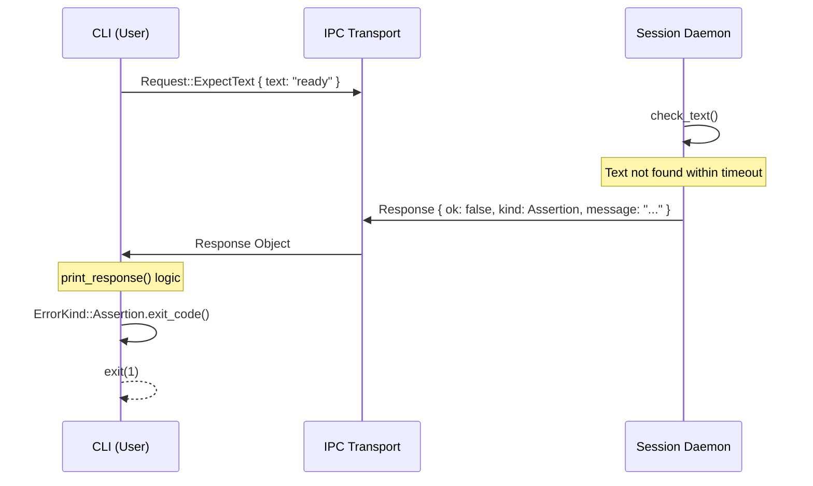

<!-- source: DeepWiki mcp.deepwiki.com · repo microsoft/tui-test · page 6.2 Exit Code Taxonomy · fetched 2026-10-26 -->

# Exit Code Taxonomy

<details>
<summary>Relevant source files</summary>

The following files were used as context for generating this wiki page:

- [src/cli.rs](src/cli.rs)
- [src/main.rs](src/main.rs)
- [src/protocol.rs](src/protocol.rs)

</details>


The `shell-use` CLI employs a stable exit-code taxonomy designed to allow callers—specifically AI agents and CI pipelines—to programmatically distinguish between different classes of failure. Rather than returning a generic non-zero code, the system maps internal `ErrorKind` variants to specific integers.

## Taxonomy Definition

The following table defines the stable exit codes used across the `shell-use` ecosystem.

| Code | Name | Description | `ErrorKind` Mapping |
| :--- | :--- | :--- | :--- |
| **0** | **Success** | The command completed successfully. | N/A |
| **1** | **Assertion Failure** | An `expect` or `wait` condition was not met within the timeout. | `ErrorKind::Assertion` |
| **2** | **Usage Error** | Invalid CLI arguments, malformed regex, or invalid color names. | `ErrorKind::Usage` |
| **3** | **Session Missing** | Target session does not exist or has been closed. | `ErrorKind::NoSession` |
| **4** | **IPC / Daemon Error** | Failed to start the daemon or communication over the socket failed. | N/A (CLI Internal) |
| **5** | **Internal Error** | Unexpected daemon failure (e.g., PTY spawn failure, I/O error). | `ErrorKind::Internal` |

**Sources:**
- [src/protocol.rs:156-177]() (Definition of `ErrorKind` and `exit_code` mapping)
- [src/main.rs:35-61]() (Top-level exit handling in `main`)

---

## Response Mapping Logic

When the CLI communicates with the daemon, it receives a `Response` struct. If the `ok` field is `false`, the CLI inspects the `kind` field (an `ErrorKind` enum) to determine the exit code.

### Natural Language to Code Entity Space: Exit Mapping

This diagram illustrates how the CLI (`main.rs`) processes results from the IPC layer and maps them to the process exit status.



**Sources:**
- [src/main.rs:65-87]() (`run_remote` logic)
- [src/protocol.rs:179-192]() (`Response` struct definition)
- [src/protocol.rs:214-245]() (`Response` helper constructors)

---

## Implementation Details

### ErrorKind and Exit Mapping
The `ErrorKind` enum in `protocol.rs` is the source of truth for failure classification. It is decorated with `#[serde(rename_all = "snake_case")]` to ensure stable JSON representation across the IPC boundary.

```rust
// [src/protocol.rs:154-177]
pub enum ErrorKind {
    Assertion, // Exit 1
    Usage,     // Exit 2
    NoSession, // Exit 3
    Internal,  // Exit 5
}
```

### CLI Response Handling
The `print_response` function (called by `run_remote` in `main.rs`) is responsible for translating the `Response` into the final integer returned to the shell.

1.  **Success Path**: If `Response.ok` is true, the CLI prints the data (as text or JSON) and returns `0`. [src/main.rs:81]()
2.  **Failure Path**: If `Response.ok` is false:
    -   It prints the `message` to `stderr`.
    -   It extracts the `ErrorKind` from the `kind` field.
    -   It calls `ErrorKind::exit_code()` to get the specific integer. [src/protocol.rs:169-176]()

### Non-Daemon Exit Codes
Certain exit codes are generated by the CLI wrapper itself before a request is even sent to the daemon:
-   **Code 2**: Returned by `run_remote` if `build_request` fails (e.g., invalid environment variable format). [src/main.rs:70]()
-   **Code 4**: Returned if `ensure_daemon` fails to start the background process or if `ipc::send` fails to connect to the Unix socket/Named pipe. [src/main.rs:76, 84]()
-   **Code 5**: Returned if the `InternalDaemon` command (the background process itself) encounters a fatal startup error. [src/main.rs:39]()

### Protocol Flow: Assertion Failure

This diagram traces an `expect text` command that fails, showing the transition from daemon logic to CLI exit.



**Sources:**
- [src/main.rs:155]() (Mapping `Expect` command to `Request`)
- [src/protocol.rs:224-226]() (`Response::assertion` constructor)
- [src/main.rs:65-87]() (The `run_remote` sequence)

---

