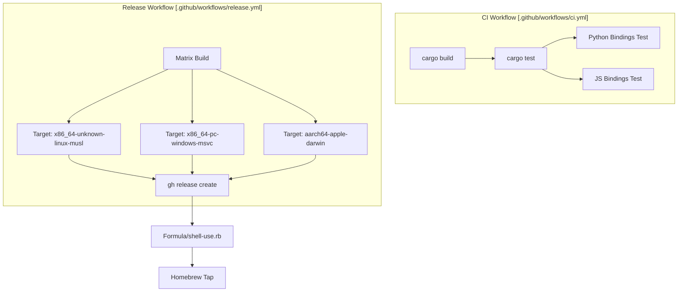
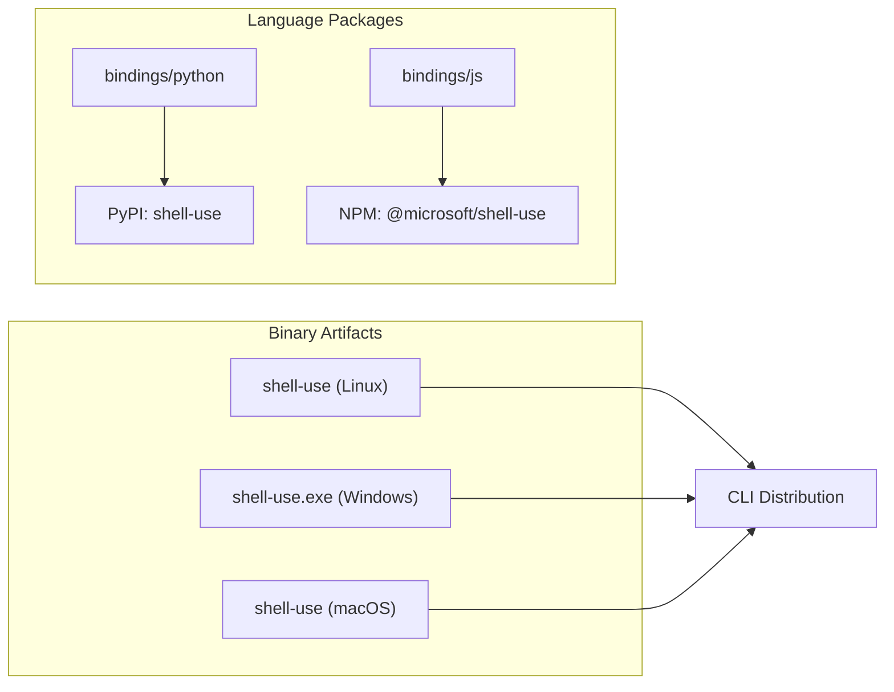

<!-- source: DeepWiki mcp.deepwiki.com · repo microsoft/tui-test · page 7 Distribution and CI/CD · fetched 2026-10-26 -->

# Distribution and CI/CD

Relevant source files

The following files were used as context for generating this wiki page:

- [.cargo/config.toml](.cargo/config.toml)
- [.github/workflows/ci.yml](.github/workflows/ci.yml)
- [.github/workflows/release.yml](.github/workflows/release.yml)
- [Formula/shell-use.rb](Formula/shell-use.rb)
- [README.md](README.md)

This page provides a high-level overview of the build, testing, and distribution infrastructure for `shell-use`. The project utilizes GitHub Actions to ensure cross-platform compatibility and automated delivery across Windows, macOS, and Linux.

### Release Pipeline

The release process is triggered by version tags (e.g., `v0.0.1`) and automates the compilation of binaries for multiple architectures and operating systems [.github/workflows/release.yml:1-7](). The pipeline handles complex cross-compilation requirements, such as using `musl-tools` for static Linux binaries and `gcc-aarch64-linux-gnu` for ARM targets [.github/workflows/release.yml:41-55](). 

Key aspects of the release flow include:
*   **Static Linking**: Windows builds use `+crt-static` to ensure the resulting `.exe` has no external runtime dependencies [.github/workflows/release.yml:60-60]().
*   **Multi-Platform Matrix**: Supports `x86_64` and `aarch64` for Linux (GNU/Musl), macOS (Darwin), and Windows (MSVC) [.github/workflows/release.yml:13-31]().
*   **Artifact Packaging**: Binaries are compressed into `.tar.gz` for Unix-like systems and `.zip` for Windows before being attached to a GitHub Release [.github/workflows/release.yml:62-78]().

For details, see [Release Pipeline](#7.1).

### Continuous Integration

The CI workflow validates every push and pull request to the `main` branch [.github/workflows/ci.yml:3-7](). It ensures that the Rust core, Python bindings, and JavaScript/TypeScript bindings remain functional across all supported platforms.

The CI suite performs the following checks:
*   **Rust Quality**: Runs `cargo fmt` for style, `cargo clippy` for linting, and `cargo test` for unit and integration logic [.github/workflows/ci.yml:43-46]().
*   **Bindings Validation**: Executes the Python `unittest` suite and the JS test suite across three different runtimes: Node.js, Bun, and Deno [.github/workflows/ci.yml:61-88]().
*   **Binary Pathing**: Tests use the `SHELL_USE_BIN` environment variable to point the language clients to the freshly built Rust binary [.github/workflows/ci.yml:24-25]().

For details, see [Continuous Integration](#7.2).

### Distribution Channels

`shell-use` is distributed through official package managers to simplify installation and updates.

| Channel | Platform | Command |
| :--- | :--- | :--- |
| **Homebrew** | macOS / Linux | `brew install microsoft/shell-use/shell-use` |
| **WinGet** | Windows | `winget install Microsoft.ShellUse` |
| **Direct** | All | GitHub Release Binaries |

Sources: [README.md:8-25](), [Formula/shell-use.rb:1-36]()

### Build and Test Architecture

The following diagrams illustrate the relationship between the CI/CD workflows and the resulting distribution artifacts.

**CI/CD Pipeline to Code Entity Mapping**

Sources: [.github/workflows/ci.yml:12-23](), [.github/workflows/release.yml:13-31](), [Formula/shell-use.rb:7-27]()

**Distribution Artifact Mapping**

Sources: [README.md:73-102](), [.github/workflows/release.yml:62-72]()

---

