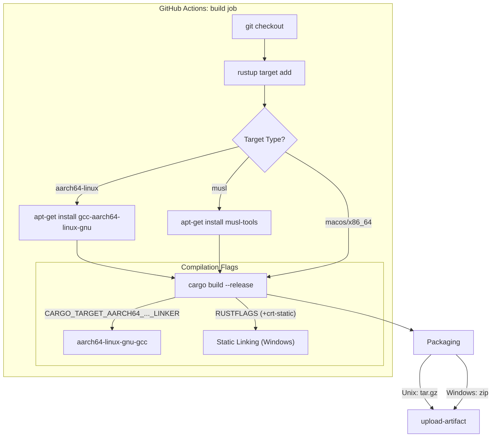
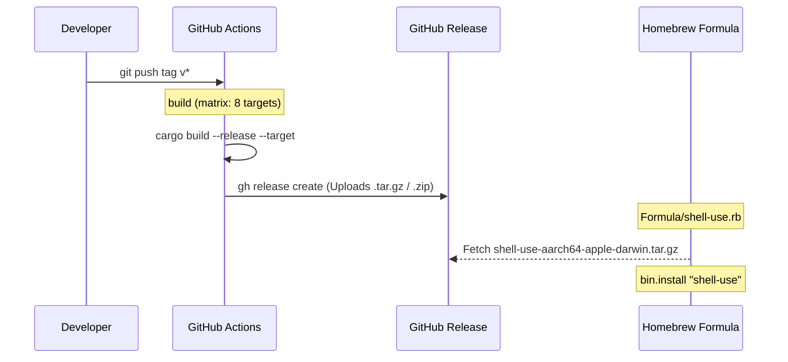

<!-- source: DeepWiki mcp.deepwiki.com · repo microsoft/tui-test · page 7.1 Release Pipeline · fetched 2026-10-26 -->

# Release Pipeline

<details>
<summary>Relevant source files</summary>

The following files were used as context for generating this wiki page:

- [.cargo/config.toml](.cargo/config.toml)
- [.github/workflows/release.yml](.github/workflows/release.yml)
- [Formula/shell-use.rb](Formula/shell-use.rb)

</details>


The `shell-use` release pipeline is an automated GitHub Actions workflow designed to produce optimized, statically-linked binaries for multiple operating systems and CPU architectures. It ensures that the CLI and daemon can be distributed as standalone artifacts with minimal runtime dependencies.

## Workflow Triggers and Permissions

The release process is triggered specifically by the creation of a version tag matching the pattern `v[0-9]+.*` [ .github/workflows/release.yml:3-6](). 

The workflow operates with two distinct permission levels:
1.  **Build Job**: Requires `contents: read` to check out the source code [ .github/workflows/release.yml:8-11]().
2.  **Release Job**: Requires `contents: write` to create the GitHub Release and upload assets [ .github/workflows/release.yml:83-84]().

## Build Matrix and Target Architectures

The pipeline utilizes a matrix strategy to compile for eight distinct targets across Linux, macOS, and Windows.

| OS | Target Triple | Architecture | C Library |
| :--- | :--- | :--- | :--- |
| **Linux** | `x86_64-unknown-linux-gnu` | x86_64 | glibc |
| **Linux** | `aarch64-unknown-linux-gnu` | ARM64 | glibc |
| **Linux** | `x86_64-unknown-linux-musl` | x86_64 | musl (Static) |
| **Linux** | `aarch64-unknown-linux-musl` | ARM64 | musl (Static) |
| **macOS** | `x86_64-apple-darwin` | x86_64 | System |
| **macOS** | `aarch64-apple-darwin` | ARM64 | System |
| **Windows** | `x86_64-pc-windows-msvc` | x86_64 | MSVC (Static CRT) |
| **Windows** | `aarch64-pc-windows-msvc` | ARM64 | MSVC (Static CRT) |

**Sources:** [ .github/workflows/release.yml:13-31]()

### Release Build Process Diagram

This diagram maps the GitHub Actions workflow steps to the specific tools and environment variables used during the build phase.



**Sources:** [ .github/workflows/release.yml:33-79]()

## Toolchains and Cross-Compilation

To support ARM64 and MUSL targets from a standard `ubuntu-latest` runner, the pipeline installs specific cross-compilation toolchains:

*   **ARM64 Linux**: The `gcc-aarch64-linux-gnu` package is installed to provide the necessary linker [ .github/workflows/release.yml:41-45]().
*   **MUSL**: The `musl-tools` package is required for building fully static Linux binaries [ .github/workflows/release.yml:46-50]().
*   **Linker Configuration**: For `aarch64` targets, the `CARGO_TARGET_AARCH64_UNKNOWN_LINUX_GNU_LINKER` and `CARGO_TARGET_AARCH64_UNKNOWN_LINUX_MUSL_LINKER` environment variables are set to `aarch64-linux-gnu-gcc` during the build [ .github/workflows/release.yml:58-59]().

## Static Linking Strategies

A core requirement for `shell-use` distribution is minimizing external dependencies.

### Windows (MSVC)
For Windows targets, the pipeline enforces static linking against the C Runtime (CRT). This is achieved by passing `-C target-feature=+crt-static` via `RUSTFLAGS` [ .github/workflows/release.yml:60](). This configuration is also mirrored in the project's Cargo configuration [ .cargo/config.toml:1-5]().

### Linux (MUSL)
By targeting `*-unknown-linux-musl`, the pipeline produces binaries that do not depend on the host system's `glibc` version, making them highly portable across different Linux distributions.

**Sources:** [ .github/workflows/release.yml:57-61](), [ .cargo/config.toml:1-5]()

## Artifact Packaging and Release

Once compilation is complete, the binaries are compressed based on the runner's operating system:
*   **Unix-like**: Binaries are packaged into `.tar.gz` archives [ .github/workflows/release.yml:62-66]().
*   **Windows**: Binaries (`shell-use.exe`) are packaged into `.zip` archives using `Compress-Archive` [ .github/workflows/release.yml:68-71]().

### The Release Job
The `release` job waits for all matrix builds to complete [ .github/workflows/release.yml:81](). It downloads all uploaded artifacts into a single directory and uses the GitHub CLI (`gh`) to create the official release:

```bash
gh release create "${{ github.ref_name }}" \
  --generate-notes \
  artifacts/*
```
**Sources:** [ .github/workflows/release.yml:94-100]()

## Homebrew Distribution

The release artifacts are consumed by the `shell-use.rb` Homebrew formula. The formula dynamically selects the appropriate `.tar.gz` download URL and SHA-256 checksum based on the user's OS (`on_macos` or `on_linux`) and architecture (`on_arm` or `on_intel`) [ Formula/shell-use.rb:7-27]().

### Distribution Data Flow

This diagram illustrates how a tagged commit flows through the build system to the final user installation via Homebrew.



**Sources:** [ .github/workflows/release.yml:1-100](), [ Formula/shell-use.rb:1-31]()

---

