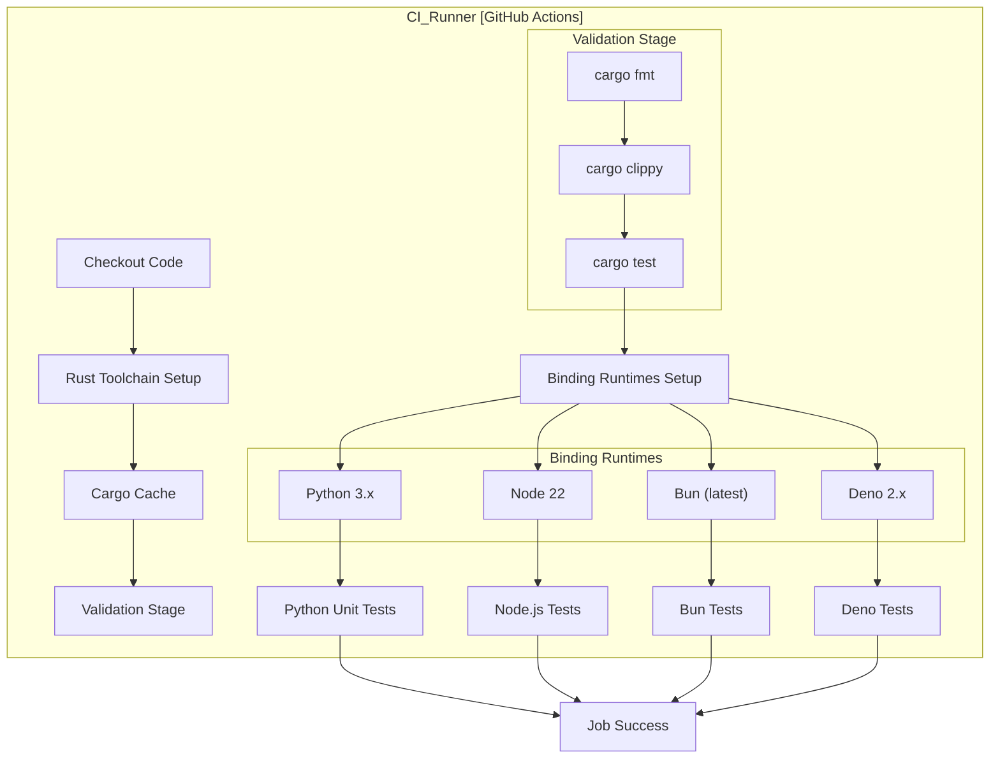
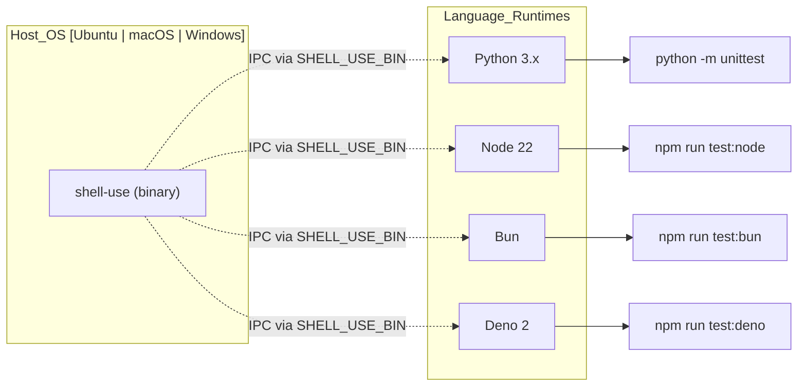

<!-- source: DeepWiki mcp.deepwiki.com · repo microsoft/tui-test · page 7.2 Continuous Integration · fetched 2026-10-26 -->

# Continuous Integration

Relevant source files

The following files were used as context for generating this wiki page:

- [.cargo/config.toml](.cargo/config.toml)
- [.github/workflows/ci.yml](.github/workflows/ci.yml)
- [.github/workflows/release.yml](.github/workflows/release.yml)
- [Formula/shell-use.rb](Formula/shell-use.rb)
- [README.md](README.md)

The `shell-use` codebase employs a rigorous Continuous Integration (CI) pipeline to ensure cross-platform compatibility across Windows, macOS, and Linux. The CI workflow validates not only the core Rust daemon and CLI but also the multi-runtime language bindings (Python and JavaScript/TypeScript) on every push and pull request to the `main` branch [[.github/workflows/ci.yml:3-7]]().

## CI Workflow Architecture

The CI pipeline is implemented as a GitHub Actions workflow that utilizes a build matrix to parallelize testing across different operating systems. It is designed to verify the entire stack: from low-level Rust code to high-level language bindings that communicate with the daemon via IPC.

### Platform Matrix and Environment

The workflow runs on `ubuntu-latest`, `macos-latest`, and `windows-latest` [[.github/workflows/ci.yml:17-22]](). Each job identifies the platform-specific binary path to be used by the language bindings during integration tests [[.github/workflows/ci.yml:18-20]]().

Title: CI Pipeline Data Flow

**Sources:** [[.github/workflows/ci.yml:12-88]]()

## Rust Validation

The Rust core is validated through three primary steps:
1.  **Formatting**: `cargo fmt` ensures adherence to style guidelines across the entire workspace [[.github/workflows/ci.yml:43]]().
2.  **Linting**: `cargo clippy` is run with `-D warnings` to enforce code quality and catch common idiomatic errors [[.github/workflows/ci.yml:44]]().
3.  **Unit & Integration Testing**: `cargo test` executes the internal Rust test suite [[.github/workflows/ci.yml:46]]().

The environment variable `SHELL_USE_BIN` is set to point to the freshly built debug binary, allowing subsequent binding tests to locate the `shell-use` executable [[.github/workflows/ci.yml:24-25]]().

**Sources:** [[.github/workflows/ci.yml:43-46]]()

## Binding Test Matrix

A significant portion of the CI suite is dedicated to ensuring that the Python and JavaScript bindings remain synchronized with the Rust daemon's IPC protocol.

### Python Bindings
The Python tests are executed using the `unittest` discovery module. The `PYTHONPATH` is explicitly set to `src` to ensure the local version of the package is tested [[.github/workflows/ci.yml:61-66]]().

### JavaScript / TypeScript Bindings
The JS bindings are tested across three distinct runtimes to ensure compatibility with modern web and server-side ecosystems:
*   **Node.js**: Validated using `npm run test:node` [[.github/workflows/ci.yml:78]]().
*   **Bun**: Validated using `npm run test:bun` [[.github/workflows/ci.yml:83]]().
*   **Deno**: Validated using `npm run test:deno` [[.github/workflows/ci.yml:88]]().

Before running these tests, the CI performs a build step in the `bindings/js` directory to compile the TypeScript source [[.github/workflows/ci.yml:71-73]]().

Title: Cross-Platform Binding Validation

**Sources:** [[.github/workflows/ci.yml:24-25]](), [[.github/workflows/ci.yml:61-88]]()

## Infrastructure and Caching

To optimize CI turnaround time, the workflow utilizes `actions/cache` for Cargo dependencies. It caches the `~/.cargo/registry`, `~/.cargo/git`, and the `target` directory, keyed by the `Cargo.lock` hash [[.github/workflows/ci.yml:34-41]](). This significantly reduces build times for the Rust binary across the three OS platforms.

The workflow also configures specific toolchains:
*   **Rust**: Stable toolchain with `clippy` and `rustfmt` components [[.github/workflows/ci.yml:29-32]]().
*   **Python**: Version 3.x [[.github/workflows/ci.yml:48-50]]().
*   **Node**: Version 22 [[.github/workflows/ci.yml:51-53]]().
*   **Bun**: Latest version [[.github/workflows/ci.yml:54-56]]().
*   **Deno**: Version 2.x [[.github/workflows/ci.yml:57-59]]().

**Sources:** [[.github/workflows/ci.yml:29-59]]()

---

