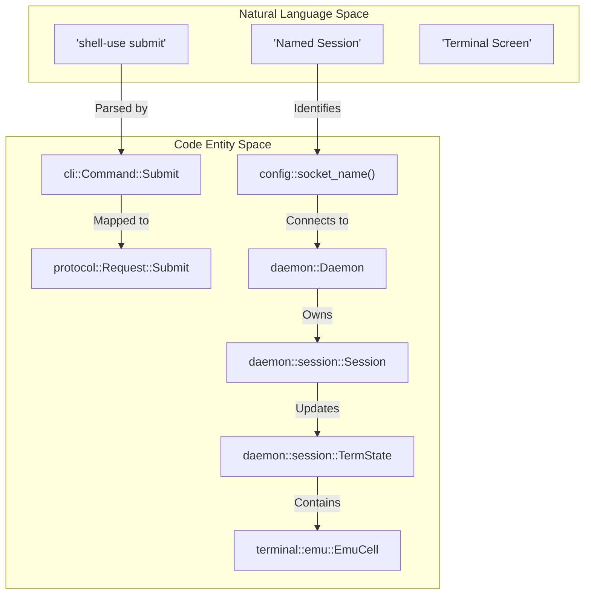
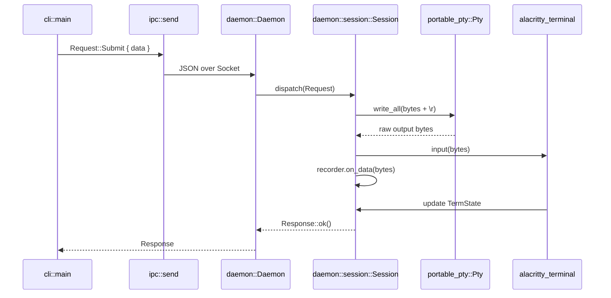

<!-- source: DeepWiki mcp.deepwiki.com · repo microsoft/tui-test · page 8 Glossary · fetched 2026-10-26 -->

# Glossary

Relevant source files

The following files were used as context for generating this wiki page:

- [.github/workflows/ci.yml](.github/workflows/ci.yml)
- [Cargo.lock](Cargo.lock)
- [README.md](README.md)
- [shell/shellIntegration.nu](shell/shellIntegration.nu)
- [shell/shellIntegration.xsh](shell/shellIntegration.xsh)
- [src/cli.rs](src/cli.rs)
- [src/daemon/mod.rs](src/daemon/mod.rs)
- [src/main.rs](src/main.rs)
- [src/protocol.rs](src/protocol.rs)
- [src/shell/mod.rs](src/shell/mod.rs)
- [src/trace/recorder.rs](src/trace/recorder.rs)

This page defines codebase-specific terms, abbreviations, and domain concepts used within `shell-use`. It serves as a technical reference for onboarding engineers to understand how high-level terminal concepts map to specific implementation details in the Rust daemon and CLI.

## Core Domain Terms

### Session
A **Session** is the primary unit of isolation in `shell-use`. Each session consists of a dedicated PTY (Pseudo-Terminal), a terminal emulator instance, and an always-on recorder. Sessions are identified by a unique name (defaulting to `default`) [src/main.rs:28-28]().
*   **Implementation**: Managed by the `Session` struct [src/daemon/session.rs:43-62]().
*   **Lifecycle**: Created via `Request::Open` [src/protocol.rs:10-17]() and terminated via `Request::Close` [src/protocol.rs:18-18]().

### Daemon
The **Daemon** is a background process that owns and manages sessions. It listens on a platform-specific local socket (Unix domain socket or Windows named pipe) to service requests from the stateless CLI [src/daemon/mod.rs:1-2]().
*   **Auto-start**: The CLI automatically spawns the daemon if it is not already running during a command execution [src/main.rs:74-77]().
*   **Idle Watchdog**: A background thread that shuts down the daemon if no activity is detected for a configured timeout [src/daemon/mod.rs:111-127]().

### PTY (Pseudo-Terminal)
The PTY is the interface between the `shell-use` daemon and the child process (shell or program).
*   **Backend**: Uses the `portable-pty` crate to provide cross-platform PTY allocation [Cargo.lock:1218-1218]().
*   **Flow**: Raw bytes from the PTY are fed into the terminal emulator and simultaneously sent to the `Recorder` [src/daemon/session.rs:153-162]().

### Terminal Emulator (Emu)
A software implementation of a physical terminal. `shell-use` uses a headless version of the `alacritty_terminal` library to maintain the state of the terminal grid [Cargo.lock:21-24]().
*   **Grid State**: Stored in `TermState`, which tracks the cursor position, grid cells, and semantic prompt markers [src/daemon/session.rs:26-39]().
*   **Cell**: Represented by `EmuCell`, containing the character and its visual attributes (foreground, background, and flags) [src/terminal/emu.rs:23-23]().

### Semantic Prompts (OSC 133)
`shell-use` uses **OSC 133** escape sequences to track the lifecycle of commands within a shell. This allows the system to distinguish between the command being typed, the output produced, and the shell prompt itself [shell/shellIntegration.xsh:7-7]().
*   **A**: Prompt start.
*   **B**: Prompt end / Command start.
*   **C**: Command end / Output start.
*   **D**: Command finished (with exit code).

---

## Architecture Diagrams

### From Natural Language to Code Entities
This diagram bridges user-facing concepts to the specific structs and enums that implement them.

**Sources**: [src/main.rs:28-62](), [src/cli.rs:123-127](), [src/protocol.rs:36-38](), [src/daemon/mod.rs:28-34](), [src/daemon/session.rs:26-62]().

### Request Flow and Data Transformation
This diagram illustrates how a CLI request transforms into PTY input and terminal state.

**Sources**: [src/main.rs:65-87](), [src/daemon/mod.rs:79-95](), [src/daemon/session.rs:153-162](), [src/trace/recorder.rs:79-89]().

---

## Technical Glossary Table

| Term | Definition | Code Pointer |
| :--- | :--- | :--- |
| **Asciicast** | The v2 JSON format used for session recording, compatible with `asciinema`. | [src/trace/recorder.rs:1-6]() |
| **Cell** | A single character position on the terminal grid with its associated colors. | [src/terminal/emu.rs:23-23]() |
| **Exit Code Taxonomy** | A stable mapping of internal errors to process exit codes (0-5). | [src/protocol.rs:167-177]() |
| **Idle Watchdog** | A background thread that kills the daemon after `IDLE_TIMEOUT_MS`. | [src/daemon/mod.rs:111-127]() |
| **Live Target** | A shared reference to terminal state used by the `monitor` command. | [src/daemon/mod.rs:39-42]() |
| **OSC 7** | Escape sequence used by shells to report the Current Working Directory (CWD). | [shell/shellIntegration.xsh:10-10]() |
| **Portable-PTY** | The cross-platform library used to spawn and manage PTYs. | [Cargo.lock:1218-1218]() |
| **Recording** | An always-on `.cast` file stored in `~/.shell-use/recordings/`. | [src/daemon/mod.rs:133-150]() |
| **Shell Integration** | Scripts injected into the shell to enable semantic tracking. | [src/shell/mod.rs:65-114]() |
| **Snapshot** | A persisted text/color representation of the screen for regression testing. | [src/protocol.rs:85-93]() |
| **ZDOTDIR** | Environment variable used to redirect Zsh configuration for integration. | [src/shell/mod.rs:186-193]() |

**Sources**: [src/trace/recorder.rs:1-6](), [src/terminal/emu.rs:23-23](), [src/protocol.rs:167-177](), [src/daemon/mod.rs:111-127](), [src/daemon/mod.rs:39-42](), [shell/shellIntegration.xsh:10-10](), [Cargo.lock:1218-1218](), [src/daemon/mod.rs:133-150](), [src/shell/mod.rs:65-114](), [src/protocol.rs:85-93](), [src/shell/mod.rs:186-193]().