# Page: Overview

# Overview

<details>
<summary>Relevant source files</summary>

The following files were used as context for generating this wiki page:

- [.github/workflows/ci.yml](.github/workflows/ci.yml)
- [Cargo.toml](Cargo.toml)
- [README.md](README.md)
- [SKILL.md](SKILL.md)

</details>


`shell-use` is a Rust-powered headless terminal CLI and daemon designed for controlling, inspecting, testing, and recording shell sessions and TUI applications [README.md:1-6](). It provides a robust interface for automation and AI agents to interact with real terminal environments across Windows, Linux, and macOS [README.md:6-6]().

The system operates on a client-daemon model where a stateless CLI communicates with a background process that manages a Pseudo-Terminal (PTY) and a full terminal emulator [SKILL.md:8-14]().

### Key Capabilities

- **Session Management**: Spawn persistent shell sessions (Bash, Zsh, PowerShell, etc.) or run TUI programs like `vim` directly [README.md:122-131]().
- **Terminal Inspection**: Query the rendered state of the terminal, including viewport text, cursor position, and per-cell attributes (colors, characters) [README.md:132-141]().
- **Input Simulation**: Send literal text, named key combinations (e.g., `Ctrl+C`), and complex mouse actions (clicks, drags, scrolls) [README.md:142-152]().
- **Assertions and Waiting**: Block execution until specific text appears, the screen becomes idle, or a command finishes. Assert on exit codes, output, or visual snapshots [SKILL.md:97-113]().
- **Observability**: Capture full-color SVG screenshots and retrieve standard `asciinema` v2 recordings of any session [SKILL.md:117-123]().

---

### High-Level Architecture

The architecture bridges the gap between high-level user commands and the low-level PTY/Emulator state.

#### System Context: Natural Language to Code Entities
This diagram illustrates how user-facing concepts map to the underlying Rust implementation.

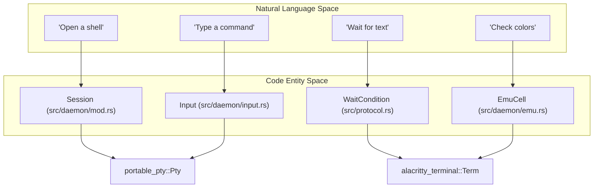
**Sources:** [src/daemon/mod.rs:1-20](), [src/daemon/emu.rs:1-15](), [src/protocol.rs:1-50]()

#### Client-Daemon Communication
The CLI is stateless; it sends a `Request` to the daemon over a local IPC socket and receives a `Response`.

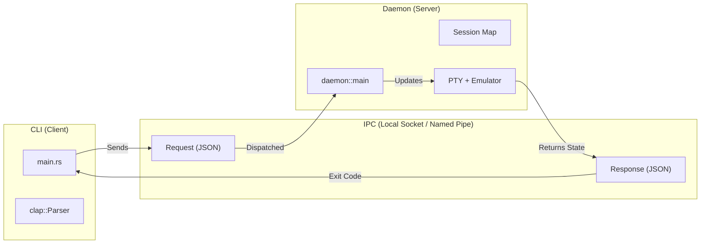
**Sources:** [src/main.rs:1-30](), [src/daemon/mod.rs:40-100](), [src/protocol.rs:100-200]()

---

### Core Components

| Component | Description | Reference |
| :--- | :--- | :--- |
| **CLI** | The entry point for users and scripts. It handles argument parsing and IPC transport. | [CLI Reference](#2) |
| **Daemon** | A background process that manages the lifecycle of multiple named sessions and their PTYs. | [Daemon and Internal Architecture](#3) |
| **PTY/Emulator** | Uses `portable-pty` and `alacritty_terminal` to turn raw bytes into a queryable grid. | [PTY and Terminal Emulation](#3.2) |
| **Bindings** | Python and JavaScript libraries that wrap the CLI/Daemon protocol for programmatic use. | [Language Bindings](#5) |

For details on the client-daemon model and session lifecycle, see [Core Concepts and Architecture](#1.2).

### AI and Agent Integration
`shell-use` is designed to be "AI native." It provides self-documenting commands that output machine-readable context for LLMs to understand the available toolset without manual prompt engineering [README.md:51-58]().

- `shell-use agent-context`: Returns a JSON schema of all commands and flags [SKILL.md:20-22]().
- `shell-use skill`: Outputs the [SKILL.md]() guide for RAG or few-shot prompting [SKILL.md:24-24]().
- **Stable Exit Codes**: A strictly defined taxonomy (0-5) allows agents to distinguish between assertion failures, usage errors, and internal system issues [SKILL.md:41-54]().

For details on integrating with agents, see [Agent Integration](#6).

### Getting Started
To begin using `shell-use`, you can install it via Homebrew or Winget and run a basic session.

```bash
shell-use open
shell-use submit "echo 'Hello World'"
shell-use expect text "Hello World"
shell-use close
```

For detailed installation instructions and more examples, see [Installation and Quick Start](#1.1).

**Sources:** [README.md:1-100](), [SKILL.md:1-150](), [Cargo.toml:1-30]()

---

# Page: Installation and Quick Start

# Installation and Quick Start

<details>
<summary>Relevant source files</summary>

The following files were used as context for generating this wiki page:

- [.cargo/config.toml](.cargo/config.toml)
- [.github/workflows/ci.yml](.github/workflows/ci.yml)
- [.github/workflows/release.yml](.github/workflows/release.yml)
- [Formula/shell-use.rb](Formula/shell-use.rb)
- [README.md](README.md)

</details>


This page provides a technical guide for installing `shell-use` across different operating systems and executing initial workflows for both standard shell sessions and interactive Terminal User Interface (TUI) applications.

## Installation Methods

`shell-use` is distributed as a statically linked binary for major platforms. The installation process places the `shell-use` executable on the system `PATH`, which is a prerequisite for both CLI usage and programmatic bindings [README.md:71-72]().

### Homebrew (macOS and Linux)
The project maintains a custom tap for Homebrew. This installs the binary and manages updates [README.md:10-15]().

```sh
brew tap microsoft/shell-use https://github.com/microsoft/shell-use
brew install shell-use
```

### Winget (Windows)
For Windows users, `shell-use` is available via the Windows Package Manager [README.md:17-21]().

```sh
winget install Microsoft.ShellUse
```

### Manual Download
Pre-compiled binaries are available for multiple architectures via GitHub Releases [README.md:23-25](). The release pipeline targets the following environments:

| Platform | Architecture | Target Triple |
| :--- | :--- | :--- |
| **Linux** | x86_64 / aarch64 | `unknown-linux-gnu` & `unknown-linux-musl` |
| **macOS** | x86_64 / aarch64 | `apple-darwin` |
| **Windows** | x86_64 / aarch64 | `pc-windows-msvc` |

**Sources:** [README.md:8-25](), [.github/workflows/release.yml:15-31](), [Formula/shell-use.rb:7-27]()

---

## Quick Start: Shell Sessions

The most common use case for `shell-use` is automating a standard shell (e.g., Bash, Zsh, or PowerShell). The CLI follows a client-daemon architecture where the first command (typically `open`) lazily starts the background daemon [README.md:32]().

### Workflow Example
The following sequence demonstrates opening a session, executing a command, and asserting the state.

```sh
shell-use open                  # Start session & daemon
shell-use submit "echo hello"   # Type string + Enter
shell-use wait command          # Wait for prompt return
shell-use expect text "hello"   # Verify output exists
shell-use expect exit-code 0    # Verify success
shell-use close                 # Cleanup session
```

### Implementation Logic: Command Submission
When `submit` is called, the CLI communicates with the daemon to simulate keyboard input followed by a carriage return. The `wait command` instruction utilizes shell integration (OSC sequences) to detect when the shell has returned to an idle prompt state.

**Sources:** [README.md:29-38](), [README.md:147](), [README.md:162]()

---

## Quick Start: TUI Programs

`shell-use` can drive complex, full-screen TUI applications like `vim` or `htop`. Unlike standard shell commands, TUI interactions often rely on `wait idle` to ensure the terminal emulator has finished rendering frames [README.md:44]().

### Workflow Example: Editing with Vim
```sh
shell-use run vim file.txt       # Direct execution without shell
shell-use wait idle              # Wait for UI to render
shell-use press i                # Enter Insert mode
shell-use type "some text"       # Input literal text
shell-use press Escape : w q Enter # Save and quit
shell-use wait exit              # Wait for process termination
```

### Terminal State Data Flow
The diagram below illustrates how a TUI command like `press i` moves through the system to update the internal terminal representation.

**TUI Input and Rendering Pipeline**
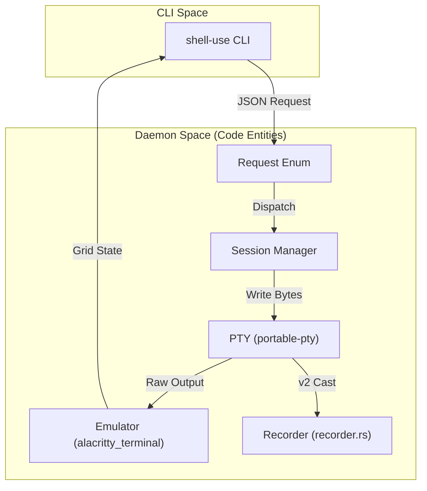

**Sources:** [README.md:42-49](), [README.md:148](), [README.md:127]()

---

## Programmatic Quick Start

While the CLI is useful for scripts, `shell-use` provides native bindings for Python and JavaScript/TypeScript. These libraries encapsulate the IPC logic and daemon management [README.md:69-71]().

### Language Comparison

| Feature | Python (`shell-use`) | JavaScript (`@microsoft/shell-use`) |
| :--- | :--- | :--- |
| **Install** | `pip install shell-use` | `npm install @microsoft/shell-use` |
| **Context** | `async with ShellUse()` | `const su = new ShellUse()` |
| **Runtimes** | Python 3.x | Node.js, Bun, Deno |

### Binding Architecture
The bindings serve as a bridge between the high-level language and the Rust-based `shell-use` binary.

**Bridge: Language Space to Code Entity Space**
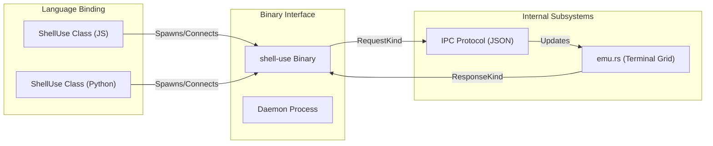

**Sources:** [README.md:73-114](), [.github/workflows/ci.yml:61-88](), [README.md:71]()

---

## Verifying Installation

To verify that the installation and the daemon architecture are functioning correctly, use the `daemon status` command:

```sh
shell-use daemon status
```

This confirms the CLI can communicate with the background process and reports the version and active session count [README.md:130]().

**Sources:** [README.md:130](), [Formula/shell-use.rb:33-35]()

---

# Page: Core Concepts and Architecture

# Core Concepts and Architecture

<details>
<summary>Relevant source files</summary>

The following files were used as context for generating this wiki page:

- [.github/workflows/ci.yml](.github/workflows/ci.yml)
- [Cargo.lock](Cargo.lock)
- [README.md](README.md)
- [src/daemon/mod.rs](src/daemon/mod.rs)
- [src/ipc/mod.rs](src/ipc/mod.rs)
- [src/protocol.rs](src/protocol.rs)

</details>


`shell-use` is built on a client-daemon architecture designed to provide a stateless, scriptable interface to stateful terminal sessions. It decouples the CLI invocation from the long-running shell process, allowing users and AI agents to inspect and control terminal applications across multiple commands or language-binding calls.

## Client-Daemon Model

The system is split into two primary components: a stateless CLI (the "client") and a background process (the "daemon").

1.  **The Client**: Every time a user runs `shell-use <command>`, a short-lived process is spawned. It identifies the target session, connects to the daemon via IPC, sends a request, waits for a response, prints the result, and exits.
2.  **The Daemon**: A per-session process that manages the lifecycle of the actual shell or program. It owns the PTY (Pseudo-Terminal), runs a terminal emulator to maintain the screen state, and records the session to an `asciinema` cast.

### Data Flow: CLI to Daemon

The CLI communicates with the daemon using a JSON-over-local-socket protocol. This allows the CLI to remain completely stateless while the daemon maintains the complex, mutable state of the terminal grid.

Terminal Pipeline and Entity Mapping
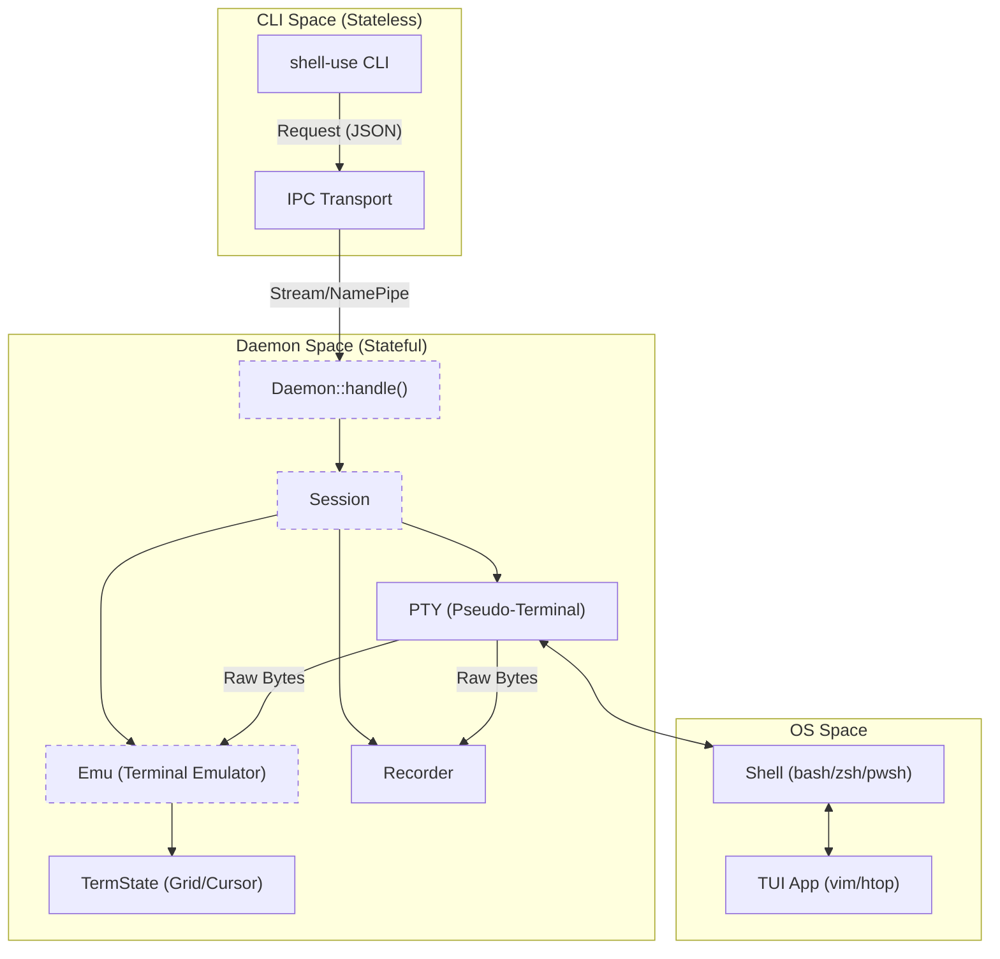
**Sources:** [src/daemon/mod.rs:28-34](), [src/daemon/mod.rs:172-197](), [src/protocol.rs:5-103]()

## Session Lifecycle

A session is identified by a unique name (defaulting to `default`). The daemon's lifecycle is managed automatically by the CLI:

*   **Lazy Start**: When `shell-use open` or `shell-use run` is called, the CLI checks if a daemon is already listening on the session's socket [src/ipc/mod.rs:36-41](). If not, it spawns a new daemon process in the background.
*   **Active Management**: The `Daemon` struct in `src/daemon/mod.rs` manages a `Mutex<Option<Session>>` [src/daemon/mod.rs:30](). A session is created via `Session::open()` which initializes the PTY and the terminal emulator [src/daemon/mod.rs:208-217]().
*   **Idle Watchdog**: To prevent resource leaks, the daemon runs a background thread that monitors `last_activity`. If no IPC requests are received for a configured timeout (defaulting to several hours), the daemon kills the session and exits [src/daemon/mod.rs:111-127]().
*   **Cleanup**: Upon receiving a `Request::Close` or hitting an idle timeout, the daemon removes its PID file and socket [src/daemon/mod.rs:101-106]().

**Sources:** [src/daemon/mod.rs:45-99](), [src/daemon/mod.rs:111-127](), [src/ipc/mod.rs:36-41]()

## IPC Transport and Protocol

The IPC layer abstracts platform differences between Unix-like systems and Windows.

*   **Transport**: On macOS and Linux, `shell-use` uses Unix Domain Sockets. On Windows, it uses Named Pipes [src/ipc/mod.rs:11-17]().
*   **Framing**: The protocol is line-delimited JSON. Each connection typically handles exactly one `Request` and one `Response` [src/ipc/mod.rs:1-3]().
*   **Request Types**: Defined in the `Request` enum, including `Ping`, `Open`, `Write`, `Press`, `WaitText`, and `Snapshot` [src/protocol.rs:8-103]().
*   **Response Types**: Every response includes an `ok` boolean and an optional `ErrorKind` to help the CLI determine the correct exit code [src/protocol.rs:181-192]().

**Sources:** [src/ipc/mod.rs:11-17](), [src/protocol.rs:8-103](), [src/protocol.rs:154-177]()

## PTY and Terminal Emulator Pipeline

The core of `shell-use` is its ability to turn a stream of raw PTY bytes into a queryable, structured grid.

1.  **PTY (Pseudo-Terminal)**: The daemon spawns the shell process using `portable-pty`. This creates a master/slave pair where the daemon reads the master end.
2.  **Terminal Emulator (`Emu`)**: Raw bytes from the PTY are fed into an internal terminal emulator based on `alacritty_terminal` [Cargo.lock:21-24](). This emulator maintains a grid of `EmuCell` objects.
3.  **State Inspection**: When a user runs `shell-use text` or `shell-use state`, the daemon locks the session, reads the current grid from the emulator, and converts it into the requested format (e.g., plain text via `rows_to_strings`) [src/daemon/mod.rs:23]().
4.  **Input Injection**: Input commands (like `type` or `press`) are converted by the daemon into the specific ANSI escape sequences or UTF-8 bytes that the PTY expects, effectively "typing" into the shell.

Code Entity Space Mapping
| System Component | Rust Module / Entity | Responsibility |
| :--- | :--- | :--- |
| **Daemon Entry** | `daemon::run` | Socket listening and request dispatching. |
| **Session Logic** | `daemon::session::Session` | Orchestrates PTY, Emulator, and Recording. |
| **Emulator** | `terminal::emu::Emu` | Processes ANSI escapes into a grid of cells. |
| **IPC Protocol** | `protocol::Request` | Enum defining all valid CLI-to-Daemon actions. |
| **IPC Transport** | `ipc::send` / `ipc::listen` | Platform-agnostic socket/pipe management. |
| **Recording** | `daemon::session::Recorder` | Writes PTY traffic to `asciinema` v2 files. |

**Sources:** [src/daemon/mod.rs:28-42](), [src/daemon/mod.rs:172-197](), [src/protocol.rs:8-103](), [Cargo.lock:21-24]()

---

# Page: CLI Reference

# CLI Reference

<details>
<summary>Relevant source files</summary>

The following files were used as context for generating this wiki page:

- [src/cli.rs](src/cli.rs)
- [src/main.rs](src/main.rs)

</details>


The `shell-use` command-line interface provides a comprehensive set of tools for controlling headless terminal sessions. The CLI operates on a client-daemon architecture where most commands communicate with a background process via a local socket [src/main.rs:79-86](). It is designed for both human use and AI agent integration, featuring a stable exit-code taxonomy and machine-readable outputs.

## Command Architecture

The CLI is structured into several functional groups, all accessible via the primary `shell-use` binary. Global flags such as `--session` allow targeting specific named environments, while `--json` enables machine-readable responses [src/cli.rs:8-15]().

### Natural Language to Code Mapping

The following diagram illustrates how high-level CLI commands map to internal `Request` types sent to the daemon.

"CLI to Daemon Request Mapping"
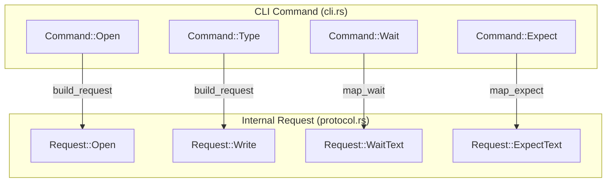
Sources: [src/main.rs:89-159](), [src/cli.rs:27-201]()

## Command Groups

### Session and Process Commands
These commands manage the lifecycle of terminal sessions. `open` initializes a shell, while `run` executes a specific program directly [src/cli.rs:28-65](). The daemon is automatically started if not already running when a session command is issued [src/main.rs:74-77]().
For details, see [Session and Process Commands](#2.1).

### Input Commands
Input is handled through high-level abstractions like `type` for literal strings and `press` for named key combinations (e.g., `Ctrl+C`) [src/cli.rs:118-138](). It also supports complex mouse interactions including clicks, drags, and scrolling [src/cli.rs:140-143]().
For details, see [Input Commands](#2.2).

### Inspection and Wait Commands
Inspection commands like `state` and `text` retrieve the current status of the terminal emulator [src/cli.rs:79-86](). The `wait` family allows scripts to block until specific conditions are met, such as the screen becoming `idle` or specific `text` appearing [src/cli.rs:167-170]().
For details, see [Inspection and Wait Commands](#2.3).

### Assertion Commands
The `expect` group provides testing capabilities by asserting the state of the terminal. It supports regex matching, color-aware assertions (foreground/background), and snapshot-based testing to ensure UI consistency [src/cli.rs:172-175]().
For details, see [Assertion Commands](#2.4).

### Observability Commands
Observability tools facilitate debugging and recording. `monitor` provides a live view of a session [src/cli.rs:188](), while `screenshot` can generate full-color SVG images [src/cli.rs:89-98](). `get-recording` exports the session history in asciinema v2 format [src/cli.rs:180-183]().
For details, see [Observability Commands](#2.5).

## Exit Code Taxonomy

`shell-use` employs a stable exit-code taxonomy to allow callers (especially AI agents) to programmatically distinguish between different types of outcomes [src/main.rs:35-61]().

| Code | Meaning | Description |
| :--- | :--- | :--- |
| `0` | Success | Command completed successfully. |
| `1` | Assertion Failure | An `expect` command condition was not met. |
| `2` | Usage Error | Invalid CLI arguments or malformed input. |
| `3` | Session Missing | The target session does not exist or is closed. |
| `4` | IPC Error | Communication with the daemon failed. |
| `5` | Internal Error | An unexpected error occurred within the daemon. |

"Process Lifecycle and Exit Flow"
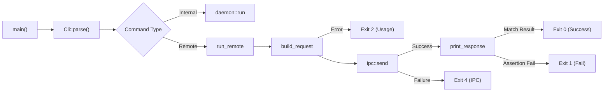
Sources: [src/main.rs:26-62](), [src/main.rs:65-87]()

## Global Options

The CLI supports several global flags that modify the behavior of all subcommands:

*   `--session <NAME>`: Targets a specific named session. If omitted, the daemon uses a default session name or the `SHELL_USE_SESSION` environment variable [src/cli.rs:9-11](), [src/main.rs:28]().
*   `--json`: Formats the output as a JSON object for easier parsing by scripts [src/cli.rs:13-15]().
*   `--verbose`: Enables detailed logging of PTY data, useful for debugging terminal emulation issues [src/cli.rs:17-20]().

Sources: [src/main.rs:1-215](), [src/cli.rs:1-226]()

---

# Page: Session and Process Commands

# Session and Process Commands

<details>
<summary>Relevant source files</summary>

The following files were used as context for generating this wiki page:

- [src/cli.rs](src/cli.rs)
- [src/config.rs](src/config.rs)
- [src/daemon/mod.rs](src/daemon/mod.rs)
- [src/main.rs](src/main.rs)

</details>


This page documents the commands used to manage the lifecycle of shell sessions and their underlying PTY processes. It covers session creation, process signaling, terminal resizing, and the mechanics of the auto-starting daemon.

## Session Lifecycle Overview

`shell-use` operates on a client-daemon model. A "session" represents a single PTY process (either a shell or a direct program) managed by a background daemon.

### Named Sessions
Sessions are identified by a name. If no name is provided via the `--session` flag or the `SHELL_USE_SESSION` environment variable, the system defaults to the name `"default"` [src/config.rs:75-79]().

### Daemon Auto-Starting
The CLI is designed to be stateless. When a command is issued (e.g., `open`), the CLI checks if a daemon for that session is already running. If not, it lazily spawns a detached daemon process [src/main.rs:74-77]().

1.  **Check**: The CLI attempts to connect to the session's socket [src/ipc.rs:136-146]().
2.  **Spawn**: If connection fails, the CLI re-executes its own binary with the hidden `__daemon` command [src/cli.rs:199-200]() and the `--session` name [src/main.rs:36-42]().
3.  **Detachment**: The daemon process detaches and creates a PID file at `~/.shell-use/<session>.pid` [src/daemon/mod.rs:50-54]().
4.  **Handshake**: The CLI waits for the socket to become available before sending the initial `Request` [src/main.rs:80-86]().

### Idle Watchdog
To prevent resource leaks, the daemon includes an `idle_watchdog` thread. If no IPC requests are received for `IDLE_TIMEOUT_MS` (default 4 hours), the daemon kills the child process, removes its socket/PID files, and exits [src/daemon/mod.rs:111-127]().

---

## Command Reference

### open
Spawns a new shell session.
*   **Behavior**: If a session is already open, this returns an error. Otherwise, it initializes the terminal emulator and PTY [src/daemon/mod.rs:208-232]().
*   **Options**:
    *   `--shell`: Choose between `bash`, `zsh`, `fish`, `powershell`, etc. [src/cli.rs:29-32]().
    *   `--cols`, `--rows`: Set initial terminal dimensions (default 80x30) [src/cli.rs:33-38]().
    *   `--cwd`: Set the initial working directory [src/cli.rs:39-41]().
    *   `--env`: Pass environment variables as `KEY=VALUE` [src/cli.rs:42-44]().

### run
Spawns a session running a specific program directly instead of an interactive shell.
*   **Behavior**: Similar to `open`, but bypasses shell integration scripts and executes the provided binary and arguments directly in the PTY [src/main.rs:105-123]().

### close
Terminates a session.
*   **Behavior**: Sends a `Request::Close` to the daemon. The daemon kills the PTY child process and shuts itself down [src/daemon/mod.rs:187-193]().
*   **Options**:
    *   `--all`: If specified, the CLI iterates through all active sockets in the `home_dir` and sends shutdown signals to every daemon [src/main.rs:57-57]().

### sessions
Lists all currently active sessions.
*   **Implementation**: Scans the `~/.shell-use/` directory for active socket files and verifies connectivity [src/main.rs:56-56]().

### resize
Changes the dimensions of the terminal grid and the underlying PTY.
*   **Implementation**: Sends `Request::Resize`. The daemon updates the `alacritty_terminal` grid and issues a `TIOCSWINSZ` ioctl (on Unix) or `SetConsoleScreenBufferInfoEx` (on Windows) to the PTY [src/cli.rs:145-150](), [src/main.rs:146-146]().

### signal & kill
Sends OS signals to the process group leader inside the PTY.
*   **signal**: Allows sending `INT`, `TERM`, `KILL`, or `QUIT` [src/cli.rs:204-215]().
*   **kill**: A shorthand for `signal KILL` [src/main.rs:151-153]().

**Sources:** [src/main.rs:35-159](), [src/cli.rs:26-78](), [src/daemon/mod.rs:45-127](), [src/config.rs:3-14]()

---

## Implementation Diagrams

### Command Dispatch Flow
The following diagram illustrates how a CLI command like `open` transitions from user input to daemon execution.

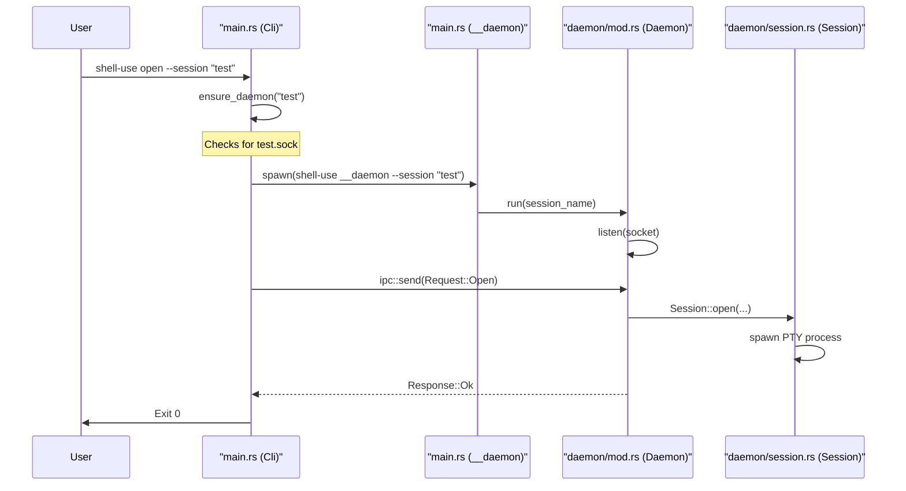
**Sources:** [src/main.rs:65-87](), [src/daemon/mod.rs:45-99](), [src/daemon/session.rs:65-100]()

### Session State Management
This diagram maps the CLI commands to the internal `Request` variants and the `Daemon` methods that handle them.

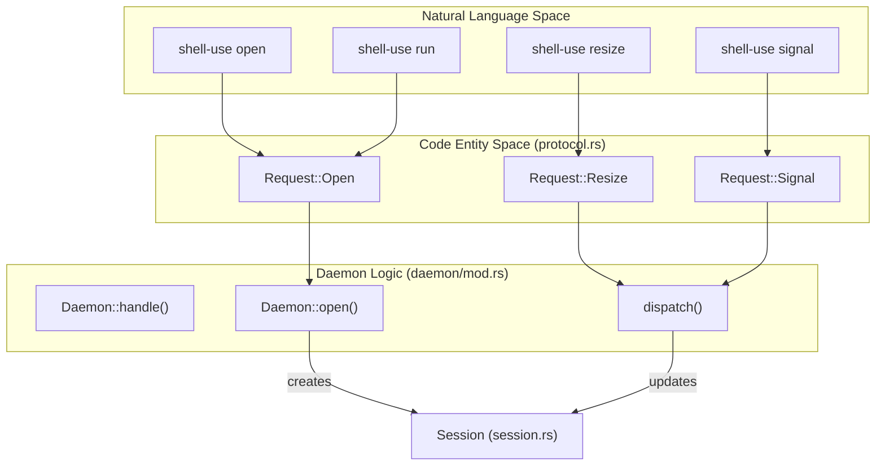
**Sources:** [src/main.rs:89-159](), [src/protocol.rs:18-60](), [src/daemon/mod.rs:171-197]()

---

## Data Structures

### Request Mapping
The `build_request` function in `src/main.rs` is the primary translation layer between CLI subcommands and the IPC protocol.

| CLI Command | Request Variant | Key Parameters |
| :--- | :--- | :--- |
| `open` | `Request::Open` | `shell`, `cols`, `rows`, `cwd`, `env` |
| `run` | `Request::Open` | `program` (Vec), `cols`, `rows`, `cwd`, `env` |
| `close` | `Request::Close` | N/A |
| `resize` | `Request::Resize` | `cols`, `rows` |
| `signal` | `Request::Signal` | `name` (e.g., "INT", "KILL") |

**Sources:** [src/main.rs:89-159](), [src/protocol.rs:18-60]()

### Process Environment
When a session is opened, environment variables are merged. The system takes variables from the caller's environment and applies overrides provided via the `--env` flag [src/main.rs:103-121]().

**Sources:** [src/main.rs:89-123](), [src/cli.rs:42-44]()

---

# Page: Input Commands

# Input Commands

<details>
<summary>Relevant source files</summary>

The following files were used as context for generating this wiki page:

- [src/cli.rs](src/cli.rs)
- [src/input/keys.rs](src/input/keys.rs)
- [src/input/mod.rs](src/input/mod.rs)
- [src/input/mouse.rs](src/input/mouse.rs)
- [src/main.rs](src/main.rs)

</details>


Input commands provide the primary interface for interacting with a terminal session in `shell-use`. These commands allow for typing literal text, sending complex key combinations with modifiers, and simulating mouse interactions (clicks, drags, and scrolling). All input commands are processed by the CLI, converted into escape sequences or structured requests, and sent via IPC to the daemon, which writes them directly to the PTY.

## Keyboard Input

Keyboard input is handled through four primary commands that range from literal text entry to low-level byte injection.

### Command Variants

| Command | Purpose | Implementation Detail |
| :--- | :--- | :--- |
| `type` | Sends literal text. | Maps to `Request::Write` [src/main.rs:139-139](). |
| `write` | Sends raw bytes. | Maps to `Request::Write` [src/main.rs:147-147](). |
| `submit` | Types text followed by a return key. | Maps to `Request::Submit` [src/main.rs:140-140](). |
| `press` | Sends named keys or combos (e.g., `Ctrl+C`). | Maps to `Request::Press` [src/main.rs:141-141](). |
| `keys` | Alias for `press` for a single combination. | Maps to `Request::Press` [src/main.rs:142-142](). |

### Key Name Syntax and Modifiers

The `press` and `keys` commands use a string-based syntax to represent non-printable characters and modified keys. The translation logic resides in `src/input/keys.rs`.

*   **Modifiers**: Supported modifiers include `Ctrl` (or `Control`), `Alt` (or `Option`, `Meta`), and `Shift` [src/input/keys.rs:257-259]().
*   **Combinations**: Joined by a `+` sign, e.g., `Ctrl+Alt+Delete`.
*   **Named Keys**: Common keys like `Enter`, `Escape`, `BackSpace`, `Tab`, `Home`, `End`, `PageUp`, `PageDown`, `Insert`, `Delete`, and function keys `F1`-`F12` are supported [src/input/keys.rs:27-215]().

### Data Flow: Natural Language to PTY Bytes

The following diagram illustrates how a natural language command like `press Ctrl+C` is transformed into the ASCII Control-C character (`\x03`) and delivered to the PTY.

**Keyboard Input Pipeline**
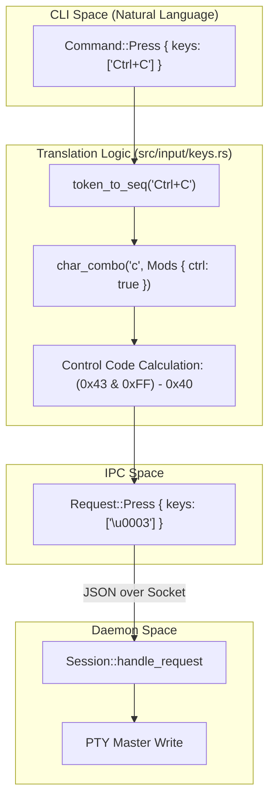
Sources: [src/main.rs:141-142](), [src/input/keys.rs:221-241](), [src/input/keys.rs:244-266]()

---

## Mouse Commands

`shell-use` supports terminal mouse protocol simulation (SGR mode). Mouse actions are defined in the `MouseCmd` enum [src/cli.rs:232-261]() and converted to `MouseAction` protocol objects [src/main.rs:172-208]().

### Mouse Actions

| Action | Description | Parameters |
| :--- | :--- | :--- |
| `click` | Press and release. | `x`, `y`, `button`, `clicks` |
| `move` | Move cursor (hover). | `x`, `y` |
| `down` | Press button. | `x`, `y`, `button` |
| `up` | Release button. | `x`, `y`, `button` |
| `drag` | Press at point A, move, release at B. | `x1`, `y1`, `x2`, `y2`, `button` |
| `scroll` | Simulate scroll wheel. | `direction` (up/down), `amount` |

### SGR Encoding Implementation

The daemon converts these actions into standard SGR mouse escape sequences (`CSI < ... M/m`) before writing to the PTY.

*   **Coordinates**: 0-based in the CLI, but converted to 1-based for the SGR protocol [src/input/mouse.rs:7-24]().
*   **Buttons**: Left (0), Middle (1), Right (2) [src/input/mouse.rs:5-6]().
*   **Scroll**: Encoded as buttons 64 (Up) and 65 (Down) [src/input/mouse.rs:21-23]().

**Mouse Command Entity Mapping**
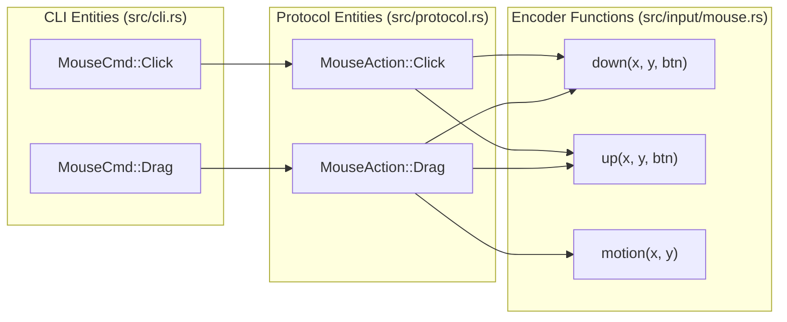
Sources: [src/cli.rs:232-261](), [src/main.rs:172-208](), [src/input/mouse.rs:1-29]()

---

## Implementation Details

### Modifier Parameter Calculation
For named keys (like `Home` or `ArrowUp`), `shell-use` calculates the modifier parameter `p` using the formula `1 + shift + 2*alt + 4*ctrl` [src/input/keys.rs:18-20](). This follows the standard XTerm modifier encoding:
*   No modifiers: `1`
*   Shift: `2`
*   Alt: `3`
*   Ctrl: `5`
*   Ctrl+Shift: `6`
*   Ctrl+Alt: `7`
*   Ctrl+Alt+Shift: `8`

This parameter is then injected into the CSI sequence, for example: `\x1b[1;5H` for `Ctrl+Home` [src/input/keys.rs:28-30]().

### Escape Sequence Constants
The system uses standard terminal constants for building sequences:
*   `ESC`: `\u{1b}` [src/input/keys.rs:3]()
*   `CSI`: `\u{1b}[` [src/input/keys.rs:4]()

Sources: [src/input/keys.rs:1-21](), [src/input/mouse.rs:1-4]()

---

# Page: Inspection and Wait Commands

# Inspection and Wait Commands

<details>
<summary>Relevant source files</summary>

The following files were used as context for generating this wiki page:

- [src/cli.rs](src/cli.rs)
- [src/main.rs](src/main.rs)
- [src/terminal/locator.rs](src/terminal/locator.rs)
- [src/terminal/mod.rs](src/terminal/mod.rs)

</details>


Inspection and wait commands allow users and automated agents to observe the state of a terminal session and synchronize actions based on that state. These commands bridge the gap between the asynchronous nature of terminal output and the synchronous requirements of testing and automation.

## Inspection Commands

Inspection commands provide point-in-time snapshots of the terminal's state, including text content, cell attributes, and metadata like cursor position or exit codes.

### `state`
The `state` command returns a comprehensive summary of the session's current status [src/cli.rs:79-80](). This includes the current working directory (CWD), terminal dimensions, cursor position, the last executed command, its exit code (if available via shell integration), and a text snapshot of the visible viewport.

### `text`
The `text` command extracts the plain text from the terminal grid [src/cli.rs:81-86]().
*   **Viewport only**: By default, it returns only the currently visible rows.
*   **Full scrollback**: The `--full` flag includes the entire scrollback buffer maintained by the emulator [src/cli.rs:84-85]().

### `cells`
The `cells` command allows for low-level inspection of specific grid coordinates [src/cli.rs:99-111](). It returns detailed attributes for each cell in the specified region (x, y, width, height), including:
*   The character (`ch`).
*   Foreground and background colors.
*   Styling flags (bold, italic, etc.).

### `get`
The `get` command retrieves specific structured fields from the session [src/cli.rs:112-117](). Supported fields include:
*   `command`: The last command detected via OSC 133 sequences.
*   `output`: The output of the last command.
*   `exit-code`: The exit status of the last command.
*   `cwd`: The current working directory (reported via OSC 7).
*   `cursor`: Current `(x, y)` cursor coordinates.
*   `size`: Current terminal dimensions `(cols, rows)`.

### `screenshot`
Captures the terminal state [src/cli.rs:87-98](). If a path is provided via `--out` or `--path`, it generates a full-color SVG image [src/cli.rs:89-94](). Without a path, it behaves similarly to `text`, dumping the content to stdout.

---

## Wait Commands

Wait commands block execution until a specific condition is met or a timeout is reached. This is critical for handling the variable latency of CLI programs and network operations.

### Wait Family Overview

| Command | Condition | Use Case |
| :--- | :--- | :--- |
| `wait text` | Specific text appears on screen. | Synchronizing with TUI rendering or prompts. |
| `wait idle` | No PTY activity for a period (default 200ms). | Waiting for a command's output to "settle". |
| `wait command` | OSC 133 "Command Finished" sequence received. | Precise synchronization with shell prompts. |
| `wait exit` | The session's primary process terminates. | Waiting for a program (like `vim`) to close. |

### Implementation and Polling
Wait commands are processed by the daemon. For text-based waits, the daemon utilizes the `locator` module to perform regex or string matching against the terminal grid [src/terminal/locator.rs:39-43]().

#### Natural Language to Code Entity Mapping: Wait Logic
The following diagram illustrates how a CLI `wait` command is transformed into a daemon request and handled by the terminal emulator's search logic.

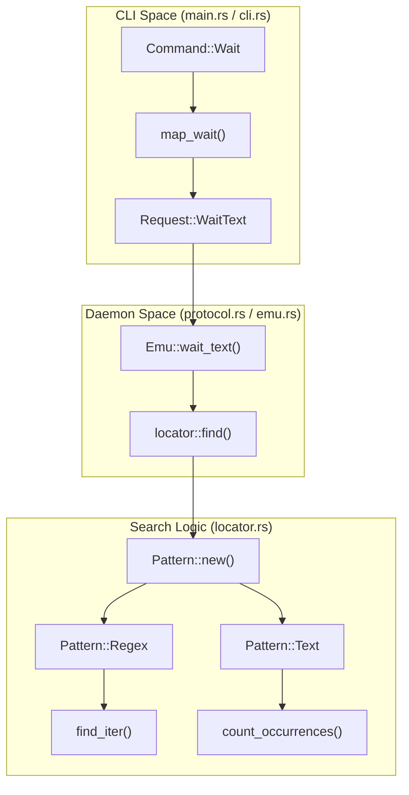
**Sources:** [src/main.rs:154](), [src/main.rs:210-235](), [src/terminal/locator.rs:8-28](), [src/terminal/locator.rs:39-43]()

---

## Technical Details: The Locator Module

The `locator` module is responsible for finding text within the `EmuCell` grid. It flattens the 2D grid into a 1D character array for searching, then maps the resulting match indices back to grid coordinates `(x, y)` [src/terminal/locator.rs:48-63]().

### Search Behavior
1.  **Text vs Regex**: Supports literal string matching or Rust-style regex [src/terminal/locator.rs:8-11]().
2.  **Strict Mode**: If `strict` is enabled, the search will fail if more than one match is found on the screen, preventing ambiguous interactions [src/terminal/locator.rs:75-80]().
3.  **Coordinate Mapping**: Once a match is found in the flat buffer, the system calculates the original `x` and `y` positions for every character in the match [src/terminal/locator.rs:106-119]().

#### Data Flow: Grid Inspection
This diagram shows how the `cells` and `text` commands flow from the user request into the internal `EmuCell` representation.

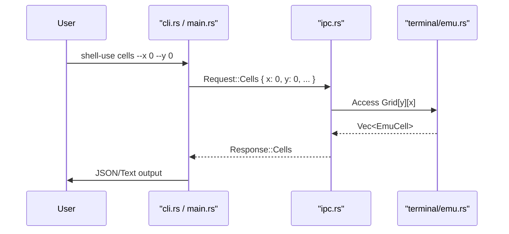
**Sources:** [src/cli.rs:99-111](), [src/main.rs:135](), [src/terminal/emu.rs:1-6](), [src/terminal/locator.rs:31-35]()

### Wait Options
All wait commands support a `--timeout` (in milliseconds). If the condition is not met within this window, the command exits with a non-zero status code (typically 1 for assertion/timeout failure) [src/main.rs:210-235]().

**Sources:**
*   [src/main.rs:129-158]() - Request building logic.
*   [src/main.rs:210-235]() - Mapping wait commands to protocol requests.
*   [src/cli.rs:79-117]() - Definition of inspection subcommands.
*   [src/cli.rs:164-170]() - Definition of wait subcommands.
*   [src/terminal/locator.rs:1-121]() - Implementation of grid searching and pattern matching.

---

# Page: Assertion Commands

# Assertion Commands

<details>
<summary>Relevant source files</summary>

The following files were used as context for generating this wiki page:

- [src/assert/color.rs](src/assert/color.rs)
- [src/assert/mod.rs](src/assert/mod.rs)
- [src/assert/snapshot.rs](src/assert/snapshot.rs)
- [src/cli.rs](src/cli.rs)
- [src/main.rs](src/main.rs)

</details>


Assertion commands provide a mechanism for validating the state of a shell session. Unlike `wait` commands which block until a condition is met, `expect` commands evaluate the current state of the terminal emulator immediately and return a binary result: exit code `0` for success and `1` for failure [src/main.rs:60-61]().

## The Expect Family

The `expect` family of commands is defined in the CLI as subcommands of `ExpectCmd` [src/cli.rs:172-175](). These requests are mapped from CLI arguments to protocol `Request` variants in the `map_expect` function [src/main.rs:237-244]().

### Text and Regex Assertions
`expect text` validates the presence or absence of strings within the terminal grid.

| Argument | Description |
| :--- | :--- |
| `text` | The string or regex pattern to search for. |
| `--regex` | Interpret the input text as a regular expression. |
| `--full` | Search the entire scrollback buffer instead of just the visible viewport. |
| `--not` | Invert the logic: fail if the text is found. |
| `--no-strict` | Disable strict matching (e.g., allow for minor whitespace variations). |

### Color Assertions
The `expect text` command supports attribute-aware assertions using the `--fg` (foreground) and `--bg` (background) flags [src/main.rs:245-246](). 

The `src/assert/color.rs` module handles the parsing and comparison logic for these attributes:
- **Supported Formats**: ANSI 256 indices (`0-255`), Hex codes (`#rrggbb`), and RGB triples (`r,g,b`) [src/assert/color.rs:13-29]().
- **Color Space Mapping**: The system automatically translates between ANSI indices and RGB space to allow cross-format comparison [src/assert/color.rs:115-159]().

### Exit-Code and Output Assertions
- `expect exit-code <code>`: Validates the exit code of the last completed command (requires shell integration for OSC 133 support).
- `expect output <text>`: Validates the output of the last command specifically, excluding the prompt and subsequent input.

## Snapshots

Snapshots allow for regression testing of complex terminal layouts (e.g., TUI applications). The `expect snapshot <name>` command compares the current terminal state against a stored `.snap` file [src/assert/snapshot.rs:1-3]().

### Snapshot Workflow Data Flow
The following diagram illustrates how terminal cells are transformed into serialized snapshots and compared against the filesystem.

**Snapshot Comparison Pipeline**
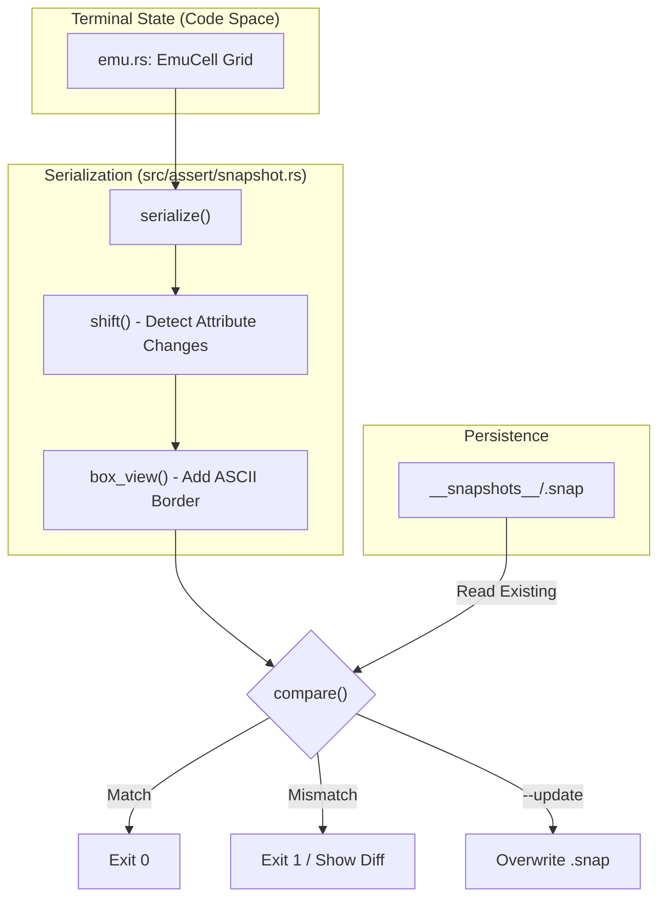
Sources: [src/assert/snapshot.rs:86-112](), [src/assert/snapshot.rs:129-155]()

### Snapshot Format
Snapshots are stored in a human-readable format that includes:
1. **The View**: A boxed ASCII representation of the terminal text [src/assert/snapshot.rs:114-124]().
2. **The Attribute Map**: If colors are included, a JSON object maps `x,y` coordinates to "shifts" in terminal attributes (fg, bg, bold, etc.) [src/assert/snapshot.rs:38-68]().

## Implementation Details

### Color Matching Logic
The `matches` function in `src/assert/color.rs` determines if a terminal cell's color satisfies the expected criteria, handling the `Color::Default` and `Color::Idx` vs `Color::Rgb` abstractions used by the `alacritty_terminal` emulator.

**Entity Mapping: Color Assertion**
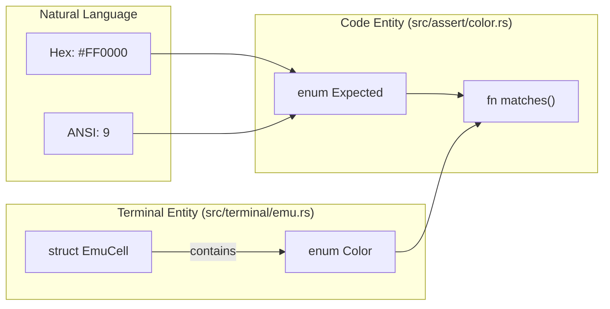
Sources: [src/assert/color.rs:6-10](), [src/assert/color.rs:56-75](), [src/terminal/emu.rs:1-10]()

### Key Functions
- `serialize(rows, cols, include_colors)`: Converts the internal `EmuCell` grid into the snapshot string format [src/assert/snapshot.rs:86]().
- `compare(base, name, content, update)`: Handles file I/O, directory creation (`__snapshots__`), and the logic for updating or failing the assertion [src/assert/snapshot.rs:129]().
- `Expected::parse(s)`: A robust parser for multiple color string formats [src/assert/color.rs:13]().

Sources:
- [src/main.rs:237-260]() (Mapping CLI to Request)
- [src/cli.rs:172-175]() (CLI Subcommands)
- [src/assert/snapshot.rs:9-14]() (Snapshot Status types)
- [src/assert/snapshot.rs:86-112]() (Serialization logic)
- [src/assert/color.rs:56-75]() (Color matching logic)

---

# Page: Observability Commands

# Observability Commands

<details>
<summary>Relevant source files</summary>

The following files were used as context for generating this wiki page:

- [src/agent_context.rs](src/agent_context.rs)
- [src/cli.rs](src/cli.rs)
- [src/main.rs](src/main.rs)
- [src/monitor.rs](src/monitor.rs)
- [src/render/mod.rs](src/render/mod.rs)
- [src/render/svg.rs](src/render/svg.rs)

</details>


Observability commands in `shell-use` provide mechanisms for inspecting, monitoring, and documenting the state of headless terminal sessions. These commands cater to both human operators (via live monitoring and SVG screenshots) and automated agents (via machine-readable context and usage manifests).

### Visual Monitoring and Capture

`shell-use` supports high-fidelity visual observability through live streaming and vector-based screenshots.

#### Monitor (Live View)
The `monitor` command allows a human to watch an agent's session in real-time. The implementation uses a client-server frame streaming model [src/monitor.rs:1-7]().

*   **Implementation**: The daemon renders the current terminal grid into a framed ANSI representation using `render_frame` [src/monitor.rs:33-56]().
*   **Data Flow**: Frames are streamed at approximately 20fps over the session socket [src/monitor.rs:4-7](). The client takes over an alternate screen in raw mode to display these frames [src/monitor.rs:228-230]().
*   **UI Elements**: The monitor includes a border [src/monitor.rs:132-151](), session metadata (shell type, dimensions, status) [src/monitor.rs:58-71](), and a placeholder for inactive sessions [src/monitor.rs:109-130]().

#### Screenshot (SVG Output)
The `screenshot` command can produce either plain text or a full-color SVG image [src/cli.rs:89-98]().

*   **SVG Rendering**: The `render_svg` function [src/render/svg.rs:154-222]() generates a standalone SVG document styled after `svg-term-cli`, featuring macOS-style window controls and a rounded panel [src/render/svg.rs:1-3]().
*   **Visual Fidelity**: It preserves colors, bold/italic/underline styles, and inverse video [src/render/svg.rs:4-6](). It uses `textLength` to ensure precise column alignment regardless of the viewer's monospace font metrics [src/render/svg.rs:7-8]().
*   **Implementation**: Styles are resolved via a `Theme` [src/render/svg.rs:24-55]() which maps terminal colors to RGB hex values [src/render/svg.rs:58-72]().

**Observability Data Flow**

| Command | Source Entity | Output Format | Primary Use Case |
| :--- | :--- | :--- | :--- |
| `monitor` | `monitor::run_client` | ANSI Stream | Real-time human oversight of agent actions. |
| `screenshot` | `render::svg::render_svg` | SVG (Vector) | High-quality documentation and debugging. |
| `get-recording` | `recorder::Recorder` | asciinema v2 (.cast) | Session replay and GIF generation. |

**Sources:** [src/monitor.rs:1-151](), [src/render/svg.rs:1-222](), [src/cli.rs:89-98](), [src/cli.rs:180-188]().

### Session Recording Retrieval

Every `shell-use` session is recorded by default in the asciinema v2 format.

*   **Command**: `get-recording` [src/cli.rs:180-183]().
*   **Function**: It retrieves the `.cast` file associated with a session [src/main.rs:55]().
*   **Workflow**: Users can redirect this output to a file for use with `asciinema play` or `agg` for GIF generation [src/cli.rs:178-179]().

**Sources:** [src/main.rs:55](), [src/cli.rs:176-183]().

### Agent Self-Documentation

To facilitate integration with Large Language Models (LLMs) and autonomous agents, `shell-use` provides commands that describe its own interface and capabilities.

#### Agent Context
The `agent-context` command generates a comprehensive JSON description of the CLI surface [src/agent_context.rs:1-3]().

*   **Implementation**: It uses the `clap` command model to reflectively build the documentation, ensuring the schema never drifts from the implementation [src/agent_context.rs:13-15]().
*   **Content**: The output includes the `schema_version`, global flags, subcommands, arguments (including types and defaults), and the stable exit-code taxonomy [src/agent_context.rs:23-31]().
*   **Exit Codes**: Explicitly documents codes 0 through 5, mapping them to specific failure states like "assertion failure" (1) or "session missing" (3) [src/agent_context.rs:36-45]().

#### Skill and Usage
*   **`skill`**: Prints the contents of `SKILL.md` [src/main.rs:51-54](), which serves as a long-form manifest for agent capabilities [src/main.rs:24]().
*   **`usage`**: Prints a compact command cheatsheet [src/cli.rs:189-190]().

**CLI to Code Entity Mapping**

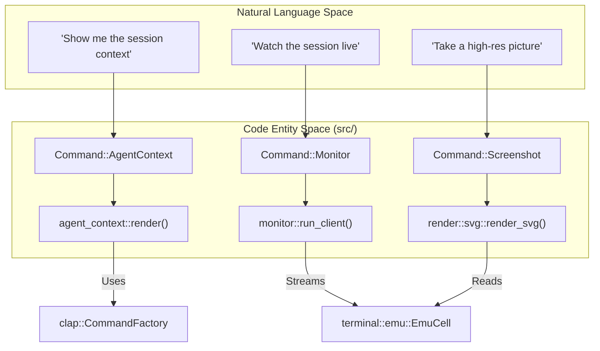

**Sources:** [src/agent_context.rs:1-139](), [src/main.rs:43-54](), [src/cli.rs:189-197]().

### Command Implementation Detail

The mapping from CLI commands to internal protocol requests is handled in `main.rs`.

**Protocol Mapping Diagram**

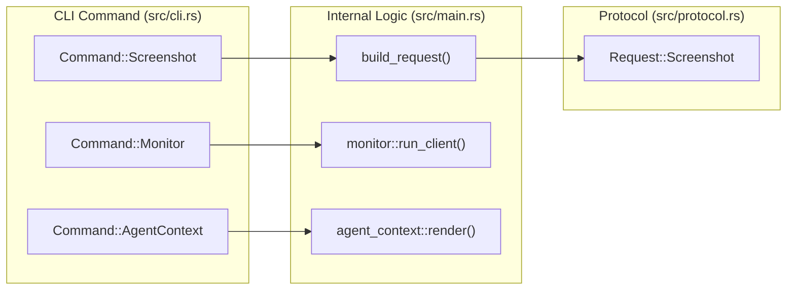

**Sources:** [src/main.rs:35-62](), [src/main.rs:131-134](), [src/cli.rs:26-201]().

---

# Page: Daemon and Internal Architecture

# Daemon and Internal Architecture

<details>
<summary>Relevant source files</summary>

The following files were used as context for generating this wiki page:

- [Cargo.lock](Cargo.lock)
- [src/daemon/mod.rs](src/daemon/mod.rs)

</details>


The `shell-use` daemon is a headless Rust process that manages the lifecycle of a single terminal session. It acts as the bridge between the CLI (or language bindings) and the underlying pseudo-terminal (PTY). The daemon is responsible for terminal emulation, input injection, state inspection, and session recording.

## System Architecture

The daemon operates as a background process, typically spawned lazily by the CLI. It uses a request-response model over a local IPC socket to service commands.

The following diagram illustrates the internal pipeline from the IPC layer down to the PTY:

### Internal Data Flow
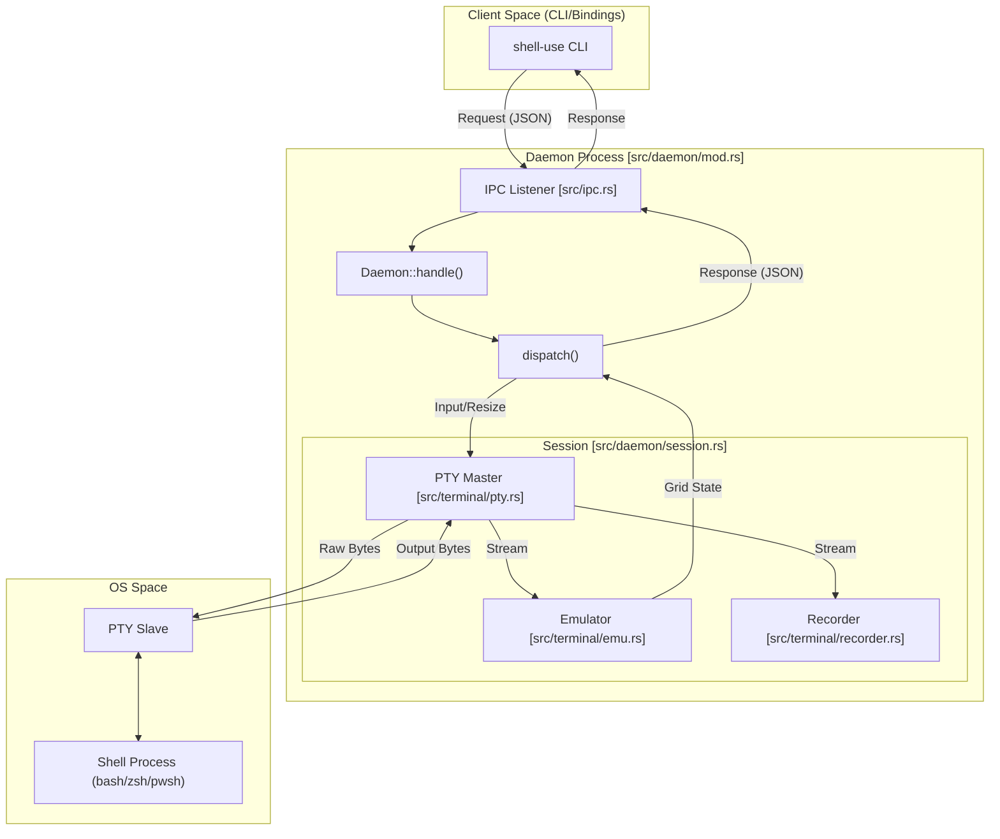
Sources: [src/daemon/mod.rs:79-95](), [src/daemon/session.rs:200-220](), [src/terminal/pty.rs:1-15]()

## Core Subsystems

### 1. Daemon Lifecycle and Session Management
The daemon is designed to be ephemeral. It starts when a session is opened and terminates via an explicit `Shutdown` request or an idle watchdog. It manages a PID file and a platform-specific socket (Unix Domain Socket or Windows Named Pipe) to allow the CLI to locate and communicate with it.

For details, see [Daemon Lifecycle and Session Management](#3.1).

**Key Entities:**
- `Daemon`: The top-level coordinator [src/daemon/mod.rs:28-34]().
- `spawn_idle_watchdog`: Monitors `last_activity` and exits after 10 minutes of inactivity [src/daemon/mod.rs:111-127]().
- `cleanup`: Removes PID and socket files on exit [src/daemon/mod.rs:101-106]().

### 2. PTY and Terminal Emulation
The daemon wraps a native PTY using `portable-pty`. Raw output from the shell is fed into an internal terminal emulator based on `alacritty_terminal`. This allows `shell-use` to maintain a logical grid of cells, including colors and attributes, which can be queried without a physical display.

For details, see [PTY and Terminal Emulation](#3.2).

**Key Entities:**
- `Pty`: Manages the fork and file descriptors [src/terminal/pty.rs:17-25]().
- `Emulator`: Wraps the Alacritty grid logic [src/terminal/emu.rs:32-35]().
- `EmuCell`: Represents a single character with its metadata [src/terminal/emu.rs:142-148]().

### 3. IPC Protocol and Transport
Communication between the CLI and the daemon uses a JSON-based protocol. The `Request` enum defines all possible actions (e.g., `Type`, `WaitText`, `GetField`), and the `Response` enum carries the result or error state.

For details, see [IPC Protocol and Transport](#3.3).

**Key Entities:**
- `Request` / `Response`: The primary wire format [src/protocol.rs:12-100]().
- `ipc::listen`: Sets up the local socket [src/ipc.rs:26-35]().

### 4. Session Recording and Tracing
Every session is automatically recorded in the `asciinema` v2 format. The `Recorder` intercepts the PTY byte stream and writes it to a `.cast` file with millisecond-precision timestamps. Additionally, a verbose logger can be enabled to trace internal state transitions.

For details, see [Session Recording and Tracing](#3.4).

**Key Entities:**
- `Recorder`: Handles the `.cast` file generation [src/terminal/recorder.rs:13-18]().
- `Logger`: Provides debug event tracing to a file [src/daemon/logger.rs:11-14]().

## Component Interaction Map

This table maps the conceptual responsibilities to the primary code entities implementing them.

| Responsibility | Code Entity | Implementation File |
| :--- | :--- | :--- |
| **Request Routing** | `Daemon::handle` | [src/daemon/mod.rs:172-197]() |
| **Command Execution** | `dispatch` | [src/daemon/session.rs:268-350]() |
| **State Persistence** | `TermState` | [src/daemon/session.rs:46-55]() |
| **Byte Processing** | `Session::process_pty_output` | [src/daemon/session.rs:232-248]() |
| **Socket Management** | `ipc::listen` / `ipc::connect` | [src/ipc.rs:26-45]() |

Sources: [src/daemon/mod.rs:28-34](), [src/daemon/session.rs:26-44](), [src/terminal/emu.rs:32-40]()

---

# Page: Daemon Lifecycle and Session Management

# Daemon Lifecycle and Session Management

<details>
<summary>Relevant source files</summary>

The following files were used as context for generating this wiki page:

- [src/config.rs](src/config.rs)
- [src/daemon/logger.rs](src/daemon/logger.rs)
- [src/daemon/mod.rs](src/daemon/mod.rs)
- [src/daemon/session.rs](src/daemon/session.rs)

</details>


The `shell-use` daemon is a background process responsible for managing a single terminal session. It encapsulates a Pseudo-Terminal (PTY), a terminal emulator, and a request handler that services IPC calls from the CLI. Each named session (e.g., "default", "test-1") runs its own dedicated daemon process to ensure isolation and persistence.

## Lifecycle Overview

The daemon is designed to be lazily started by the CLI. When a user executes a command for a session that does not yet have an active daemon, the CLI spawns the daemon process in a detached state.

### Startup and Initialization
When `daemon::run` is invoked [src/daemon/mod.rs:45-45](), it performs the following sequence:
1.  **Home Directory Setup**: Ensures the `~/.shell-use` directory exists [src/daemon/mod.rs:46-46]().
2.  **Recording Cleanup**: Invokes `sweep_recordings` to delete stale `.cast` files from previous crashed or finished sessions [src/daemon/mod.rs:47-47]().
3.  **Socket Binding**: Creates a local IPC socket (Unix Domain Socket or Windows Named Pipe) based on the session name [src/daemon/mod.rs:48-49]().
4.  **PID Persistence**: Writes the current process ID to a `.pid` file in the home directory [src/daemon/mod.rs:50-54]().
5.  **Logging**: If verbosity is enabled, initializes a `Logger` that writes to a `.log` file [src/daemon/mod.rs:56-63]().
6.  **Watchdog Activation**: Spawns a background thread to monitor for inactivity [src/daemon/mod.rs:77-77]().

### Daemon Process Management
| Entity | Role | File Reference |
| :--- | :--- | :--- |
| `Daemon` | Main struct holding the `Session`, `Logger`, and activity timestamps. | [src/daemon/mod.rs:28-34]() |
| `run` | The entry point for the daemon process loop. | [src/daemon/mod.rs:45-99]() |
| `cleanup` | Removes the PID file and socket on exit. | [src/daemon/mod.rs:101-106]() |
| `sweep_recordings` | Garbage collects `.cast` files for sessions no longer running. | [src/daemon/mod.rs:133-150]() |

**Sources:** [src/daemon/mod.rs:28-150](), [src/config.rs:32-73]()

## Session Management

A `Session` represents the active terminal instance. It is created via a `Request::Open` IPC call.

### The `Session` Struct
The `Session` [src/daemon/session.rs:21-30]() coordinates:
*   **PTY**: The raw process interface [src/terminal/pty.rs]().
*   **Emu**: The `alacritty_terminal` based emulator that tracks grid state [src/terminal/emu.rs]().
*   **Recorder**: The `asciinema` v2 logger [src/trace/recorder.rs]().
*   **Reader Thread**: A dedicated thread that pulls bytes from the PTY and updates the emulator and recorder [src/daemon/session.rs:85-114]().

### Session State Transitions
The daemon transitions through three primary states regarding its session:
1.  **Empty**: Daemon is running but no shell/program has been opened yet (`session: Mutex<Option<Session>>` is `None`).
2.  **Active**: A session is running and processing PTY data.
3.  **Exited**: The PTY process has terminated, but the daemon remains alive to serve the final terminal buffer and exit code until closed or timed out [src/daemon/session.rs:111-114]().

### Data Flow: PTY to Emulator
The following diagram illustrates how data flows from the underlying PTY into the daemon's internal state.

**PTY Data Ingestion Flow**
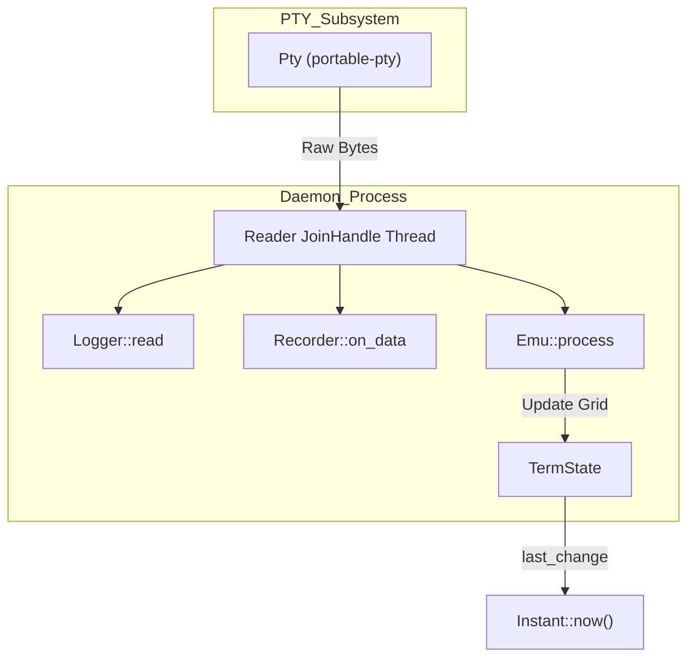
**Sources:** [src/daemon/session.rs:85-114](), [src/daemon/mod.rs:39-42]()

## IPC and Activity Watchdog

The daemon uses an "Idle Watchdog" to prevent orphaned processes from consuming system resources indefinitely.

### Idle Watchdog
The watchdog thread [src/daemon/mod.rs:111-127]() sleeps for `IDLE_CHECK_INTERVAL_MS` (5 minutes) [src/config.rs:14-14](). On wake, it checks the `last_activity` timestamp [src/daemon/mod.rs:114-114](). If the elapsed time exceeds `IDLE_TIMEOUT_MS` (4 hours) [src/config.rs:12-12](), the daemon:
1.  Kills the child PTY process [src/daemon/mod.rs:121-121]().
2.  Deletes its `.pid` and socket files [src/daemon/mod.rs:123-123]().
3.  Exits the process [src/daemon/mod.rs:124-124]().

### Request Handling
Every IPC request received via the `listener` resets the `last_activity` timer [src/daemon/mod.rs:85-85]().

**Request Lifecycle**
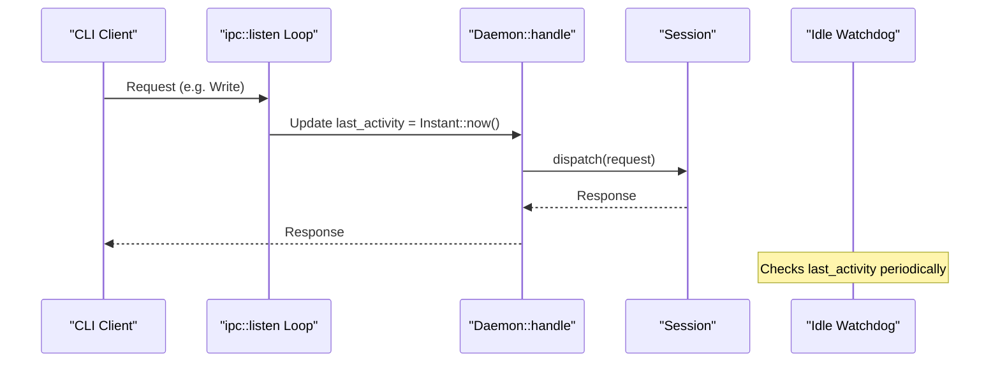
**Sources:** [src/daemon/mod.rs:77-95](), [src/daemon/mod.rs:111-127](), [src/config.rs:10-14]()

## Shutdown Sequence

The daemon exits under three conditions:
1.  **Explicit Shutdown**: A `Request::Shutdown` is received [src/daemon/mod.rs:178-178]().
2.  **Session Close**: A `Request::Close` is received, which kills the session and breaks the listener loop [src/daemon/mod.rs:187-193]().
3.  **Idle Timeout**: The watchdog triggers an exit [src/daemon/mod.rs:124-124]().

### Cleanup Logic
The `cleanup` function [src/daemon/mod.rs:101-106]() ensures the environment is sanitized:
*   **PID File**: Removed so CLI tools know the daemon is inactive [src/daemon/mod.rs:102-102]().
*   **Socket**: On Unix, the socket file is unlinked [src/daemon/mod.rs:104-104](). (On Windows, named pipes are cleaned up by the OS).

**Sources:** [src/daemon/mod.rs:101-106](), [src/daemon/mod.rs:172-197]()

---

# Page: PTY and Terminal Emulation

# PTY and Terminal Emulation

<details>
<summary>Relevant source files</summary>

The following files were used as context for generating this wiki page:

- [Cargo.lock](Cargo.lock)
- [src/terminal/emu.rs](src/terminal/emu.rs)
- [src/terminal/mod.rs](src/terminal/mod.rs)
- [src/terminal/pty.rs](src/terminal/pty.rs)

</details>


The PTY and Terminal Emulation subsystem is responsible for the low-level lifecycle of shell processes and the transformation of raw ANSI byte streams into a structured, queryable grid. This pipeline allows `shell-use` to inspect terminal state, colors, and cursor positions as if it were a physical display.

## PTY Management

The PTY (Pseudo-Terminal) layer is implemented in `src/terminal/pty.rs` using the `portable-pty` crate [Cargo.lock:22-43](). It abstracts platform-specific process spawning (Unix `forkpty` vs. Windows `ConPTY`).

### The Pty Struct
The `Pty` struct [src/terminal/pty.rs:9-13]() manages the master end of the PTY, the input writer, and the child process handle.

*   **Spawning**: The `Pty::spawn` function [src/terminal/pty.rs:25-69]() initializes the `native_pty_system`, opens a new PTY pair with specific dimensions, and configures the environment (defaulting `TERM` to `xterm-256color`).
*   **Input**: Data is sent to the process via `Pty::write` [src/terminal/pty.rs:87-90](), which writes directly to the master PTY's input stream.
*   **Resizing**: The `Pty::resize` method [src/terminal/pty.rs:92-100]() updates the window size in the kernel/OS, triggering `SIGWINCH` in the child process.

### Signal Handling
Because `portable-pty` provides a cross-platform abstraction, signal delivery is normalized in `Pty::signal` [src/terminal/pty.rs:112-120]():
*   `SIGINT` is delivered by writing the ASCII ETX byte (`\x03`) to the PTY [src/terminal/pty.rs:115-115]().
*   `SIGTERM`, `SIGKILL`, and `SIGQUIT` result in a direct process kill [src/terminal/pty.rs:116-116]().

**Sources:** [src/terminal/pty.rs:1-130](), [Cargo.lock:22-43]()

## Terminal Emulation

The emulation layer, found in `src/terminal/emu.rs`, wraps `alacritty_terminal` [Cargo.lock:21-43]() to maintain an in-memory representation of the terminal screen.

### The Emu Instance
The `Emu` struct [src/terminal/emu.rs:97-104]() acts as the central coordinator for state. It contains:
1.  **`Term`**: The Alacritty terminal state machine [src/terminal/emu.rs:98-98]().
2.  **`ansi::Processor`**: The parser that consumes raw bytes and drives state changes in `Term` [src/terminal/emu.rs:99-99]().
3.  **`CommandTracker`**: An integration hook for semantic shell sequences (OSC 133/7) [src/terminal/emu.rs:100-100]().

### Data Flow: Bytes to Grid
The transformation of data follows a strict pipeline:

Title: PTY Data Processing Pipeline
```mermaid
graph LR
    subgraph "External Process"
        "ChildProcess"
    end

    subgraph "PTY Subsystem"
        "PtyReader[Read]"
    end

    subgraph "Emu Subsystem"
        "Emu::process" --> "ansi::Processor::advance"
        "ansi::Processor::advance" --> "Alacritty::Term"
        "Emu::process" --> "CommandTracker::feed"
    end

    "ChildProcess" -- "Raw ANSI Bytes" --> "PtyReader[Read]"
    "PtyReader[Read]" -- "bytes" --> "Emu::process"
    "Alacritty::Term" -- "Internal Grid" --> "EmuCell"
```
**Sources:** [src/terminal/emu.rs:128-131](), [src/terminal/pty.rs:29-29]()

### Grid and Cell Representation
The emulator exposes the grid via `EmuCell` [src/terminal/emu.rs:39-51](), which flattens Alacritty's internal flags into a simplified structure:
*   **Colors**: Represented by the `Color` enum [src/terminal/emu.rs:18-23](), supporting `Default`, `Idx(u8)` (256-color palette), and `Rgb(u8, u8, u8)`.
*   **Attributes**: Boolean flags for `bold`, `italic`, `underline`, `inverse`, etc. [src/terminal/emu.rs:44-50]().
*   **Wide Characters**: The `cell_from_alac` function [src/terminal/emu.rs:53-80]() handles Alacritty's `WIDE_CHAR_SPACER` logic, ensuring that multi-column characters (like Emojis) are correctly represented as a single character followed by empty cells.

**Sources:** [src/terminal/emu.rs:18-80]()

## State Inspection

The `Emu` struct provides methods to query the terminal state for assertions and snapshots.

| Method | Description | Implementation |
| :--- | :--- | :--- |
| `cursor()` | Returns `(x, y)` coordinates | Clamps `grid.cursor.point` to bounds [src/terminal/emu.rs:157-162]() |
| `viewable_rows()` | Returns the current screen | Uses `rows_in_range` for the visible area [src/terminal/emu.rs:165-167]() |
| `full_rows()` | Returns history + screen | Calculates scrollback offset [src/terminal/emu.rs:170-176]() |
| `rows_to_strings()` | Flattens cells to text | Maps `EmuCell.ch` to `String`, replacing blanks with spaces [src/terminal/emu.rs:194-202]() |

### Capture Proxy
The `CaptureProxy` [src/terminal/emu.rs:83-85]() implements Alacritty's `EventListener` [src/terminal/emu.rs:87-95](). It captures `Event::PtyWrite` events—bytes the terminal emulator wants to send back to the PTY (e.g., in response to a Device Status Report query). These are stored in a `pending` buffer and retrieved via `take_pending_writes()` [src/terminal/emu.rs:138-143]() to be written back to the PTY master.

Title: Terminal State Entity Mapping
```mermaid
classDiagram
    class Pty {
        +MasterPty master
        +Write writer
        +Child child
        +spawn()
        +write(data)
    }
    class Emu {
        -Term term
        -Processor processor
        -CommandTracker tracker
        +process(bytes)
        +viewable_rows() Vec~Vec~EmuCell~~
    }
    class EmuCell {
        +String ch
        +Color fg
        +Color bg
        +bool bold
    }
    class Color {
        <<enumeration>>
        Default
        Idx
        Rgb
    }

    Pty ..> Emu : "provides bytes"
    Emu "1" *-- "many" EmuCell : "contains"
    EmuCell "1" *-- "2" Color : "fg/bg"
```
**Sources:** [src/terminal/emu.rs:18-104](), [src/terminal/pty.rs:9-13]()

---

# Page: IPC Protocol and Transport

# IPC Protocol and Transport

<details>
<summary>Relevant source files</summary>

The following files were used as context for generating this wiki page:

- [src/ipc/mod.rs](src/ipc/mod.rs)
- [src/protocol.rs](src/protocol.rs)

</details>


The `shell-use` architecture relies on a stateless CLI that communicates with a long-running daemon via a local IPC (Inter-Process Communication) mechanism. This transport layer facilitates the exchange of JSON-encoded commands and results, allowing the CLI to remain lightweight while the daemon manages complex PTY and terminal emulation state.

### Transport Layer

The transport is implemented using the `interprocess` crate, providing a unified API for local sockets across different operating systems [src/ipc/mod.rs:1-9](). The communication model is generally **request-response**: the CLI opens a connection, sends a single JSON-encoded `Request`, receives a single JSON-encoded `Response`, and closes the connection [src/ipc/mod.rs:19-33]().

#### Socket Naming and Platform Differences
The daemon identifies sessions by a socket name. The underlying transport mechanism varies by platform to adhere to OS-specific conventions:

| Feature | Unix (Linux/macOS) | Windows |
| :--- | :--- | :--- |
| **Mechanism** | Unix Domain Sockets (UDS) | Named Pipes |
| **Namespace** | Filesystem Path | `\\.\pipe\` Namespace |
| **Implementation** | `GenericFilePath` [src/ipc/mod.rs:15]() | `GenericNamespaced` [src/ipc/mod.rs:13]() |
| **Cleanup** | Stale socket files are manually removed [src/ipc/mod.rs:51-53]() | Handled by OS |

#### IPC Connection Lifecycle
The following diagram illustrates the lifecycle of a single IPC exchange between the CLI and the Daemon.

**IPC Request-Response Flow**
```mermaid
sequenceDiagram
    participant CLI as "CLI (src/ipc/mod.rs:send)"
    participant OS as "OS Socket Layer"
    participant D as "Daemon (src/ipc/mod.rs:listen)"

    CLI->>OS: Stream::connect(socket_name)
    OS->>D: Accept Connection
    CLI->>D: Write Request JSON + '\n'
    D->>D: deserialize(Request)
    D->>D: process_request()
    D->>CLI: Write Response JSON + '\n'
    CLI->>CLI: deserialize(Response)
    CLI->>OS: Close Connection
```
Sources: [src/ipc/mod.rs:19-33](), [src/ipc/mod.rs:50-57](), [src/ipc/mod.rs:69-75]()

---

### Protocol Schema

The protocol uses a tagged JSON format. Every message is a single line of text terminated by a newline (`\n`) [src/ipc/mod.rs:25]().

#### The Request Enum
The `Request` enum defines all valid commands the CLI can send to the daemon. It uses a `snake_case` tag named `kind` to differentiate command types [src/protocol.rs:6-8]().

Key Request types include:
*   **Session Management**: `Open`, `Close`, `Shutdown` [src/protocol.rs:10-18, 102]()
*   **Input Injection**: `Write` (raw strings), `Submit` (strings + enter), `Press` (key combos), `Mouse` [src/protocol.rs:33-44]()
*   **Inspection**: `Text` (screen scrape), `Cells` (raw grid data), `Get` (metadata like CWD or cursor) [src/protocol.rs:21-32]()
*   **Synchronization**: `WaitText`, `WaitIdle`, `WaitCommand`, `WaitExit` [src/protocol.rs:52-67]()
*   **Assertions**: `ExpectText`, `ExpectExitCode`, `ExpectOutput`, `Snapshot` [src/protocol.rs:68-93]()

#### The Response Struct
The `Response` struct is the standard envelope for all daemon replies [src/protocol.rs:180-192]().

```rust
pub struct Response {
    pub ok: bool,                     // Success/Failure indicator
    pub data: Option<Value>,          // JSON payload for successful queries
    pub message: Option<String>,      // Human-readable error/failure message
    pub kind: Option<ErrorKind>,      // Classification for CLI exit codes
}
```
Sources: [src/protocol.rs:5-103](), [src/protocol.rs:180-192]()

---

### Error Handling and Exit Codes

The protocol includes a specific `ErrorKind` taxonomy. This allows the daemon to communicate *why* a request failed so the CLI can map the failure to a stable process exit code [src/protocol.rs:153-156]().

**Error Mapping to Code Entities**
```mermaid
graph TD
    subgraph "protocol.rs"
        EK["enum ErrorKind"]
        EK_A["Assertion (1)"]
        EK_U["Usage (2)"]
        EK_N["NoSession (3)"]
        EK_I["Internal (5)"]
        
        EK --> EK_A
        EK --> EK_U
        EK --> EK_N
        EK --> EK_I
    end

    subgraph "CLI Logic Mapping"
        R["Response::err(kind, msg)"]
        EC["ErrorKind::exit_code()"]
    end

    EK_A -.->|returns 1| EC
    EK_U -.->|returns 2| EC
    EK_N -.->|returns 3| EC
    EK_I -.->|returns 5| EC
    
    R -.->|populates| EK
```

| ErrorKind | Exit Code | Description |
| :--- | :--- | :--- |
| `Assertion` | `1` | An `expect` or `wait` condition was not met within the timeout [src/protocol.rs:171](). |
| `Usage` | `2` | Invalid arguments (e.g., malformed regex or invalid color name) [src/protocol.rs:172](). |
| `NoSession` | `3` | The target session socket exists but no active session is running [src/protocol.rs:173](). |
| `Internal` | `5` | I/O errors, PTY failures, or rendering issues [src/protocol.rs:174](). |

Sources: [src/protocol.rs:154-177](), [src/protocol.rs:213-245]()

---

### Specialized Transports

While most commands use the standard request-response cycle, some features require persistent connections.

#### Monitor Mode
The `Monitor` request [src/protocol.rs:98-101]() transitions the connection into a streaming mode. Instead of a single response, the daemon streams terminal updates to the CLI to provide a live view of the session. The CLI uses `ipc::connect` to establish this raw stream [src/ipc/mod.rs:44-47]().

#### Implementation Summary
*   **Serialization**: Handled by `serde_json` [src/ipc/mod.rs:24, 31]().
*   **Buffering**: `BufReader` is used to efficiently handle line-based reading from the socket [src/ipc/mod.rs:23, 61]().
*   **Synchronous I/O**: The current IPC implementation uses synchronous `std::io` traits via the `interprocess` sync API [src/ipc/mod.rs:55]().

Sources: [src/ipc/mod.rs:1-76](), [src/protocol.rs:1-151]()

---

# Page: Session Recording and Tracing

# Session Recording and Tracing

<details>
<summary>Relevant source files</summary>

The following files were used as context for generating this wiki page:

- [src/daemon/logger.rs](src/daemon/logger.rs)
- [src/trace/mod.rs](src/trace/mod.rs)
- [src/trace/recorder.rs](src/trace/recorder.rs)

</details>


The `shell-use` daemon provides always-on session recording and diagnostic tracing to ensure that every interaction with the headless terminal is durable, reproducible, and debuggable. This is achieved through two primary mechanisms: an asciinema-compatible session recorder and a verbose PTY logger.

## Session Recording (Recorder)

The `Recorder` struct in `src/trace/recorder.rs` implements always-on recording of terminal sessions using the **asciinema v2 cast format**. This format is a line-delimited JSON format that allows for streaming updates, ensuring that recordings are readable even if the daemon crashes [src/trace/recorder.rs:1-6]().

### Data Flow and Lifecycle

When a session is opened, a `.cast` file is created. The recorder captures three main types of data:
1.  **Header**: Initial terminal dimensions (columns/rows) and environment variables [src/trace/recorder.rs:55-76]().
2.  **Output ("o")**: Raw bytes read from the PTY, decoded into UTF-8 [src/trace/recorder.rs:79-89]().
3.  **Resize ("r")**: Changes to the terminal window size [src/trace/recorder.rs:92-94]().

### Incremental UTF-8 Decoding

Because PTY reads may split multi-byte UTF-8 sequences (e.g., emojis or box-drawing characters) across separate chunks, the `Recorder` maintains a `pending` buffer [src/trace/recorder.rs:20-21](). The `decode_incremental` function ensures that incomplete sequences are held until the remaining bytes arrive, preventing corruption in the recording [src/trace/recorder.rs:98-127]().

### Recording Logic Diagram

The following diagram illustrates how raw PTY data is transformed into an asciinema event.

| Component | Responsibility |
| :--- | :--- |
| `strip_subsequence` | Removes internal sequences like `WIN32_INPUT_MODE` [src/trace/recorder.rs:140-150](). |
| `decode_incremental` | Buffers split UTF-8 sequences in `pending: Vec<u8>` [src/trace/recorder.rs:98-127](). |
| `write_event` | Appends a timestamped JSON array to the `.cast` file [src/trace/recorder.rs:129-137](). |

```mermaid
graph TD
    subgraph "PTY Output Stream"
        A["Raw Bytes"] --> B["strip_subsequence()"]
    end

    subgraph "Recorder Processing"
        B --> C["decode_incremental()"]
        C -- "Incomplete UTF-8" --> D["pending buffer"]
        C -- "Valid String" --> E["write_event()"]
    end

    subgraph "Storage"
        E --> F[".cast File (JSONL)"]
    end

    style D stroke-dasharray: 5 5
```
Sources: [src/trace/recorder.rs:79-137](), [src/trace/recorder.rs:140-150]()

## Verbose PTY Logging (Logger)

While the `Recorder` focuses on the final visual output for playback, the `Logger` in `src/daemon/logger.rs` provides a developer-centric view of the PTY's raw communication. It is modeled after `inshellisense`'s data logs [src/daemon/logger.rs:1-3]().

### Log Tags
The logger categorizes every entry with a specific tag to clarify the direction and nature of the data:
*   `READ`: Bytes received from the PTY (the application's output) [src/daemon/logger.rs:47-51]().
*   `WRITE`: Bytes sent to the PTY (user input/keystrokes) [src/daemon/logger.rs:53-57]().
*   `REPLY`: Data written back to the PTY in response to terminal capability queries [src/daemon/logger.rs:59-63]().
*   `EVENT`: Lifecycle milestones such as session `open`, `resize`, or `exit` [src/daemon/logger.rs:43-45]().

### Escaping and Formatting
To make control sequences (like ANSI escape codes) visible in text editors, the `escape` function transforms non-printable bytes into readable representations (e.g., `\e`, `\n`, `\r`, or hex escapes like `\x1b`) [src/daemon/logger.rs:88-102]().

### Logger Implementation Diagram

```mermaid
sequenceDiagram
    participant PTY as "PTY Subsystem"
    participant L as "logger::Logger"
    participant S as "BufWriter (File)"

    PTY->>L: read(bytes)
    L->>L: escape(bytes)
    L->>S: writeln!("HH:MM:SS.mmm READ ...")
    
    PTY->>L: write(bytes)
    L->>L: escape(bytes)
    L->>S: writeln!("HH:MM:SS.mmm WRITE ...")

    Note over L,S: All writes are protected by Mutex
```
Sources: [src/daemon/logger.rs:17-19](), [src/daemon/logger.rs:47-72](), [src/daemon/logger.rs:88-102]()

## Storage and Retrieval

### File Locations
Recordings and logs are typically stored in a temporary or session-specific directory managed by the daemon. 
*   **Recordings**: `.cast` files are created using `OpenOptions` with `truncate(true)` to ensure fresh starts [src/trace/recorder.rs:39-45]().
*   **Logs**: Log files are created similarly, providing a chronological trace of the session [src/daemon/logger.rs:28-37]().

### Durability
Both the `Recorder` and `Logger` utilize `BufWriter` and perform a `flush()` operation after every write event [src/trace/recorder.rs:136](), [src/daemon/logger.rs:69](). This ensures that data is committed to disk immediately, which is critical for debugging sessions that may hang or crash.

| Feature | `Recorder` | `Logger` |
| :--- | :--- | :--- |
| **Format** | Asciinema v2 (JSONL) | Timestamped Text |
| **Primary Use** | Visual Playback / Audit | Technical Debugging |
| **Encoding** | UTF-8 String | Escaped Raw Bytes |
| **Events** | Output, Resize | Read, Write, Reply, Event |

Sources: [src/trace/recorder.rs:7-11](), [src/trace/recorder.rs:136](), [src/daemon/logger.rs:1-9](), [src/daemon/logger.rs:65-71]()

---

# Page: Shell Integration

# Shell Integration

<details>
<summary>Relevant source files</summary>

The following files were used as context for generating this wiki page:

- [shell/shellIntegration.nu](shell/shellIntegration.nu)
- [shell/shellIntegration.xsh](shell/shellIntegration.xsh)
- [src/cli.rs](src/cli.rs)
- [src/main.rs](src/main.rs)
- [src/shell/mod.rs](src/shell/mod.rs)

</details>


`shell-use` provides deep visibility into shell sessions by injecting integration scripts that enable semantic tracking. This allows the daemon to distinguish between the shell prompt, user input, and command output using standard terminal escape sequences.

The integration primarily leverages two types of Operating System Command (OSC) sequences:
- **OSC 133**: Semantic prompt tracking (e.g., marking the start of a prompt, the start of output, and the exit code of the last command).
- **OSC 7**: Reporting the Current Working Directory (CWD) to the terminal emulator.

### Integration Flow

The following diagram illustrates how the `shell-use` CLI prepares the environment and launches a shell with these integrations active.

**Shell Launch Sequence**
```mermaid
graph TD
    subgraph "Natural Language Space"
        User["User runs 'shell-use open'"]
    end

    subgraph "Code Entity Space"
        CLI["cli::Command::Open"]
        SL["shell::shell_launch()"]
        WIS["shell::write_integration_scripts()"]
        LaunchStruct["shell::Launch"]
        PTY["daemon::run_pty"]
    end

    User --> CLI
    CLI --> SL
    SL --> WIS
    WIS -- "Materializes .bash, .ps1, etc." --> LaunchStruct
    LaunchStruct -- "target, args, env" --> PTY
```
**Sources:** [src/main.rs:91-104](), [src/shell/mod.rs:137-226](), [src/shell/mod.rs:65-114]()

---

## Integration Architecture and Script Materialization

When a session is opened, `shell-use` does not rely on pre-installed global scripts. Instead, it "materializes" bundled scripts from the binary into a local directory (`~/.shell-use/shell/`) using `write_integration_scripts()` [src/shell/mod.rs:65-114]().

The `shell_launch()` function determines the specific execution arguments and environment variables required to force the shell to load these scripts [src/shell/mod.rs:137-226]().

### Key Mechanisms
- **ZDOTDIR Redirection**: For Zsh, `shell-use` creates a temporary directory and sets the `ZDOTDIR` environment variable to point there, allowing it to override shell startup without touching the user's global config [src/shell/mod.rs:186-195]().
- **Windows Discovery**: On Windows, the system attempts to locate `git-bash` or appropriate `.exe` wrappers to ensure a consistent environment [src/shell/mod.rs:144-156]().
- **Init Files**: Most shells are launched with flags like `--init-file` (Bash) or `-rc` (Elvish) to source the integration immediately [src/shell/mod.rs:152-154](), [src/shell/mod.rs:209-215]().

For details, see [Integration Architecture and Script Materialization](#4.1).

**Sources:** [src/shell/mod.rs:65-114](), [src/shell/mod.rs:137-226](), [src/shell/mod.rs:116-128]()

---

## Supported Shells

`shell-use` supports a wide variety of shells, each with a custom integration script designed to hook into the prompt and command execution lifecycle.

| Shell | Mechanism | Primary File |
| :--- | :--- | :--- |
| **Bash** | `--init-file` | `shellIntegration.bash` |
| **Zsh** | `ZDOTDIR` redirection | `shellIntegration-rc.zsh` |
| **Fish** | `--init-command` | `shellIntegration.fish` |
| **PowerShell** | `-command` sourcing | `shellIntegration.ps1` |
| **Nushell** | `source` command | `shellIntegration.nu` |
| **Xonsh** | `@events` hooks | `shellIntegration.xsh` |
| **Elvish** | `-rc` flag | `shellIntegration.elv` |

### Semantic Sequences (OSC 133)
The scripts are responsible for emitting specific sequences that the `alacritty_terminal` based emulator interprets:
- `OSC 133 ; A ST`: Prompt start.
- `OSC 133 ; B ST`: Prompt end / Input start.
- `OSC 133 ; C ST`: Command start / Output start.
- `OSC 133 ; D ; <ExitCode> ST`: Command finished with exit code.

**Example: Xonsh Event Integration**
The Xonsh integration uses Python-based event decorators to trigger these sequences.
```python
@events.on_precommand
def __su_pre(cmd, **kw):
    __su_osc('C') # Mark command start

@events.on_postcommand
def __su_post(cmd, rtn, **kw):
    __su_osc(f'D;{rtn}') # Mark command end with return code
```
**Sources:** [shell/shellIntegration.xsh:12-19](), [src/shell/mod.rs:10-20]()

### CWD Reporting (OSC 7)
Most integrations also emit `OSC 7;file://<hostname><path>` to ensure the `Get(Cwd)` command returns the accurate current directory of the shell [shell/shellIntegration.xsh:9-10]().

For details, see [Per-Shell Integration Scripts](#4.2).

**Sources:** [shell/shellIntegration.nu:1-15](), [shell/shellIntegration.xsh:1-26](), [src/shell/mod.rs:10-20]()

---

# Page: Integration Architecture and Script Materialization

# Integration Architecture and Script Materialization

<details>
<summary>Relevant source files</summary>

The following files were used as context for generating this wiki page:

- [shell/shellIntegration-env.zsh](shell/shellIntegration-env.zsh)
- [shell/shellIntegration-login.zsh](shell/shellIntegration-login.zsh)
- [shell/shellIntegration-profile.zsh](shell/shellIntegration-profile.zsh)
- [shell/shellIntegration-rc.zsh](shell/shellIntegration-rc.zsh)
- [shell/shellIntegration.nu](shell/shellIntegration.nu)
- [shell/shellIntegration.xsh](shell/shellIntegration.xsh)
- [src/shell/mod.rs](src/shell/mod.rs)

</details>


The `shell-use` system relies on semantic integration with various shells to provide reliable command tracking and state inspection. This is achieved by injecting specialized scripts into the shell process at startup. These scripts use terminal escape sequences (OSC 133 and OSC 7) to signal command boundaries, exit codes, and current working directory changes to the underlying terminal emulator.

## The Launch Sequence

The core of the shell integration logic resides in `src/shell/mod.rs`. When a new session is initiated, the system must determine the correct executable path, command-line arguments, and environment variables required to wrap the shell with `shell-use` hooks.

### The `Launch` Struct
The `Launch` struct is the primary data carrier for process creation parameters:
[src/shell/mod.rs:130-134]()

| Field | Type | Description |
| :--- | :--- | :--- |
| `target` | `String` | The path to the shell executable (e.g., `/bin/zsh` or `pwsh.exe`). |
| `args` | `Vec<String>` | CLI flags used to force the shell to source integration scripts. |
| `env` | `Vec<(String, String)>` | Environment variables, such as `ZDOTDIR` for Zsh redirection. |

### `shell_launch()` Implementation
The `shell_launch()` function is the entry point for preparing a shell session. It performs three critical tasks:
1.  **Materialization**: Calls `write_integration_scripts()` to ensure the latest scripts exist on disk [src/shell/mod.rs:138-138]().
2.  **Specialization**: Branches based on the `Shell` enum to handle syntax differences (e.g., `--init-file` for Bash vs `-rc` for Elvish) [src/shell/mod.rs:142-223]().
3.  **Environment Setup**: Configures shell-specific variables like `USER_ZDOTDIR` or `PROMPT` [src/shell/mod.rs:192-193]().

**Shell Launch Logic Flow**

```mermaid
graph TD
    subgraph "Natural Language Space"
        A["Request to Open Shell"]
    end

    subgraph "Code Entity Space"
        B["shell_launch(shell: Shell)"]
        C["write_integration_scripts()"]
        D["setup_zsh_dotfiles()"]
        E["Launch Struct"]
        F["Shell::Bash Branch"]
        G["Shell::Zsh Branch"]
    end

    A --> B
    B --> C
    C -->|"Materialize .bash, .ps1, .zsh, etc."| B
    B -->|"If Zsh"| D
    B -->|"If Bash"| F
    B -->|"If Zsh"| G
    F -->|"Use --init-file"| E
    G -->|"Set ZDOTDIR & USER_ZDOTDIR"| E
    D -->|"Copy .zshrc to temp dir"| E
```
Sources: [src/shell/mod.rs:130-226]()

---

## Script Materialization

Because `shell-use` is distributed as a single binary, the shell integration scripts are embedded into the Rust executable using the `include_str!` macro.

### `write_integration_scripts()`
This function creates a directory (returned by `scripts_dir()`, typically `~/.shell-use/shell`) and writes the embedded script contents to individual files [src/shell/mod.rs:56-58](), [src/shell/mod.rs:65-114]().

Supported scripts include:
*   `shellIntegration.bash`
*   `shellIntegration.ps1`
*   `shellIntegration.xsh` (Xonsh)
*   `shellIntegration.nu` (Nushell)
*   Multiple `.zsh` files for the Zsh redirection logic.

Sources: [src/shell/mod.rs:56-114]()

---

## Zsh Integration and ZDOTDIR Redirection

Zsh integration is more complex than other shells because it does not provide a standard `--init-file` flag that bypasses user configuration while still allowing it to load. To solve this, `shell-use` uses `ZDOTDIR` redirection.

1.  **Redirection**: `shell_launch` creates a temporary directory and sets the `ZDOTDIR` environment variable to point to it [src/shell/mod.rs:192-192]().
2.  **Proxying**: Inside this temporary directory, `shell-use` materializes a `.zshrc` file (from `shellIntegration-rc.zsh`) that manually sources the user's original `.zshrc` located at `USER_ZDOTDIR` [shell/shellIntegration-rc.zsh:3-7]().
3.  **Hooking**: After sourcing the user's config, the script applies `add-zsh-hook` for `preexec` and `precmd` to emit the required OSC sequences [shell/shellIntegration-rc.zsh:29-30]().

**ZDOTDIR Data Flow**

```mermaid
sequenceDiagram
    participant D as Daemon
    participant Z as Zsh Process
    participant FS as Filesystem

    D->>FS: setup_zsh_dotfiles() (creates temp .zshrc)
    D->>Z: Spawn with ZDOTDIR=temp_dir, USER_ZDOTDIR=original_home
    Z->>FS: Load temp_dir/.zshrc
    Note over FS,Z: shellIntegration-rc.zsh executes
    Z->>FS: Source USER_ZDOTDIR/.zshrc (User's config)
    Z->>Z: add-zsh-hook preexec __su_preexec
    Z->>Z: setopt PROMPT_SUBST
```
Sources: [src/shell/mod.rs:116-128](), [src/shell/mod.rs:186-195](), [shell/shellIntegration-rc.zsh:1-30]()

---

## Windows Discovery Logic

On Windows, `shell-use` must handle the discovery of shell executables that may not be in the standard PATH or require specific extensions.

### `windows_exe()`
A utility function that appends `.exe` to the command name when running on Windows platforms [src/shell/mod.rs:232-236]().

### `git_bash_path()`
For Bash on Windows, the system specifically looks for Git Bash, as it provides a compatible Unix-like environment. The logic (not fully shown in snippets but referenced) handles locating `bash.exe` within the Git installation directory [src/shell/mod.rs:145-145]().

### Command-Line Arguments for Windows Shells
*   **PowerShell/Pwsh**: Uses `-NoLogo -NoProfile -noexit -command` to source the integration script [src/shell/mod.rs:168-172]().
*   **Cmd**: Sets the `PROMPT` environment variable to `$G ` and executes `/k cls` to clear the initial banner [src/shell/mod.rs:197-201]().

Sources: [src/shell/mod.rs:144-175](), [src/shell/mod.rs:196-202](), [src/shell/mod.rs:232-236]()

---

## Semantic Prompt Hooks

Each materialized script implements a set of common hooks. While the implementation varies (e.g., Python for Xonsh, shell functions for Zsh), the emitted sequences are standardized.

| Sequence | Purpose | Example (Xonsh) |
| :--- | :--- | :--- |
| `OSC 133; A` | Prompt Start | `__su_osc('A')` [shell/shellIntegration.xsh:21-21]() |
| `OSC 133; B` | Command Start | `\033]133;B\007` [shell/shellIntegration.xsh:23-23]() |
| `OSC 133; C` | Execution Start | `__su_osc('C')` [shell/shellIntegration.xsh:14-14]() |
| `OSC 133; D;{rc}` | Execution End (Exit Code) | `__su_osc(f'D;{rtn}')` [shell/shellIntegration.xsh:18-18]() |
| `OSC 7; {url}` | Current Working Directory | `__su_cwd()` [shell/shellIntegration.xsh:10-10]() |

### Nushell Special Case
Nushell provides native support for these sequences. The `shellIntegration.nu` script simply enables the built-in `osc133` and `osc7` flags in `$env.config` rather than manually printing sequences [shell/shellIntegration.nu:4-7]().

Sources: [shell/shellIntegration.xsh:6-26](), [shell/shellIntegration.nu:1-15]()

---

# Page: Per-Shell Integration Scripts

# Per-Shell Integration Scripts

<details>
<summary>Relevant source files</summary>

The following files were used as context for generating this wiki page:

- [shell/shellIntegration.bash](shell/shellIntegration.bash)
- [shell/shellIntegration.elv](shell/shellIntegration.elv)
- [shell/shellIntegration.fish](shell/shellIntegration.fish)
- [shell/shellIntegration.nu](shell/shellIntegration.nu)
- [shell/shellIntegration.ps1](shell/shellIntegration.ps1)
- [shell/shellIntegration.xsh](shell/shellIntegration.xsh)
- [src/shell/mod.rs](src/shell/mod.rs)

</details>


This page documents the specific implementation details of the shell integration scripts used by `shell-use`. These scripts are injected into shell sessions to enable semantic tracking via **OSC 133** (Shell Integration) and **OSC 7** (Current Working Directory) escape sequences.

The integration allows the terminal emulator to distinguish between the prompt, the command being typed, and the resulting output, which is critical for the `wait command` and `expect output` functionality.

### Integration Architecture Overview

The `shell-use` daemon materializes these scripts from its binary into a local directory before launching a shell. The `Shell` enum in `src/shell/mod.rs` defines the supported environments.

| Shell | Script File | Hook Mechanism |
| :--- | :--- | :--- |
| **Bash** | `shellIntegration.bash` | `PROMPT_COMMAND` & `trap DEBUG` |
| **Zsh** | `shellIntegration-rc.zsh` | `ZDOTDIR` redirection |
| **Fish** | `shellIntegration.fish` | `--on-event` hooks |
| **PowerShell** | `shellIntegration.ps1` | `Prompt` function override & `PSReadLine` wrapper |
| **Xonsh** | `shellIntegration.xsh` | `@events.on_precommand` / `on_postcommand` |
| **Nushell** | `shellIntegration.nu` | Native `$env.config.shell_integration` |
| **Elvish** | `shellIntegration.elv` | `edit:after-command` & `edit:before-readline` |
| **Cmd** | N/A (Internal) | Static `PROMPT` environment variable |

**Diagram: Integration Script Flow**
This diagram shows how the `shell_launch` function prepares the environment and which shell-specific script is invoked.

```mermaid
graph TD
    subgraph "Code Entity Space (Rust)"
        A["shell_launch() [src/shell/mod.rs]"] --> B["write_integration_scripts()"]
        B --> C["scripts_dir()"]
        A --> D["Launch Struct"]
    end

    subgraph "Shell Script Space"
        D -- "Bash" --> E["shellIntegration.bash"]
        D -- "Zsh" --> F["shellIntegration-rc.zsh"]
        D -- "Fish" --> G["shellIntegration.fish"]
        D -- "Pwsh" --> H["shellIntegration.ps1"]
        D -- "Xonsh" --> I["shellIntegration.xsh"]
        D -- "Nushell" --> J["shellIntegration.nu"]
        D -- "Elvish" --> K["shellIntegration.elv"]
    end

    E --> L["OSC 133 Sequences"]
    F --> L
    G --> L
    H --> L
    I --> L
    J --> L
    K --> L
```
Sources: [src/shell/mod.rs:130-134](), [src/shell/mod.rs:137-226]()

---

### Bash Integration
The Bash script uses `PROMPT_COMMAND` to execute logic before the prompt is displayed and a `DEBUG` trap to detect command execution.

*   **Prompt (OSC 133;A/B):** Set inside `__su_precmd` via `PS1`. It brackets the `> ` string. [shell/shellIntegration.bash:32-32]()
*   **Command Start (OSC 133;C):** Triggered by `trap '__su_preexec_invoke' DEBUG` which fires just before a command runs. [shell/shellIntegration.bash:22-24]()
*   **Command End (OSC 133;D):** Captured in `__su_precmd` by checking the exit code `$?` of the previous command. [shell/shellIntegration.bash:27-30]()

Sources: [shell/shellIntegration.bash:15-36]()

### Zsh Integration
Zsh integration is unique because `shell-use` forces a custom `ZDOTDIR`.
1.  `shell_launch` creates a temporary directory containing `.zshrc`, `.zprofile`, etc. [src/shell/mod.rs:116-128]()
2.  It sets the `ZDOTDIR` environment variable to this temporary path, while preserving the original in `USER_ZDOTDIR`. [src/shell/mod.rs:192-193]()
3.  The scripts then source the user's original configuration to maintain their environment while overlaying the OSC sequences.

Sources: [src/shell/mod.rs:186-195]()

### Fish Integration
Fish uses its native event system for clean integration without overriding user functions.

*   **Pre-exec:** `function __su_preexec --on-event fish_preexec` emits `OSC 133;C`. [shell/shellIntegration.fish:3-3]()
*   **Post-exec:** `function __su_postexec --on-event fish_postexec` emits `OSC 133;D;$status`. [shell/shellIntegration.fish:4-4]()
*   **Prompt:** The `fish_prompt` function is redefined to wrap the output in `OSC 133;A` and `OSC 133;B`. [shell/shellIntegration.fish:5-5]()

Sources: [shell/shellIntegration.fish:1-6]()

### PowerShell (Pwsh/Windows PowerShell)
PowerShell requires wrapping the `Prompt` function and potentially the `PSConsoleHostReadLine` function to handle the input phase.

*   **State Management:** Uses a global variable `$Global:__su_state` to track if it is currently executing a command. [shell/shellIntegration.ps1:9-14]()
*   **CWD Reporting:** Uses `[System.Environment]::MachineName` and `$pwd.ProviderPath` to construct the `OSC 7` URI. [shell/shellIntegration.ps1:41-43]()
*   **PSReadLine Hook:** If `PSReadLine` is present, it intercepts the `PSConsoleHostReadLine` call to emit `OSC 133;C` immediately after the user presses Enter. [shell/shellIntegration.ps1:58-63]()

Sources: [shell/shellIntegration.ps1:1-64]()

### Xonsh Integration
Xonsh integration is implemented in Python using the `@events` decorator system.

*   **Events:** It hooks `on_precommand` to emit `OSC 133;C` and `on_postcommand` to emit `OSC 133;D;{rtn}`. [shell/shellIntegration.xsh:12-18]()
*   **Prompt:** The `$PROMPT` variable is assigned a function `__su_prompt` that returns the prompt string wrapped in sequences. [shell/shellIntegration.xsh:20-25]()

Sources: [shell/shellIntegration.xsh:1-26]()

### Nushell Integration
Nushell provides native support for these sequences, so the integration script primarily acts as a configuration toggle.

*   **Native Flags:** Sets `$env.config.shell_integration.osc133 = true` and `osc7 = true`. [shell/shellIntegration.nu:6-7]()
*   **Minimalism:** Disables the banner and forces a simple `> ` prompt to ensure predictable terminal state for tests. [shell/shellIntegration.nu:8-12]()

Sources: [shell/shellIntegration.nu:1-15]()

### Elvish Integration
Elvish integration utilizes the `edit` module hooks.

*   **Hooks:** It uses `edit:before-readline`, `edit:after-readline`, and `edit:after-command`. [shell/shellIntegration.elv:36-38]()
*   **Exit Status:** The `__su_after_command` function extracts the exit status from the `cmd-info` map, handling nested error structures. [shell/shellIntegration.elv:21-32]()

Sources: [shell/shellIntegration.elv:1-39]()

### Windows Command Prompt (Cmd)
`Cmd.exe` does not support complex scripting or hooks. `shell-use` implements a "best effort" integration by setting the `PROMPT` environment variable to `$G ` (a simple `> `). It does not currently support semantic OSC 133 sequences for Cmd.

Sources: [src/shell/mod.rs:197-201]()

---

### Sequence Mapping Reference

This table describes how the integration scripts map shell states to terminal escape sequences.

| Sequence | Name | Meaning | Code Example (Elvish) |
| :--- | :--- | :--- | :--- |
| `\e]133;A\a` | Prompt Start | The shell is about to display the prompt. | `__su_osc "133;A"` [shell/shellIntegration.elv:12]() |
| `\e]133;B\a` | Prompt End | The prompt has ended; user input begins. | `__su_osc "133;B"` [shell/shellIntegration.elv:14]() |
| `\e]133;C\a` | Command Start | The user submitted a command; output begins. | `__su_osc "133;C"` [shell/shellIntegration.elv:18]() |
| `\e]133;D;{n}\a` | Command End | The command finished with exit code `{n}`. | `__su_osc "133;D;"$status` [shell/shellIntegration.elv:31]() |
| `\e]7;file://...` | CWD | Reports the current working directory. | `__su_osc "7;file://"$p` [shell/shellIntegration.elv:8]() |

**Diagram: Shell State Transitions**
Associating shell events with the specific functions in the integration scripts.

```mermaid
stateDiagram-v2
    [*] --> PromptState : Shell Starts
    PromptState --> InputState : "OSC 133;A (e.g. __su_precmd)"
    InputState --> ExecutingState : "OSC 133;C (e.g. __su_preexec)"
    ExecutingState --> PromptState : "OSC 133;D (e.g. __su_postexec)"
    
    note right of PromptState
        Bash: __su_precmd
        Fish: fish_prompt
        Pwsh: Global:Prompt
    end note

    note right of ExecutingState
        Bash: __su_preexec_invoke
        Xonsh: __su_pre
        Elvish: __su_after_readline
    end note
```
Sources: [shell/shellIntegration.bash:26-36](), [shell/shellIntegration.fish:1-5](), [shell/shellIntegration.ps1:18-50](), [shell/shellIntegration.elv:11-32]()

---

# Page: Language Bindings

# Language Bindings

<details>
<summary>Relevant source files</summary>

The following files were used as context for generating this wiki page:

- [bindings/js/package.json](bindings/js/package.json)
- [bindings/python/pyproject.toml](bindings/python/pyproject.toml)

</details>


The `shell-use` ecosystem provides high-level client libraries for JavaScript/TypeScript and Python. These bindings wrap the underlying JSON-over-local-socket IPC protocol, allowing developers to programmatically control, inspect, and test terminal sessions without manually managing sockets or raw PTY streams.

### Binding Architecture Overview

Both libraries implement a consistent `ShellUse` class pattern that communicates with the `shell-use` daemon. They handle the lifecycle of the daemon process, session creation, and the serialization of requests into the protocol format expected by the Rust backend.

#### System Mapping

The following diagram bridges the high-level language constructs to the internal protocol and daemon entities.

**Entity Mapping: Client to Daemon**
```mermaid
graph TD
    subgraph "Language Space (JS/Python)"
        A["ShellUse Class"] -- "manages" --> B["Session Instance"]
        B -- "calls" --> C["Method (e.g., .run(), .expect_text())"]
    end

    subgraph "IPC Layer"
        C -- "JSON Request" --> D["Unix Domain Socket / Named Pipe"]
    end

    subgraph "Daemon Space (Rust)"
        D -- "Request Enum" --> E["Session Manager"]
        E -- "controls" --> F["PTY / Terminal Emulator"]
    end

    style A stroke-width:2px
    style E stroke-width:2px
```
**Sources:**
- `bindings/js/package.json:2-4`()
- `bindings/python/pyproject.toml:6-8`()

---

### JavaScript / TypeScript Bindings

The `@microsoft/shell-use` package provides a native TypeScript interface for Node.js, Bun, and Deno environments. It leverages modern asynchronous patterns to provide a seamless developer experience for TUI testing and shell automation.

| Feature | Detail |
| :--- | :--- |
| **Package Name** | `@microsoft/shell-use` [bindings/js/package.json:2-2]() |
| **Requirements** | Node.js >= 20 [bindings/js/package.json:18-18]() |
| **Runtimes** | Node, Bun, Deno [bindings/js/package.json:26-29]() |
| **Primary Class** | `ShellUse` |

For detailed API documentation, transport layer specifics, and runtime-specific configuration, see [JavaScript / TypeScript Bindings](#5.1).

**Sources:**
- `bindings/js/package.json:1-30`()

---

### Python Bindings

The `shell-use` Python package offers an `asyncio`-based client library. It is designed to integrate easily into Python testing frameworks like `pytest` or for use in AI agent toolsets.

| Feature | Detail |
| :--- | :--- |
| **Package Name** | `shell-use` [bindings/python/pyproject.toml:6-6]() |
| **Requirements** | Python >= 3.8 [bindings/python/pyproject.toml:10-10]() |
| **Build System** | Hatchling [bindings/python/pyproject.toml:2-3]() |
| **Primary Class** | `ShellUse` |

For details on the async API, session management, and configuration options, see [Python Bindings](#5.2).

**Sources:**
- `bindings/python/pyproject.toml:1-26`()

---

### Conformance and Testing

To ensure parity between the Rust daemon and the various language bindings, a shared test suite validates protocol conformance and integration behavior across all supported platforms.

**Testing Matrix**
```mermaid
graph LR
    subgraph "Test Categories"
        T1["Protocol Tests"]
        T2["Conformance Tests"]
        T3["Integration Tests"]
    end

    subgraph "JS Runners"
        J1["node --test"]
        J2["bun test"]
        J3["deno test"]
    end

    subgraph "Python Runners"
        P1["pytest"]
    end

    T1 & T2 & T3 --> J1 & J2 & J3
    T1 & T2 & T3 --> P1
```

For information on how to run these suites and the specific behaviors they validate, see [Bindings Test Suites](#5.3).

**Sources:**
- `bindings/js/package.json:25-29`()

---

# Page: JavaScript / TypeScript Bindings

# JavaScript / TypeScript Bindings

<details>
<summary>Relevant source files</summary>

The following files were used as context for generating this wiki page:

- [bindings/js/package.json](bindings/js/package.json)
- [bindings/js/src/client.ts](bindings/js/src/client.ts)
- [bindings/js/src/config.ts](bindings/js/src/config.ts)
- [bindings/js/src/errors.ts](bindings/js/src/errors.ts)
- [bindings/js/src/index.ts](bindings/js/src/index.ts)
- [bindings/js/src/protocol.ts](bindings/js/src/protocol.ts)
- [bindings/js/src/sessions.ts](bindings/js/src/sessions.ts)
- [bindings/js/src/transport.ts](bindings/js/src/transport.ts)
- [bindings/js/src/types.ts](bindings/js/src/types.ts)
- [bindings/js/src/version.ts](bindings/js/src/version.ts)

</details>


The `@microsoft/shell-use` npm package provides high-level JavaScript and TypeScript bindings for the `shell-use` terminal daemon. It allows developers to programmatically control, inspect, and automate terminal sessions using a promise-based API. The package is designed to work across multiple runtimes including Node.js, Bun, and Deno.

## Core API: The `ShellUse` Class

The primary entry point for the library is the `ShellUse` class, which manages the lifecycle of a specific shell session and provides methods for interaction and inspection.

### Initialization and Configuration
When a `ShellUse` instance is created, it resolves the session name and binary path from options or environment variables [bindings/js/src/client.ts:112-117]().

| Option | Environment Variable | Default | Description |
| :--- | :--- | :--- | :--- |
| `session` | `SHELL_USE_SESSION` | `"default"` | The name of the session to connect to [bindings/js/src/config.ts:9-11](). |
| `binary` | `SHELL_USE_BIN` | `"shell-use"` | Path to the `shell-use` executable [bindings/js/src/config.ts:13-15](). |
| `home` | `SHELL_USE_HOME` | `~/.shell-use` | Directory for sockets and logs [bindings/js/src/config.ts:17-23](). |

### Session Management
The class provides methods to start shells or specific programs:
*   **`open(opts)`**: Starts a shell (e.g., `bash`, `pwsh`) with optional dimensions and environment [bindings/js/src/client.ts:137-147]().
*   **`run(program, args, opts)`**: Starts a specific command directly without a shell wrapper [bindings/js/src/client.ts:149-159]().
*   **`close()`**: Terminates the session and disconnects from the daemon [bindings/js/src/client.ts:161-173]().

### Interaction and Inspection
Interaction is handled via high-level methods that wrap the underlying JSON-RPC protocol:
*   **Input**: `type(text)`, `press(...keys)`, and `submit(text)` [bindings/js/src/client.ts:175-193]().
*   **Mouse**: A nested `mouse` object provides `click`, `drag`, `scroll`, and `move` [bindings/js/src/client.ts:41-103]().
*   **State**: `state()` returns the full terminal state, while `text()` retrieves the visible grid as a string [bindings/js/src/client.ts:207-216]().
*   **Assertions**: `expectText()` and `waitText()` allow for polling the terminal for specific output with timeout support [bindings/js/src/client.ts:260-280]().

**Sources:** [bindings/js/src/client.ts:41-280](), [bindings/js/src/config.ts:1-30]()

---

## Transport Layer and Protocol

The library communicates with the Rust daemon over local sockets (Unix Domain Sockets on Linux/macOS, Named Pipes on Windows).

### Data Flow: Client to Daemon
The `ShellUse` class uses a private `send` method to route all requests through the `transport` module.

Terminal Command Execution Flow
```mermaid
graph TD
    A["ShellUse.type('ls')"] --> B["ShellUse.send({kind: 'write', data: 'ls'})"]
    B --> C["transport.request()"]
    C --> D{"Daemon running?"}
    D -- "No" --> E["transport.ensureDaemon()"]
    E --> F["spawn('shell-use daemon status')"]
    F --> G["Wait for Socket"]
    D -- "Yes" --> H["net.connect(socketPath)"]
    G --> H
    H --> I["JSON.stringify(payload) + '\\n'"]
    I --> J["net.Socket.write()"]
    J --> K["net.Socket.on('data')"]
    K --> L["JSON.parse(response)"]
    L --> M["unwrap(response)"]
    M --> N["Return to User"]
```

### Version Checking
To prevent compatibility issues, the client performs a lazy version check during the first request. It calls `checkVersion` to compare the daemon's reported version against the hardcoded `VERSION` constant [bindings/js/src/version.ts:3-13](). If they mismatch, a `VersionMismatchError` is thrown [bindings/js/src/client.ts:125-135]().

**Sources:** [bindings/js/src/transport.ts:81-130](), [bindings/js/src/client.ts:119-135](), [bindings/js/src/version.ts:1-13]()

---

## Error Handling

The library defines a hierarchy of error types that map to specific daemon failure modes. Every `ShellUseError` includes an `exitCode` property corresponding to the project's stable exit-code taxonomy [bindings/js/src/errors.ts:9-18]().

| Error Class | `ErrorKind` | Exit Code | Trigger |
| :--- | :--- | :--- | :--- |
| `ExpectationError` | `assertion` | 1 | `expectText` failed to match [bindings/js/src/errors.ts:21-25](). |
| `UsageError` | `usage` | 2 | Invalid arguments passed to API [bindings/js/src/errors.ts:27-31](). |
| `NoSessionError` | `no_session` | 3 | Target session does not exist [bindings/js/src/errors.ts:33-37](). |
| `DaemonError` | `daemon` | 4 | IPC or daemon startup failure [bindings/js/src/errors.ts:39-43](). |
| `InternalError` | `internal` | 5 | Unexpected daemon crash/error [bindings/js/src/errors.ts:51-55](). |

The `unwrap` function in `protocol.ts` is responsible for converting daemon error responses into these typed JavaScript exceptions [bindings/js/src/protocol.ts:4-9]().

**Sources:** [bindings/js/src/errors.ts:1-70](), [bindings/js/src/protocol.ts:1-9]()

---

## Multi-Runtime Support

The package is distributed as an ESM module [bindings/js/package.json:5]() and targets environments with Node.js 20 or higher [bindings/js/package.json:18](). It uses standard `node:net` and `node:child_process` modules, which are also supported by Bun and Deno.

### Code-to-Runtime Association
The following diagram shows how package exports and test scripts map to runtime capabilities.

Binding Runtime Architecture
```mermaid
graph LR
    subgraph "NPM Package: @microsoft/shell-use"
        Index["index.ts (Exports)"]
        Client["client.ts (Logic)"]
        Transport["transport.ts (IPC)"]
    end

    subgraph "Runtimes"
        Node["Node.js (node --test)"]
        Bun["Bun (bun test)"]
        Deno["Deno (deno test)"]
    end

    Index --> Client
    Client --> Transport
    Transport -- "net.Socket" --> Node
    Transport -- "net.Socket" --> Bun
    Transport -- "std/node/net" --> Deno
    
    Node -.-> TestNode["test:node script"]
    Bun -.-> TestBun["test:bun script"]
    Deno -.-> TestDeno["test:deno script"]
```

The `package.json` defines specific test targets for each runtime to ensure cross-platform transport stability [bindings/js/package.json:25-29]().

**Sources:** [bindings/js/package.json:1-53](), [bindings/js/src/transport.ts:1-7]()

---

## Global Session Utilities

Beyond the `ShellUse` class, the package provides standalone functions for managing the daemon environment:

*   **`sessions(opts)`**: Scans the `homeDir` for `.pid` files and attempts to connect to each to return a list of active sessions [bindings/js/src/sessions.ts:9-28]().
*   **`closeAll(opts)`**: Iterates through all active sessions and sends a `close` command to each [bindings/js/src/sessions.ts:30-40]().
*   **`daemonStop(session, opts)`**: Sends a `shutdown` command to a specific session's daemon [bindings/js/src/sessions.ts:52-60]().
*   **`getRecording(session, opts)`**: Reads the `.cast` (asciinema) file associated with a session from the `recordingDir` [bindings/js/src/sessions.ts:62-76]().

**Sources:** [bindings/js/src/sessions.ts:1-76](), [bindings/js/src/config.ts:42-51]()

---

# Page: Python Bindings

# Python Bindings

<details>
<summary>Relevant source files</summary>

The following files were used as context for generating this wiki page:

- [bindings/python/pyproject.toml](bindings/python/pyproject.toml)
- [bindings/python/src/shell_use/__init__.py](bindings/python/src/shell_use/__init__.py)
- [bindings/python/src/shell_use/_config.py](bindings/python/src/shell_use/_config.py)
- [bindings/python/src/shell_use/_protocol.py](bindings/python/src/shell_use/_protocol.py)
- [bindings/python/src/shell_use/_transport.py](bindings/python/src/shell_use/_transport.py)
- [bindings/python/src/shell_use/client.py](bindings/python/src/shell_use/client.py)
- [bindings/python/src/shell_use/errors.py](bindings/python/src/shell_use/errors.py)
- [bindings/python/src/shell_use/types.py](bindings/python/src/shell_use/types.py)

</details>


The `shell-use` Python package provides an asynchronous client for interacting with the `shell-use` terminal daemon. It abstracts the underlying JSON-over-IPC protocol into a high-level `ShellUse` class, enabling programmatic control of terminal sessions, TUI automation, and terminal state inspection.

## Architecture and Data Flow

The Python binding acts as a thin wrapper around the Rust daemon. It manages the lifecycle of the daemon (auto-starting it if necessary), handles the platform-specific IPC transport (Unix Sockets or Windows Named Pipes), and serializes/deserializes the JSON protocol.

### Communication Pipeline

The diagram below illustrates how a method call on the `ShellUse` class traverses the transport layer to reach the `shell-use` daemon.

**Client-Daemon Interaction Flow**
```mermaid
sequenceDiagram
    participant App as "Python Application"
    participant Client as "ShellUse (client.py)"
    participant Trans as "_transport.py"
    participant Daemon as "shell-use daemon (Rust)"

    App->>Client: await .open(shell="zsh")
    Client->>Client: _check_version()
    Client->>Trans: request(payload)
    Trans->>Trans: ensure_daemon()
    Note over Trans: Checks socket existence
    Trans->>Daemon: JSON Request over Socket/Pipe
    Daemon-->>Trans: JSON Response
    Trans-->>Client: Dict[str, Any]
    Client->>Client: unwrap(resp)
    Client-->>App: Result / Exception
```
**Sources:** [bindings/python/src/shell_use/client.py:107-110](), [bindings/python/src/shell_use/_transport.py:79-105]()

## The `ShellUse` Class

The `ShellUse` class is the primary entry point for the library. It is designed for `asyncio` and maintains the configuration for a specific session.

### Configuration and Initialization
When initialized, `ShellUse` resolves its environment using a set of priority-based configuration helpers:
1.  **Session Name**: Defaults to the `SHELL_USE_SESSION` environment variable, or `"default"` [bindings/python/src/shell_use/_config.py:16-17]().
2.  **Binary Path**: Defaults to `SHELL_USE_BIN` or simply `"shell-use"` on the system PATH [bindings/python/src/shell_use/_config.py:20-21]().
3.  **Home Directory**: Defaults to `~/.shell-use` (Unix) or `SHELL_USE_HOME` [bindings/python/src/shell_use/_config.py:28-29]().

### Version Checking
To ensure protocol compatibility, the client performs a lazy version check during the first `send()` call [bindings/python/src/shell_use/client.py:112-120](). It compares the client's `VERSION` constant [bindings/python/src/shell_use/_config.py:8]() against the `version` field returned by the daemon's `status` command. A mismatch raises a `VersionMismatchError` [bindings/python/src/shell_use/client.py:13-20]().

**Sources:** [bindings/python/src/shell_use/client.py:89-102](), [bindings/python/src/shell_use/_config.py:1-56]()

## Transport Layer

The `_transport.py` module handles the low-level IPC mechanics.

| Platform | Mechanism | Path Implementation |
| :--- | :--- | :--- |
| **Unix/macOS** | Unix Domain Socket | `~/.shell-use/{session}.sock` |
| **Windows** | Named Pipe | `\\.\pipe\shell-use-{session}.sock` |

**Sources:** [bindings/python/src/shell_use/_config.py:32-35](), [bindings/python/src/shell_use/_transport.py:14-29]()

### Daemon Autostart
If a request is made and the socket does not exist, the `ensure_daemon` function attempts to spawn the `shell-use` binary with the `daemon status` command [bindings/python/src/shell_use/_transport.py:49-76](). This command is designed to start the daemon in the background if it is not already running. The client then polls the connection for up to 5 seconds before failing [bindings/python/src/shell_use/_transport.py:72-76]().

## Protocol and Error Handling

### Request Wrapping
All high-level methods (e.g., `.type()`, `.press()`, `.state()`) wrap their arguments into a dictionary with a `kind` field and send it via `ShellUse.send()` [bindings/python/src/shell_use/client.py:107-110]().

### Response Unwrapping
The `unwrap()` function in `_protocol.py` inspects the daemon's response. If the `ok` field is `False`, it maps the `kind` string provided by the daemon to a specific Python exception type [bindings/python/src/shell_use/_protocol.py:10-13]().

**Error Mapping Table**
| Daemon `kind` | Python Exception | Exit Code |
| :--- | :--- | :--- |
| `assertion` | `ExpectationError` | 1 |
| `usage` | `UsageError` | 2 |
| `no_session` | `NoSessionError` | 3 |
| `daemon` | `DaemonError` | 4 |
| `internal` | `InternalError` | 5 |

**Sources:** [bindings/python/src/shell_use/errors.py:15-56](), [bindings/python/src/shell_use/_protocol.py:10-13]()

## Key Code Entities

The following diagram maps the logical system components to the specific Python classes and modules.

**Entity Mapping**
```mermaid
graph TD
    subgraph "Public API"
        SU["ShellUse (client.py)"]
        M["_Mouse (client.py)"]
        ST["State (types.py)"]
        CL["Cell (types.py)"]
    end

    subgraph "Internal Plumbing"
        TR["_transport.py"]
        PR["_protocol.py"]
        CF["_config.py"]
    end

    SU --> M
    SU --> TR
    TR --> CF
    SU --> PR
    PR --> ST
    PR --> CL
```
**Sources:** [bindings/python/src/shell_use/client.py:89-102](), [bindings/python/src/shell_use/types.py:9-49](), [bindings/python/src/shell_use/_transport.py:1-12]()

## API Summary

### Session Management
*   `open(shell, cols, rows, cwd, env)`: Starts a new shell session [bindings/python/src/shell_use/client.py:122-141]().
*   `run(program, *args, ...)`: Starts a specific executable instead of a shell [bindings/python/src/shell_use/client.py:143-162]().
*   `close()`: Terminates the session [bindings/python/src/shell_use/client.py:164-170]().

### Input
*   `type(text)` / `write(data)`: Sends raw strings to the PTY [bindings/python/src/shell_use/client.py:172-176]().
*   `press(*keys)`: Sends key combinations (e.g., `"ctrl+c"`) [bindings/python/src/shell_use/client.py:181-182]().
*   `mouse.click(x, y, ...)`: Performs mouse interactions [bindings/python/src/shell_use/client.py:27-48]().

### Inspection
*   `state()`: Returns a `State` dataclass containing cursor position, ready status, and terminal dimensions [bindings/python/src/shell_use/client.py:196-197]().
*   `text(full=False)`: Returns the visible text of the terminal [bindings/python/src/shell_use/client.py:199-200]().
*   `cells(x, y, w, h)`: Returns a list of `Cell` objects containing character and styling data (colors, bold, etc.) [bindings/python/src/shell_use/client.py:202-204]().

**Sources:** [bindings/python/src/shell_use/client.py:122-220](), [bindings/python/src/shell_use/types.py:9-49]()

---

# Page: Bindings Test Suites

# Bindings Test Suites

<details>
<summary>Relevant source files</summary>

The following files were used as context for generating this wiki page:

- [bindings/js/test/conformance.test.mjs](bindings/js/test/conformance.test.mjs)
- [bindings/js/test/integration.test.mjs](bindings/js/test/integration.test.mjs)
- [bindings/js/test/protocol.test.mjs](bindings/js/test/protocol.test.mjs)
- [bindings/python/tests/test_conformance.py](bindings/python/tests/test_conformance.py)
- [bindings/python/tests/test_integration.py](bindings/python/tests/test_integration.py)
- [bindings/python/tests/test_protocol.py](bindings/python/tests/test_protocol.py)

</details>


The `shell-use` project maintains a rigorous testing strategy for its language bindings (JavaScript and Python) to ensure they remain synchronized with the Rust daemon's CLI and IPC protocol. The test suites are categorized into **Conformance**, **Protocol**, and **Integration** tests.

## Conformance Testing

Conformance tests ensure that the language SDKs provide full coverage of the features available in the `shell-use` CLI. They dynamically validate the SDK surface area against the daemon's own self-documentation.

### Mechanism
The tests execute the `shell-use agent-context` command [bindings/js/test/conformance.test.mjs:10-13]() [bindings/python/tests/test_conformance.py:50-51]() to retrieve a JSON schema of all supported CLI commands and exit codes.

1.  **Command Mapping**: Every command in the CLI (e.g., `open`, `wait`, `expect`) must have a corresponding method in the SDK `ShellUse` class or module exports [bindings/js/test/conformance.test.mjs:22-45]() [bindings/python/tests/test_conformance.py:11-34]().
2.  **Exclusion List**: Commands intended only for interactive use (like `monitor`) or self-documentation (like `usage`) are explicitly excluded from SDK requirements [bindings/js/test/conformance.test.mjs:47]() [bindings/python/tests/test_conformance.py:36]().
3.  **Error Taxonomy**: The tests verify that SDK-specific error classes (e.g., `ExpectationError`, `UsageError`) map to the correct numeric exit codes defined in the core taxonomy [bindings/js/test/conformance.test.mjs:66-72]() [bindings/python/tests/test_conformance.py:70-74]().

### Natural Language to Code Entity Space: Conformance
This diagram shows how the "Natural Language" requirement for feature parity is enforced by comparing the CLI schema against SDK classes.

```mermaid
graph TD
    subgraph "Natural Language Space"
        REQ["'Every CLI command must be in the SDK'"]
    end

    subgraph "Code Entity Space"
        BIN["shell-use binary"]
        SCHEMA["agent-context JSON"]
        MAPPING["MAPPING Object"]
        JS_SDK["ShellUse Class (JS)"]
        PY_SDK["ShellUse Class (Python)"]
    end

    REQ --> BIN
    BIN -- "execFileSync" --> SCHEMA
    SCHEMA -- "Iterate commands" --> MAPPING
    MAPPING -- "assert.ok" --> JS_SDK
    MAPPING -- "assertTrue" --> PY_SDK
```
Sources: [bindings/js/test/conformance.test.mjs:10-64](), [bindings/python/tests/test_conformance.py:49-64]()

---

## Protocol Testing

Protocol tests validate the serialization of requests and the handling of responses without requiring a running daemon. They use a mock transport to inspect the JSON payloads sent over the wire.

### Key Validations
*   **Payload Structure**: Ensures that methods like `open()` build the correct JSON structure, including environment variables and terminal dimensions [bindings/js/test/protocol.test.mjs:19-31]() [bindings/python/tests/test_protocol.py:53-67]().
*   **Kebab-Case Mapping**: Validates that camelCase or snake_case SDK methods correctly map to kebab-case protocol fields (e.g., `getExitCode` -> `exit-code`) [bindings/js/test/protocol.test.mjs:54-59]() [bindings/python/tests/test_protocol.py:89-93]().
*   **Default Values**: Verifies that default timeouts (e.g., 5s for `waitText`, 30s for `waitCommand`) are correctly injected into the payload [bindings/js/test/protocol.test.mjs:70-87]() [bindings/python/tests/test_protocol.py:113-139]().
*   **Version Handshaking**: Tests the `checkVersion` logic to ensure it throws a `VersionMismatchError` if the daemon's version does not match the SDK's expected version [bindings/js/test/protocol.test.mjs:97-107]() [bindings/python/tests/test_protocol.py:141-152]().

### Implementation: CapturingClient
Both JS and Python suites implement a `CapturingClient` that overrides the `send` method to store payloads in an array for assertion [bindings/js/test/protocol.test.mjs:7-17]() [bindings/python/tests/test_protocol.py:19-28]().

Sources: [bindings/js/test/protocol.test.mjs:1-108](), [bindings/python/tests/test_protocol.py:1-156]()

---

## Integration Testing

Integration tests perform end-to-end validation by spawning a real `shell-use` daemon and executing shell commands.

### Test Scenarios
*   **Echo Roundtrip**: Opens a session, submits `echo hello-sdk`, waits for the command to finish, and asserts that the text appears in the terminal grid [bindings/js/test/integration.test.mjs:12-27]() [bindings/python/tests/test_integration.py:26-37]().
*   **Session Management**: Verifies that the `sessions()` module function correctly lists active sessions managed by the daemon [bindings/js/test/integration.test.mjs:29-40]() [bindings/python/tests/test_integration.py:39-49]().
*   **Snapshot Workflow**: Validates that `expectSnapshot` correctly writes files to the client's current working directory (CWD) rather than the daemon's CWD [bindings/js/test/integration.test.mjs:42-63]() [bindings/python/tests/test_integration.py:51-72]().

### Data Flow: Integration Execution
This diagram traces the flow from an SDK call to the actual terminal emulator and back.

```mermaid
sequenceDiagram
    participant Test as "Integration Test"
    participant SDK as "ShellUse (JS/Py)"
    participant Daemon as "shell-use daemon"
    participant PTY as "PTY / Shell"

    Test->>SDK: su.submit("echo hi")
    SDK->>Daemon: JSON Request { kind: "submit", data: "echo hi\n" }
    Daemon->>PTY: Write raw bytes
    PTY-->>Daemon: Raw output "hi"
    Daemon->>Daemon: Update EmuCell Grid
    Test->>SDK: su.expectText("hi")
    SDK->>Daemon: JSON Request { kind: "expect_text", text: "hi" }
    Daemon-->>SDK: JSON Response { ok: true }
    SDK-->>Test: void / Promise.resolve
```
Sources: [bindings/js/test/integration.test.mjs:12-27](), [bindings/python/tests/test_integration.py:26-37]()

---

## Running the Tests

Tests are executed using the native test runners for each language. They require the `SHELL_USE_BIN` environment variable to point to a compiled `shell-use` binary for integration and conformance suites.

### JavaScript
The JS suite uses the Node.js native test runner.
```bash
# From bindings/js
export SHELL_USE_BIN=../../target/debug/shell-use
npm test
```
Sources: [bindings/js/test/integration.test.mjs:9-10]()

### Python
The Python suite uses `unittest`.
```bash
# From bindings/python
export SHELL_USE_BIN=../../target/debug/shell-use
python3 -m unittest discover tests
```
Sources: [bindings/python/tests/test_integration.py:10-17]()

## Summary of Test Coverage

| Category | Validates | Dependency |
| :--- | :--- | :--- |
| **Conformance** | SDK method parity with CLI commands | `shell-use` binary |
| **Protocol** | JSON payload structure & serialization | None (Mocked) |
| **Integration** | Real-world PTY interaction & snapshots | `shell-use` binary + Shell |

Sources: [bindings/js/test/conformance.test.mjs:22-45](), [bindings/js/test/protocol.test.mjs:19-31](), [bindings/js/test/integration.test.mjs:12-27]()

---

# Page: Agent Integration

# Agent Integration

<details>
<summary>Relevant source files</summary>

The following files were used as context for generating this wiki page:

- [.github/workflows/ci.yml](.github/workflows/ci.yml)
- [README.md](README.md)
- [SKILL.md](SKILL.md)
- [src/agent_context.rs](src/agent_context.rs)
- [src/cli.rs](src/cli.rs)
- [src/main.rs](src/main.rs)

</details>


`shell-use` is designed as an "AI-native" CLI, providing structured interfaces that allow LLM-based agents to discover capabilities, understand the CLI surface without manual documentation parsing, and handle errors via stable machine-readable signals.

### Agent Discovery and Self-Documentation

The CLI provides three primary commands to bridge the gap between Natural Language instructions and the technical command space. These commands allow an agent to self-correct and explore the tool's surface area dynamically.

*   **`agent-context`**: Prints a versioned JSON schema of the entire CLI. This includes every command, argument, flag, default value, and enum option [src/agent_context.rs:13-34]().
*   **`usage`**: Provides a high-level, human-readable cheatsheet of common patterns [src/main.rs:43-46]().
*   **`skill`**: Outputs a long-form workflow guide (based on `SKILL.md`) that explains the mental model of sessions, PTY interaction, and assertions [src/main.rs:51-54]().

For details on the JSON schema and how to use these commands for prompt injection, see [Agent Context and Self-Documentation](#6.1).

### Integration Workflow

The following diagram illustrates how an Agent interacts with the `shell-use` ecosystem, moving from natural language intent to specific code entities via the self-documentation commands.

**Natural Language to Code Entity Mapping**
```mermaid
graph TD
    subgraph "Natural Language Space"
        NL_INTENT["'Check if the server started'"]
        NL_HELP["'How do I send a Ctrl+C?'"]
    end

    subgraph "Code Entity Space (shell-use CLI)"
        direction LR
        CMD_CONTEXT["Command::AgentContext"]
        CMD_SKILL["Command::Skill"]
        CMD_EXPECT["Command::Expect"]
        CMD_PRESS["Command::Press"]
    end

    NL_INTENT -->|"Agent decides to use"| CMD_EXPECT
    NL_HELP -->|"Agent queries"| CMD_CONTEXT
    NL_HELP -->|"Agent reads"| CMD_SKILL
    CMD_CONTEXT -.->|"Describes"| CMD_PRESS
    CMD_SKILL -.->|"Explains"| CMD_EXPECT
```
**Sources:** [src/main.rs:35-60](), [src/cli.rs:27-201]()

### Skill Quick-Start

To enable an agent (like GitHub Copilot or Claude Dev) to use `shell-use` effectively within a repository, the `SKILL.md` can be projected into standard agent skill directories:

```sh
# Install the workflow guide for the agent to reference
mkdir -p .agents/skills/shell-use && shell-use skill > .agents/skills/shell-use/SKILL.md
```
**Sources:** [README.md:59-65]()

### Stable Exit-Code Taxonomy

Unlike standard CLIs that often return `1` for all errors, `shell-use` implements a stable taxonomy. This allows agents to distinguish between a logical failure (e.g., an assertion failed) and a transport failure (e.g., the daemon crashed).

| Code | Meaning | Logic in Code |
| :--- | :--- | :--- |
| `0` | Success | `Response::Ok` |
| `1` | Assertion/Wait Failure | `Response::Failure` |
| `2` | Usage Error | `anyhow::Result` during `build_request` |
| `3` | Session Missing | Daemon cannot find target socket |
| `4` | IPC/Daemon Error | `ipc::send` failure |
| `5` | Internal Error | Panic or unexpected state |

For a complete mapping of `ResponseKind` to these codes, see [Exit Code Taxonomy](#6.2).

**Error Handling Flow**
```mermaid
graph TD
    CLI["Cli::parse()"] --> REQ["build_request()"]
    REQ -->|"Invalid Args"| E2["Exit 2 (Usage)"]
    REQ --> SEND["ipc::send()"]
    SEND -->|"Socket Error"| E4["Exit 4 (IPC)"]
    SEND --> RESP["print_response()"]
    RESP -->|"Response::Ok"| E0["Exit 0 (Success)"]
    RESP -->|"Response::Failure"| E1["Exit 1 (Assertion)"]
```
**Sources:** [src/main.rs:26-62](), [src/agent_context.rs:36-45]()

## Child Pages
- [Agent Context and Self-Documentation](#6.1) — Details on the `agent-context` JSON schema, versioning, and the `SKILL.md` content.
- [Exit Code Taxonomy](#6.2) — Comprehensive list of exit codes and how the CLI maps internal `Response` types to process exit statuses.

---

# Page: Agent Context and Self-Documentation

# Agent Context and Self-Documentation

<details>
<summary>Relevant source files</summary>

The following files were used as context for generating this wiki page:

- [.github/workflows/ci.yml](.github/workflows/ci.yml)
- [README.md](README.md)
- [SKILL.md](SKILL.md)
- [src/agent_context.rs](src/agent_context.rs)

</details>


`shell-use` is designed as an "AI-native" CLI, providing structured metadata and documentation directly to Large Language Models (LLMs) and autonomous agents. This eliminates the need for agents to rely on brittle scraping of help text or outdated training data. Instead, the tool provides a versioned JSON schema of its entire command surface, ensuring the agent always has an accurate view of the current binary's capabilities.

## Self-Documentation Commands

The system provides three primary entry points for an agent to discover how to use the tool:

| Command | Output Format | Purpose |
| :--- | :--- | :--- |
| `agent-context` | JSON | Machine-readable schema of every command, flag, enum, and exit code. |
| `usage` | Plain Text | A concise, one-screen cheatsheet for quick reference. |
| `skill` | Markdown | The full workflow guide (`SKILL.md`) containing best practices and examples. |

**Sources:** [README.md:51-57](), [SKILL.md:16-24]()

---

## Agent Context JSON Schema

The `agent-context` command generates a comprehensive JSON document derived directly from the `clap` command model in the Rust source code. This ensures that the documentation is always in sync with the implementation.

### Implementation Details
The context is generated by the `render()` function in `src/agent_context.rs`. It reflects the `Cli` struct defined in the crate's CLI module.

**Data Flow: Code to JSON**
1. The `Cli::command()` factory is invoked to retrieve the `clap::Command` definition [src/agent_context.rs:14-14]().
2. Global flags (e.g., `--session`, `--json`) are extracted using `is_global_set()` [src/agent_context.rs:17-21]().
3. The command hierarchy is recursively traversed via `commands_json` to build a map of subcommands [src/agent_context.rs:48-57]().
4. Argument metadata (types, defaults, enums) is serialized via `arg_json` [src/agent_context.rs:80-139]().

### Schema Structure
The output follows a versioned format (currently `schema_version: "1"`) [src/agent_context.rs:10-10]().

```json
{
  "schema_version": "1",
  "name": "shell-use",
  "version": "0.1.0",
  "about": "Drive, inspect, assert on, record, and watch a real terminal...",
  "exit_codes": {
    "0": "success",
    "1": "assertion or wait condition not met",
    "3": "no active session",
    "...": "..."
  },
  "global_flags": [...],
  "commands": {
    "open": {
      "about": "Spawn a shell session",
      "args": [...]
    },
    "expect": {
      "subcommands": {
        "text": { ... }
      }
    }
  }
}
```

### Argument Type Mapping
The generator maps internal Rust types to a simplified set for agents:
*   **`bool`**: Flags using `ArgAction::SetTrue` [src/agent_context.rs:82-82]().
*   **`enum`**: Arguments with a defined list of possible values (e.g., signal types like `INT`, `TERM`) [src/agent_context.rs:92-93]().
*   **`value`**: Positional arguments [src/agent_context.rs:94-95]().
*   **`string`**: Standard named options [src/agent_context.rs:97-97]().

**Sources:** [src/agent_context.rs:1-139]()

---

## Skill Injection (SKILL.md)

The `SKILL.md` file is a specialized workflow guide intended to be injected into an agent's "skill" directory. This allows agents (like GitHub Copilot or Claude) to understand high-level workflows, such as driving a TUI or handling session persistence.

### Injection Cheatsheet
To provide `shell-use` capabilities to an agent, the output of `shell-use skill` should be redirected to the agent's specific skill path:

```sh
# For GitHub Copilot / Codex
mkdir -p .agents/skills/shell-use && shell-use skill > .agents/skills/shell-use/SKILL.md

# For Claude
mkdir -p .claude/skills/shell-use && shell-use skill > .claude/skills/shell-use/SKILL.md
```

**Sources:** [README.md:59-65](), [SKILL.md:1-124]()

---

## System Mapping Diagrams

### Diagram 1: Discovery Data Flow
This diagram illustrates how the `Cli` definition in the Rust source code is transformed into various documentation formats for the Agent.

```mermaid
graph TD
    subgraph "Code Entity Space"
        CLI_DEF["Cli::command() (clap::Command)"]
        AC_MOD["src/agent_context.rs"]
        SKILL_FILE["SKILL.md"]
    end

    subgraph "Natural Language Space"
        AGENT_JSON["agent-context (JSON)"]
        USAGE_TEXT["usage (Cheatsheet)"]
        SKILL_MD["skill (Workflow Guide)"]
    end

    CLI_DEF -->|Reflected by| AC_MOD
    AC_MOD -->|render()| AGENT_JSON
    CLI_DEF -->|Short Help| USAGE_TEXT
    SKILL_FILE -->|Stdout| SKILL_MD

    AGENT_JSON -.->|Informs| AgentLogic["AI Agent / LLM"]
    SKILL_MD -.->|Context for| AgentLogic
```
**Sources:** [src/agent_context.rs:13-34](), [README.md:51-57]()

### Diagram 2: Agent Interaction Lifecycle
This diagram shows how an agent uses the self-documentation to perform a task, bridging the gap between documentation and execution.

```mermaid
sequenceDiagram
    participant Agent as AI Agent
    participant CLI as shell-use CLI
    participant Daemon as shell-use Daemon (daemon.rs)

    Note over Agent: Phase 1: Discovery
    Agent->>CLI: agent-context --json
    CLI-->>Agent: Returns SCHEMA_VERSION 1 JSON
    Agent->>CLI: skill
    CLI-->>Agent: Returns SKILL.md content

    Note over Agent: Phase 2: Execution
    Agent->>CLI: open --session "research"
    CLI->>Daemon: RequestKind::Open
    Daemon-->>CLI: ResponseKind::Ok
    CLI-->>Agent: Exit Code 0

    Note over Agent: Phase 3: Validation
    Agent->>CLI: expect text "Results"
    CLI->>Daemon: RequestKind::GetText
    Daemon-->>CLI: ResponseKind::Text(...)
    CLI-->>Agent: Exit Code 1 (Failure) or 0 (Success)
```
**Sources:** [SKILL.md:126-134](), [src/agent_context.rs:36-45](), [README.md:32-37]()

---

## Usage Cheatsheet
The `usage` command provides a condensed version of the following table for human and agent quick-reference:

| Category | Key Commands |
| :--- | :--- |
| **Lifecycle** | `open`, `run`, `close`, `sessions`, `daemon status` |
| **Input** | `type`, `submit`, `press`, `keys`, `mouse click` |
| **Inspection** | `state`, `text`, `screenshot`, `cells`, `get` |
| **Wait** | `wait text`, `wait idle`, `wait command`, `wait exit` |
| **Assertion** | `expect text`, `expect exit-code`, `expect output`, `expect snapshot` |

**Sources:** [SKILL.md:55-123](), [README.md:122-160]()

---

# Page: Exit Code Taxonomy

# Exit Code Taxonomy

<details>
<summary>Relevant source files</summary>

The following files were used as context for generating this wiki page:

- [src/cli.rs](src/cli.rs)
- [src/main.rs](src/main.rs)
- [src/protocol.rs](src/protocol.rs)

</details>


The `shell-use` CLI employs a stable exit-code taxonomy designed to allow callers—specifically AI agents and CI pipelines—to programmatically distinguish between different classes of failure. Rather than returning a generic non-zero code, the system maps internal `ErrorKind` variants to specific integers.

## Taxonomy Definition

The following table defines the stable exit codes used across the `shell-use` ecosystem.

| Code | Name | Description | `ErrorKind` Mapping |
| :--- | :--- | :--- | :--- |
| **0** | **Success** | The command completed successfully. | N/A |
| **1** | **Assertion Failure** | An `expect` or `wait` condition was not met within the timeout. | `ErrorKind::Assertion` |
| **2** | **Usage Error** | Invalid CLI arguments, malformed regex, or invalid color names. | `ErrorKind::Usage` |
| **3** | **Session Missing** | Target session does not exist or has been closed. | `ErrorKind::NoSession` |
| **4** | **IPC / Daemon Error** | Failed to start the daemon or communication over the socket failed. | N/A (CLI Internal) |
| **5** | **Internal Error** | Unexpected daemon failure (e.g., PTY spawn failure, I/O error). | `ErrorKind::Internal` |

**Sources:**
- [src/protocol.rs:156-177]() (Definition of `ErrorKind` and `exit_code` mapping)
- [src/main.rs:35-61]() (Top-level exit handling in `main`)

---

## Response Mapping Logic

When the CLI communicates with the daemon, it receives a `Response` struct. If the `ok` field is `false`, the CLI inspects the `kind` field (an `ErrorKind` enum) to determine the exit code.

### Natural Language to Code Entity Space: Exit Mapping

This diagram illustrates how the CLI (`main.rs`) processes results from the IPC layer and maps them to the process exit status.

```mermaid
graph TD
    subgraph "CLI Process (main.rs)"
        START["Entry Point: main()"] --> PARSE["Cli::parse()"]
        PARSE --> CMD_MATCH{"Match Command"}
        
        CMD_MATCH -- "InternalDaemon" --> D_RUN["daemon::run()"]
        D_RUN -- "Err" --> EXIT5["exit(5)"]
        
        CMD_MATCH -- "Remote Command" --> REMOTE["run_remote()"]
        REMOTE --> ENSURE["ensure_daemon()"]
        ENSURE -- "Err" --> EXIT4["exit(4)"]
        
        REMOTE --> SEND["ipc::send()"]
        SEND -- "Socket Error" --> EXIT4
        SEND -- "Success" --> PRINT["print_response(Response)"]
        
        PRINT --> KIND_MATCH{"Response.kind?"}
        KIND_MATCH -- "Some(ErrorKind)" --> EK_EXIT["ErrorKind::exit_code()"]
        KIND_MATCH -- "None (ok: true)" --> EXIT0["exit(0)"]
        
        EK_EXIT --> FINAL_EXIT["std::process::exit(code)"]
    end

    subgraph "Daemon Process (protocol.rs)"
        REQ["Request"] --> PROC["Process Logic"]
        PROC -- "Assert Fail" --> R_ERR1["Response::assertion()"]
        PROC -- "Bad Args" --> R_ERR2["Response::usage()"]
        PROC -- "No Session" --> R_ERR3["Response::no_session()"]
        PROC -- "Panic/IO" --> R_ERR5["Response::internal()"]
    end

    R_ERR1 -.-> SEND
    R_ERR2 -.-> SEND
    R_ERR3 -.-> SEND
    R_ERR5 -.-> SEND
```

**Sources:**
- [src/main.rs:65-87]() (`run_remote` logic)
- [src/protocol.rs:179-192]() (`Response` struct definition)
- [src/protocol.rs:214-245]() (`Response` helper constructors)

---

## Implementation Details

### ErrorKind and Exit Mapping
The `ErrorKind` enum in `protocol.rs` is the source of truth for failure classification. It is decorated with `#[serde(rename_all = "snake_case")]` to ensure stable JSON representation across the IPC boundary.

```rust
// [src/protocol.rs:154-177]
pub enum ErrorKind {
    Assertion, // Exit 1
    Usage,     // Exit 2
    NoSession, // Exit 3
    Internal,  // Exit 5
}
```

### CLI Response Handling
The `print_response` function (called by `run_remote` in `main.rs`) is responsible for translating the `Response` into the final integer returned to the shell.

1.  **Success Path**: If `Response.ok` is true, the CLI prints the data (as text or JSON) and returns `0`. [src/main.rs:81]()
2.  **Failure Path**: If `Response.ok` is false:
    -   It prints the `message` to `stderr`.
    -   It extracts the `ErrorKind` from the `kind` field.
    -   It calls `ErrorKind::exit_code()` to get the specific integer. [src/protocol.rs:169-176]()

### Non-Daemon Exit Codes
Certain exit codes are generated by the CLI wrapper itself before a request is even sent to the daemon:
-   **Code 2**: Returned by `run_remote` if `build_request` fails (e.g., invalid environment variable format). [src/main.rs:70]()
-   **Code 4**: Returned if `ensure_daemon` fails to start the background process or if `ipc::send` fails to connect to the Unix socket/Named pipe. [src/main.rs:76, 84]()
-   **Code 5**: Returned if the `InternalDaemon` command (the background process itself) encounters a fatal startup error. [src/main.rs:39]()

### Protocol Flow: Assertion Failure

This diagram traces an `expect text` command that fails, showing the transition from daemon logic to CLI exit.

```mermaid
sequenceDiagram
    participant User as CLI (User)
    participant IPC as IPC Transport
    participant Daemon as Session Daemon

    User->>IPC: Request::ExpectText { text: "ready" }
    Daemon->>Daemon: check_text()
    Note over Daemon: Text not found within timeout
    Daemon->>IPC: Response { ok: false, kind: Assertion, message: "..." }
    IPC->>User: Response Object
    Note over User: print_response() logic
    User->>User: ErrorKind::Assertion.exit_code()
    User-->>User: exit(1)
```

**Sources:**
- [src/main.rs:155]() (Mapping `Expect` command to `Request`)
- [src/protocol.rs:224-226]() (`Response::assertion` constructor)
- [src/main.rs:65-87]() (The `run_remote` sequence)

---

# Page: Distribution and CI/CD

# Distribution and CI/CD

<details>
<summary>Relevant source files</summary>

The following files were used as context for generating this wiki page:

- [.cargo/config.toml](.cargo/config.toml)
- [.github/workflows/ci.yml](.github/workflows/ci.yml)
- [.github/workflows/release.yml](.github/workflows/release.yml)
- [Formula/shell-use.rb](Formula/shell-use.rb)
- [README.md](README.md)

</details>


This page provides a high-level overview of the build, testing, and distribution infrastructure for `shell-use`. The project utilizes GitHub Actions to ensure cross-platform compatibility and automated delivery across Windows, macOS, and Linux.

### Release Pipeline

The release process is triggered by version tags (e.g., `v0.0.1`) and automates the compilation of binaries for multiple architectures and operating systems [.github/workflows/release.yml:1-7](). The pipeline handles complex cross-compilation requirements, such as using `musl-tools` for static Linux binaries and `gcc-aarch64-linux-gnu` for ARM targets [.github/workflows/release.yml:41-55](). 

Key aspects of the release flow include:
*   **Static Linking**: Windows builds use `+crt-static` to ensure the resulting `.exe` has no external runtime dependencies [.github/workflows/release.yml:60-60]().
*   **Multi-Platform Matrix**: Supports `x86_64` and `aarch64` for Linux (GNU/Musl), macOS (Darwin), and Windows (MSVC) [.github/workflows/release.yml:13-31]().
*   **Artifact Packaging**: Binaries are compressed into `.tar.gz` for Unix-like systems and `.zip` for Windows before being attached to a GitHub Release [.github/workflows/release.yml:62-78]().

For details, see [Release Pipeline](#7.1).

### Continuous Integration

The CI workflow validates every push and pull request to the `main` branch [.github/workflows/ci.yml:3-7](). It ensures that the Rust core, Python bindings, and JavaScript/TypeScript bindings remain functional across all supported platforms.

The CI suite performs the following checks:
*   **Rust Quality**: Runs `cargo fmt` for style, `cargo clippy` for linting, and `cargo test` for unit and integration logic [.github/workflows/ci.yml:43-46]().
*   **Bindings Validation**: Executes the Python `unittest` suite and the JS test suite across three different runtimes: Node.js, Bun, and Deno [.github/workflows/ci.yml:61-88]().
*   **Binary Pathing**: Tests use the `SHELL_USE_BIN` environment variable to point the language clients to the freshly built Rust binary [.github/workflows/ci.yml:24-25]().

For details, see [Continuous Integration](#7.2).

### Distribution Channels

`shell-use` is distributed through official package managers to simplify installation and updates.

| Channel | Platform | Command |
| :--- | :--- | :--- |
| **Homebrew** | macOS / Linux | `brew install microsoft/shell-use/shell-use` |
| **WinGet** | Windows | `winget install Microsoft.ShellUse` |
| **Direct** | All | GitHub Release Binaries |

Sources: [README.md:8-25](), [Formula/shell-use.rb:1-36]()

### Build and Test Architecture

The following diagrams illustrate the relationship between the CI/CD workflows and the resulting distribution artifacts.

**CI/CD Pipeline to Code Entity Mapping**
```mermaid
graph TD
    subgraph "CI Workflow [.github/workflows/ci.yml]"
        A["cargo build"] --> B["cargo test"]
        B --> C["Python Bindings Test"]
        B --> D["JS Bindings Test"]
    end

    subgraph "Release Workflow [.github/workflows/release.yml]"
        E["Matrix Build"] --> F["Target: x86_64-unknown-linux-musl"]
        E --> G["Target: x86_64-pc-windows-msvc"]
        E --> H["Target: aarch64-apple-darwin"]
        F & G & H --> I["gh release create"]
    end

    I --> J["Formula/shell-use.rb"]
    J --> K["Homebrew Tap"]
```
Sources: [.github/workflows/ci.yml:12-23](), [.github/workflows/release.yml:13-31](), [Formula/shell-use.rb:7-27]()

**Distribution Artifact Mapping**
```mermaid
graph LR
    subgraph "Binary Artifacts"
        L["shell-use (Linux)"]
        M["shell-use.exe (Windows)"]
        N["shell-use (macOS)"]
    end

    subgraph "Language Packages"
        O["bindings/python"] --> P["PyPI: shell-use"]
        Q["bindings/js"] --> R["NPM: @microsoft/shell-use"]
    end

    L & M & N --> S["CLI Distribution"]
```
Sources: [README.md:73-102](), [.github/workflows/release.yml:62-72]()

---

# Page: Release Pipeline

# Release Pipeline

<details>
<summary>Relevant source files</summary>

The following files were used as context for generating this wiki page:

- [.cargo/config.toml](.cargo/config.toml)
- [.github/workflows/release.yml](.github/workflows/release.yml)
- [Formula/shell-use.rb](Formula/shell-use.rb)

</details>


The `shell-use` release pipeline is an automated GitHub Actions workflow designed to produce optimized, statically-linked binaries for multiple operating systems and CPU architectures. It ensures that the CLI and daemon can be distributed as standalone artifacts with minimal runtime dependencies.

## Workflow Triggers and Permissions

The release process is triggered specifically by the creation of a version tag matching the pattern `v[0-9]+.*` [ .github/workflows/release.yml:3-6](). 

The workflow operates with two distinct permission levels:
1.  **Build Job**: Requires `contents: read` to check out the source code [ .github/workflows/release.yml:8-11]().
2.  **Release Job**: Requires `contents: write` to create the GitHub Release and upload assets [ .github/workflows/release.yml:83-84]().

## Build Matrix and Target Architectures

The pipeline utilizes a matrix strategy to compile for eight distinct targets across Linux, macOS, and Windows.

| OS | Target Triple | Architecture | C Library |
| :--- | :--- | :--- | :--- |
| **Linux** | `x86_64-unknown-linux-gnu` | x86_64 | glibc |
| **Linux** | `aarch64-unknown-linux-gnu` | ARM64 | glibc |
| **Linux** | `x86_64-unknown-linux-musl` | x86_64 | musl (Static) |
| **Linux** | `aarch64-unknown-linux-musl` | ARM64 | musl (Static) |
| **macOS** | `x86_64-apple-darwin` | x86_64 | System |
| **macOS** | `aarch64-apple-darwin` | ARM64 | System |
| **Windows** | `x86_64-pc-windows-msvc` | x86_64 | MSVC (Static CRT) |
| **Windows** | `aarch64-pc-windows-msvc` | ARM64 | MSVC (Static CRT) |

**Sources:** [ .github/workflows/release.yml:13-31]()

### Release Build Process Diagram

This diagram maps the GitHub Actions workflow steps to the specific tools and environment variables used during the build phase.

```mermaid
graph TD
    subgraph "GitHub Actions: build job"
        A["git checkout"] --> B["rustup target add"]
        B --> C{"Target Type?"}
        
        C -- "aarch64-linux" --> D["apt-get install gcc-aarch64-linux-gnu"]
        C -- "musl" --> E["apt-get install musl-tools"]
        
        D --> F["cargo build --release"]
        E --> F
        C -- "macos/x86_64" --> F
        
        subgraph "Compilation Flags"
            F -- "CARGO_TARGET_AARCH64_..._LINKER" --> G["aarch64-linux-gnu-gcc"]
            F -- "RUSTFLAGS (+crt-static)" --> H["Static Linking (Windows)"]
        end
    end
    
    F --> I["Packaging"]
    I -- "Unix: tar.gz" --> J["upload-artifact"]
    I -- "Windows: zip" --> J
```

**Sources:** [ .github/workflows/release.yml:33-79]()

## Toolchains and Cross-Compilation

To support ARM64 and MUSL targets from a standard `ubuntu-latest` runner, the pipeline installs specific cross-compilation toolchains:

*   **ARM64 Linux**: The `gcc-aarch64-linux-gnu` package is installed to provide the necessary linker [ .github/workflows/release.yml:41-45]().
*   **MUSL**: The `musl-tools` package is required for building fully static Linux binaries [ .github/workflows/release.yml:46-50]().
*   **Linker Configuration**: For `aarch64` targets, the `CARGO_TARGET_AARCH64_UNKNOWN_LINUX_GNU_LINKER` and `CARGO_TARGET_AARCH64_UNKNOWN_LINUX_MUSL_LINKER` environment variables are set to `aarch64-linux-gnu-gcc` during the build [ .github/workflows/release.yml:58-59]().

## Static Linking Strategies

A core requirement for `shell-use` distribution is minimizing external dependencies.

### Windows (MSVC)
For Windows targets, the pipeline enforces static linking against the C Runtime (CRT). This is achieved by passing `-C target-feature=+crt-static` via `RUSTFLAGS` [ .github/workflows/release.yml:60](). This configuration is also mirrored in the project's Cargo configuration [ .cargo/config.toml:1-5]().

### Linux (MUSL)
By targeting `*-unknown-linux-musl`, the pipeline produces binaries that do not depend on the host system's `glibc` version, making them highly portable across different Linux distributions.

**Sources:** [ .github/workflows/release.yml:57-61](), [ .cargo/config.toml:1-5]()

## Artifact Packaging and Release

Once compilation is complete, the binaries are compressed based on the runner's operating system:
*   **Unix-like**: Binaries are packaged into `.tar.gz` archives [ .github/workflows/release.yml:62-66]().
*   **Windows**: Binaries (`shell-use.exe`) are packaged into `.zip` archives using `Compress-Archive` [ .github/workflows/release.yml:68-71]().

### The Release Job
The `release` job waits for all matrix builds to complete [ .github/workflows/release.yml:81](). It downloads all uploaded artifacts into a single directory and uses the GitHub CLI (`gh`) to create the official release:

```bash
gh release create "${{ github.ref_name }}" \
  --generate-notes \
  artifacts/*
```
**Sources:** [ .github/workflows/release.yml:94-100]()

## Homebrew Distribution

The release artifacts are consumed by the `shell-use.rb` Homebrew formula. The formula dynamically selects the appropriate `.tar.gz` download URL and SHA-256 checksum based on the user's OS (`on_macos` or `on_linux`) and architecture (`on_arm` or `on_intel`) [ Formula/shell-use.rb:7-27]().

### Distribution Data Flow

This diagram illustrates how a tagged commit flows through the build system to the final user installation via Homebrew.

```mermaid
sequenceDiagram
    participant Dev as Developer
    participant GHA as GitHub Actions
    participant GHR as GitHub Release
    participant HB as Homebrew Formula

    Dev->>GHA: git push tag v*
    Note over GHA: build (matrix: 8 targets)
    GHA->>GHA: cargo build --release --target
    GHA->>GHR: gh release create (Uploads .tar.gz / .zip)
    
    Note over HB: Formula/shell-use.rb
    HB-->>GHR: Fetch shell-use-aarch64-apple-darwin.tar.gz
    Note over HB: bin.install "shell-use"
```

**Sources:** [ .github/workflows/release.yml:1-100](), [ Formula/shell-use.rb:1-31]()

---

# Page: Continuous Integration

# Continuous Integration

<details>
<summary>Relevant source files</summary>

The following files were used as context for generating this wiki page:

- [.cargo/config.toml](.cargo/config.toml)
- [.github/workflows/ci.yml](.github/workflows/ci.yml)
- [.github/workflows/release.yml](.github/workflows/release.yml)
- [Formula/shell-use.rb](Formula/shell-use.rb)
- [README.md](README.md)

</details>


The `shell-use` codebase employs a rigorous Continuous Integration (CI) pipeline to ensure cross-platform compatibility across Windows, macOS, and Linux. The CI workflow validates not only the core Rust daemon and CLI but also the multi-runtime language bindings (Python and JavaScript/TypeScript) on every push and pull request to the `main` branch [[.github/workflows/ci.yml:3-7]]().

## CI Workflow Architecture

The CI pipeline is implemented as a GitHub Actions workflow that utilizes a build matrix to parallelize testing across different operating systems. It is designed to verify the entire stack: from low-level Rust code to high-level language bindings that communicate with the daemon via IPC.

### Platform Matrix and Environment

The workflow runs on `ubuntu-latest`, `macos-latest`, and `windows-latest` [[.github/workflows/ci.yml:17-22]](). Each job identifies the platform-specific binary path to be used by the language bindings during integration tests [[.github/workflows/ci.yml:18-20]]().

Title: CI Pipeline Data Flow
```mermaid
graph TD
    subgraph "CI_Runner [GitHub Actions]"
        A["Checkout Code"] --> B["Rust Toolchain Setup"]
        B --> C["Cargo Cache"]
        C --> D["Validation Stage"]
        
        subgraph "Validation Stage"
            D1["cargo fmt"]
            D2["cargo clippy"]
            D3["cargo test"]
            D1 --> D2 --> D3
        end

        D3 --> E["Binding Runtimes Setup"]
        
        subgraph "Binding Runtimes"
            E1["Python 3.x"]
            E2["Node 22"]
            E3["Bun (latest)"]
            E4["Deno 2.x"]
        end
        
        E --> E1 & E2 & E3 & E4
        
        E1 --> F1["Python Unit Tests"]
        E2 --> F2["Node.js Tests"]
        E3 --> F3["Bun Tests"]
        E4 --> F4["Deno Tests"]
    end

    F1 & F2 & F3 & F4 --> G["Job Success"]
```
**Sources:** [[.github/workflows/ci.yml:12-88]]()

## Rust Validation

The Rust core is validated through three primary steps:
1.  **Formatting**: `cargo fmt` ensures adherence to style guidelines across the entire workspace [[.github/workflows/ci.yml:43]]().
2.  **Linting**: `cargo clippy` is run with `-D warnings` to enforce code quality and catch common idiomatic errors [[.github/workflows/ci.yml:44]]().
3.  **Unit & Integration Testing**: `cargo test` executes the internal Rust test suite [[.github/workflows/ci.yml:46]]().

The environment variable `SHELL_USE_BIN` is set to point to the freshly built debug binary, allowing subsequent binding tests to locate the `shell-use` executable [[.github/workflows/ci.yml:24-25]]().

**Sources:** [[.github/workflows/ci.yml:43-46]]()

## Binding Test Matrix

A significant portion of the CI suite is dedicated to ensuring that the Python and JavaScript bindings remain synchronized with the Rust daemon's IPC protocol.

### Python Bindings
The Python tests are executed using the `unittest` discovery module. The `PYTHONPATH` is explicitly set to `src` to ensure the local version of the package is tested [[.github/workflows/ci.yml:61-66]]().

### JavaScript / TypeScript Bindings
The JS bindings are tested across three distinct runtimes to ensure compatibility with modern web and server-side ecosystems:
*   **Node.js**: Validated using `npm run test:node` [[.github/workflows/ci.yml:78]]().
*   **Bun**: Validated using `npm run test:bun` [[.github/workflows/ci.yml:83]]().
*   **Deno**: Validated using `npm run test:deno` [[.github/workflows/ci.yml:88]]().

Before running these tests, the CI performs a build step in the `bindings/js` directory to compile the TypeScript source [[.github/workflows/ci.yml:71-73]]().

Title: Cross-Platform Binding Validation
```mermaid
graph LR
    subgraph "Host_OS [Ubuntu | macOS | Windows]"
        BIN["shell-use (binary)"]
    end

    subgraph "Language_Runtimes"
        PY["Python 3.x"]
        NODE["Node 22"]
        BUN["Bun"]
        DENO["Deno 2"]
    end

    BIN -. "IPC via SHELL_USE_BIN" .-> PY
    BIN -. "IPC via SHELL_USE_BIN" .-> NODE
    BIN -. "IPC via SHELL_USE_BIN" .-> BUN
    BIN -. "IPC via SHELL_USE_BIN" .-> DENO

    PY --> T1["python -m unittest"]
    NODE --> T2["npm run test:node"]
    BUN --> T3["npm run test:bun"]
    DENO --> T4["npm run test:deno"]
```
**Sources:** [[.github/workflows/ci.yml:24-25]](), [[.github/workflows/ci.yml:61-88]]()

## Infrastructure and Caching

To optimize CI turnaround time, the workflow utilizes `actions/cache` for Cargo dependencies. It caches the `~/.cargo/registry`, `~/.cargo/git`, and the `target` directory, keyed by the `Cargo.lock` hash [[.github/workflows/ci.yml:34-41]](). This significantly reduces build times for the Rust binary across the three OS platforms.

The workflow also configures specific toolchains:
*   **Rust**: Stable toolchain with `clippy` and `rustfmt` components [[.github/workflows/ci.yml:29-32]]().
*   **Python**: Version 3.x [[.github/workflows/ci.yml:48-50]]().
*   **Node**: Version 22 [[.github/workflows/ci.yml:51-53]]().
*   **Bun**: Latest version [[.github/workflows/ci.yml:54-56]]().
*   **Deno**: Version 2.x [[.github/workflows/ci.yml:57-59]]().

**Sources:** [[.github/workflows/ci.yml:29-59]]()

---

# Page: Glossary

# Glossary

<details>
<summary>Relevant source files</summary>

The following files were used as context for generating this wiki page:

- [.github/workflows/ci.yml](.github/workflows/ci.yml)
- [Cargo.lock](Cargo.lock)
- [README.md](README.md)
- [shell/shellIntegration.nu](shell/shellIntegration.nu)
- [shell/shellIntegration.xsh](shell/shellIntegration.xsh)
- [src/cli.rs](src/cli.rs)
- [src/daemon/mod.rs](src/daemon/mod.rs)
- [src/main.rs](src/main.rs)
- [src/protocol.rs](src/protocol.rs)
- [src/shell/mod.rs](src/shell/mod.rs)
- [src/trace/recorder.rs](src/trace/recorder.rs)

</details>


This page defines codebase-specific terms, abbreviations, and domain concepts used within `shell-use`. It serves as a technical reference for onboarding engineers to understand how high-level terminal concepts map to specific implementation details in the Rust daemon and CLI.

## Core Domain Terms

### Session
A **Session** is the primary unit of isolation in `shell-use`. Each session consists of a dedicated PTY (Pseudo-Terminal), a terminal emulator instance, and an always-on recorder. Sessions are identified by a unique name (defaulting to `default`) [src/main.rs:28-28]().
*   **Implementation**: Managed by the `Session` struct [src/daemon/session.rs:43-62]().
*   **Lifecycle**: Created via `Request::Open` [src/protocol.rs:10-17]() and terminated via `Request::Close` [src/protocol.rs:18-18]().

### Daemon
The **Daemon** is a background process that owns and manages sessions. It listens on a platform-specific local socket (Unix domain socket or Windows named pipe) to service requests from the stateless CLI [src/daemon/mod.rs:1-2]().
*   **Auto-start**: The CLI automatically spawns the daemon if it is not already running during a command execution [src/main.rs:74-77]().
*   **Idle Watchdog**: A background thread that shuts down the daemon if no activity is detected for a configured timeout [src/daemon/mod.rs:111-127]().

### PTY (Pseudo-Terminal)
The PTY is the interface between the `shell-use` daemon and the child process (shell or program).
*   **Backend**: Uses the `portable-pty` crate to provide cross-platform PTY allocation [Cargo.lock:1218-1218]().
*   **Flow**: Raw bytes from the PTY are fed into the terminal emulator and simultaneously sent to the `Recorder` [src/daemon/session.rs:153-162]().

### Terminal Emulator (Emu)
A software implementation of a physical terminal. `shell-use` uses a headless version of the `alacritty_terminal` library to maintain the state of the terminal grid [Cargo.lock:21-24]().
*   **Grid State**: Stored in `TermState`, which tracks the cursor position, grid cells, and semantic prompt markers [src/daemon/session.rs:26-39]().
*   **Cell**: Represented by `EmuCell`, containing the character and its visual attributes (foreground, background, and flags) [src/terminal/emu.rs:23-23]().

### Semantic Prompts (OSC 133)
`shell-use` uses **OSC 133** escape sequences to track the lifecycle of commands within a shell. This allows the system to distinguish between the command being typed, the output produced, and the shell prompt itself [shell/shellIntegration.xsh:7-7]().
*   **A**: Prompt start.
*   **B**: Prompt end / Command start.
*   **C**: Command end / Output start.
*   **D**: Command finished (with exit code).

---

## Architecture Diagrams

### From Natural Language to Code Entities
This diagram bridges user-facing concepts to the specific structs and enums that implement them.

```mermaid
graph TD
    subgraph "Natural Language Space"
        UserCmd["'shell-use submit'"]
        SessionName["'Named Session'"]
        TermGrid["'Terminal Screen'"]
    end

    subgraph "Code Entity Space"
        UserCmd -->|Parsed by| CliEnum["cli::Command::Submit"]
        CliEnum -->|Mapped to| ReqEnum["protocol::Request::Submit"]
        SessionName -->|Identifies| SocketFile["config::socket_name()"]
        SocketFile -->|Connects to| DaemonStruct["daemon::Daemon"]
        DaemonStruct -->|Owns| SessionStruct["daemon::session::Session"]
        SessionStruct -->|Updates| TermState["daemon::session::TermState"]
        TermState -->|Contains| EmuCell["terminal::emu::EmuCell"]
    end
```
**Sources**: [src/main.rs:28-62](), [src/cli.rs:123-127](), [src/protocol.rs:36-38](), [src/daemon/mod.rs:28-34](), [src/daemon/session.rs:26-62]().

### Request Flow and Data Transformation
This diagram illustrates how a CLI request transforms into PTY input and terminal state.

```mermaid
sequenceDiagram
    participant CLI as cli::main
    participant IPC as ipc::send
    participant D as daemon::Daemon
    participant S as daemon::session::Session
    participant PTY as portable_pty::Pty
    participant EMU as alacritty_terminal

    CLI->>IPC: Request::Submit { data }
    IPC->>D: JSON over Socket
    D->>S: dispatch(Request)
    S->>PTY: write_all(bytes + \r)
    PTY-->>S: raw output bytes
    S->>EMU: input(bytes)
    S->>S: recorder.on_data(bytes)
    EMU->>S: update TermState
    S-->>D: Response::ok()
    D-->>CLI: Response
```
**Sources**: [src/main.rs:65-87](), [src/daemon/mod.rs:79-95](), [src/daemon/session.rs:153-162](), [src/trace/recorder.rs:79-89]().

---

## Technical Glossary Table

| Term | Definition | Code Pointer |
| :--- | :--- | :--- |
| **Asciicast** | The v2 JSON format used for session recording, compatible with `asciinema`. | [src/trace/recorder.rs:1-6]() |
| **Cell** | A single character position on the terminal grid with its associated colors. | [src/terminal/emu.rs:23-23]() |
| **Exit Code Taxonomy** | A stable mapping of internal errors to process exit codes (0-5). | [src/protocol.rs:167-177]() |
| **Idle Watchdog** | A background thread that kills the daemon after `IDLE_TIMEOUT_MS`. | [src/daemon/mod.rs:111-127]() |
| **Live Target** | A shared reference to terminal state used by the `monitor` command. | [src/daemon/mod.rs:39-42]() |
| **OSC 7** | Escape sequence used by shells to report the Current Working Directory (CWD). | [shell/shellIntegration.xsh:10-10]() |
| **Portable-PTY** | The cross-platform library used to spawn and manage PTYs. | [Cargo.lock:1218-1218]() |
| **Recording** | An always-on `.cast` file stored in `~/.shell-use/recordings/`. | [src/daemon/mod.rs:133-150]() |
| **Shell Integration** | Scripts injected into the shell to enable semantic tracking. | [src/shell/mod.rs:65-114]() |
| **Snapshot** | A persisted text/color representation of the screen for regression testing. | [src/protocol.rs:85-93]() |
| **ZDOTDIR** | Environment variable used to redirect Zsh configuration for integration. | [src/shell/mod.rs:186-193]() |

**Sources**: [src/trace/recorder.rs:1-6](), [src/terminal/emu.rs:23-23](), [src/protocol.rs:167-177](), [src/daemon/mod.rs:111-127](), [src/daemon/mod.rs:39-42](), [shell/shellIntegration.xsh:10-10](), [Cargo.lock:1218-1218](), [src/daemon/mod.rs:133-150](), [src/shell/mod.rs:65-114](), [src/protocol.rs:85-93](), [src/shell/mod.rs:186-193]().