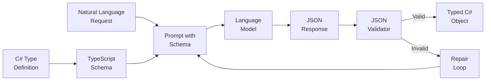
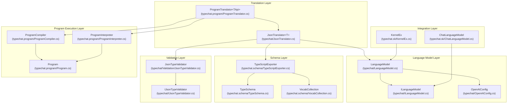

<!-- source: DeepWiki mcp.deepwiki.com · repo microsoft/typechat.net · page 1 Overview · fetched 2026-10-26 -->

# Overview

<details>
<summary>Relevant source files</summary>

The following files were used as context for generating this wiki page:

- [README.md](README.md)
- [TypeChat.sln](TypeChat.sln)
- [examples/CoffeeShop/CoffeeShop.csproj](examples/CoffeeShop/CoffeeShop.csproj)
- [examples/CoffeeShop2/CoffeeShop2.csproj](examples/CoffeeShop2/CoffeeShop2.csproj)
- [examples/Math/Math.csproj](examples/Math/Math.csproj)
- [examples/Sentiment/Program.cs](examples/Sentiment/Program.cs)
- [examples/Sentiment/Sentiment.csproj](examples/Sentiment/Sentiment.csproj)
- [examples/appSettings.json](examples/appSettings.json)

</details>


This document provides a high-level introduction to TypeChat.NET, explaining what it is, its core purpose, and the key capabilities it provides. It describes the main assemblies, fundamental translation workflow, and primary use cases.

For detailed information about getting started with your first application, see [Getting Started](#2). For architectural details about layers and component interactions, see [Architecture Overview](#1.2). For in-depth coverage of core concepts, see [Core Concepts](#3).

**Sources:** [README.md:1-17]()

## What is TypeChat.NET

TypeChat.NET is a cross-platform .NET library that enables building natural language interfaces using large language models (LLMs) with strong types, type validation, and type-safe programs. It brings the concepts from the TypeChat project to the .NET ecosystem.

The library's primary goal is to make language model outputs more deterministic and reliable by constraining them to strongly-typed schemas. Instead of receiving free-form text responses from LLMs, applications receive validated, deserialized C# objects that conform to defined types.

**Sources:** [README.md:5-7]()

## Core Translation Workflow

TypeChat.NET operates through a structured translation pipeline that converts natural language into typed objects:



**TypeChat.NET Translation Pipeline**

The translation process follows these steps:

1. **Schema Generation**: C# types are automatically exported to TypeScript schema format
2. **Prompt Construction**: User input is combined with the schema and instructions
3. **LLM Request**: The prompt is sent to a language model (e.g., GPT-3.5, GPT-4)
4. **JSON Parsing**: The model's text response is parsed as JSON
5. **Validation**: The JSON is validated against the schema
6. **Repair Loop**: If validation fails, errors are sent back to the model for correction
7. **Deserialization**: Valid JSON is deserialized into the target C# type

**Sources:** [README.md:8-15](), [README.md:29-37]()

## Primary Assemblies

TypeChat.NET consists of three main NuGet packages, each serving distinct purposes:

| Assembly | Purpose | Key Types |
|----------|---------|-----------|
| **Microsoft.TypeChat** | Core JSON translation, validation, and schema generation | `JsonTranslator<T>`, `LanguageModel`, `TypeScriptExporter` |
| **Microsoft.TypeChat.Program** | Natural language to executable code translation | `ProgramTranslator<T>`, `ProgramCompiler`, `ProgramInterpreter` |
| **Microsoft.TypeChat.SemanticKernel** | Integration with Semantic Kernel for plugins and models | `KernelEx`, `ChatLanguageModel`, plugin programs |

**Sources:** [README.md:19-27](), [README.md:69-74]()

### Microsoft.TypeChat

The core assembly provides JSON translation capabilities. It converts natural language into JSON that conforms to a schema, validates the result, and repairs invalid outputs by sending validation errors back to the language model.

Key features:
- JSON translation, validation, repair, and deserialization via `JsonTranslator<T>`
- Schema export to TypeScript format from .NET types
- Support for vocabularies using `[JsonVocab]` attribute to constrain string values
- Support for polymorphic types using `[JsonPolymorphic]` attribute
- Extensibility through interfaces: `ILanguageModel`, `IJsonTypeValidator`, `IJsonTranslatorPrompts`

**Sources:** [README.md:28-45]()

### Microsoft.TypeChat.Program

This assembly extends TypeChat to translate natural language into executable programs represented as JSON. Programs are type-checked against target APIs and can be compiled or interpreted.

Key features:
- `ProgramTranslator<TApi>` translates natural language to JSON programs
- Programs follow a defined grammar in [src/typechat.program/ProgramSchema.ts]()
- `ProgramCompiler` uses .NET's Dynamic Language Runtime (DLR) to compile programs with type checking
- `ProgramInterpreter` provides runtime execution without compilation
- Compilation diagnostics feed back to the LLM for program repair

**Sources:** [README.md:47-67]()

### Microsoft.TypeChat.SemanticKernel

This assembly provides integration with Microsoft Semantic Kernel 1.0, enabling TypeChat to work with Semantic Kernel's plugin system and AI services.

Key features:
- Extension methods for creating kernels with chat and embedding models
- Model adapters: `ChatLanguageModel`, `TextCompletionModel`, `TextEmbeddingModel`
- Support for translating natural language into Semantic Kernel plugin invocations
- Access to language models and embeddings through Semantic Kernel services

**Sources:** [README.md:69-75]()

## Key Components and Code Entities

The following diagram maps high-level concepts to the primary code entities in TypeChat.NET:



**TypeChat.NET Component Architecture**

**Sources:** [README.md:19-75]()

## Translation Example

A minimal TypeChat.NET application translating natural language to a typed object:

```csharp
// Schema definition
public class SentimentResponse
{
    public string Sentiment { get; set; }
    public string Reason { get; set; }
}

// Translation setup
var model = new LanguageModel(Config.LoadOpenAI());
var translator = new JsonTranslator<SentimentResponse>(model);

// Translate natural language to typed object
SentimentResponse response = await translator.TranslateAsync("I love this product!");
Console.WriteLine($"Sentiment: {response.Sentiment}");
```

This example demonstrates:
- Defining a target type (`SentimentResponse`) that represents the desired output structure
- Creating a `JsonTranslator<T>` with a `LanguageModel` configured via `OpenAIConfig`
- Calling `TranslateAsync` to convert natural language into a strongly-typed object
- Accessing the result as a typed C# object with IntelliSense and compile-time safety

**Sources:** [README.md:8-15](), [examples/Sentiment/Program.cs:1-43]()

## Program Translation Example

TypeChat.Program enables translating natural language into executable code:

```csharp
// API definition
public interface IMathAPI
{
    double Add(double x, double y);
    double Multiply(double x, double y);
}

// Translation and execution
var api = new MathAPI();
var translator = new ProgramTranslator<IMathAPI>(model, api);

// Translate "add 2 and 3, then multiply by 5"
Program program = await translator.TranslateAsync(requestText);

// Execute the generated program
object result = program.Run(api);
```

This demonstrates:
- Defining a target API interface that programs can call
- Using `ProgramTranslator<TApi>` to generate JSON programs
- Executing programs via the `Run` method against the API implementation
- Type-safe program generation and execution

**Sources:** [README.md:57-67]()

## Primary Use Cases

TypeChat.NET supports several categories of applications:

| Use Case | Description | Example |
|----------|-------------|---------|
| **Structured Data Extraction** | Convert natural language to typed data objects | Sentiment analysis, form filling |
| **Command Translation** | Transform requests into action objects | Calendar operations, order processing |
| **Code Generation** | Generate executable programs from natural language | Math calculators, API orchestration |
| **Conversational Agents** | Build multi-turn dialogs with history | Health data collection, interactive assistants |
| **Request Routing** | Classify and route inputs to appropriate handlers | Multi-schema apps, hierarchical routing |

**Sources:** [README.md:123-146]()

## Configuration

TypeChat.NET requires access to OpenAI or Azure OpenAI services. Configuration is managed through the `OpenAIConfig` class:

```csharp
// Load from application configuration
OpenAIConfig config = Config.LoadOpenAI();

// Load from JSON file
OpenAIConfig config = OpenAIConfig.LoadFromJsonFile("path/to/config.json");

// Load from environment variables
OpenAIConfig config = OpenAIConfig.FromEnvironment();

// Create language model
var model = new LanguageModel(config);
```

Configuration includes:
- **Azure**: Boolean indicating Azure OpenAI vs. OpenAI service
- **ApiKey**: API key or "identity" for Azure DefaultCredential authentication
- **Endpoint**: Service endpoint URL
- **Model**: Model deployment name (e.g., "gpt-35-turbo", "gpt-4")
- **MaxRetries**: HTTP retry attempts
- **TimeoutMs**: Request timeout in milliseconds

**Sources:** [README.md:148-207](), [examples/appSettings.json:1-21]()

## Supported Language Models

TypeChat.NET has been tested with and supports:
- **gpt-35-turbo**: Cost-effective model suitable for many scenarios
- **gpt-4**: More capable model recommended for complex schemas and scenarios
- **ada-002**: Text embedding model for vectorization and semantic search

Both OpenAI and Azure OpenAI service deployments are supported.

**Sources:** [README.md:79-85]()

## Development Status

TypeChat.NET is in active development with frequent updates. The framework continues to evolve as the team explores the design space and incorporates feedback. Supported scenarios are demonstrated in the included examples, and documentation continues to improve.

**Sources:** [README.md:17]()

---

