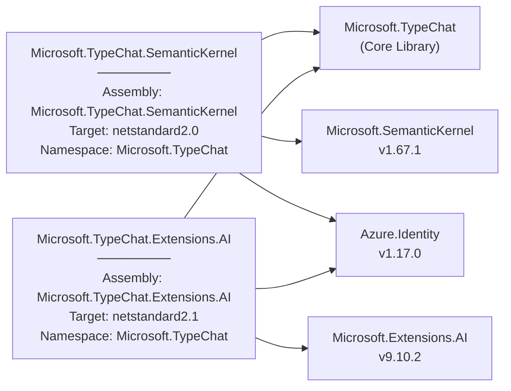
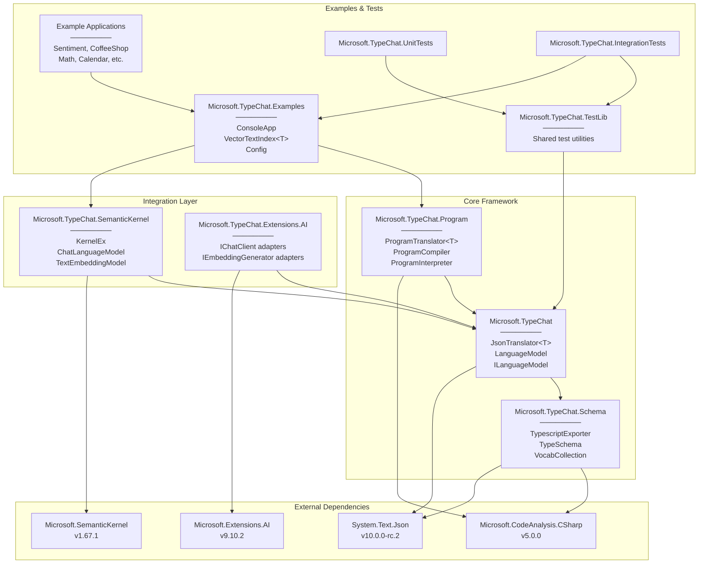
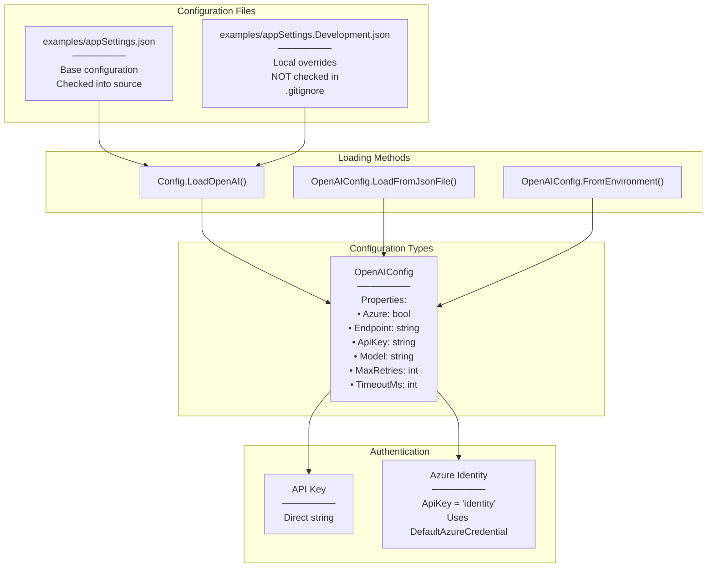
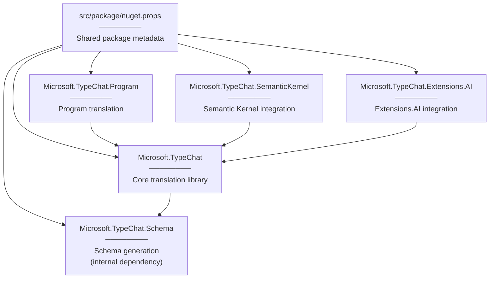

<!-- source: DeepWiki mcp.deepwiki.com · repo microsoft/typechat.net · page 1.1 Repository Structure · fetched 2026-10-26 -->

# Repository Structure

<details>
<summary>Relevant source files</summary>

The following files were used as context for generating this wiki page:

- [README.md](README.md)
- [examples/Sentiment/Program.cs](examples/Sentiment/Program.cs)
- [examples/appSettings.json](examples/appSettings.json)
- [examples/typechat.examplesLib/TypeChat.ExamplesLib.csproj](examples/typechat.examplesLib/TypeChat.ExamplesLib.csproj)
- [src/typechat.meai/TypeChat.Extensions.AI.csproj](src/typechat.meai/TypeChat.Extensions.AI.csproj)
- [src/typechat.program/TypeChat.Program.csproj](src/typechat.program/TypeChat.Program.csproj)
- [src/typechat.schema/TypeChat.Schema.csproj](src/typechat.schema/TypeChat.Schema.csproj)
- [src/typechat.sk/KernelEx.cs](src/typechat.sk/KernelEx.cs)
- [src/typechat.sk/TypeChat.SemanticKernel.csproj](src/typechat.sk/TypeChat.SemanticKernel.csproj)
- [src/typechat/TypeChat.csproj](src/typechat/TypeChat.csproj)

</details>


This document describes the physical organization of the TypeChat.NET repository, including the purpose of each assembly, their dependencies, and how the projects are structured. For a conceptual overview of how these components interact, see [Architecture Overview](#1.2). For information about getting started with development, see [Installation](#2.1).

## Repository Layout

The TypeChat.NET repository is organized into three primary directories that separate core framework code, example applications, and test infrastructure:

```mermaid
graph TB
    Root["typechat.net/<br/>(Repository Root)"]
    
    Root --> Src["src/<br/>(Framework Code)"]
    Root --> Examples["examples/<br/>(Example Applications)"]
    Root --> Tests["tests/<br/>(Test Infrastructure)"]
    Root --> Docs["README.md<br/>LICENSE<br/>typechat.sln"]
    
    Src --> TypeChat["typechat/<br/>Microsoft.TypeChat"]
    Src --> Schema["typechat.schema/<br/>Microsoft.TypeChat.Schema"]
    Src --> Program["typechat.program/<br/>Microsoft.TypeChat.Program"]
    Src --> SK["typechat.sk/<br/>Microsoft.TypeChat.SemanticKernel"]
    Src --> MEAI["typechat.meai/<br/>Microsoft.TypeChat.Extensions.AI"]
    
    Examples --> ExLib["typechat.examplesLib/<br/>Microsoft.TypeChat.Examples"]
    Examples --> Sentiment["Sentiment/"]
    Examples --> Coffee["CoffeeShop/"]
    Examples --> Math["Math/"]
    Examples --> Calendar["Calendar/"]
    Examples --> Health["HealthData/"]
    Examples --> Multi["MultiSchema/"]
    Examples --> Hierarchy["SchemaHierarchy/"]
    Examples --> Restaurant["Restaurant/"]
    Examples --> Plugins["Plugins/"]
    Examples --> Config["appSettings.json"]
    
    Tests --> TestLib["typechat.testLib/<br/>Microsoft.TypeChat.TestLib"]
    Tests --> Unit["typechat.tests/<br/>Microsoft.TypeChat.UnitTests"]
    Tests --> Integration["typechat.integrationtests/<br/>Microsoft.TypeChat.IntegrationTests"]
```



**Sources:** [README.md:1-243]()

## Core Framework Assemblies

The core framework consists of three foundational assemblies that provide the primary TypeChat functionality:

| Assembly | Target Framework | Assembly Name | Root Namespace | Purpose |
|----------|-----------------|---------------|----------------|---------|
| `src/typechat/` | netstandard2.0 | Microsoft.TypeChat | Microsoft.TypeChat | Core JSON translation with validation and repair |
| `src/typechat.schema/` | netstandard2.0, net8.0 | Microsoft.TypeChat.Schema | Microsoft.TypeChat.Schema | TypeScript schema generation from C# types |
| `src/typechat.program/` | netstandard2.0 | Microsoft.TypeChat.Program | Microsoft.TypeChat | Natural language to executable program translation |

### Microsoft.TypeChat

The `Microsoft.TypeChat` assembly ([src/typechat/TypeChat.csproj]()) provides the foundational `JsonTranslator<T>` class and related infrastructure for translating natural language into strongly-typed JSON objects. Key dependencies:
- `System.ComponentModel.Annotations` (5.0.0) - for attribute support
- `System.Text.Json` (10.0.0-rc.2.25502.107) - for JSON serialization
- Project reference to `Microsoft.TypeChat.Schema`

The assembly targets netstandard2.0 for maximum compatibility and enables implicit usings and nullable annotations ([src/typechat/TypeChat.csproj:4-7]()).

### Microsoft.TypeChat.Schema

The `Microsoft.TypeChat.Schema` assembly ([src/typechat.schema/TypeChat.Schema.csproj]()) generates TypeScript-style schema definitions from C# types. It targets both netstandard2.0 and net8.0 ([src/typechat.schema/TypeChat.Schema.csproj:4]()). Key dependencies:
- `Microsoft.CodeAnalysis.CSharp` (5.0.0-2.final) - for Roslyn-based type analysis
- `System.Text.Json` (10.0.0-rc.2.25502.107) - for JSON processing

This assembly shares utility code from the core project through linked files: `ArgumentVerify.cs`, `StringEx.cs`, and `ListEx.cs` ([src/typechat.schema/TypeChat.Schema.csproj:13-15]()).

### Microsoft.TypeChat.Program

The `Microsoft.TypeChat.Program` assembly ([src/typechat.program/TypeChat.Program.csproj]()) extends TypeChat with program translation capabilities via `ProgramTranslator<T>`, `ProgramCompiler`, and `ProgramInterpreter`. Key dependencies:
- `Microsoft.CodeAnalysis.CSharp` (5.0.0-2.final) - for DLR-based compilation
- `Microsoft.CSharp` (4.7.0) - for dynamic language runtime support
- Project reference to `Microsoft.TypeChat`

The assembly includes `ProgramSchema.ts` as a distributable file ([src/typechat.program/TypeChat.Program.csproj:17-19]()) that defines the JSON grammar for programs.

**Sources:** [src/typechat/TypeChat.csproj:1-24](), [src/typechat.schema/TypeChat.Schema.csproj:1-29](), [src/typechat.program/TypeChat.Program.csproj:1-37]()

## Integration Assemblies

TypeChat.NET provides two parallel integration paths for connecting to AI services and frameworks:



### Microsoft.TypeChat.SemanticKernel

Located in `src/typechat.sk/`, this assembly ([src/typechat.sk/TypeChat.SemanticKernel.csproj]()) provides integration with Microsoft Semantic Kernel v1.67.1. Key components:
- `KernelEx` extension methods ([src/typechat.sk/KernelEx.cs]()) for configuring kernels with chat and embedding models
- `ChatLanguageModel` and `TextCompletionModel` adapters for Semantic Kernel services
- `TextEmbeddingModel` for embedding generation

The assembly targets netstandard2.0 and includes compiler warnings suppression for experimental SK features (SKEXP0001, SKEXP0011) ([src/typechat.sk/TypeChat.SemanticKernel.csproj:35-38]()).

Key dependencies:
- `Microsoft.SemanticKernel` (1.67.1)
- `Azure.Identity` (1.17.0)
- `System.Numerics.Tensors` (10.0.0) - for tensor operations in embeddings

### Microsoft.TypeChat.Extensions.AI

Located in `src/typechat.meai/`, this assembly ([src/typechat.meai/TypeChat.Extensions.AI.csproj]()) provides integration with the standard `Microsoft.Extensions.AI` abstractions (v9.10.2). It targets netstandard2.1 ([src/typechat.meai/TypeChat.Extensions.AI.csproj:4]()) to support the Extensions.AI requirements.

Key dependencies:
- `Microsoft.Extensions.AI` (9.10.2)
- `Azure.Identity` (1.17.0)
- `Microsoft.Extensions.Configuration.Binder` (10.0.0)

This integration path provides a more portable abstraction layer that can work with multiple AI providers beyond OpenAI.

**Sources:** [src/typechat.sk/TypeChat.SemanticKernel.csproj:1-41](), [src/typechat.sk/KernelEx.cs:1-141](), [src/typechat.meai/TypeChat.Extensions.AI.csproj:1-40]()

## Examples and Shared Infrastructure

### Microsoft.TypeChat.Examples

The examples library ([examples/typechat.examplesLib/TypeChat.ExamplesLib.csproj]()) provides shared infrastructure for all example applications. It targets both netstandard2.0 and net8.0 ([examples/typechat.examplesLib/TypeChat.ExamplesLib.csproj:4]()).

Key components provided:
- `ConsoleApp` base class for interactive and batch-mode example applications
- `Config.LoadOpenAI()` for configuration management
- `VectorTextIndex<T>` for semantic search and classification
- `TextClassifier` for request routing

Dependencies include:
- Project references to both `TypeChat.Program` and `TypeChat.SemanticKernel` ([examples/typechat.examplesLib/TypeChat.ExamplesLib.csproj:19-20]())
- `Azure.Identity` (1.17.0) for authentication
- `Microsoft.Extensions.Configuration.Json` (10.0.0-rc.2.25502.107) for settings
- `System.CommandLine` (2.0.0) for CLI parsing

### Example Applications

Each example project demonstrates specific TypeChat capabilities:

| Example | Primary Class | Demonstrates |
|---------|--------------|--------------|
| Sentiment | `SentimentApp` | Simple `JsonTranslator<T>` usage |
| CoffeeShop | `CoffeeShopApp` | Complex schemas with vocabularies and polymorphism |
| Math | `MathApp` | `ProgramTranslator<T>` for mathematical operations |
| Calendar | `CalendarApp` | Translating to structured calendar actions |
| HealthData | `HealthDataApp` | `AgentWithHistory<T>` for conversational data collection |
| MultiSchema | `MultiSchemaApp` | Dynamic routing across multiple schemas |
| SchemaHierarchy | `SchemaHierarchyApp` | Semantic routing using embeddings |
| Restaurant | `RestaurantApp` | Complex nested schemas with polymorphic types |
| Plugins | `PluginsApp` | Translating to Semantic Kernel plugin invocations |

All examples reference `Microsoft.TypeChat.Examples` and share the configuration structure defined in `examples/appSettings.json`.

**Sources:** [examples/typechat.examplesLib/TypeChat.ExamplesLib.csproj:1-30](), [examples/Sentiment/Program.cs:1-42](), [README.md:115-146]()

## Project Dependency Graph

The following diagram shows the complete dependency relationships between all assemblies in the repository:



**Sources:** [src/typechat/TypeChat.csproj:1-24](), [src/typechat.schema/TypeChat.Schema.csproj:1-29](), [src/typechat.program/TypeChat.Program.csproj:1-37](), [src/typechat.sk/TypeChat.SemanticKernel.csproj:1-41](), [src/typechat.meai/TypeChat.Extensions.AI.csproj:1-40](), [examples/typechat.examplesLib/TypeChat.ExamplesLib.csproj:1-30]()

## Configuration Structure

The repository uses a layered configuration approach centered on OpenAI service configuration:



The base configuration file ([examples/appSettings.json]()) defines two OpenAI configurations:
- `OpenAI` - Primary chat model configuration (gpt-35-turbo by default)
- `OpenAI_Embedding` - Embedding model configuration (ada-002 by default)

Each configuration includes retry and timeout settings ([examples/appSettings.json:11-13]()):
- `MaxRetries`: Number of retry attempts (default: 2)
- `TimeoutMs`: HTTP timeout in milliseconds (default: 30000)

Applications load configuration using `Config.LoadOpenAI()` which automatically merges `appSettings.json` with `appSettings.Development.json` when present. The development file is excluded from source control to protect API keys.

**Sources:** [examples/appSettings.json:1-21](), [README.md:148-207]()

## Shared Code Patterns

Several utility files are shared across projects using MSBuild `<Compile Include>` links to avoid duplication:

| Utility File | Purpose | Used By |
|-------------|---------|---------|
| `ArgumentVerify.cs` | Null and argument validation | TypeChat, TypeChat.Schema, TypeChat.Program, TypeChat.SemanticKernel, TypeChat.Extensions.AI, TypeChat.Examples |
| `ListEx.cs` | List extension methods | TypeChat.Schema, TypeChat.Program, TypeChat.Examples |
| `StringEx.cs` | String utility methods | TypeChat.Schema |

This linking pattern is visible in project files, for example ([src/typechat.schema/TypeChat.Schema.csproj:13-15]()):
```xml
<Compile Include="..\typechat\ArgumentVerify.cs" Link="ArgumentVerify.cs" />
<Compile Include="..\typechat\StringEx.cs" Link="StringEx.cs" />
<Compile Include="..\typechat\ListEx.cs" Link="ListEx.cs" />
```

The shared utilities avoid external dependencies and provide consistent error handling and validation patterns across the entire codebase.

**Sources:** [src/typechat.schema/TypeChat.Schema.csproj:13-15](), [src/typechat.program/TypeChat.Program.csproj:23-24](), [src/typechat.sk/TypeChat.SemanticKernel.csproj:14](), [examples/typechat.examplesLib/TypeChat.ExamplesLib.csproj:14-15]()

## NuGet Package Structure

All framework assemblies are published as NuGet packages with consistent metadata defined through shared properties:



Each project imports the shared properties ([src/typechat/TypeChat.csproj:13](), [src/typechat.program/TypeChat.Program.csproj:32](), [src/typechat.sk/TypeChat.SemanticKernel.csproj:29]()):
```xml
<Import Project="../package/nuget.props" />
```

Package installation commands ([README.md:98-113]()):
- `dotnet add package Microsoft.TypeChat`
- `dotnet add package Microsoft.TypeChat.Program`
- `dotnet add package Microsoft.TypeChat.SemanticKernel`

The `Microsoft.TypeChat.Schema` assembly is an internal dependency and not published separately—it's included as part of `Microsoft.TypeChat`.

**Sources:** [README.md:98-113](), [src/typechat/TypeChat.csproj:13](), [src/typechat.program/TypeChat.Program.csproj:32](), [src/typechat.sk/TypeChat.SemanticKernel.csproj:29]()

## Test Infrastructure

The test infrastructure is organized into three assemblies providing different testing capabilities:

| Assembly | Target Framework | Purpose |
|----------|-----------------|---------|
| Microsoft.TypeChat.TestLib | netstandard2.0, net8.0 | Shared test utilities, test data, base classes |
| Microsoft.TypeChat.UnitTests | net8.0 | Isolated component tests without external dependencies |
| Microsoft.TypeChat.IntegrationTests | net8.0 | End-to-end tests with real OpenAI services |

The test projects share the same configuration management as examples, using `appSettings.json` and `appSettings.Development.json` for OpenAI credentials. Integration tests validate the complete translation workflow, program execution, embedding generation, and agent behavior with actual language models.

Test data includes JSON files for various scenarios:
- Success cases (mathPrograms.json, objectPrograms.json)
- Failure cases (mathPrograms_Fail.json) for validation testing
- Schema examples (SentimentSchema.ts)
- Vocabulary test data (TestVocabs.json)

**Sources:** [README.md:148-159](), Diagrams 1 and 6 from context

## Build and Development

The repository is configured for cross-platform development with Visual Studio 2022 or the .NET CLI:

**Visual Studio:**
1. Open `typechat.sln` from the repository root
2. Restore NuGet packages
3. Build the solution

**Command Line:**
```bash
cd [repository root]
dotnet build typechat.sln
```

All projects use:
- `LangVersion`: latest - enabling newest C# language features
- `ImplicitUsings`: enabled - automatic common namespace imports
- `Nullable`: annotations - nullable reference type annotations without enforcement

Target frameworks are carefully chosen:
- netstandard2.0: Maximum compatibility for core libraries
- netstandard2.1: Required for Microsoft.Extensions.AI
- net8.0: Modern runtime features for examples and tests

**Sources:** [README.md:87-96](), [src/typechat/TypeChat.csproj:4-7](), [src/typechat.meai/TypeChat.Extensions.AI.csproj:4]()

---

