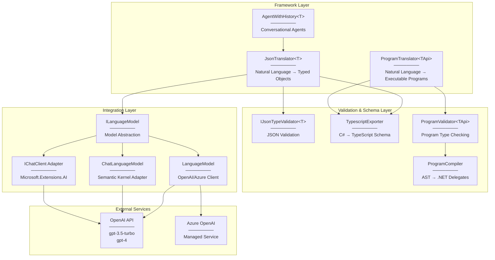
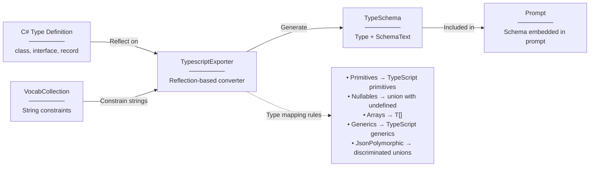
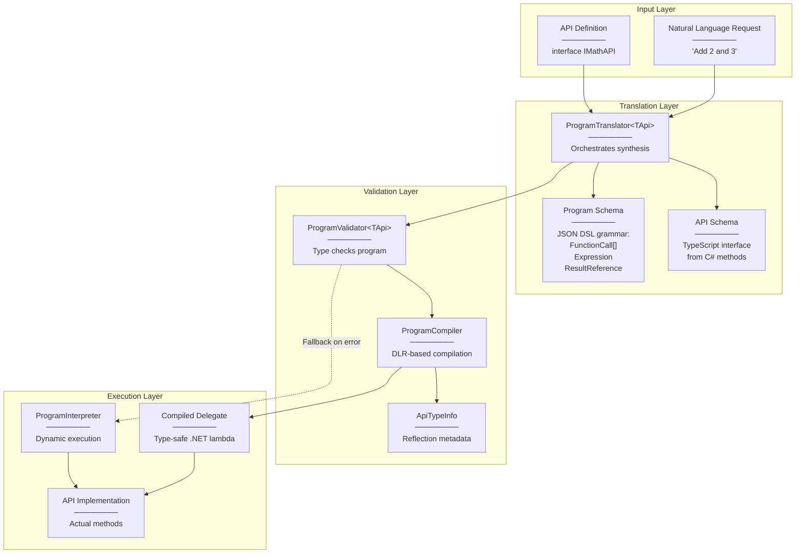
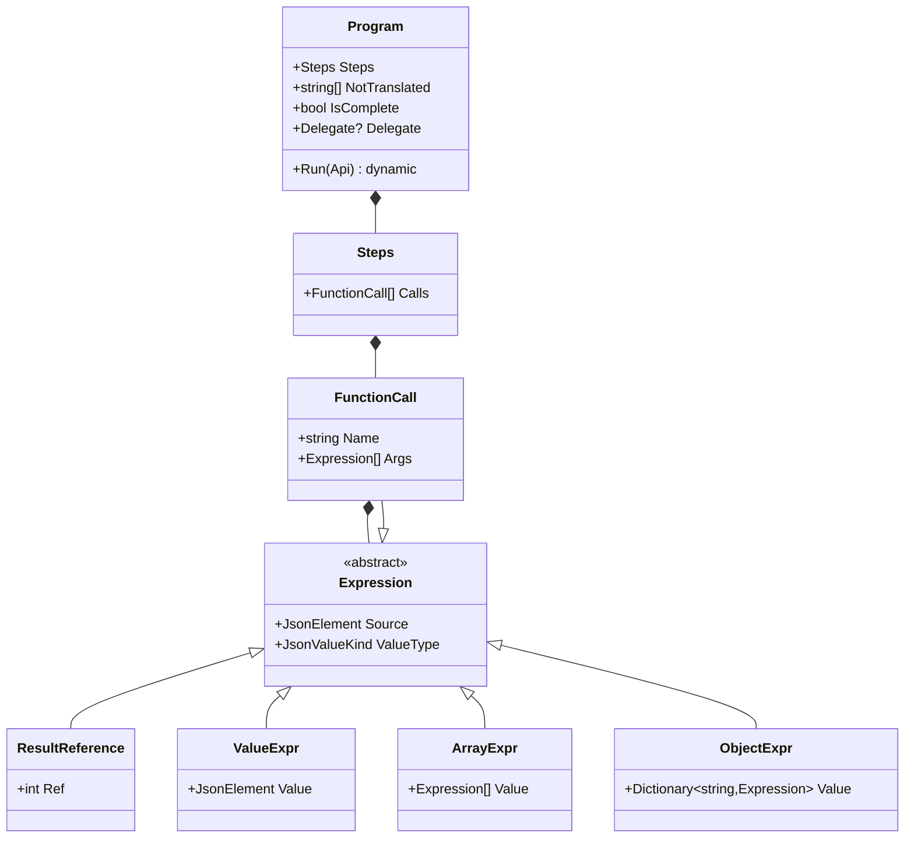
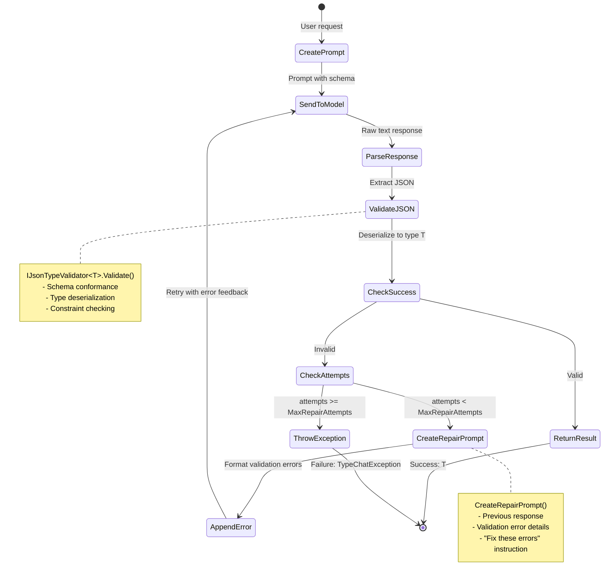
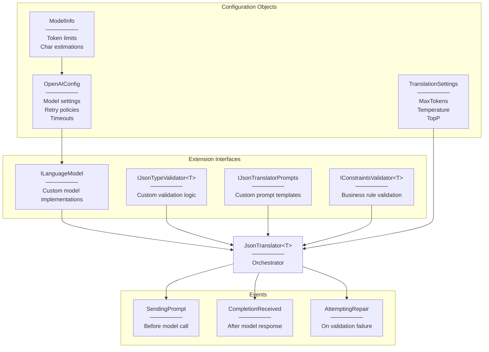
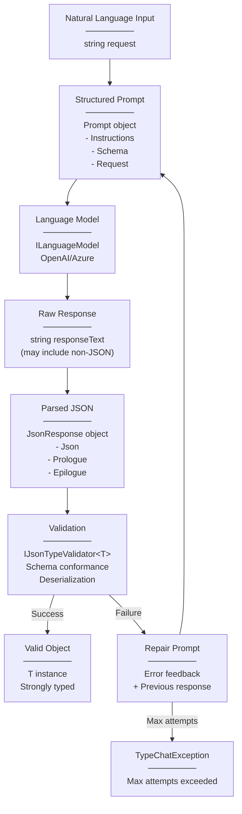

<!-- source: DeepWiki mcp.deepwiki.com · repo microsoft/typechat.net · page 1.2 Architecture Overview · fetched 2026-10-26 -->

# Architecture Overview

<details>
<summary>Relevant source files</summary>

The following files were used as context for generating this wiki page:

- [README.md](README.md)
- [examples/Math/Program.cs](examples/Math/Program.cs)
- [examples/MultiSchema/Program.cs](examples/MultiSchema/Program.cs)
- [examples/Sentiment/Program.cs](examples/Sentiment/Program.cs)
- [examples/appSettings.json](examples/appSettings.json)
- [src/typechat.program/ProgramCompiler.cs](src/typechat.program/ProgramCompiler.cs)
- [src/typechat.program/ProgramSchemaImpl.cs](src/typechat.program/ProgramSchemaImpl.cs)
- [src/typechat.program/ProgramTranslator.cs](src/typechat.program/ProgramTranslator.cs)
- [src/typechat.program/ProgramValidator.cs](src/typechat.program/ProgramValidator.cs)
- [src/typechat/JsonResponse.cs](src/typechat/JsonResponse.cs)
- [src/typechat/JsonSerializerTypeValidator.cs](src/typechat/JsonSerializerTypeValidator.cs)
- [src/typechat/JsonTranslator.cs](src/typechat/JsonTranslator.cs)
- [src/typechat/ModelInfo.cs](src/typechat/ModelInfo.cs)
- [src/typechat/Prompt.cs](src/typechat/Prompt.cs)
- [src/typechat/TypeChatException.cs](src/typechat/TypeChatException.cs)

</details>


## Purpose and Scope

This document describes the high-level architecture of TypeChat.NET, focusing on the system's layers, data flow patterns, and component interactions. It covers the core translation workflow, program synthesis architecture, and integration points with external AI services.

For information about the physical organization of assemblies and projects, see [Repository Structure](#1.1). For details on specific components like schema generation or validation, see [Core Concepts](#3). For integration specifics, see [Integration](#6).

---

## Layer Architecture

TypeChat.NET is organized into four primary architectural layers that separate concerns and enable modularity:



**Sources**: [README.md:19-76](), [src/typechat/JsonTranslator.cs:1-315](), [src/typechat.program/ProgramTranslator.cs:1-122]()

### Layer Responsibilities

| Layer | Primary Components | Responsibility |
|-------|-------------------|----------------|
| **Framework** | `JsonTranslator<T>`, `ProgramTranslator<TApi>`, `AgentWithHistory<T>` | Orchestrate translation workflows, manage validation-repair loops, expose public APIs |
| **Validation & Schema** | `IJsonTypeValidator<T>`, `TypescriptExporter`, `ProgramCompiler` | Generate schemas, validate JSON, compile programs, enforce type safety |
| **Integration** | `ILanguageModel`, `LanguageModel`, `ChatLanguageModel` | Abstract model access, adapt to different AI service providers |
| **External Services** | OpenAI, Azure OpenAI | Provide language model inference capabilities |

**Sources**: [README.md:22-27](), [src/typechat/JsonTranslator.cs:23-66](), [src/typechat.program/ProgramTranslator.cs:5-11]()

---

## Core Translation Workflow

The `JsonTranslator<T>` class implements the fundamental pattern for converting natural language requests into strongly-typed objects. This workflow consists of four phases: schema generation, prompt construction, model completion, and validation-repair.

```mermaid
sequenceDiagram
    participant App as "Application Code"
    participant JT as "JsonTranslator&lt;T&gt;"
    participant TE as "TypescriptExporter"
    participant Val as "IJsonTypeValidator&lt;T&gt;"
    participant LM as "ILanguageModel"
    participant API as "OpenAI/Azure"
    
    Note over App,TE: Initialization Phase
    App->>JT: new JsonTranslator&lt;T&gt;(model)
    JT->>TE: Export schema for type T
    TE->>TE: Generate TypeScript from C# types
    TE-->>JT: TypeSchema object
    
    Note over App,API: Translation Phase
    App->>JT: TranslateAsync(request)
    JT->>JT: CreateRequestPrompt()<br/>- Schema text<br/>- Instructions<br/>- User request
    
    JT->>LM: CompleteAsync(prompt, settings)
    LM->>API: HTTP POST with prompt
    API-->>LM: Response text (JSON)
    LM-->>JT: responseText
    
    JT->>JT: JsonResponse.Parse(responseText)
    
    JT->>Val: Validate(json)
    Val->>Val: JsonSerializer.Deserialize&lt;T&gt;()
    
    alt Validation Success
        Val-->>JT: Result&lt;T&gt; with typed object
        JT-->>App: Return T
    else Validation Failure (attempt < MaxRepairAttempts)
        Val-->>JT: Result&lt;T&gt; with error message
        JT->>JT: CreateRepairPrompt(responseText, error)
        JT->>JT: prompt.AppendResponse(responseText)
        JT->>JT: prompt.Append(repairPrompt)
        Note over JT,API: Retry loop
    else Max Attempts Exceeded
        JT-->>App: throw TypeChatException
    end
```

**Sources**: [src/typechat/JsonTranslator.cs:169-252](), [src/typechat/JsonResponse.cs:61-101](), [src/typechat/TypeChatException.cs:1-100]()

### Translation Phase Details

The translation process operates through a carefully orchestrated sequence:

1. **Prompt Construction** ([src/typechat/JsonTranslator.cs:254-257]()): The `CreateRequestPrompt()` method combines the TypeScript schema, system instructions, and user request into a structured prompt.

2. **Model Completion** ([src/typechat/JsonTranslator.cs:259-265]()): `GetResponseAsync()` sends the prompt to the language model via `ILanguageModel.CompleteAsync()` and receives raw text.

3. **JSON Extraction** ([src/typechat/JsonResponse.cs:61-101]()): `JsonResponse.Parse()` extracts JSON from the response, separating prologue, JSON body, and epilogue text.

4. **Validation** ([src/typechat/JsonTranslator.cs:275-289]()): The `IJsonTypeValidator<T>` implementation attempts to deserialize JSON into type `T`, catching any schema violations.

5. **Repair Loop** ([src/typechat/JsonTranslator.cs:236-251]()): On validation failure, errors are formatted into a repair prompt and the cycle repeats up to `MaxRepairAttempts` times.

**Sources**: [src/typechat/JsonTranslator.cs:199-252](), [src/typechat/JsonResponse.cs:1-103]()

---

## Schema Generation Architecture

TypeChat.NET automatically generates TypeScript schemas from C# types, enabling the language model to understand the expected structure of JSON responses.



**Sources**: [src/typechat.schema/TypescriptExporter.cs]() (file not shown but referenced), [README.md:34-37]()

### Type Mapping Strategy

| C# Construct | TypeScript Output | Example |
|--------------|------------------|---------|
| `int`, `double`, `decimal` | `number` | `42` → `42` |
| `string` | `string` | `"text"` → `"text"` |
| `bool` | `boolean` | `true` → `true` |
| `T?` (nullable) | `T \| undefined` | `int?` → `number \| undefined` |
| `T[]` | `T[]` | `string[]` → `string[]` |
| `List<T>` | `T[]` | `List<string>` → `string[]` |
| `[JsonVocab("a \| b")]` | `"a" \| "b"` | Constrained string literals |
| `[JsonPolymorphic]` | Discriminated union | Type hierarchy with `@type` field |

**Sources**: [README.md:34-45]()

---

## Program Translation Architecture

The `ProgramTranslator<TApi>` extends the base translation workflow to synthesize executable programs that call methods on a target API. This architecture adds compilation and type-checking capabilities.



**Sources**: [src/typechat.program/ProgramTranslator.cs:12-95](), [src/typechat.program/ProgramCompiler.cs:9-459](), [src/typechat.program/ProgramValidator.cs:1-92]()

### Program Structure

Programs follow a defined JSON grammar represented by these core types:



**Sources**: [src/typechat.program/ProgramSchemaImpl.cs:9-273](), [src/typechat.program/ProgramTranslator.cs:14-45]()

### Compilation Pipeline

The `ProgramCompiler` transforms validated JSON programs into optimized .NET delegates using the Dynamic Language Runtime (DLR):

1. **AST Construction** ([src/typechat.program/ProgramCompiler.cs:46-59]()): `CompileToExpressionTree()` walks the program's AST and builds corresponding `System.Linq.Expressions.Expression` nodes.

2. **Type Checking** ([src/typechat.program/ProgramCompiler.cs:154-207]()): `CompileArgs()` validates that function arguments match parameter types from `ApiTypeInfo`.

3. **Expression Tree Building** ([src/typechat.program/ProgramCompiler.cs:90-114]()): Each `FunctionCall` becomes a `MethodCallExpression`, with result references mapped to `ParameterExpression` variables.

4. **Delegate Compilation** ([src/typechat.program/ProgramCompiler.cs:78-82]()): The `LambdaExpression.Compile()` method generates executable IL code.

**Sources**: [src/typechat.program/ProgramCompiler.cs:13-459]()

---

## Integration Architecture

TypeChat.NET provides three parallel integration paths for language model access, each implementing the `ILanguageModel` interface:

```mermaid
graph TB
    subgraph "TypeChat Core"
        ILanguageModel["ILanguageModel Interface<br/>────────<br/>CompleteAsync(prompt, settings)"]
        JsonTranslator["JsonTranslator&lt;T&gt;<br/>────────<br/>Consumes ILanguageModel"]
    end
    
    subgraph "Direct Integration Path"
        LanguageModel["LanguageModel<br/>────────<br/>Azure.AI.OpenAI client"]
        OpenAIConfig["OpenAIConfig<br/>────────<br/>Configuration loader"]
    end
    
    subgraph "Semantic Kernel Path"
        ChatLanguageModel["ChatLanguageModel<br/>────────<br/>IChatCompletionService adapter"]
        KernelEx["KernelEx Extensions<br/>────────<br/>CreateKernel()<br/>WithChatModels()"]
        SKKernel["Kernel<br/>────────<br/>Microsoft.SemanticKernel"]
    end
    
    subgraph "Extensions.AI Path"
        ExtAIAdapter["IChatClient Adapter<br/>────────<br/>ToLanguageModel() extension"]
        IChatClient["IChatClient<br/>────────<br/>Microsoft.Extensions.AI"]
    end
    
    subgraph "OpenAI Services"
        OpenAIAPI["OpenAI API"]
        AzureOAI["Azure OpenAI"]
    end
    
    JsonTranslator --> ILanguageModel
    
    ILanguageModel <|.. LanguageModel
    ILanguageModel <|.. ChatLanguageModel
    ILanguageModel <|.. ExtAIAdapter
    
    LanguageModel --> OpenAIConfig
    LanguageModel --> OpenAIAPI
    LanguageModel --> AzureOAI
    
    ChatLanguageModel --> SKKernel
    SKKernel --> KernelEx
    SKKernel --> OpenAIAPI
    SKKernel --> AzureOAI
    
    ExtAIAdapter --> IChatClient
    IChatClient --> OpenAIAPI
    IChatClient --> AzureOAI
```

**Sources**: [README.md:69-76](), [README.md:209-220](), [src/typechat/LanguageModel.cs]() (referenced but not shown)

### Integration Path Comparison

| Integration Path | Assembly | Use Case | Key Classes |
|-----------------|----------|----------|-------------|
| **Direct** | `Microsoft.TypeChat` | Standalone applications with minimal dependencies | `LanguageModel`, `OpenAIConfig` |
| **Semantic Kernel** | `Microsoft.TypeChat.SemanticKernel` | Applications using SK plugins, planners, or kernel orchestration | `ChatLanguageModel`, `KernelEx` |
| **Extensions.AI** | `Microsoft.TypeChat.Extensions.AI` | Applications needing provider-agnostic AI abstractions | `IChatClient` adapters |

**Sources**: [README.md:22-27](), [README.md:69-76]()

---

## Validation and Repair Pattern

A key architectural innovation is the validation-repair loop, which makes language model outputs deterministic by iteratively correcting errors:



**Sources**: [src/typechat/JsonTranslator.cs:210-252](), [src/typechat/JsonTranslator.cs:267-270]()

### Repair Prompt Construction

When validation fails, `CreateRepairPrompt()` ([src/typechat/JsonTranslator.cs:267-270]()) constructs a new prompt section containing:

1. The previous response text (showing the LLM what it generated)
2. Detailed validation error messages (explaining what was wrong)
3. Instructions to correct the errors and retry

The prompt history grows with each repair attempt: `prompt.AppendResponse(responseText)` followed by `prompt.Append(repairPrompt)` ([src/typechat/JsonTranslator.cs:249-250]()). The `Prompt.Trim(2)` method ([src/typechat/JsonTranslator.cs:247]()) removes previous repair attempts to prevent unbounded growth.

**Sources**: [src/typechat/JsonTranslator.cs:236-251](), [src/typechat/Prompt.cs:1-193]()

---

## Configuration and Extensibility

TypeChat.NET exposes well-defined extension points for customization:



**Sources**: [src/typechat/JsonTranslator.cs:27-146](), [src/typechat/OpenAIConfig.cs]() (referenced), [src/typechat/ModelInfo.cs:1-61]()

### Extension Points Usage

**Custom Validation**: Implement `IJsonTypeValidator<T>` to use alternative serializers or validation libraries:
```csharp
// Reference: src/typechat/JsonSerializerTypeValidator.cs:102-151
public class JsonSerializerTypeValidator<T> : IJsonTypeValidator<T>
{
    public TypeSchema Schema { get; }
    public Result<T> Validate(string json) { /* ... */ }
}
```

**Custom Prompts**: Implement `IJsonTranslatorPrompts` to modify system instructions or repair logic:
```csharp
// Reference: src/typechat/IJsonTranslatorPrompts.cs (not shown but used in JsonTranslator.cs:30,50,62)
var translator = new JsonTranslator<T>(model, validator, customPrompts);
```

**Observability**: Subscribe to events for logging and debugging:
```csharp
// Reference: src/typechat/JsonTranslator.cs:152-165
translator.SendingPrompt += (prompt) => Logger.Log(prompt);
translator.CompletionReceived += (text) => Logger.Log(text);
translator.AttemptingRepair += (error) => Logger.LogWarning(error);
```

**Sources**: [src/typechat/JsonTranslator.cs:23-314](), [src/typechat/JsonSerializerTypeValidator.cs:1-152](), [src/typechat/ModelInfo.cs:1-61]()

---

## Data Flow Summary

The following diagram captures the complete data transformation pipeline from natural language input to typed output:



**Sources**: [src/typechat/JsonTranslator.cs:199-252](), [src/typechat/JsonResponse.cs:61-101](), [src/typechat/TypeChatException.cs:1-100]()

This architecture achieves deterministic outputs from stochastic language models through schema-guided generation, iterative error correction, and strong type validation. The layered design enables extensibility while maintaining separation of concerns across translation, validation, and model access.

---

