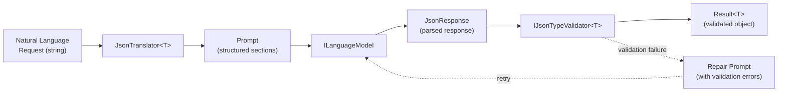
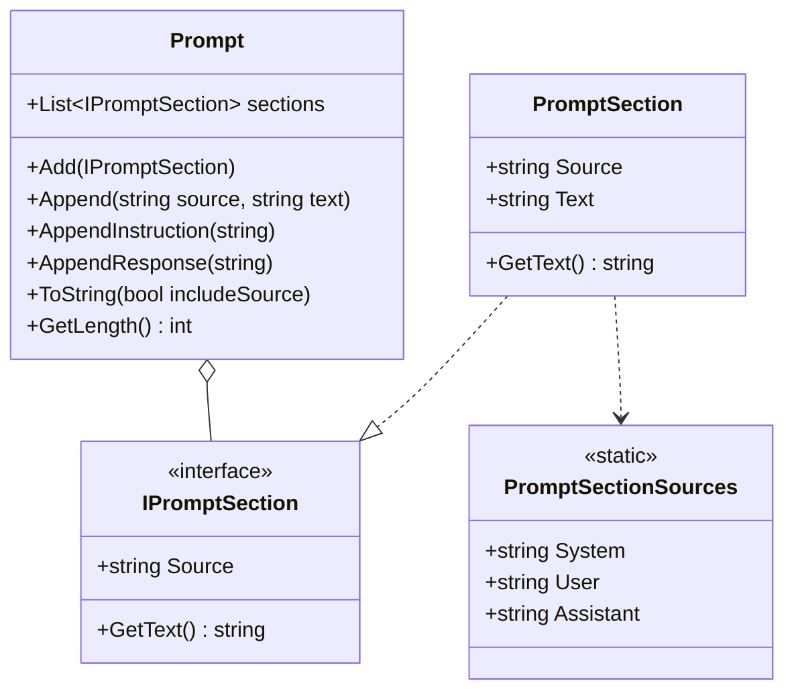
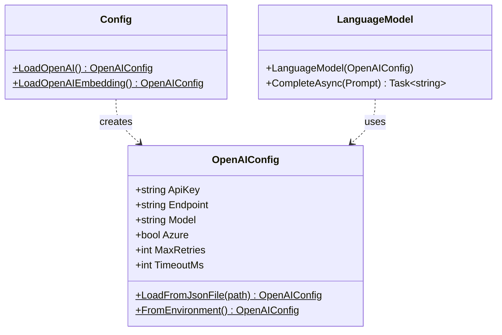
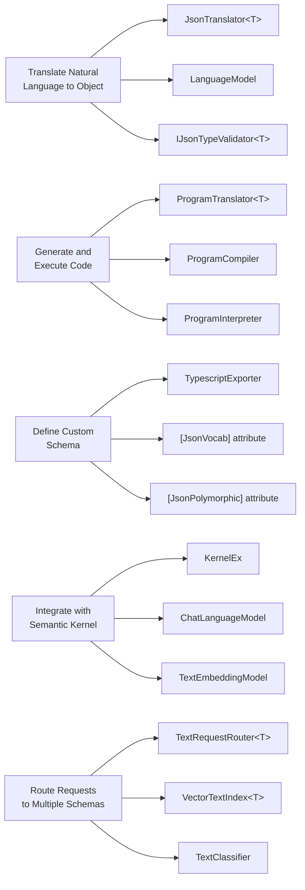

<!-- source: DeepWiki mcp.deepwiki.com · repo microsoft/typechat.net · page 10 API Reference · fetched 2026-10-26 -->

# API Reference

<details>
<summary>Relevant source files</summary>

The following files were used as context for generating this wiki page:

- [README.md](README.md)
- [examples/MultiSchema/Program.cs](examples/MultiSchema/Program.cs)
- [examples/Sentiment/Program.cs](examples/Sentiment/Program.cs)
- [examples/appSettings.json](examples/appSettings.json)
- [src/typechat/JsonResponse.cs](src/typechat/JsonResponse.cs)
- [src/typechat/JsonSerializerTypeValidator.cs](src/typechat/JsonSerializerTypeValidator.cs)
- [src/typechat/JsonTranslator.cs](src/typechat/JsonTranslator.cs)
- [src/typechat/ModelInfo.cs](src/typechat/ModelInfo.cs)
- [src/typechat/Prompt.cs](src/typechat/Prompt.cs)
- [src/typechat/TypeChatException.cs](src/typechat/TypeChatException.cs)

</details>


This section provides comprehensive documentation for all major types, interfaces, and classes in the TypeChat.NET API. For detailed implementation examples and usage patterns, see the [Examples](#8) section. For conceptual explanations of how these types work together, see [Core Concepts](#3).

Child pages provide detailed reference for specific API areas:
- [Core Types](#10.1) - Translation, validation, and language model types
- [Program Types](#10.2) - Program translation and execution types
- [Schema Types](#10.3) - Schema generation and type export types
- [Integration Types](#10.4) - Semantic Kernel and Extensions.AI integration types
- [Utility Types](#10.5) - Configuration, console apps, and helper utilities

---

## API Organization

TypeChat.NET is organized into several assemblies, each providing distinct functionality:

| Assembly | Namespace | Purpose |
|----------|-----------|---------|
| **Microsoft.TypeChat** | `Microsoft.TypeChat` | Core translation, validation, and language model abstractions |
| **Microsoft.TypeChat.Program** | `Microsoft.TypeChat.Program` | Program/plan translation, compilation, and interpretation |
| **Microsoft.TypeChat.Schema** | `Microsoft.TypeChat.Schema` | TypeScript schema generation from C# types |
| **Microsoft.TypeChat.SemanticKernel** | `Microsoft.TypeChat.SemanticKernel` | Integration with Microsoft Semantic Kernel |
| **Microsoft.TypeChat.Extensions.AI** | `Microsoft.TypeChat.Extensions.AI` | Integration with Microsoft.Extensions.AI |
| **TypeChat.ExamplesLib** | `Microsoft.TypeChat` | Shared utilities for example applications |

Sources: [README.md:19-27](), [README.md:69-75]()

---

## Assembly and Namespace Structure

```mermaid
graph TB
    subgraph MicrosoftTypeChat["Microsoft.TypeChat"]
        JsonTranslator["JsonTranslator&lt;T&gt;"]
        ILanguageModel["ILanguageModel"]
        LanguageModel["LanguageModel"]
        IJsonTypeValidator["IJsonTypeValidator&lt;T&gt;"]
        JsonSerializerTypeValidator["JsonSerializerTypeValidator&lt;T&gt;"]
        Prompt["Prompt"]
        TypeChatException["TypeChatException"]
        JsonResponse["JsonResponse"]
        Result["Result&lt;T&gt;"]
    end
    
    subgraph MicrosoftTypeChatProgram["Microsoft.TypeChat.Program"]
        ProgramTranslator["ProgramTranslator&lt;T&gt;"]
        ProgramCompiler["ProgramCompiler"]
        ProgramInterpreter["ProgramInterpreter"]
        ProgramAST["Program"]
        FunctionCall["FunctionCall"]
        Expression["Expression"]
    end
    
    subgraph MicrosoftTypeChatSchema["Microsoft.TypeChat.Schema"]
        TypescriptExporter["TypescriptExporter"]
        TypeSchema["TypeSchema"]
        SchemaText["SchemaText"]
        VocabCollection["VocabCollection"]
    end
    
    subgraph MicrosoftTypeChatSK["Microsoft.TypeChat.SemanticKernel"]
        KernelEx["KernelEx"]
        ChatLanguageModel["ChatLanguageModel"]
        TextCompletionModel["TextCompletionModel"]
        TextEmbeddingModel["TextEmbeddingModel"]
    end
    
    subgraph MicrosoftTypeChatExtAI["Microsoft.TypeChat.Extensions.AI"]
        IChatClientExtensions["IChatClient Extensions"]
        IEmbeddingGeneratorExtensions["IEmbeddingGenerator Extensions"]
    end
    
    subgraph ExamplesLib["TypeChat.ExamplesLib"]
        Config["Config"]
        OpenAIConfig["OpenAIConfig"]
        ConsoleApp["ConsoleApp"]
        VectorTextIndex["VectorTextIndex&lt;T&gt;"]
        TextRequestRouter["TextRequestRouter&lt;T&gt;"]
    end
    
    ProgramTranslator --> JsonTranslator
    ProgramCompiler --> ProgramAST
    ProgramInterpreter --> ProgramAST
    
    JsonTranslator --> ILanguageModel
    JsonTranslator --> IJsonTypeValidator
    JsonTranslator --> Prompt
    
    JsonSerializerTypeValidator --> TypeSchema
    
    TypescriptExporter --> TypeSchema
    
    ChatLanguageModel --> ILanguageModel
    TextCompletionModel --> ILanguageModel
    
    ConsoleApp --> Config
    Config --> OpenAIConfig
```



Sources: [README.md:19-75](), [src/typechat/JsonTranslator.cs:1-314]()

---

## Core Translation Types

The following types form the core translation workflow that converts natural language into typed objects:

### Primary Types

| Type | Location | Purpose |
|------|----------|---------|
| `JsonTranslator<T>` | [src/typechat/JsonTranslator.cs:23-314]() | Translates natural language requests into validated objects of type `T` |
| `ILanguageModel` | [src/typechat/ILanguageModel.cs]() | Interface for language model implementations |
| `LanguageModel` | [src/typechat/LanguageModel.cs]() | OpenAI/Azure OpenAI implementation of `ILanguageModel` |
| `IJsonTypeValidator<T>` | [src/typechat/IJsonTypeValidator.cs]() | Interface for validating JSON against schema |
| `JsonSerializerTypeValidator<T>` | [src/typechat/JsonSerializerTypeValidator.cs:102-151]() | JSON.NET-based validator implementation |
| `Prompt` | [src/typechat/Prompt.cs:8-192]() | Represents a multi-section prompt sent to the language model |
| `PromptSection` | [src/typechat/PromptSection.cs]() | Individual section within a prompt with source attribution |

Sources: [src/typechat/JsonTranslator.cs:1-314](), [README.md:28-45]()

### Translation Workflow Types



Sources: [src/typechat/JsonTranslator.cs:169-252]()

### Supporting Types

| Type | Location | Purpose |
|------|----------|---------|
| `JsonResponse` | [src/typechat/JsonResponse.cs:9-102]() | Parses model responses into prologue, JSON, and epilogue sections |
| `Result<T>` | [src/typechat/Result.cs]() | Represents success/failure of validation with typed value or error message |
| `TypeChatException` | [src/typechat/TypeChatException.cs:8-100]() | Exception thrown during translation failures |
| `TranslationSettings` | [src/typechat/TranslationSettings.cs]() | Configuration for translation requests (MaxTokens, Temperature, etc.) |
| `ModelInfo` | [src/typechat/ModelInfo.cs:8-60]() | Metadata about language model capabilities and limits |

Sources: [src/typechat/JsonResponse.cs:1-102](), [src/typechat/TypeChatException.cs:1-100](), [src/typechat/ModelInfo.cs:1-60]()

---

## Prompt and Completion Types

### Prompt Construction



Sources: [src/typechat/Prompt.cs:8-192]()

### Prompt Customization

| Interface | Location | Purpose |
|-----------|----------|---------|
| `IJsonTranslatorPrompts` | [src/typechat/IJsonTranslatorPrompts.cs]() | Customizes prompts for translation and repair |
| `JsonTranslatorPrompts` | [src/typechat/JsonTranslatorPrompts.cs]() | Default prompt implementation |

Sources: [README.md:219]()

---

## Schema Generation Types

These types export C# type definitions as TypeScript schemas for language models:

| Type | Location | Purpose |
|------|----------|---------|
| `TypescriptExporter` | [src/typechat.schema/TypescriptExporter.cs]() | Generates TypeScript schema from C# types |
| `TypeSchema` | [src/typechat.schema/TypeSchema.cs]() | Represents a type and its schema text |
| `SchemaText` | [src/typechat.schema/SchemaText.cs]() | Wrapper for schema text with validation |
| `VocabCollection` | [src/typechat.schema/VocabCollection.cs]() | Collection of vocabularies for schema generation |

### Schema Attributes

| Attribute | Purpose |
|-----------|---------|
| `[Comment("...")]` | Adds documentation comments to exported schema |
| `[JsonVocab("...")]` | Constrains string property to vocabulary values |
| `[JsonPolymorphic]` | Enables discriminated union types |

Sources: [README.md:34-44]()

---

## Validation and Repair Types

### Validator Interfaces

```mermaid
graph TB
    IJsonTypeValidator["IJsonTypeValidator&lt;T&gt;<br/>────────<br/>Validate(string json) : Result&lt;T&gt;"]
    IConstraintsValidator["IConstraintsValidator&lt;T&gt;<br/>────────<br/>Validate(T value) : Result&lt;T&gt;"]
    
    JsonSerializerTypeValidator["JsonSerializerTypeValidator&lt;T&gt;<br/>────────<br/>Uses System.Text.Json<br/>Deserializes and validates"]
    
    TypeValidator["TypeValidator&lt;T&gt;<br/>────────<br/>Auto-generates schema<br/>Handles vocabularies"]
    
    CustomValidator["Custom Validator<br/>────────<br/>User-defined validation"]
    
    JsonTranslator["JsonTranslator&lt;T&gt;"]
    
    IJsonTypeValidator <|.. JsonSerializerTypeValidator
    IJsonTypeValidator <|.. TypeValidator
    IJsonTypeValidator <|.. CustomValidator
    
    JsonTranslator --> IJsonTypeValidator
    JsonTranslator --> IConstraintsValidator
```

Sources: [src/typechat/JsonSerializerTypeValidator.cs:1-151](), [src/typechat/JsonTranslator.cs:93-111]()

### Validation Result Type

The `Result<T>` type represents the outcome of validation:

| Member | Type | Purpose |
|--------|------|---------|
| `Success` | `bool` | Indicates whether validation succeeded |
| `Value` | `T` | The validated value (if successful) |
| `Message` | `string` | Error message (if validation failed) |

**Implicit Conversion**: `Result<T>` can be implicitly converted to `T`, throwing `TypeChatException` on failure.

Sources: [src/typechat/Result.cs]()

---

## Configuration Types

### OpenAI Configuration



Sources: [README.md:192-207](), [examples/appSettings.json:1-21]()

### Configuration Loading Patterns

**From Configuration File:**
```csharp
OpenAIConfig config = Config.LoadOpenAI();
```

**From JSON File:**
```csharp
OpenAIConfig config = OpenAIConfig.LoadFromJsonFile("path/to/config.json");
```

**From Environment Variables:**
```csharp
OpenAIConfig config = OpenAIConfig.FromEnvironment();
```

Sources: [examples/Sentiment/Program.cs:12-15](), [README.md:149-190]()

---

## Program Translation Types

The Program subsystem translates natural language into executable code:

| Type | Location | Purpose |
|------|----------|---------|
| `ProgramTranslator<T>` | [src/typechat.program/ProgramTranslator.cs]() | Translates natural language into `Program` objects targeting API `T` |
| `Program` | [src/typechat.program/Program.cs]() | AST representing a sequence of function calls |
| `ProgramCompiler` | [src/typechat.program/ProgramCompiler.cs]() | Compiles programs using DLR into type-safe delegates |
| `ProgramInterpreter` | [src/typechat.program/ProgramInterpreter.cs]() | Executes programs dynamically without compilation |
| `FunctionCall` | [src/typechat.program/FunctionCall.cs]() | Represents a single API method invocation |
| `Expression` | [src/typechat.program/Expression.cs]() | Base class for program expressions (values, references, calls) |

Sources: [README.md:47-67]()

### Program Structure

```mermaid
graph TB
    Program["Program<br/>────────<br/>@steps : FunctionCall[]"]
    
    FunctionCall["FunctionCall<br/>────────<br/>@func : string<br/>@args : Expression[]<br/>@result : string?"]
    
    Expression["Expression (abstract)<br/>────────<br/>Base for all expressions"]
    
    Value["Value<br/>────────<br/>@value : primitive"]
    
    ResultReference["ResultReference<br/>────────<br/>@ref : string"]
    
    ArrayExpression["ArrayExpression<br/>────────<br/>@value : Expression[]"]
    
    ObjectExpression["ObjectExpression<br/>────────<br/>Properties : dict"]
    
    Program --> FunctionCall
    FunctionCall --> Expression
    Expression <|-- Value
    Expression <|-- ResultReference
    Expression <|-- ArrayExpression
    Expression <|-- ObjectExpression
```

Sources: [README.md:50](), [src/typechat.program/ProgramSchema.ts]()

---

## Integration Types

### Semantic Kernel Integration

| Type | Location | Purpose |
|------|----------|---------|
| `KernelEx` | [src/typechat.semantickernel/KernelEx.cs]() | Extension methods for `Kernel` initialization |
| `ChatLanguageModel` | [src/typechat.semantickernel/ChatLanguageModel.cs]() | Adapts SK `IChatCompletionService` to `ILanguageModel` |
| `TextCompletionModel` | [src/typechat.semantickernel/TextCompletionModel.cs]() | Adapts SK text completion to `ILanguageModel` |
| `TextEmbeddingModel` | [src/typechat.semantickernel/TextEmbeddingModel.cs]() | Generates embeddings using SK embedding services |

**Usage Pattern:**
```csharp
var kernel = new Kernel();
var model = new ChatLanguageModel(
    kernel.GetService<IChatCompletionService>("gpt-4"),
    "gpt-4"
);
```

Sources: [README.md:69-75](), [README.md:209-214]()

### Microsoft.Extensions.AI Integration

| Extension Method | Purpose |
|-----------------|---------|
| `ToLanguageModel(this IChatClient)` | Converts `IChatClient` to `ILanguageModel` |
| `ToEmbeddingModel(this IEmbeddingGenerator)` | Converts embedding generator for TypeChat use |

Sources: [README.md:69-75]()

---

## Utility Types

### Console Application Framework

| Type | Location | Purpose |
|------|----------|---------|
| `ConsoleApp` | [examples/typechat.examplesLib/ConsoleApp.cs]() | Base class for interactive console applications |
| `IInputHandler` | [examples/typechat.examplesLib/IInputHandler.cs]() | Interface for processing user input |

Sources: [examples/Sentiment/Program.cs:6-41]()

### Request Routing

| Type | Location | Purpose |
|------|----------|---------|
| `TextRequestRouter<T>` | [examples/typechat.examplesLib/Classification/TextRequestRouter.cs]() | Routes requests to appropriate handlers using LLM classification |
| `VectorTextIndex<T>` | [examples/typechat.examplesLib/VectorTextIndex.cs]() | Semantic search using embedding vectors |
| `TextClassifier` | [examples/typechat.examplesLib/Classification/TextClassifier.cs]() | Classifies text into categories |

Sources: [examples/MultiSchema/Program.cs:22-98]()

---

## Exception Handling

### TypeChatException

The `TypeChatException` class provides structured error information:

| Property | Type | Purpose |
|----------|------|---------|
| `Code` | `ErrorCode` | Classification of error (Unknown, NoJsonObject, JsonValidation, NoTranslator) |
| `Request` | `string` | The request that caused the error |
| `Response` | `JsonResponse?` | The response that caused the error |
| `Message` | `string` | Human-readable error description |

**Error Codes:**

| Code | Value | Description |
|------|-------|-------------|
| `Unknown` | 0 | Unclassified error |
| `NoJsonObject` | 1 | Model did not return valid JSON |
| `JsonValidation` | 2 | JSON failed schema validation |
| `NoTranslator` | 3 | No suitable translator found for request |

Sources: [src/typechat/TypeChatException.cs:8-100]()

---

## Events and Diagnostics

### JsonTranslator Events

`JsonTranslator<T>` exposes events for monitoring translation progress:

| Event | Signature | Purpose |
|-------|-----------|---------|
| `SendingPrompt` | `Action<Prompt>` | Fires before sending prompt to model |
| `CompletionReceived` | `Action<string>` | Fires when model response is received |
| `AttemptingRepair` | `Action<string>` | Fires when attempting to repair invalid JSON |

**Usage Example:**
```csharp
translator.SendingPrompt += (prompt) => {
    Console.WriteLine($"Sending: {prompt}");
};
translator.AttemptingRepair += (error) => {
    Console.WriteLine($"Repair needed: {error}");
};
```

Sources: [src/typechat/JsonTranslator.cs:148-165]()

---

## API Type Hierarchy

### Type Relationships by Assembly

```mermaid
graph TB
    subgraph Interfaces["Core Interfaces"]
        ILanguageModel["ILanguageModel"]
        IJsonTypeValidator["IJsonTypeValidator&lt;T&gt;"]
        IConstraintsValidator["IConstraintsValidator&lt;T&gt;"]
        IJsonTranslatorPrompts["IJsonTranslatorPrompts"]
        IPromptSection["IPromptSection"]
    end
    
    subgraph CoreImpl["Core Implementations"]
        JsonTranslator["JsonTranslator&lt;T&gt;"]
        LanguageModel["LanguageModel"]
        JsonSerializerTypeValidator["JsonSerializerTypeValidator&lt;T&gt;"]
        TypeValidator["TypeValidator&lt;T&gt;"]
        Prompt["Prompt"]
        PromptSection["PromptSection"]
    end
    
    subgraph ProgramTypes["Program Types"]
        ProgramTranslator["ProgramTranslator&lt;T&gt;"]
        Program["Program"]
        ProgramCompiler["ProgramCompiler"]
        ProgramInterpreter["ProgramInterpreter"]
    end
    
    subgraph SchemaTypes["Schema Types"]
        TypescriptExporter["TypescriptExporter"]
        TypeSchema["TypeSchema"]
    end
    
    subgraph IntegrationTypes["Integration Types"]
        ChatLanguageModel["ChatLanguageModel"]
        TextEmbeddingModel["TextEmbeddingModel"]
    end
    
    JsonTranslator ..|> ILanguageModel
    JsonTranslator ..|> IJsonTypeValidator
    JsonTranslator ..|> IConstraintsValidator
    JsonTranslator ..|> IJsonTranslatorPrompts
    
    LanguageModel ..|> ILanguageModel
    JsonSerializerTypeValidator ..|> IJsonTypeValidator
    TypeValidator ..|> IJsonTypeValidator
    
    Prompt o-- IPromptSection
    PromptSection ..|> IPromptSection
    
    ProgramTranslator --> JsonTranslator
    ProgramCompiler --> Program
    ProgramInterpreter --> Program
    
    JsonSerializerTypeValidator --> TypeSchema
    TypeValidator --> TypescriptExporter
    TypescriptExporter --> TypeSchema
    
    ChatLanguageModel ..|> ILanguageModel
```

Sources: [src/typechat/JsonTranslator.cs:1-314](), [src/typechat/ILanguageModel.cs]()

---

## Common API Patterns

### Pattern: Basic Translation

```csharp
// 1. Create language model
var model = new LanguageModel(Config.LoadOpenAI());

// 2. Create translator for target type
var translator = new JsonTranslator<SentimentResponse>(model);

// 3. Translate natural language
SentimentResponse result = await translator.TranslateAsync(userInput);
```

Sources: [examples/Sentiment/Program.cs:10-21]()

### Pattern: Custom Validation

```csharp
// Create validator with custom schema
var validator = new JsonSerializerTypeValidator<MyType>(customSchema);

// Create translator with custom validator
var translator = new JsonTranslator<MyType>(model, validator);

// Add constraints validation
translator.ConstraintsValidator = new MyConstraintsValidator();
```

Sources: [src/typechat/JsonTranslator.cs:39-66]()

### Pattern: Program Translation

```csharp
// 1. Define API interface
public interface IMathAPI {
    double Add(double x, double y);
    double Multiply(double x, double y);
}

// 2. Create program translator
var api = new MathAPI();
var translator = new ProgramTranslator<IMathAPI>(model, api);

// 3. Translate and execute
Program program = await translator.TranslateAsync("add 5 and 3, then multiply by 2");
object result = program.Run(api);
```

Sources: [README.md:57-67]()

### Pattern: Event Monitoring

```csharp
translator.SendingPrompt += (prompt) => {
    logger.LogDebug($"Prompt: {prompt}");
};

translator.CompletionReceived += (response) => {
    logger.LogDebug($"Response: {response}");
};

translator.AttemptingRepair += (error) => {
    logger.LogWarning($"Repair: {error}");
};
```

Sources: [src/typechat/JsonTranslator.cs:152-165]()

---

## Type Navigation Map

This diagram maps common user scenarios to the primary API types involved:



Sources: [README.md:1-243](), [src/typechat/JsonTranslator.cs:1-314]()

---

