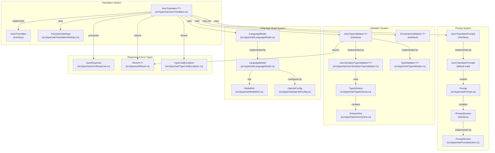
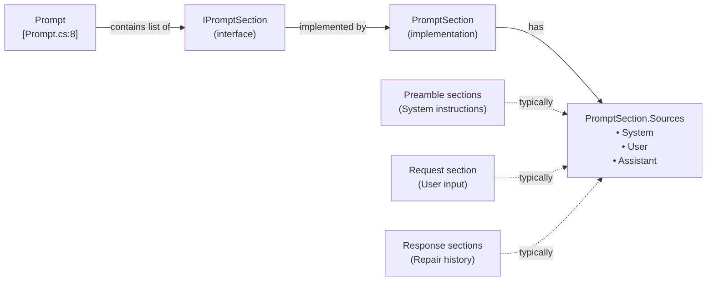
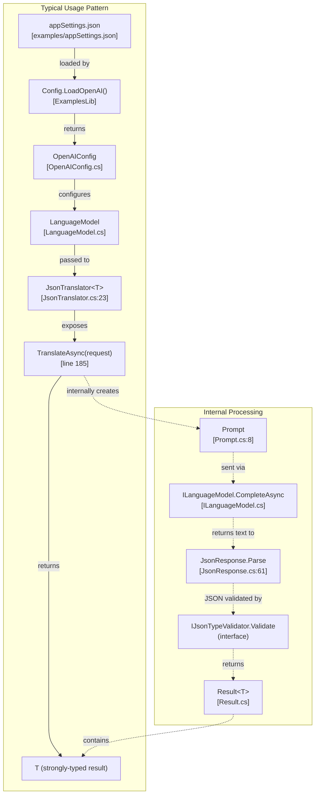

<!-- source: DeepWiki mcp.deepwiki.com · repo microsoft/typechat.net · page 10.1 Core Types · fetched 2026-10-26 -->

# Core Types

<details>
<summary>Relevant source files</summary>

The following files were used as context for generating this wiki page:

- [README.md](README.md)
- [examples/MultiSchema/Program.cs](examples/MultiSchema/Program.cs)
- [examples/Sentiment/Program.cs](examples/Sentiment/Program.cs)
- [examples/appSettings.json](examples/appSettings.json)
- [src/typechat/JsonResponse.cs](src/typechat/JsonResponse.cs)
- [src/typechat/JsonSerializerTypeValidator.cs](src/typechat/JsonSerializerTypeValidator.cs)
- [src/typechat/JsonTranslator.cs](src/typechat/JsonTranslator.cs)
- [src/typechat/ModelInfo.cs](src/typechat/ModelInfo.cs)
- [src/typechat/Prompt.cs](src/typechat/Prompt.cs)
- [src/typechat/TypeChatException.cs](src/typechat/TypeChatException.cs)

</details>


This document provides comprehensive API reference documentation for the fundamental types in the TypeChat core library. These types form the foundation of TypeChat's natural language translation capabilities and are used by all higher-level features.

For information about program-specific types (ProgramTranslator, ProgramCompiler, etc.), see [Program Types](#10.2). For schema generation types, see [Schema Types](#10.3). For practical usage examples, see [Getting Started](#2) and [Core Concepts](#3).

## Type System Overview

The following diagram illustrates the core types in TypeChat and their relationships:



**Sources:** [src/typechat/JsonTranslator.cs:1-315](), [src/typechat/Prompt.cs:1-193](), [src/typechat/JsonSerializerTypeValidator.cs:1-152](), [src/typechat/JsonResponse.cs:1-103](), [src/typechat/TypeChatException.cs:1-101](), [src/typechat/ModelInfo.cs:1-61]()

## JsonTranslator<T>

`JsonTranslator<T>` is the primary class for translating natural language requests into strongly-typed objects. It orchestrates the entire translation workflow including prompt construction, model interaction, validation, and automatic repair.

### Class Declaration

[src/typechat/JsonTranslator.cs:23-314]()

```
public class JsonTranslator<T> : IJsonTranslator
```

### Core Properties

| Property | Type | Description |
|----------|------|-------------|
| `Model` | `ILanguageModel` | The language model used for translation [line 89]() |
| `Validator` | `IJsonTypeValidator<T>` | Validates and deserializes JSON responses [lines 94-102]() |
| `ConstraintsValidator` | `IConstraintsValidator<T>?` | Optional additional validation of deserialized objects [lines 107-111]() |
| `Prompts` | `IJsonTranslatorPrompts` | Customizable prompts for translation and repair [lines 116-124]() |
| `TranslationSettings` | `TranslationSettings` | Settings like MaxTokens, temperature [line 129]() |
| `MaxRepairAttempts` | `int` | Number of repair attempts when validation fails (default: 1) [lines 135-146]() |

### Constructors

**Basic Constructor**
```csharp
public JsonTranslator(ILanguageModel model, SchemaText schema)
```
[src/typechat/JsonTranslator.cs:39-42]()

Creates a JsonTranslator with a simple schema text. Uses `JsonSerializerTypeValidator<T>` internally.

**Custom Validator Constructor**
```csharp
public JsonTranslator(
    ILanguageModel model,
    IJsonTypeValidator<T> validator,
    IJsonTranslatorPrompts? prompts = null)
```
[src/typechat/JsonTranslator.cs:50-66]()

Provides full control over validation and prompts.

**Automatic Schema Generation Constructor**
```csharp
public JsonTranslator(
    ILanguageModel model, 
    IJsonTranslatorPrompts? prompts = null, 
    IVocabCollection? knownVocabs = null)
```
[src/typechat/JsonTranslator.cs:74-84]()

Automatically generates TypeScript schema from type `T` using `TypeValidator<T>`.

### Translation Methods

**Primary Translation Method**
```csharp
public Task<T> TranslateAsync(
    string request, 
    CancellationToken cancelToken = default)
```
[src/typechat/JsonTranslator.cs:185-188]()

**Advanced Translation Method**
```csharp
public async Task<T> TranslateAsync(
    Prompt request,
    IList<IPromptSection>? preamble,
    TranslationSettings? requestSettings = null,
    CancellationToken cancelToken = default)
```
[src/typechat/JsonTranslator.cs:199-252]()

Allows custom preamble and per-request settings.

### Events

JsonTranslator provides diagnostic events for monitoring the translation process:

| Event | Signature | Purpose |
|-------|-----------|---------|
| `SendingPrompt` | `Action<Prompt>` | Fired before sending prompt to model [line 155]() |
| `CompletionReceived` | `Action<string>` | Fired when model returns response [line 160]() |
| `AttemptingRepair` | `Action<string>` | Fired when attempting to repair validation errors [line 165]() |

### Translation Workflow

```mermaid
sequenceDiagram
    participant Client as "Client Code"
    participant JT as "JsonTranslator&lt;T&gt;<br/>[JsonTranslator.cs:23]"
    participant Prompts as "IJsonTranslatorPrompts<br/>[CreateRequestPrompt]"
    participant Model as "ILanguageModel<br/>[CompleteAsync]"
    participant Validator as "IJsonTypeValidator&lt;T&gt;<br/>[Validate]"
    participant Parser as "JsonResponse.Parse<br/>[JsonResponse.cs:61]"
    
    Client->>JT: TranslateAsync(request)
    
    JT->>Prompts: CreateRequestPrompt(schema, request)
    Prompts-->>JT: Prompt
    
    JT->>JT: SendingPrompt event
    JT->>Model: CompleteAsync(prompt, settings)
    Model-->>JT: responseText
    JT->>JT: CompletionReceived event
    
    JT->>Parser: Parse(responseText)
    Parser-->>JT: JsonResponse
    
    alt Has Complete JSON
        JT->>Validator: Validate(json)
        Validator-->>JT: Result&lt;T&gt;
        
        alt Validation Success
            JT->>Client: Return T
        else Validation Failed (attempts < max)
            JT->>JT: AttemptingRepair event
            JT->>Prompts: CreateRepairPrompt(errors)
            Prompts-->>JT: Repair prompt
            Note over JT,Model: Loop back to CompleteAsync
        else Max Attempts Exceeded
            JT->>Client: Throw TypeChatException
        end
    else No JSON or Incomplete
        JT->>Client: Throw TypeChatException
    end
```

**Sources:** [src/typechat/JsonTranslator.cs:199-252](), [src/typechat/JsonResponse.cs:61-101]()

## Prompt

The `Prompt` class represents a structured collection of prompt sections that are sent to the language model. It extends `List<IPromptSection>` and provides convenient methods for building multi-part prompts.

### Class Declaration

[src/typechat/Prompt.cs:8-192]()

```
public class Prompt : List<IPromptSection>
```

### Constructors

| Constructor | Description |
|-------------|-------------|
| `Prompt()` | Creates empty prompt [lines 13-16]() |
| `Prompt(PromptSection? text)` | Creates prompt with single section [lines 22-25]() |
| `Prompt(IEnumerable<IPromptSection>? preamble, PromptSection? text, IEnumerable<IPromptSection>? postamble)` | Creates structured prompt with preamble, text, and postamble [lines 36-50]() |

### Key Methods

| Method | Description |
|--------|-------------|
| `Append(string section)` | Appends text with User source [line 77]() |
| `AppendInstruction(string section)` | Appends instruction with System source [line 83]() |
| `AppendResponse(string section)` | Appends response with Assistant source [line 89]() |
| `Append(IPromptSection section)` | Appends a prompt section [line 95]() |
| `Append(Prompt prompt)` | Appends another prompt [line 107]() |
| `Last()` | Returns most recent section [lines 113-122]() |
| `JoinSections(string sectionSep, bool includeSource, StringBuilder sb)` | Combines sections into string [lines 131-143]() |
| `ToString(bool includeSource)` | Converts to string, optionally including sources [lines 152-156]() |
| `GetLength()` | Returns total character length [lines 162-170]() |

### PromptSection

Individual sections of a prompt are represented by `IPromptSection` interface and the `PromptSection` class.

**Standard Sources** [PromptSection.cs]():
- `Sources.System`: Instructions to the model
- `Sources.User`: User input
- `Sources.Assistant`: Model responses (used in repair loops)



**Sources:** [src/typechat/Prompt.cs:1-193]()

## Validation Types

TypeChat uses a validation system to ensure that JSON returned by language models conforms to the expected schema and can be deserialized into type `T`.

### IJsonTypeValidator<T>

Core interface for JSON validation and deserialization.

```
public interface IJsonTypeValidator<T>
{
    TypeSchema Schema { get; }
    Result<T> Validate(string json);
}
```

### JsonSerializerTypeValidator<T>

Default validator implementation using System.Text.Json.

[src/typechat/JsonSerializerTypeValidator.cs:102-151]()

**Key Features:**
- Uses .NET JSON serializer for validation [line 56]()
- Provides detailed error messages with line numbers [lines 68-84]()
- Configurable via `JsonSerializerOptions` [lines 37-43]()

**Default Options** [src/typechat/JsonSerializerTypeValidator.cs:15-28]():
- `IncludeFields = true`
- `AllowTrailingCommas = true`
- `ReadCommentHandling = JsonCommentHandling.Skip`
- Includes `JsonStringEnumConverter`

### TypeSchema

Represents the schema for a type, combining the .NET Type with its TypeScript schema text.

```
public class TypeSchema
{
    public Type Type { get; }
    public SchemaText Schema { get; }
}
```

**Sources:** [src/typechat/JsonSerializerTypeValidator.cs:1-152]()

## Response and Error Types

### JsonResponse

Parses raw text responses from language models to extract JSON, handling cases where models include explanatory text before or after the JSON.

[src/typechat/JsonResponse.cs:9-102]()

**Properties:**

| Property | Type | Description |
|----------|------|-------------|
| `ResponseText` | `string` | Raw response from model [line 20]() |
| `Json` | `string?` | Extracted JSON (text within outermost `{}`) [line 26]() |
| `Prologue` | `string?` | Text before JSON [line 31]() |
| `Epilogue` | `string?` | Text after JSON [line 36]() |
| `HasCompleteJson` | `bool` | Whether JSON is enclosed in braces [line 41]() |

**Static Method:**
```csharp
public static JsonResponse Parse(string responseText)
```
[src/typechat/JsonResponse.cs:61-101]()

Parses response text to extract JSON and surrounding content.

### Result<T>

Generic result type that represents either success with a value or failure with an error message.

```
public class Result<T>
{
    public bool Success { get; }
    public T Value { get; }
    public string Message { get; }
    
    public static Result<T> Error(string message);
    public static implicit operator T(Result<T> result);
}
```

### TypeChatException

Exception type thrown when translation fails after all repair attempts.

[src/typechat/TypeChatException.cs:8-100]()

**Error Codes:**

| Code | Description |
|------|-------------|
| `Unknown` | Unknown error [line 24]() |
| `NoJsonObject` | Model returned no JSON [lines 27-28]() |
| `JsonValidation` | JSON validation failed [lines 31-32]() |
| `NoTranslator` | No suitable translator found (multi-schema scenarios) [lines 35-36]() |

**Properties:**

| Property | Type | Description |
|----------|------|-------------|
| `Code` | `ErrorCode` | Error classification [line 54]() |
| `Request` | `string` | Original request that caused error [line 59]() |
| `Response` | `JsonResponse?` | Model response if available [line 64]() |

**Sources:** [src/typechat/JsonResponse.cs:1-103](), [src/typechat/TypeChatException.cs:1-101]()

## Language Model Types

### ILanguageModel

Interface that abstracts language model interactions. Implementations handle API communication with OpenAI or other providers.

```
public interface ILanguageModel
{
    Task<string> CompleteAsync(
        Prompt prompt, 
        TranslationSettings settings, 
        CancellationToken cancelToken);
}
```

[src/typechat/ILanguageModel.cs]()

### LanguageModel

Default implementation of `ILanguageModel` for OpenAI and Azure OpenAI services.

[src/typechat/LanguageModel.cs]()

**Constructor:**
```csharp
public LanguageModel(OpenAIConfig config)
```

Typical usage pattern from examples:
```csharp
OpenAIConfig config = Config.LoadOpenAI();
var model = new LanguageModel(config);
var translator = new JsonTranslator<SentimentResponse>(model);
```

[examples/Sentiment/Program.cs:12-16]()

### OpenAIConfig

Configuration class for OpenAI and Azure OpenAI services.

[src/typechat/OpenAIConfig.cs]()

**Key Properties:**
- `Azure`: Whether using Azure OpenAI (vs OpenAI service)
- `ApiKey`: API key or "identity" for Azure credentials
- `Endpoint`: Service endpoint URL
- `Model`: Model name or deployment name
- `MaxRetries`: HTTP retry count
- `TimeoutMs`: Request timeout in milliseconds

**Loading Configuration:**
```csharp
// From application configuration
OpenAIConfig config = Config.LoadOpenAI();

// From JSON file
OpenAIConfig config = OpenAIConfig.LoadFromJsonFile(path);

// From environment variables
OpenAIConfig config = OpenAIConfig.FromEnvironment();
```

[README.md:199-207]()

**Example Configuration File:**
[examples/appSettings.json:1-21]()

```json
{
  "OpenAI": {
    "Azure": true,
    "Endpoint": "https://YOUR_RESOURCE_NAME.openai.azure.com",
    "ApiKey": "YOUR API KEY",
    "Model": "gpt-35-turbo",
    "MaxRetries": 2,
    "TimeoutMs": 30000
  }
}
```

### ModelInfo

Describes language model capabilities and limitations.

[src/typechat/ModelInfo.cs:8-60]()

**Properties:**

| Property | Type | Description |
|----------|------|-------------|
| `Name` | `string` | Model name [line 36]() |
| `MaxTokens` | `int` | Token limit (default: 4096) [line 42]() |
| `TokenToCharMultiple` | `double` | Character-to-token ratio estimate [line 48]() |
| `MaxCharCount` | `int` | Estimated max characters (computed) [line 54]() |

**Constructor:**
```csharp
public ModelInfo(
    string name, 
    int maxTokens = 4096, 
    double tokenToCharMultiple = 2.5)
```
[src/typechat/ModelInfo.cs:22-30]()

**Sources:** [src/typechat/ModelInfo.cs:1-61](), [examples/appSettings.json:1-21](), [README.md:192-207]()

## TranslationSettings

Controls parameters for individual translation requests.

```
public class TranslationSettings
{
    public int? MaxTokens { get; set; }
    public double? Temperature { get; set; }
    public double? TopP { get; set; }
    // Additional parameters...
}
```

[src/typechat/TranslationSettings.cs]()

These settings can be customized per request or set globally on the `JsonTranslator<T>` instance via the `TranslationSettings` property [src/typechat/JsonTranslator.cs:129]().

## Supporting Interfaces

### IJsonTranslatorPrompts

Interface for customizing prompts sent to language models.

```
public interface IJsonTranslatorPrompts
{
    Prompt CreateRequestPrompt(
        TypeSchema schema, 
        Prompt request, 
        IList<IPromptSection>? preamble);
    
    PromptSection CreateRepairPrompt(
        TypeSchema schema, 
        string responseText, 
        string validationError);
}
```

Default implementation: `JsonTranslatorPrompts` [src/typechat/JsonTranslatorPrompts.cs]()

### IConstraintsValidator<T>

Optional interface for additional validation after successful JSON deserialization.

```
public interface IConstraintsValidator<T>
{
    Result<T> Validate(T value);
}
```

Used when business logic validation is needed beyond schema conformance, such as checking that dates are in the future or quantities are positive.

## Type Relationship Summary



**Sources:** [src/typechat/JsonTranslator.cs:1-315](), [src/typechat/Prompt.cs:1-193](), [src/typechat/JsonResponse.cs:1-103](), [examples/Sentiment/Program.cs:1-43](), [examples/appSettings.json:1-21]()

---

