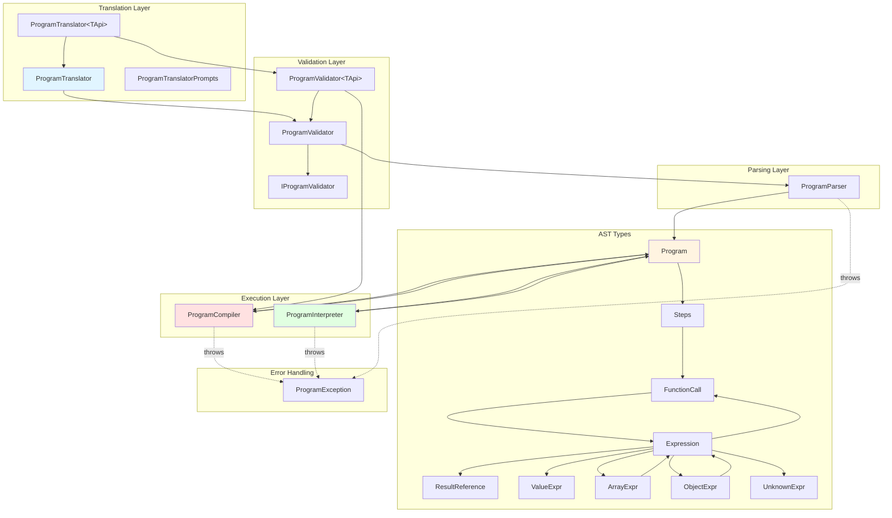
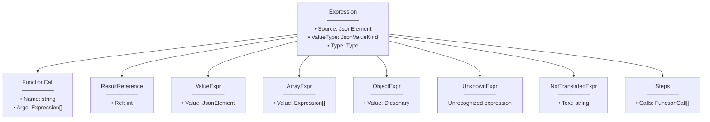
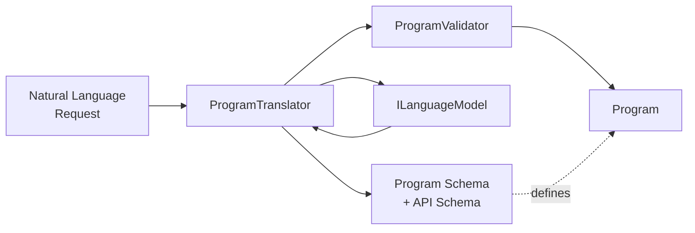
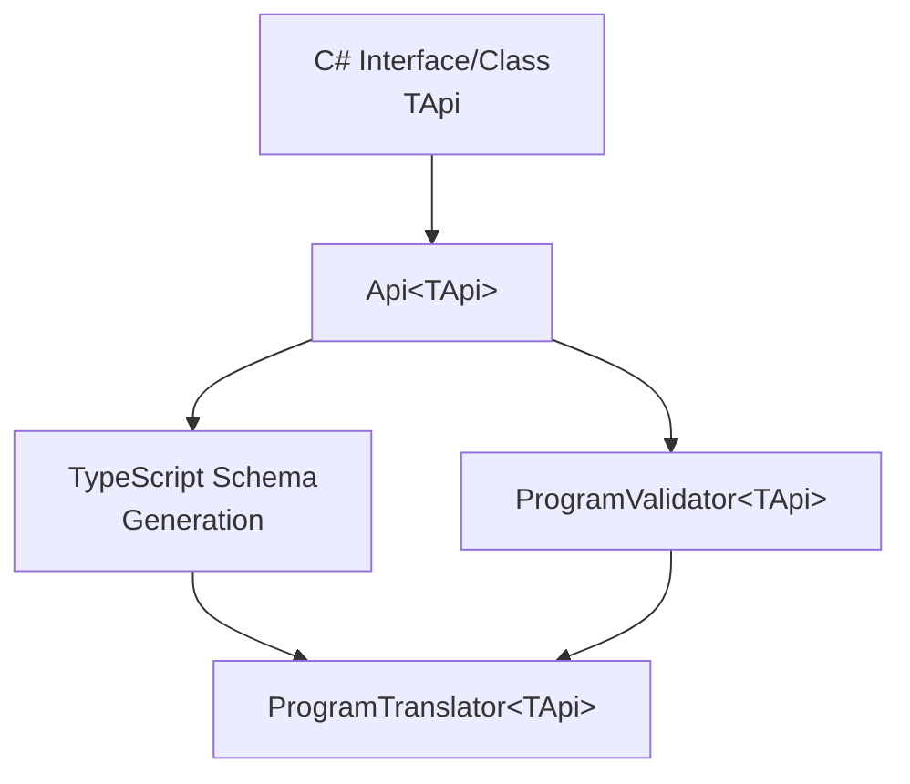
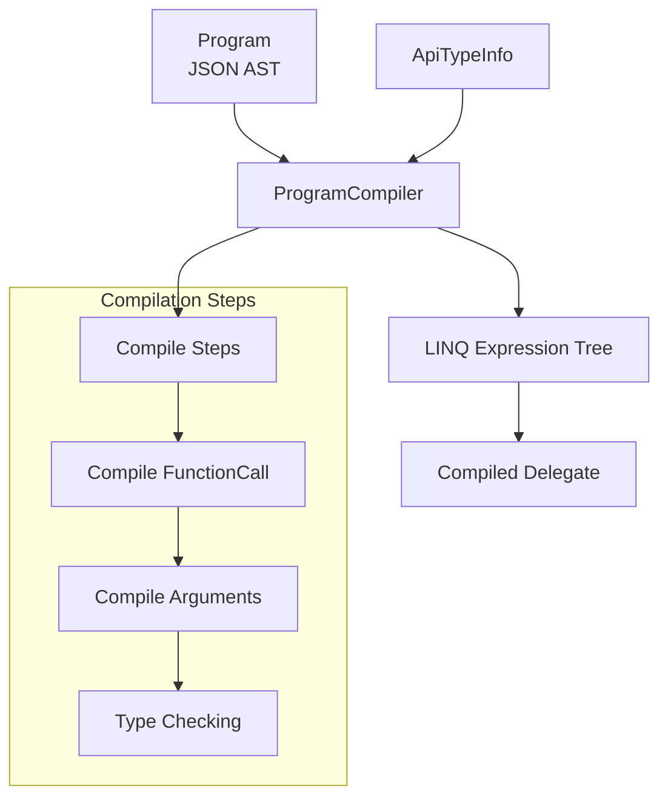
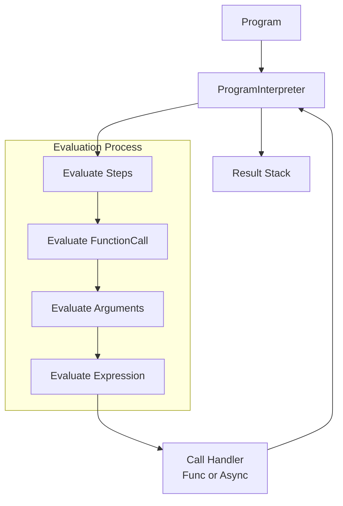
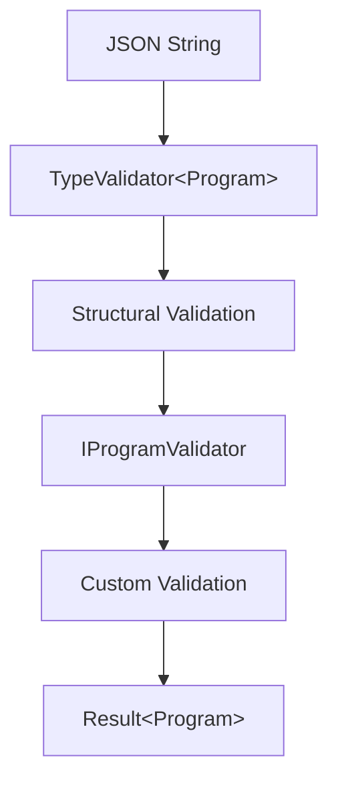
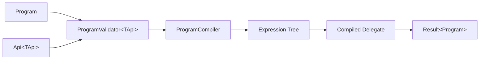
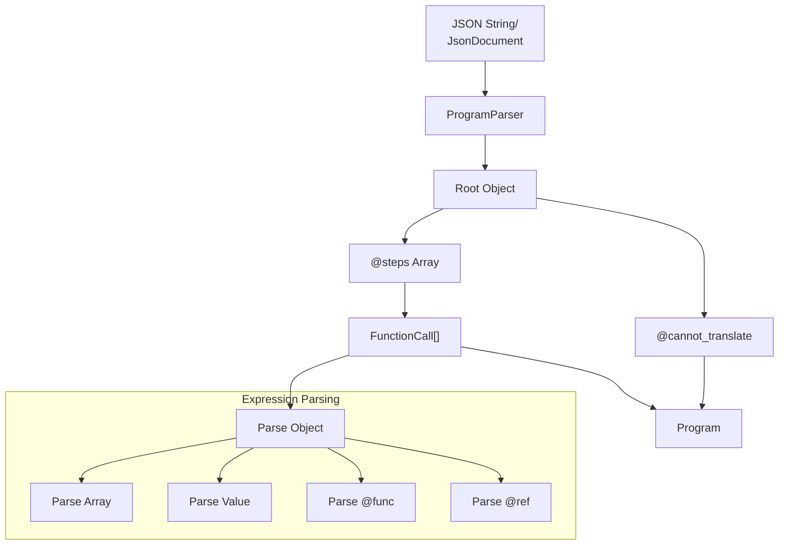

<!-- source: DeepWiki mcp.deepwiki.com · repo microsoft/typechat.net · page 10.2 Program Types · fetched 2026-10-26 -->

# Program Types

<details>
<summary>Relevant source files</summary>

The following files were used as context for generating this wiki page:

- [examples/Math/Program.cs](examples/Math/Program.cs)
- [src/typechat.program/ProgramCompiler.cs](src/typechat.program/ProgramCompiler.cs)
- [src/typechat.program/ProgramException.cs](src/typechat.program/ProgramException.cs)
- [src/typechat.program/ProgramInterpreter.cs](src/typechat.program/ProgramInterpreter.cs)
- [src/typechat.program/ProgramParser.cs](src/typechat.program/ProgramParser.cs)
- [src/typechat.program/ProgramSchemaImpl.cs](src/typechat.program/ProgramSchemaImpl.cs)
- [src/typechat.program/ProgramTranslator.cs](src/typechat.program/ProgramTranslator.cs)
- [src/typechat.program/ProgramValidator.cs](src/typechat.program/ProgramValidator.cs)

</details>


## Purpose and Scope

This document provides comprehensive API reference documentation for all types in the `TypeChat.Program` library. These types enable translating natural language requests into executable programs that call type-safe APIs, and then compiling or interpreting those programs for execution.

For conceptual information about program translation and usage patterns, see [Program Translation](#5). For end-to-end examples, see [Math Calculator Example](#8.3) and [Calendar Actions Example](#8.4).

The types documented here are located in the `src/typechat.program` directory and fall into several categories:
- **Program AST Types**: Classes representing the abstract syntax tree of programs
- **Translation Types**: Classes that generate programs from natural language
- **Execution Types**: Compilers and interpreters that execute programs
- **Validation Types**: Validators that ensure programs are type-safe
- **Supporting Types**: Parsers, exceptions, and utilities

---

## Type Hierarchy Overview



**Diagram: Type Hierarchy and Relationships**

Sources: [src/typechat.program/ProgramTranslator.cs:1-122](), [src/typechat.program/ProgramCompiler.cs:1-460](), [src/typechat.program/ProgramInterpreter.cs:1-257](), [src/typechat.program/ProgramSchemaImpl.cs:1-273]()

---

## Program AST Types

### Program

The root type representing a complete program. Programs consist of a sequence of function calls (steps) that execute in order.

**Location**: [src/typechat.program/ProgramSchemaImpl.cs:9-110]()

| Property | Type | Description |
|----------|------|-------------|
| `Source` | `JsonDocument?` | Original JSON source document |
| `Steps` | `Steps` | Sequence of function calls to execute |
| `NotTranslated` | `string[]?` | Parts of request that couldn't be translated |
| `HasSteps` | `bool` | Whether the program contains any steps |
| `IsComplete` | `bool` | Whether program is complete (has steps and no untranslated parts) |
| `HasNotTranslated` | `bool` | Whether there are untranslated parts |
| `Delegate` | `Delegate?` | Compiled delegate for type-safe execution |

**Key Methods**:

| Method | Returns | Description |
|--------|---------|-------------|
| `Run(Api api)` | `dynamic` | Executes program synchronously using compiled delegate or interpreter |
| `RunAsync(Api api)` | `Task<dynamic>` | Executes program asynchronously |
| `Dispose()` | `void` | Releases JSON source document |

**Constructor**: [src/typechat.program/ProgramSchemaImpl.cs:18-29]()
```
Program(JsonDocument? source, Steps steps)
Program(JsonDocument? source = null)  // internal
```

Sources: [src/typechat.program/ProgramSchemaImpl.cs:9-110]()

---

### Expression Hierarchy

All expression types inherit from the abstract `Expression` base class.



**Diagram: Expression Type Hierarchy**

Sources: [src/typechat.program/ProgramSchemaImpl.cs:112-273]()

---

### Steps

Container for the sequence of function calls in a program.

**Location**: [src/typechat.program/ProgramSchemaImpl.cs:135-145]()

| Property | Type | Description |
|----------|------|-------------|
| `Calls` | `FunctionCall[]` | Array of function calls to execute in order |

**Constructor**:
```
Steps(JsonElement source, FunctionCall[]? calls)
```

Sources: [src/typechat.program/ProgramSchemaImpl.cs:135-145]()

---

### FunctionCall

Represents a call to an API function with arguments.

**Location**: [src/typechat.program/ProgramSchemaImpl.cs:147-165]()

| Property | Type | Description |
|----------|------|-------------|
| `Name` | `string` | Name of the function to call |
| `Args` | `Expression[]` | Arguments to pass to the function |
| `Source` | `JsonElement` | Original JSON element |

**Constructor**:
```
FunctionCall(JsonElement source, JsonElement name, Expression[] args)
```

Sources: [src/typechat.program/ProgramSchemaImpl.cs:147-165]()

---

### ResultReference

References the result of a previous step in the program.

**Location**: [src/typechat.program/ProgramSchemaImpl.cs:167-179]()

| Property | Type | Description |
|----------|------|-------------|
| `Ref` | `int` | Zero-based index of the step whose result to reference |

**Constructor**:
```
ResultReference(JsonElement source, JsonElement value)
```

The `Ref` value must be non-negative and less than the number of completed steps. [src/typechat.program/ProgramSchemaImpl.cs:173-177]()

Sources: [src/typechat.program/ProgramSchemaImpl.cs:167-179]()

---

### ValueExpr

Represents a JSON primitive value (string, number, boolean, or null).

**Location**: [src/typechat.program/ProgramSchemaImpl.cs:181-231]()

| Property | Type | Description |
|----------|------|-------------|
| `Value` | `JsonElement` | The primitive JSON value |
| `Type` | `Type` | .NET type (`string`, `double`, `bool`) based on JSON type |

**Methods**:
- `ToJsonNode()`: Converts to `JsonNode` for serialization [src/typechat.program/ProgramSchemaImpl.cs:214-229]()

**Type Mapping**: [src/typechat.program/ProgramSchemaImpl.cs:194-212]()

| JSON Type | .NET Type |
|-----------|-----------|
| `String` | `typeof(string)` |
| `Number` | `typeof(double)` |
| `True`/`False` | `typeof(bool)` |

Sources: [src/typechat.program/ProgramSchemaImpl.cs:181-231]()

---

### ArrayExpr

Represents a JSON array containing expressions.

**Location**: [src/typechat.program/ProgramSchemaImpl.cs:233-243]()

| Property | Type | Description |
|----------|------|-------------|
| `Value` | `Expression[]` | Array of expressions |
| `Type` | `Type` | Always `typeof(object[])` |

**Constructor**:
```
ArrayExpr(JsonElement source, Expression[] exprs)
```

Sources: [src/typechat.program/ProgramSchemaImpl.cs:233-243]()

---

### ObjectExpr

Represents a JSON object with string keys and expression values.

**Location**: [src/typechat.program/ProgramSchemaImpl.cs:245-255]()

| Property | Type | Description |
|----------|------|-------------|
| `Value` | `Dictionary<string, Expression>` | Object properties as key-value pairs |
| `Type` | `Type` | Always `typeof(JsonObject)` |

**Constructor**:
```
ObjectExpr(JsonElement source, Dictionary<string, Expression> obj)
```

Sources: [src/typechat.program/ProgramSchemaImpl.cs:245-255]()

---

### UnknownExpr

Represents an expression that couldn't be parsed into a known type.

**Location**: [src/typechat.program/ProgramSchemaImpl.cs:266-272]()

**Constructor**:
```
UnknownExpr(JsonElement source)
```

Sources: [src/typechat.program/ProgramSchemaImpl.cs:266-272]()

---

## Translation Types

### ProgramTranslator

Translates natural language requests into type-safe programs targeting a specific API.



**Diagram: ProgramTranslator Flow**

**Location**: [src/typechat.program/ProgramTranslator.cs:12-95]()

The base `ProgramTranslator` extends `JsonTranslator<Program>` and uses a fixed program schema combined with a dynamically generated API schema.

**Constructor**:
```
ProgramTranslator(
    ILanguageModel model, 
    IJsonTypeValidator<Program> validator, 
    SchemaText apiDef)
```

| Property | Type | Description |
|----------|------|-------------|
| `ApiDef` | `SchemaText` | TypeScript schema defining the target API |

**Key Method**:
- `OnValidationComplete(Result<Program> validationResult)`: Returns `false` to stop validation if the program has untranslated parts [src/typechat.program/ProgramTranslator.cs:89-94]()

**Program Schema**: The fixed program schema is defined as a TypeScript string [src/typechat.program/ProgramTranslator.cs:14-45]():

```typescript
export type Program = {
    "@steps": FunctionCall[];
    "@cannot_translate"?: string[];
}

export type FunctionCall = {
    "@func": string;
    "@args"?: Expression[];
};

export type Expression = JsonValue | FunctionCall | ResultReference;

export type ResultReference = {
    "@ref": number;
};
```

Sources: [src/typechat.program/ProgramTranslator.cs:12-95]()

---

### ProgramTranslator&lt;TApi&gt;

Generic version that automatically generates the API schema from a C# type.

**Location**: [src/typechat.program/ProgramTranslator.cs:105-121]()



**Diagram: ProgramTranslator&lt;TApi&gt; Initialization**

**Constructor**:
```
ProgramTranslator(ILanguageModel model, Api<TApi> api)
```

This constructor automatically:
1. Generates a TypeScript schema from `TApi` using `api.GenerateSchema()`
2. Creates a `ProgramValidator<TApi>` for type-safe validation and compilation
3. Passes both to the base `ProgramTranslator` constructor

**Example Usage**: [examples/Math/Program.cs:15-19]()
```csharp
_translator = new ProgramTranslator<IMathAPI>(
    new LanguageModel(Config.LoadOpenAI()),
    _api
);
```

Sources: [src/typechat.program/ProgramTranslator.cs:105-121](), [examples/Math/Program.cs:15-19]()

---

## Execution Types

### ProgramCompiler

Compiles a JSON program into a type-safe .NET delegate using the Dynamic Language Runtime (DLR) and LINQ Expression Trees.

**Location**: [src/typechat.program/ProgramCompiler.cs:13-459]()



**Diagram: Program Compilation Pipeline**

**Constructor**:
```
ProgramCompiler(Type type)
ProgramCompiler(ApiTypeInfo typeInfo)
```

**Key Methods**:

| Method | Returns | Description |
|--------|---------|-------------|
| `CompileToExpressionTree(Program, object)` | `LambdaExpression` | Generates LINQ expression tree with type checking |
| `Compile(Program, Api)` | `Delegate` | Compiles to executable delegate |
| `Compile(Program, object)` | `Delegate` | Compiles to executable delegate with API instance |

**Compilation Process**: [src/typechat.program/ProgramCompiler.cs:46-82]()

1. Parse program steps [src/typechat.program/ProgramCompiler.cs:90-102]()
2. For each function call:
   - Look up method in `ApiTypeInfo` [src/typechat.program/ProgramCompiler.cs:106]()
   - Compile arguments with type checking [src/typechat.program/ProgramCompiler.cs:154-207]()
   - Generate method call expression [src/typechat.program/ProgramCompiler.cs:124]()
3. Handle async methods by injecting wait calls [src/typechat.program/ProgramCompiler.cs:374-390]()
4. Build block expression with result variables [src/typechat.program/ProgramCompiler.cs:54-58]()
5. Compile to delegate [src/typechat.program/ProgramCompiler.cs:80-81]()

**Type Conversions**: The compiler handles automatic conversions between JSON types and .NET types [src/typechat.program/ProgramCompiler.cs:173-183]():
- Primitives: Direct conversion with cast if needed
- Arrays: Element-wise conversion
- Objects: JSON deserialization to target type [src/typechat.program/ProgramCompiler.cs:194-203]()

**Internal API**: The compiler uses helper methods for runtime operations [src/typechat.program/ProgramCompiler.cs:409-458]():

| Method | Purpose |
|--------|---------|
| `Deserialize(JsonObject, Type)` | Deserializes JSON objects to typed objects |
| `Serialize(object)` | Serializes objects to JSON nodes |
| `AddNode(JsonObject, string, JsonNode)` | Adds properties to JSON objects |
| `WaitFor(Task)` | Synchronously waits for async methods |
| `WaitForResult(Task)` | Synchronously waits and returns task result |

Sources: [src/typechat.program/ProgramCompiler.cs:13-459]()

---

### ProgramInterpreter

Lightweight interpreter for dynamic program execution without compilation.

**Location**: [src/typechat.program/ProgramInterpreter.cs:11-256]()



**Diagram: Program Interpretation Flow**

**Constructor**:
```
ProgramInterpreter()
```

The interpreter is stateful and maintains a list of results from executed steps. For multi-threaded usage, create multiple interpreter instances (they are lightweight). [src/typechat.program/ProgramInterpreter.cs:5-25]()

**Key Methods**:

| Method | Returns | Description |
|--------|---------|-------------|
| `Run(Program, Func<string, dynamic[], dynamic>)` | `dynamic?` | Executes program synchronously |
| `RunAsync(Program, Func<string, dynamic[], Task<dynamic>>)` | `Task<dynamic?>` | Executes program asynchronously |

**Execution Process**: [src/typechat.program/ProgramInterpreter.cs:34-75]()

1. Clear previous state [src/typechat.program/ProgramInterpreter.cs:77-82]()
2. For each step:
   - Evaluate the function call [src/typechat.program/ProgramInterpreter.cs:90-95]()
   - Invoke handler with function name and evaluated arguments
   - Store result in result stack [src/typechat.program/ProgramInterpreter.cs:47]()
3. Return last result [src/typechat.program/ProgramInterpreter.cs:84-88]()

**Expression Evaluation**: [src/typechat.program/ProgramInterpreter.cs:103-153]()

The interpreter recursively evaluates expressions based on type:

| Expression Type | Evaluation |
|-----------------|------------|
| `FunctionCall` | Evaluate args, invoke handler |
| `ResultReference` | Retrieve from result stack |
| `ValueExpr` | Extract primitive value |
| `ArrayExpr` | Evaluate each element |
| `ObjectExpr` | Evaluate each property, build `JsonObject` |

**Result References**: When evaluating `ResultReference`, the interpreter looks up the result by index [src/typechat.program/ProgramInterpreter.cs:236-243]():
```csharp
if (expr.Ref >= _results.Count)
{
    ProgramException.ThrowInvalidResultRef(expr.Ref, _results.Count);
}
return _results[expr.Ref];
```

**Static Helper**:
- `ToJsonNode(dynamic obj)`: Converts interpreter results to JSON nodes [src/typechat.program/ProgramInterpreter.cs:255]()

Sources: [src/typechat.program/ProgramInterpreter.cs:11-256]()

---

## Validation Types

### ProgramValidator

Base validator that structurally validates JSON programs and optionally performs additional validation.

**Location**: [src/typechat.program/ProgramValidator.cs:17-57]()



**Diagram: Validation Pipeline**

**Constructor**:
```
ProgramValidator(IProgramValidator? programValidator = null)
```

**Properties**:

| Property | Type | Description |
|----------|------|-------------|
| `Schema` | `TypeSchema` | Returns the program schema |

**Key Methods**:

| Method | Returns | Description |
|--------|---------|-------------|
| `Validate(string json)` | `Result<Program>` | Validates JSON structure and delegates to `ValidateProgram` |
| `ValidateProgram(Program)` | `Result<Program>` | Override for custom validation logic |

**Validation Steps**: [src/typechat.program/ProgramValidator.cs:33-47]()

1. Structural validation using `TypeValidator<Program>` [src/typechat.program/ProgramValidator.cs:35-36]()
2. Check if request has untranslated parts - if so, skip further validation [src/typechat.program/ProgramValidator.cs:40-41]()
3. Call `ValidateProgram` for additional checks [src/typechat.program/ProgramValidator.cs:43]()

Sources: [src/typechat.program/ProgramValidator.cs:17-57]()

---

### ProgramValidator&lt;TApi&gt;

Type-safe validator that compiles programs to verify they correctly bind to the target API.

**Location**: [src/typechat.program/ProgramValidator.cs:64-91]()



**Diagram: Type-Safe Validation through Compilation**

**Constructor**:
```
ProgramValidator(Api<TApi> api)
```

**Validation Process**: [src/typechat.program/ProgramValidator.cs:77-90]()

1. Create `ProgramCompiler` with API type information [src/typechat.program/ProgramValidator.cs:79]()
2. Attempt to compile program to expression tree [src/typechat.program/ProgramValidator.cs:82]()
3. If compilation succeeds:
   - Compile expression tree to delegate [src/typechat.program/ProgramValidator.cs:83]()
   - Store delegate in `Program.Delegate` property
   - Return success result
4. If compilation fails:
   - Catch exception [src/typechat.program/ProgramValidator.cs:86]()
   - Return error result with exception message [src/typechat.program/ProgramValidator.cs:88]()

This validation ensures:
- All function names exist in the API
- Argument counts match method signatures
- Argument types are compatible
- Result references are valid

The compiled delegate is cached in the `Program` object for efficient execution.

Sources: [src/typechat.program/ProgramValidator.cs:64-91]()

---

### IProgramValidator

Interface for custom program validators.

**Location**: [src/typechat.program/ProgramValidator.cs:9-12]()

**Method**:
```
Result<Program> ValidateProgram(Program program);
```

Implementations can provide custom validation logic beyond structural JSON validation.

Sources: [src/typechat.program/ProgramValidator.cs:9-12]()

---

## Supporting Types

### ProgramParser

Parses JSON programs into the AST representation.

**Location**: [src/typechat.program/ProgramParser.cs:8-195]()



**Diagram: Program Parsing Process**

**Constants**: [src/typechat.program/ProgramParser.cs:10-17]()

| Constant | Value | Description |
|----------|-------|-------------|
| `ExprNames.Steps` | `"@steps"` | Property name for steps array |
| `ExprNames.Func` | `"@func"` | Property name for function name |
| `ExprNames.Args` | `"@args"` | Property name for arguments |
| `ExprNames.Ref` | `"@ref"` | Property name for result reference |
| `ExprNames.CannotTranslate` | `"@cannot_translate"` | Property name for untranslated parts |

**Key Methods**:

| Method | Returns | Description |
|--------|---------|-------------|
| `Parse(string)` | `Program` | Parses JSON string to program |
| `Parse(JsonDocument)` | `Program` | Parses JSON document to program |

**Parsing Logic**: [src/typechat.program/ProgramParser.cs:40-77]()

1. Ensure root is a JSON object [src/typechat.program/ProgramParser.cs:42-43]()
2. Parse `@cannot_translate` array if present [src/typechat.program/ProgramParser.cs:47-51]()
3. Parse `@steps` array if present [src/typechat.program/ProgramParser.cs:52-68]()
4. Return program if it has steps or untranslated parts [src/typechat.program/ProgramParser.cs:70-74]()
5. Otherwise throw `InvalidProgramJson` exception [src/typechat.program/ProgramParser.cs:76]()

**Expression Parsing**: [src/typechat.program/ProgramParser.cs:172-194]()

The parser dispatches based on JSON value kind:

| JSON Kind | Result Type |
|-----------|-------------|
| `Object` | `FunctionCall`, `ResultReference`, or `ObjectExpr` |
| `Array` | `ArrayExpr` |
| `String`, `Number`, `Boolean`, `Null` | `ValueExpr` |
| Other | `UnknownExpr` |

**Object Disambiguation**: [src/typechat.program/ProgramParser.cs:139-158]()
- If object has `@func` property → `FunctionCall`
- If object has `@ref` property → `ResultReference`
- Otherwise → `ObjectExpr`

Sources: [src/typechat.program/ProgramParser.cs:8-195]()

---

### ProgramException

Exception type for all program-related errors.

**Location**: [src/typechat.program/ProgramException.cs:8-76]()

**Constructor**:
```
ProgramException(ErrorCode code, string? message = null, Exception? inner = null)
```

**Error Codes**: [src/typechat.program/ProgramException.cs:13-23]()

| Error Code | Description |
|------------|-------------|
| `InvalidProgramJson` | JSON does not contain a valid program |
| `JsonValueTypeNotSupported` | Unsupported JSON value type |
| `TypeMismatch` | Type mismatch when calling a function |
| `InvalidResultRef` | Invalid reference to a previous result |
| `ArgCountMismatch` | Wrong number of arguments |
| `FunctionNotFound` | Function not found in target API |
| `UnknownExpression` | Unknown expression type |

**Properties**:

| Property | Type | Description |
|----------|------|-------------|
| `Code` | `ErrorCode` | The specific error code |

**Static Factory Methods**: [src/typechat.program/ProgramException.cs:35-75]()

| Method | Error Code | Description |
|--------|-----------|-------------|
| `ThrowFunctionNotFound(string)` | `FunctionNotFound` | Function name not found in API |
| `ThrowArgCountMismatch(FunctionCall, int, int)` | `ArgCountMismatch` | Wrong number of arguments with context |
| `ThrowTypeMismatch(FunctionCall, ParameterInfo, Type)` | `TypeMismatch` | Type mismatch with parameter info |
| `ThrowInvalidResultRef(int)` | `InvalidResultRef` | Invalid result reference ID |
| `ThrowVariableNotFound(string)` | `FunctionNotFound` | Variable not found |

**Error Messages**: The exception includes detailed error messages with context. For example, `ThrowArgCountMismatch` includes the JSON source [src/typechat.program/ProgramException.cs:39-43]():
```csharp
string json = call.Source.ToString();
string message = $"@func {call.Name}: Wrong number of arguments passed. Expected {expectedCount}, Got {actualCount}\n\n{json}";
```

Sources: [src/typechat.program/ProgramException.cs:8-76]()

---

## Type Reference Table

| Type | Category | Primary Purpose | Location |
|------|----------|-----------------|----------|
| `Program` | AST | Root program container | [src/typechat.program/ProgramSchemaImpl.cs:9]() |
| `Steps` | AST | Container for function call sequence | [src/typechat.program/ProgramSchemaImpl.cs:135]() |
| `Expression` | AST | Base class for all expressions | [src/typechat.program/ProgramSchemaImpl.cs:112]() |
| `FunctionCall` | AST | API function call | [src/typechat.program/ProgramSchemaImpl.cs:147]() |
| `ResultReference` | AST | Reference to previous result | [src/typechat.program/ProgramSchemaImpl.cs:167]() |
| `ValueExpr` | AST | JSON primitive value | [src/typechat.program/ProgramSchemaImpl.cs:181]() |
| `ArrayExpr` | AST | JSON array | [src/typechat.program/ProgramSchemaImpl.cs:233]() |
| `ObjectExpr` | AST | JSON object | [src/typechat.program/ProgramSchemaImpl.cs:245]() |
| `UnknownExpr` | AST | Unparseable expression | [src/typechat.program/ProgramSchemaImpl.cs:266]() |
| `ProgramTranslator` | Translation | Base translator for programs | [src/typechat.program/ProgramTranslator.cs:12]() |
| `ProgramTranslator<TApi>` | Translation | Type-safe program translator | [src/typechat.program/ProgramTranslator.cs:105]() |
| `ProgramCompiler` | Execution | Compiles programs to delegates | [src/typechat.program/ProgramCompiler.cs:13]() |
| `ProgramInterpreter` | Execution | Interprets programs dynamically | [src/typechat.program/ProgramInterpreter.cs:11]() |
| `ProgramValidator` | Validation | Validates program structure | [src/typechat.program/ProgramValidator.cs:17]() |
| `ProgramValidator<TApi>` | Validation | Type-safe program validation | [src/typechat.program/ProgramValidator.cs:64]() |
| `IProgramValidator` | Validation | Custom validator interface | [src/typechat.program/ProgramValidator.cs:9]() |
| `ProgramParser` | Parsing | Parses JSON to AST | [src/typechat.program/ProgramParser.cs:8]() |
| `ProgramException` | Error | Program-specific exceptions | [src/typechat.program/ProgramException.cs:8]() |

Sources: [src/typechat.program/ProgramSchemaImpl.cs:1-273](), [src/typechat.program/ProgramTranslator.cs:1-122](), [src/typechat.program/ProgramCompiler.cs:1-460](), [src/typechat.program/ProgramInterpreter.cs:1-257](), [src/typechat.program/ProgramValidator.cs:1-92](), [src/typechat.program/ProgramParser.cs:1-195](), [src/typechat.program/ProgramException.cs:1-76]()

---

